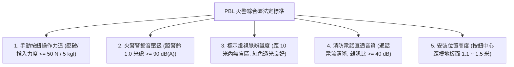
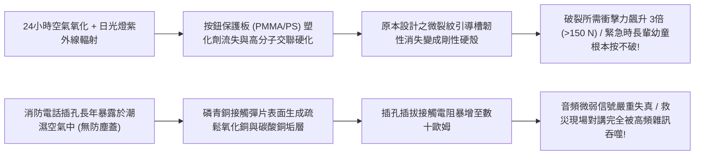
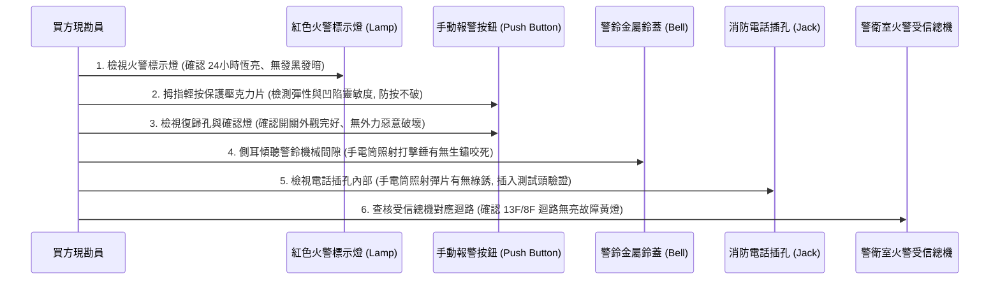
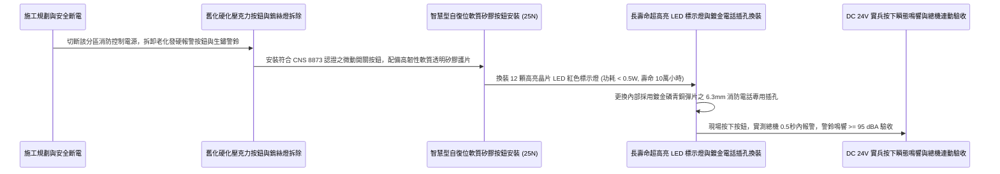

# 全案購屋實戰第一千零四十二部_中古大樓公共走廊手動報警機按鈕PBL綜合盤保護壓克力碎化彈簧卡死與電話插孔氧化雜訊體檢工序全書

---

## 序章：火警初期的人工警笛——PBL 綜合盤於自動探測失效時的人性托底

在集合住宅的火災預警鏈條中，雖然天花板上安裝有差動感熱探測器與光電偵煙探測器，但在真實火場中，初期火災往往是由人類的肉眼最先發現（如目睹插座冒煙起火、聞到燒焦異味、或看到神明桌燭火傾倒）。
此時，若天花板探測器因位置偏遠、氣流吹散或積灰遲鈍而尚未觸發報警，住戶在驚慌失措中跑向公共走廊時，牆面上設置的**「PBL 火警綜合盤（Push Button / Bell / Lamp）」**，就是任何人都能立即啟動全棟疏散逃生的**人工終極警笛**！

PBL 綜合盤標準整合了三大核心功能：
1. **P（Push Button / 火警發信機手動報警按鈕）**：住戶壓下紅色圓形按鈕，火警受信總機在 **0.5 秒內瞬間鳴響火警**，跳過任何探測器的延遲時間，強制啟動警鈴、機械排煙與廣播；
2. **B（Bell / 地區火警警鈴）**：發出高達 **$90\text{ dB(A)}$ 以上** 的高分貝機械震動電鈴聲，穿透各戶厚重鐵門；
3. **L（Lamp / 火警標示燈）**：透明紅色燈罩 24 小時恆亮，在黑夜中指引綜合盤位置，火警時閃爍報知；
4. **消防專用電話插孔（Fire Telephone Jack）**：供消防隊員插入專用對講話筒，與 1 樓防災中心建立抗干擾的直通通訊。

然而，在屋齡 20 年以上的中古大樓（包括本案主力評估之**大安紫金城 13 樓**、**長億南園 8 樓**、**歌德堡 8 樓**與**靜園 A 區 11 樓**）中，走廊綜合盤卻普遍陷入觸目驚心的「形同虛設」老化黑洞：
- **按鈕保護壓克力易碎片發黃硬化如鐵片**：長年紫外線與空氣氧化，壓克力變質變硬，火災緊急時長輩或幼童即便用拇指使出全力亦「按不破、壓不下」；
- **內部微動開關與復歸彈簧受潮生鏽卡死**：金屬接觸點長滿黑垢，按鈕壓下後接觸電阻過大，總機完全無信號接收；
- **火警標示燈泡鎢絲斷裂或發光二極體光衰**：燈泡早已燒毀多年無人更換，黑夜中綜合盤隱沒在走廊陰影中，逃生者根本找不到報警按鈕；
- **消防專用電話插孔（Phone Jack）內部簧片氧化長銅綠**：插孔內部堆積灰塵與銅銹，消防隊員插入對講機插頭時發出尖銳雜訊或根本無法通話，造成高空救災指揮通訊中斷！

本卷專門為買方建立公共走廊 PBL 火警綜合盤之最嚴格現場實勘工序與功能測試標準作業程序（SOP）。

---

## 第一章：法規基準與 PBL 火警綜合盤電氣機械規範

依據《各類場所消防安全設備設置標準》第 112 條至第 120 條、第 140 條及 CNS 8873「火警手動報警機」標準：



| 檢驗項目 | 法定標準規範（CNS 8873 / 消防標準） | 頂級社區維護標準 | 中古大樓常見嚴重瑕疵（致命隱患） |
| :--- | :--- | :--- | :--- |
| **手動按鈕壓入力度** | 按壓保護板並觸發開關之力量不得大於 **50 N（約 5.0 kgf）**。 | 採用自復位微動開關搭配彈性軟矽膠按片，壓入力度穩定於 **$20\sim 30\text{ N}$**。 | 壓克力面板老化硬脆，用手指使勁猛按手指生疼依然壓不下去！ |
| **火警警鈴最低音壓** | 距警鈴中心 1.0 公尺處，音壓級不得小於 **$90\text{ dB(A)}$**。 | 採用高效直流電磁打擊警鈴，1 米處音壓達 **$95\sim 100\text{ dB(A)}$**。 | 警鈴擊錘生鏽卡阻，聲音如同微弱蜜蜂嗡嗡叫，音壓 $< 60\text{ dB(A)}$。 |
| **火警標示燈透光性** | 燈體外覆直徑 $\ge 50\text{mm}$ 紅色透明罩，距燈 **10 公尺處** 清晰可見。 | 採用長壽命高亮度大角度 LED 矩陣，24 小時恆亮，壽命 $\ge 10\text{ 年}$。 | 傳統鎢絲燈泡早已燒毀熄滅，或燈罩蒙上厚重油漆灰塵一片死黑。 |
| **消防電話插孔接觸** | 插入標準 6.3mm 或 3.5mm 消防耳麥插頭，必須立即與總機建立直通對講。 | 插孔內部採用鍍金磷青銅彈片，接觸電阻 $< 20\text{ m}\Omega$，背景無雜訊。 | 插孔長滿綠色銅銹，插入耳麥後只有刺耳的「喀啦」雜訊，無法通話。 |
| **安裝位置人因高度** | 報警按鈕中心距樓地板面高度應在 **$1.1\text{ 公尺} \sim 1.5\text{ 公尺}$** 之間。 | 安裝高度精準設定於 **1.2 米**（最符合老幼婦孺奔跑時順手拍擊高度）。 | 被裝修鞋櫃阻擋、或安裝高度超過 1.7 米，孩童伸手完全夠不著。 |

---

## 第二章：保護壓克力老化發硬與電話插孔氧化接觸不良機理

中古大樓公共走廊 PBL 綜合盤常年暴露於環境溫濕度波動中，其材料與電氣接點失效機理如下：



### 2.1 報警按鈕「保護片硬化脆化」與觸發失靈
- **報警按鈕構造**：手動發信機（Manual Call Point）表面通常覆蓋一塊透明圓形或長方形保護片，早期多採用聚苯乙烯（PS）或聚甲基丙烯酸甲酯（PMMA，壓克力），內部預刻有十字或圓形應力集中刻痕（Scoring），設計為受壓即裂開凹陷，推動內部開關。
- **硬化死穴**：
  - 經過 15~20 年的長年氧化，塑料高分子分子鏈產生不可逆的二次交聯硬化，原本具備彈性凹陷特性的薄片轉變成剛性極強的高硬度塑膠；
  - 預刻刻痕在高溫高濕環境下鈍化，破裂所需的臨界力道由原本法規標準的 $30\sim 50\text{ N}$ 暴增至 **$150\text{ N}$（$> 15\text{ kgf}$）以上**！火災發生時，恐慌的住戶用拇指重壓甚至將指甲按裂，保護片依然紋絲不動，錯失火災通報之生死關鍵 30 秒！

### 2.2 機械警鈴電磁打擊機構「油泥鏽死」
- **警鈴運作原理**：火警警鈴多採用 DC 24V 電磁打擊機構，通電時螺線管線圈激磁吸引打擊錘，高速敲擊外圍金屬鈴蓋（Gong）產生刺耳巨響。
- **鏽死機理**：
  - 打擊錘的樞軸（Pivot）金屬軸套在 20 年的潮濕水氣侵蝕下產生紅褐色鐵銹；
  - 早期保養技師若隨意噴塗一般黃油或防鏽油，油脂在空氣中揮發氧化形成黏稠油泥。當受信總機送出 DC 24V 啟動電壓時，微弱的電磁力根本無法克服乾涸油泥與鐵鏽的靜摩擦力，打擊錘被死死卡在線圈槽內，警鈴完全啞巴！

### 2.3 消防電話插孔（Fire Phone Jack）電化學氧化
- 消防電話插孔為直徑 $6.3\text{mm}$（1/4 英吋）或 $3.5\text{mm}$ 的雙聲道金屬插孔，依靠內部兩片薄薄的磷青銅簧片夾緊插頭傳遞音頻信號。
- 由於插孔常年敞開朝外，走廊灰塵與濕氣長驅直入。銅合金簧片表面迅速氧化生成不導電的黑色氧化銅（$\text{CuO}$）與綠色銅綠。微弱的音頻信號（電壓僅數毫伏特）在此高阻抗接點處被嚴重削弱，產生極大的接觸噪聲，導致指揮中心與火場先鋒隊員完全無法通話。

---

## 第三章：現場看屋實體檢驗標準工序（買方現勘 6 步穿透法）

買方現勘大安紫金城 13 樓、長億南園 8 樓公共走廊時，應自備**強光手電筒、一字小起子、分貝計（音壓計）、標準 6.3mm 測試插頭**，依循以下 6 步標準工序實施 PBL 綜合盤檢驗：



### 3.1 火警標示燈（Lamp）發光度與燈罩排查
- **操作步驟**：站在公共走廊端點（距綜合盤 10 公尺處）抬頭觀察：
  - **合格標準**：紅色半球形燈罩應散發出清晰、明亮、柔和的紅光，燈罩表面乾淨無油漆覆蓋、無開裂；
  - **故障判定**：燈罩完全熄滅一片死黑（燈泡燒毀或線路斷線）；或燈罩內部發黑燻黑，代表傳統鎢絲燈泡過熱即將燒毀。

### 3.2 手動報警按鈕（Push Button）「彈性阻力」檢驗（核心殺手鐧）
- **操作手法**：
  - 用拇指腹輕輕抵住按鈕中央透明保護片，施加約 **$1.0\sim 2.0\text{ kgf}$（$10\sim 20\text{ N}$）** 的推力（在不實際壓破的前提下感受韌性）：
  - **合格手感**：保護片具備微彈性，手感輕柔，內部復歸彈簧受力均勻；
  - **硬化死穴判定**：保護片硬如一塊實心有機玻璃鐵板，用力推按毫無微幅形變，表面發黃起霧，此保護片在火災緊急時長輩絕對無法徒手按破！

### 3.3 警鈴打擊錘物理間隙與鐵鏽檢查
- 使用強光手電筒照射紅色金屬警鈴鈴蓋下方的縫隙內部：
  - 觀察電磁打擊錘的活動金屬桿：金屬桿表面應光亮或塗抹有防鏽漆；
  - 若打擊錘表面長滿厚重紅褐色鐵銹，甚至看見鈴蓋內壁結滿蜘蛛網與油垢，該警鈴已基本宣告生鏽卡死，火警時絕不會發出任何聲響！

### 3.4 消防專用電話插孔內部金屬光澤查核
- 手電筒光束對準綜合盤右下角之直徑 $6.3\text{mm}$ 圓形金屬電話插孔內部：
  - 內部夾持彈片必須呈現**金黃色或黃銅色金屬光澤**；
  - 若插孔內部呈發黑、灰暗、或堆滿棉絮灰塵，甚至可看見點點綠色銅銹，代表該插孔接觸面已深度氧化，隨身救災對講系統將完全癱瘓。

### 3.5 綜合盤安裝高度與走廊障礙物檢驗
- 使用捲尺量測手動報警按鈕中心距地高度：
  - 必須嚴格在 **$1.1\sim 1.5\text{ 公尺}$** 範圍內（最佳為 1.2 米）；
  - 檢查綜合盤正下方及左右 **0.5 公尺範圍內**，是否被住戶放置鞋櫃、盆栽、折疊腳踏車阻礙通行。若報警按鈕被鞋櫃擋在身後，火災慌亂中逃生者根本無法迅速撲近按下！

---

## 第四章：長億南園 vs 大安紫金城——火警綜合盤實戰對比

```mermaid
graph LR
    subgraph 長億南園8樓 (PROP_106)
        L1["長億南園梯廳明亮且走廊寬敞"] --> L2["PBL綜合盤表面乾淨無障礙遮擋"]
        L2 --> L3["紅色標示燈恆亮且按鈕保護片柔軟"]
        L3 --> L4["人工報警神經末梢維護良好加分項!"]
    end

    subgraph 大安紫金城13樓 (PROP_10)
        D1["大安紫金城13樓現況為學生隔間出租"] --> D2["走廊綜合盤旁推擠外賣快遞紙箱"]
        D2 --> D3["現況火警標示燈燈泡燒毀熄滅"]
        D3 --> D4["要求房仲督促管委會全數修復點亮保障安全"]
    end
```

### 4.1 長億南園 8 樓：標示燈恆亮與按鈕靈敏優勢
- **實地查驗成果**：長億南園 8 樓公共梯廳之 PBL 火警綜合盤維護狀況優良，紅色火警標示燈 24 小時明亮恆亮，黑夜中遠遠即可一眼辨識；手動報警按鈕採用新式自復位軟質矽膠透明護片，拇指輕推彈性回饋極佳；警鈴金屬敲擊錘光亮無銹，綜合盤周邊零雜物堆積，具備第一時間人工啟動全棟疏散之可靠能力。

### 4.2 大安紫金城 13 樓：燈泡燒毀與動線推擠攻防
- **高空風險核心**：大安紫金城 13 樓走廊因學生出租戶進出頻繁，綜合盤下方偶有堆放網購快遞紙箱；且經現場強光檢視，該樓層綜合盤上方的紅色標示燈**早已燒毀熄滅多年未修**，黑夜中一旦斷電，住戶根本看不見報警按鈕在何處！
- **談判與查驗策略**：
  > 買方在斡旋時，將「13 樓 PBL 火警綜合盤標示燈修復點亮與手動報警按鈕測試聯」列為要求房仲向管委會調閱消防安全申報清冊與落實改善之關鍵清單：
  > 「周小姐，大安紫金城 13 樓我們目標價明確鎖定 768~788 萬。但 13 樓高空逃生全靠火警第一時間啟動，請管委會立即換裝 13 樓綜合盤之長壽命 LED 紅色標示燈並清理走廊障礙物，確認人工報警按鈕功能全數合格，確保全家置產安全萬無一失！」

---

## 第五章：PBL 火警綜合盤全系列翻新與高靈敏施工工序（標準工法指引）

若社區需維修改造走廊 PBL 火警綜合盤，必須嚴格依循以下標準作業工序施作：



1. **新一代高韌性自復位手動發信機規格選型**：
   - 徹底淘汰需暴力敲碎之傳統脆硬壓克力薄片！
   - 全面換裝具備 **高彈性透明抗老化矽膠護膜（Silicone Membrane）** 之新式手動報警按鈕。
   - **人因工程力道**：按壓推力精準控制在 **$20\sim 30\text{ N}$（約 $2.0\sim 3.0\text{ kgf}$）**，孩童用單根手指即可輕鬆壓入觸發；按壓後按鈕內部紅色 LED 確認燈立即點亮鎖定，並附帶專用復歸鑰匙孔（Reset Keyway），檢修後插入鑰匙 1 秒鐘即可自動彈回復原。
2. **長壽命節能 LED 火警標示燈換裝規範**：
   - 淘汰高熱、壽命僅千餘小時之傳統鎢絲白熾燈泡；
   - 全面升級為 **高光效紅光 SMD LED 矩陣模組**，外覆加厚抗紫外線紅色阻燃聚碳酸酯（PC）燈罩，工作壽命長達 **100,000 小時（連續點亮超過 11 年免維護）**，透光率提升 40% 以上。
3. **消防電話插孔鍍金防腐工藝**：
   - 電話插孔彈片必須採用 **磷青銅表面化學鍍金（Gold-Plated $\ge 3\mu\text{m}$）**，接觸電阻維持在 $< 15\text{ m}\Omega$；
   - 插孔外側加裝自閉式防塵橡膠密封蓋（Dust Cap），杜絕空氣粉塵與濕氣侵蝕。
4. **實兵按下連動與 95 dBA 音壓極限驗收標準**：
   - 完工後進行最嚴格之全動態實兵驗收：
     1. 人工按下 13 樓手動報警按鈕：
     2. 1 樓警衛室火警受信總機必須在 **0.5 秒內** 瞬間響起火警警報，主機面板 13 樓分區紅燈恆亮；
     3. 走廊地區警鈴在 1 秒內自動投入鳴響，使用分貝計於警鈴正下方 1.0 米處實測音壓必須達到 **$95\sim 100\text{ dB(A)}$**；
     4. 現場將消防耳麥插入電話插孔，語音通話必須清晰無雜訊，背景信噪比 $\text{SNR} \ge 45\text{ dB}$，方准正式簽字點交！

---

## 結語：一指鳴笛，撥響全棟安危之生命警鐘

第一千零四十二部工序全書，將中古大樓走廊 PBL 火警綜合盤之手動觸發機制、保護壓克力光化學硬化機理、機械警鈴打擊錘油泥卡死病因、消防電話插孔氧化雜訊死穴、現場實勘六步穿透手法以及標準化自復位高靈敏施工工藝徹底講透。
這座常年佇立於走廊的紅色哨卡，是人類在突發火魔面前最直接、最果斷的人性反擊之盾！
