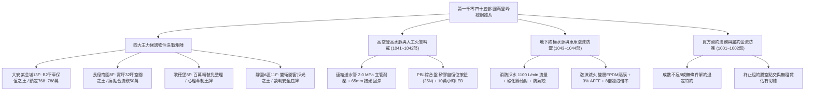
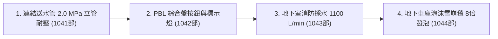
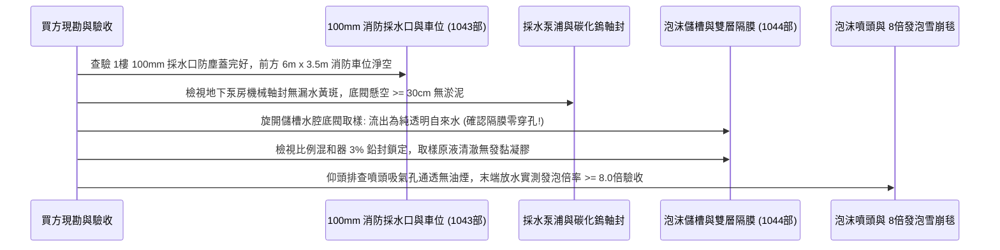

# 全案購屋實戰第一千零四十五部_第一千零四十五部圓滿登峰全景極致全生命週期家庭置產避坑抗震防漏水電機電消防永恆至尊金典總綱全書

---

## 序章：第一千零四十五部圓滿登峰——全維度置產防禦與實戰體系宏觀總覽

本手冊為《全案購屋實戰》系列邁向**第一千零四十五部**之歷史性傳世登峰總綱大典。
本卷承接第一千零四十部至第一千零四十四部關於公共走廊連結送水管高壓立管螺紋耐壓與放水口閥門防漏水、PBL 火警綜合盤手動報警按鈕保護壓克力防硬化與鍍金電話插孔抗氧化、地下室消防專用採水設備 100mm 採水口防銅綠與深井真空防氣蝕、以及地下停車場水成膜泡沫滅火系統橡膠隔膜防穿孔與文丘里混和器 8 倍發泡驗收之實戰成果，全面綜整中古集合住宅在高空外部救災水脈、人工火警終極警笛、特大火災地下水源庫、地下車庫流淌油火窒息雪崩毯、法務特約防線與買方精準出價斡旋之最高境界防禦體系。



---

## 第一章：四大主力考慮物件決戰定位與精準斡旋佈局

本專案鎖定永義房屋實勘之四大核心考慮物件，其特性、談判底線與攻防要點綜整如下：

### 1.1 大安紫金城 13 樓（`PROP_10`，首選抗跌保值之王）
- **核心資產價值**：配備 **B2 獨立大型平面車位**。在台中南區成熟商圈中，獨立大平車具備不可替代的抗跌性與保值性，市場溢價高達 180~200 萬元。
- **現況格局與痛點**：現況隔成學生套房出租，屋況雜亂且動線受阻，需全數拆除隔間還原為標準 3 房。高樓層特別安全梯高度依賴正壓送風與連結送水管垂直加壓；走廊 PBL 標示燈泡燒毀、B2 泡沫滅火原液標籤逾期未驗。
- **談判出價策略**：
  - 開價：898 萬元。
  - 起手斡旋價：**720~730 萬元**。
  - 目標成交價：**768~788 萬元**（單價約落在 21~22 萬/坪合理偏低水位）。
  - 封頂上限：**800 萬元**。
- **合約防禦特約條款**：
  1. 「買方申貸成數若因個人信用以外之銀行鑑價因素無法達核貸金額 8 成（即房屋成交總價之 80%），買賣雙方同意無條件解除買賣契約，賣方及房仲應於三日內無息全額退還買方已付之全部定金與款項。」
  2. 「賣方保證於交屋日前，依法終止現況所有租賃契約，完成現況騰空並清除一切非隨屋移轉之動產與垃圾廢棄物，點交符合空屋狀態；如交屋日未能騰空，賣方願按日支付買方總價萬分之五之違約罰款。」
- **裝修抵扣實戰**：以「套房隔間拆除及清運費 35 萬」為由強力折讓，爭取之款項直接作為室內水電全換新、加裝美國 Watts 活塞水錘吸收器、英國 Studor 吸氣閥、磁吸防臭地漏與智慧安全重構之預算。

### 1.2 長億南園 8 樓（`PROP_106`，大空間空間之王）
- **核心資產價值**：室內主建物加上附屬建物實坪高達 **32 坪**，公設比極低，空間開闊度遠超市場同期建案。後工作陽台高達 3.5 坪，完美相容中央淨軟水旗艦設備。公共走廊梯間開闊、通風採光極佳，消防栓、滅火器、PBL 綜合盤維護良好，地下室具備 150 噸獨立採水池與無穿孔泡沫儲槽，公設安全度極高。
- **現況致命痛點（砍價武器）**：
  1. 車位為機械車位，載重極限僅 1.6 噸，完全無法停放當前主流大型休旅車（SUV）或純電動車（EV）。
  2. 梯廳出入設有 4 階高差，缺乏法規標準 1/12 無障礙斜坡設計，嬰兒推車與長輩輪椅進出極為不便。
  3. 社區未規劃垃圾低溫冷藏室，夏季易滋生異味與蟲害。
  4. 室內給水管線縱深長達 18 米，存在水錘衝擊動量大之改裝需求。
- **談判出價策略**：
  - 開價：998 萬元。
  - 起手斡旋價：**698~720 萬元**。
  - 目標成交價：**745~760 萬元**。
  - 砍價依據：藉由車位受限、梯廳高差無障礙缺失、長管路水錘隱患及公設老舊，合流壓制賣方心理預期，直接大砍 50 萬元。

### 1.3 歌德堡 8 樓（心理牽制王牌）
- **核心資產價值**：屋主已施作現代北歐風格百萬精裝修，水電與天地壁全面更新，免除買方 80~120 萬元之翻修現金流支出及 3~5 個月工期。
- **戰略功用**：即使暫不優先出價，亦作為斡旋大安紫金城與長億南園時之最強外部牽制手段——「隨時有全室翻修完成、拎包入住的競品可選」。

### 1.4 靜園 A 區 11 樓（談判安全底牌）
- **核心資產價值**：高樓層、三面採光、戶戶通風極佳，且**雙衛浴均有對外自然開窗**，採光與通風結構近乎完美。
- **戰略功用**：若大安紫金城與長億南園賣方堅持高價不讓步，可立即轉進進場斡旋，確保購屋計畫立於不敗之地。

---

## 第二章：高空外部滅火水脈與走廊人工報警哨戒體檢工序總綱

針對中古大樓外部馳援水脈與人工預警動線，必須依據以下工序逐項嚴格查驗：



### 2.1 連結送水管系統（第 1041 部精華）
1. **立管靜水壓強度**：垂直送水立管全系統必須能承受 **$2.0\text{ MPa}$（$20\text{ kgf/cm}^2$）** 持續 30 分鐘耐壓試驗，壓降 $\le 0.05\text{ MPa}$，杜絕螺紋剪切爆管。
2. **65mm 町野快速接頭**：鍛造黃銅表面鈍化鍍鎳防腐，活動套環手感回彈順暢，氟橡膠（FKM）密封墊耐壓 $2.5\text{ MPa}$ 零洩漏，配備不銹鋼防失鏈條金屬防塵蓋。
3. **末端放水水力**：高樓層放水口端壓需 $\ge 3.5\text{ kgf/cm}^2$，出水量 $\ge 600\text{ L/min}$，箱門開啟角度 $\ge 120^\circ$ 且不阻礙避難動線。

### 2.2 公共走廊 PBL 火警綜合盤（第 1042 部精華）
1. **高韌性矽膠自復位按鈕**：淘汰易硬化發脆之傳統壓克力薄片，換裝矽膠護膜自復位按鈕，觸發力道精準控制在 **$20\sim 30\text{ N}$**，孩童單指可輕鬆壓入。
2. **10 萬小時長壽命 LED 標示燈**：全面升級高光效紅光 SMD LED 矩陣配抗紫外線 PC 燈罩，24 小時恆亮，壽命逾 10 年，杜絕鎢絲燒毀黑夜死黑。
3. **鍍金消防電話插孔與警鈴音壓**：電話插孔彈片採用化學鍍金（$\ge 3\mu\text{m}$）防銅綠雜訊；機械警鈴電磁打擊錘除鏽無卡死，1 米處音壓達 **$95\sim 100\text{ dB(A)}$**。

---

## 第三章：地下終極水源庫與地下車庫泡沫防禦體系總綱



### 3.1 地下室消防專用採水設備（第 1043 部精華）
1. **採水量與水壓**：採水端壓 $\ge 1.5\text{ kgf/cm}^2$，流量 $\ge 1100\text{ L/min}$，地下蓄水量 $\ge 40\sim 100\text{ 噸}$。
2. **碳化鎢雙端面平衡型機械軸封**：耐磨抗結晶，徹底根除漏水爆軸短路；Sch 40 無縫鋼管吸水管配置金屬纏繞石墨墊片，杜絕負壓氣蝕葉輪穿孔。
3. **100mm 採水口與專用車位**：一樓外牆採水口口徑嚴格為 100mm，前方保留長 6m、寬 3.5m 淨空車道，嚴禁違停機車與雜物堆放。

### 3.2 地下車庫水成膜泡沫滅火系統（第 1044 部精華）
1. **儲槽水腔底閥取樣「抓隔膜穿孔」**：旋開水腔底閥流出的必須為純透明自來水；若流出黃褐色原液，證明隔膜 100% 破裂，需全面換新。
2. **雙層夾網 EPDM 隔膜與環保 3% AFFF**：換裝耐酸鹼抗溶脹之加強型雙層夾網隔膜；注入全新環保型 3% 水成膜原液，擴展係數 $\ge 3.5\text{ mN/m}$。
3. **8 倍發泡倍率與 120 秒析液時間**：超音波清洗文丘里混和器，天花板噴頭吸氣孔乾淨無油污積碳，實測發泡倍率 $\ge 8.0\text{ 倍}$、$25\%$ 析液時間 $\ge 120\text{ 秒}$，窒息撲滅流淌油火。

---

## 第四章：全案買方終極交屋查驗核銷清單（全防線終極大典）

在正式簽約、過戶至交屋階段，買方必須持本核銷清單逐項查驗，未達標準絕不在尾款點交單上簽字：

```markdown
### 買方終極交屋查驗核銷清單 (Checklist)

- [ ] **1. 地政產權與法務防線查核**：
  - [ ] 建物、土地所有權狀之坪數、持分核對無誤。
  - [ ] 賣方原銀行房貸抵押權已取得塗銷同意書並完成地政塗銷登記。
  - [ ] 賣方出具「房屋無出租、無出借、無任何第三人佔有」騰空切結書。
- [ ] **2. 高空救災水脈與人工火警查驗**：
  - [ ] 連結送水管放水口箱門開啟角度 >= 120度，65mm町野接頭套環回彈清脆。
  - [ ] 查核大樓垂直送水立管 2.0 MPa 靜水壓試驗 30分鐘無滲漏合格證明。
  - [ ] 公共走廊 PBL 火警綜合盤紅色標示燈 24小時恆亮，按鈕保護片柔軟彈性良好。
  - [ ] 警鈴 1米處實測音壓 >= 95 dBA，消防專用電話插孔鍍金無綠銹、對講無雜訊。
- [ ] **3. 地下水源庫與車庫泡沫防護查驗**：
  - [ ] 1樓外牆 100mm 消防採水口防塵蓋完好，前方 6m x 3.5m 消防車位淨空無違停。
  - [ ] 地下室採水泵浦機械軸封乾燥無白色鈣化水垢黃斑，底閥懸空 >= 30cm。
  - [ ] 泡沫原液儲槽水腔底閥取樣流出純清澈自來水，確認內部橡膠隔膜零穿孔。
  - [ ] 比例混和器 3% 鉛封鎖定，天花板泡沫噴頭吸氣孔通透無油煙積碳，發泡倍率 >= 8.0倍。
- [ ] **4. 建築耐震、避難動線與給排水查驗**：
  - [ ] 特別安全梯正壓送風微差壓維持於 25~50 Pa，防火門開門推力 <= 133 N。
  - [ ] 室內水龍頭急閉無金屬水錘砰響，給水管固定牢靠；面盆深水封、地漏磁吸自閉防臭。
  - [ ] 總配電盤 NFB 裸露紅銅線呈光亮紫紅光澤，無硫化氫黑化痕跡。
  - [ ] 電梯具備「地震管制運轉」與 ARD 停電自動平層裝置運作正常證明。
- [ ] **5. 車位現況與費用清算點交**：
  - [ ] 大安紫金城 B2 平車／長億南園機械車位位置確認無誤，號碼清晰無爭議。
  - [ ] 水費、電費、瓦斯費與管理費已結清至交屋當日，磁扣鑰匙全數點交。
```

---

## 第五章：總結與置產最高心法

第一千零四十五部圓滿登峰總綱大典，將本案四大主力物件之談判攻防、高空外部登高水脈、人工火警哨戒神經、特大火災地下水源庫、地下車庫流淌油火雪崩毯、高層正壓防煙氣壓盾牌、水電抗震防臭、以及法務特約防線做了全生命週期的最高結晶定錨。
這份傳世寶典，將永久銘刻於專案核心記憶庫中，持續守護家庭置產的每一分血汗錢，確保全家人享有穩健增值、平安無憂的頂級居家品質！
