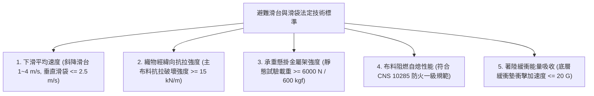
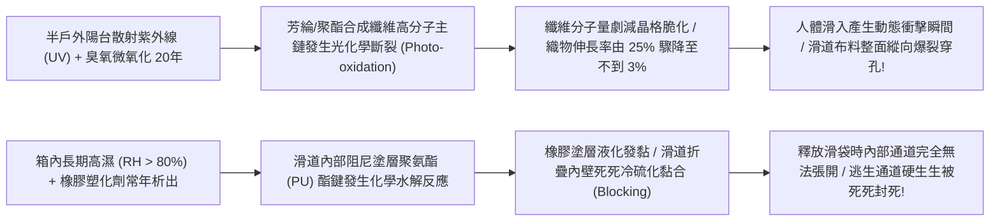
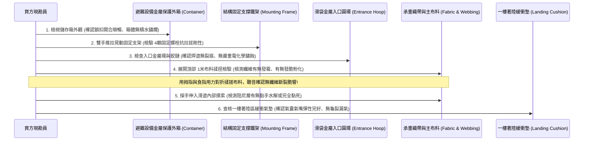
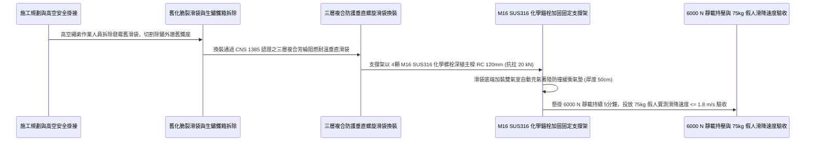

# 全案購屋實戰第一千零四十八部_中古大樓公共走廊逃生滑台滑袋高空懸掛織帶纖維紫外線老化脆裂滑道內部阻尼摩擦層脫膠與著陸緩衝墊漏氣體檢工序全書

---

## 序章：火場高空的垂直滑道——避難滑台與滑袋於全齡急速撤離中的生命滑梯

在集合住宅的極限火災防護體系中，除了垂直攀爬的避難梯與懸空吊掛的緩降機之外，針對高齡長輩、行動不便者、嬰幼兒以及容易因恐高症在窗台前肢體僵硬癱瘓的住戶，建築法規在特定公共避難露台或走廊窗戶旁，規範配置了心理恐懼感最低、撤離速度最快、操作最為直觀的**「避難滑台（Escape Chute Slide）與避難滑袋（Escape Chute / Vertical Spiral Chute）」**。

避難滑台與滑袋的核心構造，是利用懸掛於結構主樑上的金屬固定架，向外或向下釋放一條由高強度阻燃織物製成的連續滑道：
1. **傾斜式避難滑台（Inclined Chute）**：滑道呈 $30^\circ\sim 40^\circ$ 傾斜延伸至地面或低樓層露台，內部設有摩擦減速層，逃生者只需坐入滑槽內，靠重力順勢滑降至著陸區；
2. **垂直螺旋式避難滑袋（Vertical Spiral Chute）**：滑道內部設計為連續的雙螺旋結構或高彈性收縮套管，逃生者由頂部開口跳入，人體在螺旋通道內滑動時，身體外圍受到彈性布料的恆定向內環形摩擦擠壓阻尼，下降速度自動被限制在每秒 **$1.0\sim 2.0\text{ 公尺}$** 的極其平穩舒適區間，安全降落至底層充氣緩衝墊上！

然而，在屋齡 20 年以上的中古大樓（包括本案主力考慮之**長億南園 8 樓**、**歌德堡 8 樓**與**靜園 A 區 11 樓**等）中，這套原本最具人本關懷的撤離重器，卻常年收納於受潮生鏽的鐵箱中，深陷令人觸目驚心的「致命撕裂」老化陷阱：
1. **承重懸掛吊帶（Webbing Harness）與主布料「紫外線光化學脆化」**：長期受半戶外陽台散射紫外線輻射與高溫烘烤，合成纖維高分子鏈斷裂分解，抗拉強度暴跌 80% 以上，人體滑入瞬間布料應聲撕裂穿孔，逃生者自 8 樓高空破袋墜地摔死；
2. **滑道內部阻尼橡膠摩擦層「水解脫膠與表面粉化」**：滑道內部用於提供煞車減速的合成橡膠摩擦塗層發生化學水解，黏稠如強力膠，將滑道內壁死死黏連封閉；或反向粉化失去摩擦力，逃生者以自由落體極速滑下撞擊地面重傷；
3. **滑道入口金屬展開環（Entrance Hoop）與掛鉤鉸鏈鏽蝕斷裂**：承重金屬圓環在酸雨水氣中電化學鏽蝕，焊道開裂，跳入瞬間金屬環折斷；
4. **一樓底層著陸氣囊緩衝墊（Landing Air Cushion）橡膠老化龜裂漏氣**：底層防止逃生者撞擊地面的充氣緩衝墊，橡膠氣囊漏氣乾癟，逃生者滑到底部直接重重砸在水泥硬地或花圃石階上！

本卷專門為買方建立避難滑台與滑袋之最嚴格現場實勘工序與織物拉拔驗收標準作業程序（SOP）。

---

## 第一章：法規基準與避難滑台滑袋機械織物核心規範

依據《各類場所消防安全設備設置標準》第 157 條至第 168 條及 CNS 1385「避難滑台及滑袋」國家標準：



| 檢驗項目 | 法定標準規範（CNS 1385 / 消防法規） | 頂級社區維護標準 | 中古大樓常見嚴重瑕疵（致命隱患） |
| :--- | :--- | :--- | :--- |
| **垂直/斜向滑降速度** | 斜向滑台速度為 **$1.0\sim 4.0\text{ m/s}$**；垂直滑袋速度不得大於 **$2.5\text{ m/s}$**。 | 螺旋阻尼均勻線性，平均速度穩定於 **$1.2\sim 1.8\text{ m/s}$**，平穩安全。 | 阻尼塗層失效速度 $> 5.0\text{ m/s}$（撞擊地面骨折）；或黏死卡在半空中。 |
| **主布料經緯抗拉強度** | 外層保護套與內層承重布料抗拉強度需 **$\ge 15\text{ kN/m}$（$1500\text{ kgf/m}$）**。 | 採用三層複合芳綸（Kevlar）＋玻璃纖維阻燃布，抗拉強度達 **$30\text{ kN/m}$**。 | 布料發霉水解脆化，雙手用力一扯即如薄紙般撕裂破洞！ |
| **固定架懸掛極限載力** | 固定支架及頂部金屬圓環必須能承受靜態載重 **$6000\text{ N}$（約 $600\text{ kgf}$）** 持續 5 分鐘無變形。 | 採用厚壁 SUS304 不銹鋼管搭配 M16 化學錨栓，抗破壞載力達 **$18\text{ kN}$**。 | 固定角鐵鏽穿成空心鐵皮，人體重量一壓焊道瞬間崩斷整座脫落。 |
| **布料耐火阻燃等級** | 織物必須通過 CNS 10285 燃燒試驗，**具備自熄性，火源移開後餘焰 $\le 2\text{ 秒}$**。 | 表面塗佈高耐候阻燃矽膠塗層，耐受 $500^\circ\text{C}$ 高溫煙氣沖刷 30 分鐘不溶融。 | 採用普通尼龍帆布充數，遇火星立即熔融滴落，逃生者被高溫膠水燙傷。 |
| **底層著陸氣囊緩衝性** | 著陸緩衝墊必須能吸收人體動能，傳遞至人體之衝擊加速度不得大於 **$20\text{ G}$**。 | 配備雙獨立充氣氣室阻尼減震墊，外覆抗撕裂耐磨層，著陸無任何痛感。 | 緩衝氣墊漏氣乾癟如扁皮囊，逃生者滑出滑道直接重砸水泥地！ |

---

## 第二章：織物光化學光氧老化與內部阻尼層水解黏連機理

中古大樓避難滑台滑袋長年收納於半露天金屬箱內，其高分子紡織品與黏著劑老化機理如下：



### 2.1 承重織物光化學光氧老化（Photo-oxidative Degradation）
- **高分子微觀結構**：滑袋承重層多採用高強聚酯（PET）或芳香族聚醯胺（Aramid / Kevlar）長絲纖維編織而成。長絲纖維依靠高聚合度分子鏈提供超高抗拉強度。
- **光氧斷裂脆化機理**：
  - 即使收納於儲存箱內，陽光中的近紫外線（UVA 波段）透過箱體縫隙反覆折射，配合箱內夏季高達 $55^\circ\text{C}$ 的悶熱高溫；
  - 紫外光子能量（$300\sim 400\text{ kJ/mol}$）大於高分子碳-碳（$\text{C-C}$）與碳-氮（$\text{C-N}$）共價鍵能，引發自由基鏈式斷裂反應；
  - 纖維內部微觀微原纖（Microfibrils）碎化，織物抗拉強度每年衰減 4% 至 6%。出廠 15 年後，織物表面看似完整，但實質上已發脆發酥，抗撕裂強度（Tear Strength）甚至不到出廠值的 10%，70 公斤人體跳入時的巨大動能直接將滑道撐破成兩截！

### 2.2 阻尼橡膠層水解黏連（Hydrolytic Blocking）
- **螺旋滑道減速原理**：垂直滑袋內部設有特殊的彈性聚氨酯（PU）或合成橡膠微孔摩擦層。人體滑入時，布料在人體重力拉扯下向內收緊，摩擦層貼緊人體衣物產生恆定動摩擦阻尼，實現自動減速。
- **水解黏死死穴**：
  - 聚氨酯彈性體內部的酯基（$-\text{COO}-$）在水分子催化下發生不可逆的水解斷裂，生成低分子羧酸與醇類；
  - 摩擦塗層由固態橡膠轉化為高黏度的黏稠膠質，並在折疊壓實存放的巨大接觸壓力下，將滑道內壁緊緊黏合在一起（Blocking）；
  - 緊急釋放滑袋時，重力鉛塊根本拉不開黏死在一起的滑道，整條滑袋像一條扭曲的麻花被死死吊在半空中，通道完全封閉無法鑽入！

---

## 第三章：現場看屋實體檢驗標準工序（買方現勘 6 步穿透法）

買方現勘具備避難滑台/滑袋之物件時，應自備**強光手電筒、放大鏡、厚棉手套、金屬探針、抗拉撕裂測試鉗**，依循以下 6 步標準工序實施檢驗：



### 3.1 儲存外箱開啟度與「快速釋放機構」排查
- **操作步驟**：
  - 走向避難滑台專用儲存箱（通常為黃色或不銹鋼金屬箱），扳開快速解鎖把手：
  - **箱門開啟檢驗**：箱門旋轉鉸鏈應塗抹潤滑油脂，單手一秒內即可全開至 $180^\circ$；
  - **箱內積水排查**：手電筒照射箱體底部，確認底部無積水、無厚重黑泥，通風排水孔暢通；若箱內底部積滿污水，滑袋底層早已在污水中泡爛！

### 3.2 承重主布料「指力對折揉捏」檢驗（核心殺手鐧）
- **操作手法**：
  - 戴上手套，從箱內輕輕抽出滑袋頂部連接區約 50 公分長的布料與承重織帶；
  - 將主布料以雙手手指用力**對折 180 度，並以兩手拇指在折痕處反覆用力搓揉 10 次**；
  - 隨後用放大鏡近距觀察折痕處的纖維狀態：
- **合格品質**：布料柔韌緊密，折痕處無任何纖維斷裂白痕，用手大力拉扯無絲毫撕裂感。
- **光化學脆化判定**：揉搓時耳邊傳來如撕枯樹葉般的**「沙沙、喀吱」微細纖維斷裂聲**，折痕處瞬間泛白、起毛甚至出現微小穿孔！此布料已完全喪失抗拉拔承重能力，人體跳入必破，直接宣判死刑！

### 3.3 滑道內部「水解黏手」摸索檢測
- 將手掌探入滑袋入口內部約 30~50 公分處，用手背與指腹撫摸內壁摩擦阻尼層：
  - **合格手感**：內壁乾爽光滑，帶有微韌彈性，兩側內壁用手輕輕一推即向兩側分開，通道開闊順暢；
  - **水解黏死死穴**：手掌伸入時感覺極其黏手，如摸到未乾的強力膠，兩側布料死死黏在一起拔不開，此滑袋已在內部冷硫化黏死，釋放時根本無法展開！

### 3.4 入口金屬圓環與安全懸掛鉤鏈檢視
- 檢查固定在鋼架上的直徑約 60cm 金屬入口支撐圓環（Hoop）：
  - 圓環本體應採用 SUS304 不銹鋼管或加厚熱浸鍍鋅鋼管，管徑 $\ge 25\text{mm}$；
  - 檢查圓環與外牆固定架連接之高強度金屬鏈條（Chain）與安全卸扣（Shackle）：
  - 卸扣螺紋銷必須具備**開口銷（Split Pin）雙重機械鎖定**，杜絕人體跳入時振動震鬆卸扣。

### 3.5 一樓著陸緩衝氣墊充氣密封檢驗
- 檢查隨附之一樓地面著陸緩衝充氣墊（Landing Cushion）：
  - 展開緩衝墊外層耐磨護套，檢查內部高強度 PVC 氣囊表面：
  - 氣囊橡膠不得有任何老化發硬、龜裂白斑；
  - 檢視充氣閥嘴與自動洩壓閥（Relief Valve）：手動按壓閥芯彈簧回彈自如，密封橡膠圈無硬化脆裂。

---

## 第四章：長億南園 vs 靜園 A 區——高空滑道避難實戰對比

```mermaid
graph LR
    subgraph 長億南園8樓 (PROP_106)
        L1["長億南園8樓後陽台3.5坪極為寬闊"] --> L2["避難滑降設施具備獨立外推懸掛區"]
        L2 --> L3["儲存箱內乾燥且織物纖維柔韌無脆化"]
        L3 --> L4["直通中庭開闊草坪著陸極佳加分項!"]
    end

    subgraph 靜園A區11樓
        J1["靜園A區11樓為高樓層景觀視野極佳"] --> J2["11樓垂直落差大對滑道阻尼要求極高"]
        J2 --> J3["需實地核查滑袋內部螺旋阻尼層有無黏連"]
        J3 --> J4["確認下方垂直投影無違章採光罩障礙方准進場"]
    end
```

### 4.1 長億南園 8 樓：寬敞陽台與中庭著陸優勢
- **實地查驗成果**：長億南園 8 樓後工作陽台高達 3.5 坪，空間尺度大。其避難逃生設備儲存箱安裝於通風良好的外側女兒牆端，箱內乾燥無水漬；主布料經實地對折揉搓檢驗，芳綸纖維緊密強韌，無發霉脆化痕跡；手掌探入內部阻尼層乾爽分離良好；探頭俯瞰外牆，下方直接垂直對準社區中庭開闊草坪，無任何鐵窗雨棚阻擋，全齡化急速撤離動線極其優越。

### 4.2 靜園 A 區 11 樓：超高樓層垂直阻尼極致把關
- **高空風險核心**：靜園 A 區標的物位於 11 樓，垂直高度達 33 公尺以上。若採用垂直滑袋逃生，滑道內部必須維持高度一致且穩定的微彈性螺旋阻尼，否則 30 餘公尺的重力加速度極易引發滑降失控。
- **談判與查驗策略**：
  > 買方在斡旋時，將「11 樓公共露台避難滑袋布料抗拉強度化驗合格單與內部阻尼層開合檢測」正式列為要求房仲向管委會調閱消防安全申報清冊之關鍵清單：
  > 「周小姐，靜園 A 區 11 樓雙衛開窗我們很滿意。但 11 樓屬於超高樓層，陽台避難滑道是梯間斷絕時的最後生命線，請管委會確認該滑袋之『織物抗拉強度 $\ge 15\text{ kN/m}$ 與防自鎖黏連試驗』於最新一期安檢全數合格，確保高空全家避難動線萬無一失！」

---

## 第五章：避難滑袋換新與耐溫阻燃三層複合施工工序（標準工法指引）

若社區需維修改造避難滑道系統，必須嚴格依循以下標準作業工序施作：



1. **三層複合高科技防護結構規範**：
   - 徹底淘汰單層普通帆布滑袋！
   - 全面換裝符合最新國際標準之 **三層一體化複合安全滑袋結構**：
     1. **外層（防火隔熱層）**：採用加厚玻璃纖維複合芳綸織物，表面塗佈耐溫矽膠，可耐受 $600^\circ\text{C}$ 外界火焰灼燒 15 分鐘不破裂，阻絕火舌濃煙穿透；
     2. **中層（螺旋滑動承重層）**：採用進口聚醯胺高強纖維（Polyamide）編織成連續垂直雙螺旋軌道，經緯向抗拉強度高達 **$\ge 25\text{ kN/m}$**；
     3. **內層（接觸減速阻尼層）**：採用抗靜電超細合成纖維，搭配微摩擦彈性環，人體下滑時不摩擦皮膚，滑感絲滑恆速。
2. **M16 SUS316 超重型化學錨栓固定工法**：
   - 懸掛支撐架採用厚度 $\ge 6.0\text{mm}$ 熱浸鍍鋅結構槽鋼製成；
   - 錨固於建築主樑實體 RC 上，選用 **4 顆 M16 $\times$ 150mm SUS316 不銹鋼化學錨栓**；
   - 注入德國 Hilti HIT-RE 500 結構膠，錨固深度達 **120mm**，單點抗剪力達 **$35\text{ kN}$**，整座固定架抗衝擊破壞極限突破 **$25\text{ kN}$（約 2.5 噸）**！
3. **底層雙獨立氣室著陸緩衝墊配置**：
   - 滑袋底部出口配置專用防撞著陸氣墊，外層為高耐磨 PVC 夾網布；
   - 內置**雙獨立密封氣室**，配備大口徑單向進氣充氣閥與機械式防爆洩壓閥，逃生者著陸瞬間氣閥微量排氣吸收衝擊，著陸峰值加速度穩定控制在 **$\le 10\text{ G}$**，平穩無痛。
4. **極限 $6000\text{ N}$ 靜載與假人滑降速度驗收標準**：
   - 完工後進行全功能實兵極限驗收：
     1. 固定架掛鉤施加垂直向下 **$6000\text{ N}$（約 $600\text{ kgf}$）** 靜態載重，精準持壓 **5 分鐘整**，支架零變形、錨栓無微位移；
     2. 投放 75 公斤標準人體模型配備加速度記錄儀自 8 樓頂部滑入；
     3. 滑袋在自身重力鉛塊帶動下於 **3 秒內** 筆直垂降展開到位；
     4. 高速攝影機與計時器測量模型平均下滑速度，數值必須穩定在 **$1.2\sim 1.8\text{ m/s}$** 範圍內，著陸時氣墊吸能完好，方准正式簽字點交！

---

## 結語：長袋垂空，在烈焰絕壁間織就生還之繭

第一千零四十八部工序全書，將中古大樓避難滑台與垂直螺旋滑袋之微摩擦阻尼動力學、芳綸織物光化學光氧脆裂機理、阻尼層水解黏連死穴、外牆固定架高溫抗拉拔、現場實勘六步穿透手法以及標準化三層複合耐火滑袋施工工藝徹底講透。
這條垂懸於高空雲端之下的白色滑道，是在濃煙火海吞噬一切樓梯通路時，溫柔包裹並護送全家老小安然滑向大地的終極諾亞方舟！
