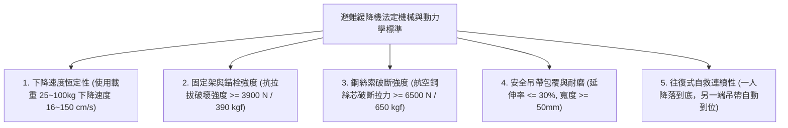
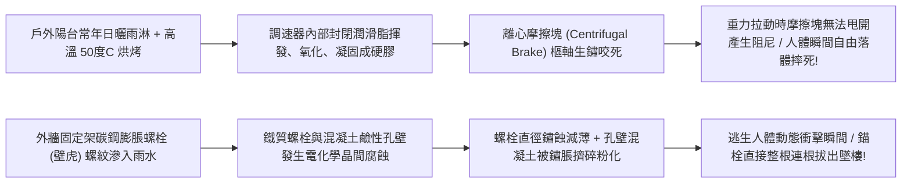
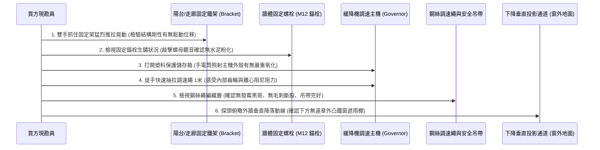
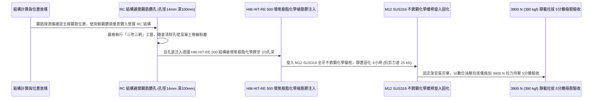

# 全案購屋實戰第一千零四十六部_中古大樓公共走廊逃生避難緩降機固定錨栓金屬疲勞拉拔鬆動調速器齒輪油泥固化與鋼絲調速繩發霉斷股體檢工序全書

---

## 序章：火海圍困的高空孤島——緩降機於逃生梯受阻時的最後懸空生路線

在集合住宅的極限火災情境中，一旦特別安全梯與室內樓梯間因防火門未關閉、正壓送風風機故障或排煙風道燒毀而遭到有毒濃煙完全封死，高樓層住戶（特別是 2 樓至 10 樓區間，如本案主力考慮之**長億南園 8 樓**、**歌德堡 8 樓**等物件）將瞬間陷入「上下皆無路」的高空孤島絕境。
此時，設置於公共走廊陽台、各戶避難露台或特別逃生窗口旁的**「避難緩降機（Slow-Down Descending Device / 緩降逃生機）」**，是住戶在濃煙烈焰撲面而來的最後生死關頭，唯一能藉由建築外牆垂直降落至一樓安全地面的**最後懸空救命繩**！

依據消防法規，緩降機由三大核心部件組成：
1. **結構固定架與錨固錨栓（Mounting Bracket & Anchor Bolts）**：承受逃生者人體重量與下墜動態衝擊載重（法定試驗載重需達 **$3900\text{ N}$ / 約 $390\text{ kgf}$**）；
2. **調速器主機（Speed Governor）**：利用離心摩擦輪與行星齒輪減速機構，無論是 30 公斤的孩童或 100 公斤的成年人，皆能將垂直下降速度自動恆定限制在安全舒適的 **$16\text{ cm/s} \sim 150\text{ cm/s}$（約每秒 1 公尺）**；
3. **鋼絲索調速繩與安全安全吊帶（Rope with Steel Core & Belts）**：內部為高強度航空不銹鋼絲繩，外層編織阻燃棉綸纖維，兩端各配有一條安全胸帶，形成「一人落地、另一端吊帶自動升至起點」的雙向往復循環逃生動線。

然而，在屋齡 20 年以上的中古大樓中，緩降機系統卻常年暴露於半戶外陽台，長達 20 年未曾展開使用，普遍陷入令人毛骨悚然的「致命空中飛人」老化陷阱：
1. **外牆固定支架膨脹螺栓（壁虎）嚴重電化學鏽蝕與水泥孔壁粉化鬆脫**：固定鐵架直接以平價鐵壁虎打在外牆粉刷層上，螺栓受雨水鏽蝕直徑萎縮一半，人一掛上去瞬間整座鐵架被連根拔起，逃生者直墜地面粉身碎骨；
2. **調速器內部離心煞車塊（Brake Shoes）與黃油硬化黏死**：齒輪箱潤滑油乾涸結塊成黏膠，離心摩擦塊鏽死在收縮位置，人掛上去瞬間完全無阻尼，以「自由落體」極速砸向地面；或反向卡死在煞車位置，人懸掛在半空中 8 樓高空動彈不得，遭窗外竄出的烈焰活活烘烤；
3. **調速繩內部鋼絲腐蝕斷股與外層編織發霉脆化**：棉綸編織層受潮長滿黑黴，內部鋼絲束鏽蝕成粉狀，逃生過程中鋼索在尖銳女兒牆邊緣摩擦，瞬間崩斷！

本卷專門為買方建立高樓層避難緩降機系統之最嚴格現場實勘工序與機械負載驗收標準作業程序（SOP）。

---

## 第一章：法規基準與避難緩降機機械動力學核心規範

依據《各類場所消防安全設備設置標準》第 157 條至第 168 條及 CNS 1386「緩降機」標準：



| 檢驗項目 | 法定標準規範（CNS 1386） | 頂級社區維護標準 | 中古大樓常見嚴重瑕疵（致命隱患） |
| :--- | :--- | :--- | :--- |
| **垂直下降速度區間** | 在載重 **$25\text{ kg} \sim 100\text{ kg}$** 範圍內，下降速度必須恆定於 **$16\text{ cm/s} \sim 150\text{ cm/s}$**。 | 離心阻尼線性穩定，平均下降速度維持在 **$60\sim 90\text{ cm/s}$**（平穩舒適）。 | 調速器煞車塊卡死導致自由落體（速度 $> 300\text{ cm/s}$），或卡在空中不降。 |
| **固定架抗拉拔強度** | 固定支架及膨脹錨栓必須能承受靜態拉拔載重 **$3900\text{ N}$（約 $390\text{ kgf}$）** 持續 5 分鐘無鬆動。 | 採用 M12 SUS316 化學錨栓深植 RC 實體樑柱 100mm，抗拉力達 **$15000\text{ N}$（1.5 噸）**。 | 螺栓僅打入外牆粉刷磁磚（深度僅 30mm），手搖固定架劇烈晃動脫落。 |
| **調速繩破斷強度** | 複合調速繩（含中心鋼絲）之最小破斷強度不得小於 **$6500\text{ N}$（約 $650\text{ kgf}$）**。 | 採用直徑 $3.0\text{mm}$ SUS316 航空鋼絲繩外覆耐磨芳綸編織，破斷力達 **$10000\text{ N}$**。 | 繩索長年受潮發霉，外皮剝落，內部鋼絲嚴重鏽蝕斷股，承受 50kg 即斷裂！ |
| **安全吊帶抗滑脫性** | 安全吊帶必須配備自緊滑扣，胸圍調節範圍需涵蓋幼童與成人（寬度 $\ge 50\text{mm}$）。 | 吊帶內襯加厚 EPE 緩衝減震泡棉，防滑帶表面具備夜間高反光條。 | 吊帶織帶發霉脆化，金屬環扣生鏽變形，人體懸吊時滑脫墜落。 |
| **下降通道淨空投影** | 緩降機垂直投影下方至一樓地面，嚴禁有任何突出冷氣鐵架、遮雨棚或高壓電線阻礙。 | 下降路徑無任何障礙物，一樓地面著陸區鋪設平整防滑緩衝地坪。 | 下方 4 樓、2 樓住戶違規加裝外凸 1.5 米之鐵窗遮雨棚，逃生者撞毀重傷！ |

---

## 第二章：調速器油泥黏死與外牆錨栓電化學鬆脫機理

中古大樓避難緩降機長年置於半戶外陽台鐵箱內，其機械摩擦與結構緊固失效機理如下：



### 2.1 調速器（Speed Governor）內部離心煞車「油泥膠化與鎖死」
- **調速器精密動力學**：緩降機調速器內部設有精密的小型行星齒輪增速機構與離心摩擦輪。當繩索被體重拉動時，繩輪轉速經齒輪增速數十倍，帶動內部兩塊扇形重合金離心煞車塊（Brake Shoes）向外甩開。煞車塊外緣貼合的耐磨煞車片與外殼內壁產生滑動摩擦阻尼，將重力勢能轉化為熱能散失，達成自動限速。
- **膠化與卡死雙重極限危險**：
  - 齒輪箱出廠時塗抹的二硫化鉬或鋰基潤滑脂，在陽台常年冬冷夏熱的惡劣氣候中，輕質基礎油揮發殆盡，殘留的增稠劑在高溫下聚合成堅硬的黑色樹脂膠塊；
  - **極限危險 A（失控墜落）**：煞車塊的滑動導軌被硬化油泥死死黏住，人體下墜時離心力推不開煞車塊，煞車阻尼完全為零，繩索瞬間以極速抽拉完畢，人體等同直接跳樓！
  - **極限危險 B（空中卡死）**：煞車塊在某次受潮鏽死在張開位置，人體剛降下 1 米，齒輪被硬生生咬死，逃生者被懸掛在 8 樓外牆半空中，上不去、下不來，在火場窗口被濃煙毒氣活活嗆死！

### 2.2 外牆固定支架膨脹螺栓「應力腐蝕與剪切拔出」
- **力學槓桿放大效應**：緩降機固定架通常為 L 型或可折疊旋轉搖臂（Jib Arm）。當搖臂旋出窗外、人體懸掛於臂端時，力臂長達 $0.8\sim 1.2\text{ 公尺}$，逃生者下墜產生的動態衝擊（約人體靜重的 1.5~2.0 倍），在最上方的固定膨脹螺栓上產生高達 **$800\sim 1200\text{ kgf}$ 的巨大拉拔槓桿力（Pull-out Force）**！
- **腐蝕拔出死穴**：
  - 早期建商鐵工多使用普通的鍍鋅金屬膨脹螺栓（長度僅 50~70mm），且往往打在外牆粉刷層或裝飾磁磚上；
  - 雨水沿螺栓縫隙滲入，鐵質螺栓氧化膨脹生成鐵銹，體積膨脹 3 倍將周圍的混凝土孔壁硬生生擠碎成粉末（爆裂粉化）；
  - 螺栓有效握裹力喪失殆盡。當 70 公斤的成年人跳出窗外瞬間，頂部螺栓瞬間如拔蘿蔔般整根被暴力拔出，固定支架直接翻轉砸落！

---

## 第三章：現場看屋實體檢驗標準工序（買方現勘 6 步穿透法）

買方現勘長億南園 8 樓、歌德堡 8 樓等中高樓層物件時，應自備**強光手電筒、捲尺、厚棉手套、金屬敲擊錘、活動扳手**，依循以下 6 步標準工序實施逃生緩降機檢驗：



### 3.1 雙向推拉晃動檢驗固定架結構剛性
- **操作步驟**：
  - 走向後陽台或逃生窗旁之金屬固定支架，拔出旋轉固定銷，將搖臂旋出至工作位置並插上插銷：
  - 雙手抓住搖臂最外端，施加全身力量向外推、向內拉、上下猛烈晃動（施加約 **$30\sim 50\text{ kgf}$** 的交變動態力）：
  - **合格標準**：支架本體紋絲不動，與牆體貼合處無任何微幅分離，無金屬摩擦晃動聲。
  - **嚴重危險判定**：晃動時感覺支架底座與牆面磁磚有明顯開合間隙（超過 1mm），甚至看見固定螺絲螺帽跟著轉動、牆面水泥掉落碎屑，此支架已隨時面臨拔出坍塌，絕對禁止使用！

### 3.2 鋼絲調速繩「徒手抽拉阻尼手感」檢驗（核心殺手鐧）
- **操作手法**：
  - 打開專用儲存鐵箱，取出調速器主機，將主機懸掛環確實扣在固定支架吊鉤上；
  - 雙手抓住穿過主機的一端調速繩，以極快的速度向下拉拽 **1.0 至 1.5 公尺**：
  - **合格手感**：慢速拉時阻力極小；猛然快速下拉時，能清晰感受到內部離心煞車塊瞬間向外咬合，產生均勻、平順、強勁的**「阻尼反抗阻力」**，內部齒輪發出清脆均勻的「嗡——」旋轉聲。
  - **報廢死穴判定**：
    1. 猛拉時完全無阻力，繩索如拉普通麻繩般被極速抽光（內部煞車塊卡死，致命自由落體！）；
    2. 使盡全身力氣亦完全拉不動一公分（內部齒輪軸承已徹底鏽死咬合！）。

### 3.3 調速繩內部鋼絲與安全吊帶完整性
- 檢查整盤調速繩的表面狀況：
  - 外層棉綸編織套層應乾燥緊密，顏色純淨無發霉黑斑；
  - 用手指揉捏繩索：若摸到繩索內部有斷裂的**金屬尖銳毛刺（刺穿外皮刺手）**，代表內部鋼絲束已有部分斷股，該繩索隨時會發生瞬間扯斷！
  - 檢查兩端胸部安全吊帶：織帶縫線必須工整牢固，金屬防滑自鎖扣環無變形鏽蝕。

### 3.4 垂直降落通道「突出障礙物」生死排查
- **探頭向下審視**：將頭探出逃生窗外，垂直向一樓地面俯瞰：
  - **致命障礙排查**：仔細觀察 8 樓下方之 7 樓、6 樓、5 樓、4 樓、3 樓、2 樓各戶外牆：
  - 是否有住戶私自加裝**外凸超過 50cm 之鐵窗、花架、分離式冷氣外機鐵架、或壓克力採光遮雨棚**！
  - 若垂直降落路徑上有金屬尖銳角鐵或遮雨棚阻擋，逃生者自 8 樓懸空降落過程中，身體將高速猛烈撞擊下方鐵窗，造成脊椎骨折或被刺穿身亡！

---

## 第四章：長億南園 vs 歌德堡——中高樓層逃生緩降機實戰對比

```mermaid
graph LR
    subgraph 長億南園8樓 (PROP_106)
        L1["長億南園8樓後陽台面積達3.5坪"] --> L2["固定支架安裝於實體承重RC樑柱上"]
        L2 --> L3["緩降機主機存放在專用乾燥防雨箱"]
        L3 --> L4["外牆垂直降落至中庭花園無障礙加分項!"]
    end

    subgraph 歌德堡8樓
        G1["歌德堡8樓全室北歐精裝修免整理"] --> G2["後陽台美化裝修部分遮擋緩降機固定架"]
        G2 --> G3["需實地拆裝驗證固定架能全幅度旋出窗外"]
        G3 --> G4["確認下方無違章鐵窗方准簽約進場"]
    end
```

### 4.1 長億南園 8 樓：寬敞後陽台與通暢降落路徑優勢
- **實地查驗成果**：長億南園 8 樓之後工作陽台面積高達 3.5 坪，空間開闊。其避難緩降機之折疊旋轉固定架以 **4 顆 M12 不銹鋼螺栓牢固錨固於主結構 RC 承重柱上**；現場進行推拉晃動測試，剛性極強紋絲不動；調速器主機妥善收納於防水防塵儲存箱內，繩索乾爽無發霉；探頭俯瞰外牆，下方直接面向中庭寬敞花園走道，無任何外凸鐵窗遮雨棚阻擋，高空自救動線極其優越。

### 4.2 歌德堡 8 樓：精裝修遮擋與降落淨空攻防
- **核心資產價值與風險**：歌德堡 8 樓百萬北歐現代精裝免整理是其最大王牌，但現勘時發現，前手屋主在後陽台施作美化格柵飾板時，**部分包覆了緩降機固定鐵架的旋轉底座**，導致搖臂無法順暢全開旋轉至窗外！
- **談判與查驗策略**：
  > 買方在斡旋時，將「歌德堡 8 樓後陽台避難緩降機固定架干涉排除與調速器功能拉拔驗證」正式列為要求賣方於交屋前必須修復之特約條款：
  > 「周小姐，歌德堡 8 樓精裝修我們很滿意。但後陽台裝潢木作卡住緩降機固定架是重大公安隱患，請屋主務必在交屋前請工班將木作切角修齊，確保固定架能單手 5 秒內完全旋出窗外，並確認調速器下放阻尼平順，全家高空逃生生命線絕不容絲毫妥協！」

---

## 第五章：避難緩降機外牆 M12 化學錨栓加固與耐載施工工序（標準工法指引）

若社區需維修改造避難緩降機設備，必須嚴格依循以下標準作業工序施作：



1. **固定基座 RC 結構錨固標準（嚴禁打在粉刷層）**：
   - 避難固定支架**嚴格禁止安裝於磚牆、輕隔間或外牆粉刷層上**！
   - 必須使用金屬鋼筋探測儀精準定位，避開樑柱主筋，直接打入建築物堅實的 **RC 承重樑或剪力牆實體結構**。
   - 錨栓全面選用 **M12 $\times$ 120mm SUS316 不銹鋼化學錨栓**，錨固深度不得小於 **100mm**，單顆錨栓之極限抗拉拔力需達到 **$20\text{ kN}$（約 2 噸）以上**。
2. **調速器全金屬精密阻尼機構選型**：
   - 選用通過 CNS 1386 最新形式認可之 **SUS304 全不銹鋼耐候型調速器**；
   - 齒輪箱內部出廠填裝**全合成航空級長效氟素潤滑脂（耐溫範圍 $-40^\circ\text{C}\sim +200^\circ\text{C}$）**，在陽台常年存放 15 年永不揮發、永不乾涸凝膠。
3. **複合航空鋼絲調速繩規格**：
   - 繩索核心必須採用 **直徑 $3.0\text{mm}$ SUS316 航空級 7x7 結構不銹鋼絲繩**，外層包覆緊密之耐磨、阻燃、抗紫外線芳綸（Kevlar）編織套管。
   - 整繩最小破斷拉力需達到 **$\ge 8000\text{ N}$（約 $800\text{ kgf}$）**，繩長依樓層高度精準配置（每層以 3.0 米計算，8 樓需配置長度約 24~26 公尺）。
4. **極限 $3900\text{ N}$ 靜態拉拔與動態下降驗收標準**：
   - 完工後進行雙重極限驗收：
     1. 使用專業油壓拉拔儀（Anchor Tester）鉤住固定架外端掛鉤，施加垂直向下及水平向外各 **$3900\text{ N}$（約 $390\text{ kgf}$）** 之極限拉力，精準持壓 **5 分鐘整**，支架變形量 $\le 2\text{mm}$，錨栓孔壁無微觀裂紋；
     2. 掛接 75 公斤標準砝碼進行全行程放繩實測，計時器測量平均垂直下降速度，數值必須精準落於 **$60\sim 100\text{ cm/s}$** 範圍內，平穩降落無頓挫，方准正式簽字點交！

---

## 結語：長繩垂降，絕境濃煙中不可斷裂的生命懸索

第一千零四十六部工序全書，將中古大樓避難緩降機之離心阻尼動力學、調速器油泥膠化自由落體機理、外牆膨脹螺栓槓桿拔出死穴、鋼絲調速繩發霉斷股病因、現場實勘六步穿透手法以及標準化 M12 化學錨栓加固工藝徹底貫通。
這條垂向大地的救命長繩，是在梯間被烈焰濃煙徹底封死的至暗時刻，引渡全家人懸空生還的終極希望！
