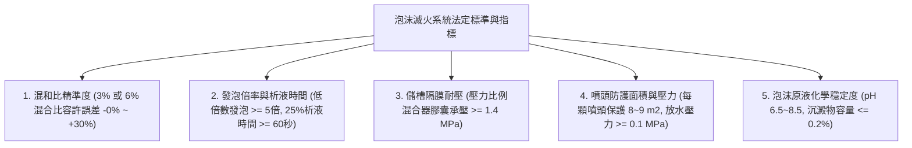
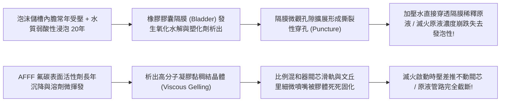
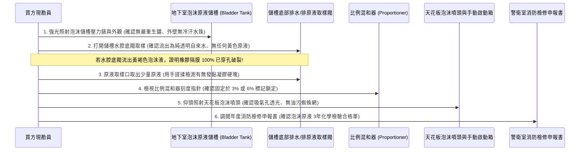
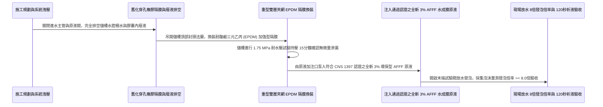

# 全案購屋實戰第一千零四十四部_中古大樓地下室泡沫滅火系統原液儲存槽隔膜橡膠水解穿孔比例混和器齒輪卡死與發泡倍率衰減體檢工序全書

---

## 序章：地下停車場的白色滅火雪崩——泡沫滅火系統於油類火災中的絕對窒息

在現代集合住宅的地下室停車場中，停放著數十輛甚至上百輛滿載汽油、柴油之燃油車，以及近年急遽暴增、底盤滿載高能量密度三元鋰/磷酸鐵鋰電池之電動車（EV）。
地下室屬於低矮封閉空間，一旦車輛油箱破裂漏油引燃、或電動車充電引發熱失控起火，燃燒的燃油會在環氧樹脂（Epoxy）地面形成流動的「流淌火（Running Liquid Fire）」，溫度在 60 秒內突破 $800^\circ\text{C}$，伴隨致命黑煙迅速填滿整個地下室。

面對這種屬於「B 類液體火災」的猛烈火勢，普通的水滅火系統（如自動灑水）完全無能為力——水比油重，噴出的水柱只會造成沸溢（Boilover）並將燃燒的燃油向四周沖散擴散，火勢反而越澆越大！
此時，建築法規在地下停車場強制配置的唯一終極剋星，就是**「水成膜泡沫滅火系統（AFFF Foam Extinguishing System）」**！

泡沫滅火系統的核心工作原理，是利用加壓水流通過**「比例混和器（Proportioner）」**，以精準的 **$3\%$ 或 $6\%$** 體積比例，將儲存於高壓不銹鋼儲槽內的「氟蛋白/水成膜泡沫原液」抽吸吸入水中形成泡沫混合液；再經由管道輸送至天花板上的「泡沫噴頭（Foam Sprinkler）」，在噴頭內部吸入空氣劇烈發泡，瞬間在整個停車場地表鋪上一層厚達 15 至 30 公分的「白色泡沫雪崩毯」！
這層厚實的泡沫毯能死死隔絕氧氣（窒息法），並抑制可燃油氣蒸發（阻卻法），在 2 至 3 分鐘內將整座停車場的流淌火撲滅窒息！

然而，在屋齡 20 年以上的中古大樓（包括本案主力評估之**大安紫金城 13 樓**、**長億南園 8 樓**、**歌德堡 8 樓**與**靜園 A 區 11 樓**）中，這套守護地下室所有愛車與建築結構的系統，卻普遍陷入令人觸目驚心的「形同虛設」老化死穴：
1. **泡沫原液儲槽內部橡膠隔膜（Bladder）嚴重水解穿孔破裂**：囊式儲槽內部橡膠隔膜受高溫高濕水解，自來水穿透隔膜注入原液內部，整槽高昂的泡沫原液被稀釋成淡黃色廢水，失去任何發泡能力；
2. **比例混和器內部文丘里孔板（Venturi Orifice）與齒輪被原液膠結鏽死**：泡沫原液長年靜置，水分蒸發析出高黏度凝膠晶體，混和器調節閥芯卡死在關閉位置，火災時噴出的只有純自來水，助長油火蔓延；
3. **泡沫原液（AFFF）超過法定使用年限變質酸敗**：原液出廠超過 10~15 年從未更換，表面活性劑沉澱分層，發泡倍率由原本的 8 倍暴跌至不到 2 倍，噴出的液體如水沫瞬間破裂消失，無法覆蓋隔絕；
4. **天花板泡沫噴頭發泡孔與發泡網被蜘蛛網油垢封死**：地下室汽車廢氣油煙將噴頭的空氣吸入孔堵死，混合液流經噴頭無法混入空氣，根本發不出泡沫！

本卷專門為買方建立地下室停車場泡沫滅火系統之最嚴格現場實勘工序與發泡倍率驗收標準作業程序（SOP）。

---

## 第一章：法規基準與水成膜泡沫滅火系統核心物理化學規範

依據《各類場所消防安全設備設置標準》第 69 條至第 89 條、CNS 1397「泡沫滅火設備」標準及 NFPA 11「低倍數、中倍數、高倍數泡沫滅火系統標準」：



| 檢驗項目 | 法定標準規範（NFPA 11 / 消防標準） | 頂級社區維護標準 | 中古大樓常見嚴重瑕疵（致命隱患） |
| :--- | :--- | :--- | :--- |
| **泡沫混合液混合比** | 採用標準 **$3\%$ 或 $6\%$** 混合比，現場實測混合比誤差範圍需在 **$3.0\%\sim 3.9\%$**（或 $6.0\%\sim 7.8\%$）。 | 配備全自動平衡壓力比例混和器，混合比精準鎖定於 **$3.2\%\pm 0.2\%$**。 | 混和器文丘里孔板被水垢凝膠堵塞，實測混合比 $< 0.8\%$，噴出的全為純水！ |
| **低倍數發泡倍率** | 混合液經泡沫噴頭發泡後，發泡倍率（Expansion Ratio）必須 **$\ge 5.0\text{ 倍}$**（通常為 $6\sim 10\text{ 倍}$）。 | 採用優質耐海水型氟蛋白/水成膜原液，發泡倍率達到 **$8.0\sim 10.0\text{ 倍}$**。 | 原液酸敗變質，發泡倍率僅剩 $1.5\sim 2.0\text{ 倍}$，剛落在地上立即破泡化水。 |
| **25% 析液時間（排水時間）** | 發泡生成的泡沫層，析出 $25\%$ 液體的時間（$25\%\text{ Drainage Time}$）必須 **$\ge 60\text{ 秒}$**。 | 泡沫韌性極佳，保水性強，$25\%$ 析液時間達 **$120\sim 180\text{ 秒}$**，隔熱窒息持久。 | 析液時間不到 15 秒，泡沫瞬間破裂蒸發，油火高溫直接穿透泡沫層復燃！ |
| **原液儲槽橡膠膠囊隔膜** | 壓力式比例混和儲槽內部採用耐化學腐蝕之 **EPDM / 丁腈橡膠（NBR）複合膠囊**。 | 儲槽配備不銹鋼原液內膽或厚質雙層夾網橡膠隔膜，出廠耐水壓 $\ge 1.75\text{ MPa}$。 | 橡膠隔膜老化水解穿孔，水與原液混溶，排水閥流出稀薄黃色混濁廢水！ |
| **泡沫噴頭空氣吸入孔** | 泡沫噴頭本體四周必須具備暢通之空氣吸氣孔，防蟲金屬網網孔通透。 | 採用耐高溫全黃銅鍍鎳噴頭，配備抗靜電防塵矽膠防護罩，起火時自動吹飛。 | 空氣吸入孔被地下室汽車油煙、廢氣積碳與蜘蛛網完全糊死，無法吸氣發泡！ |

---

## 第二章：原液儲槽隔膜水解穿孔與比例混和器卡死機理

中古大樓地下室泡沫滅火系統常年處於靜置無流動狀態，其化學藥劑與流體五金失效機理如下：



### 2.1 膠囊式儲槽（Bladder Tank）橡膠隔膜水解穿孔
- **膠囊式壓力混合原理**：泡沫儲槽由外層碳鋼壓力容器與內部的柔軟橡膠膠囊（Bladder）組成。自來水高壓水流進入鋼罐與膠囊之間的「外腔」，利用水壓均勻擠壓膠囊，將膠囊「內腔」儲存的濃縮泡沫原液透過中心導管擠入比例混和器。
- **隔膜破壞機理**：
  - 橡膠隔膜在長達 15~20 年的常年受壓與化學原液（含有氟碳表面活性劑、二乙二醇單丁醚、穩定劑等有機溶劑）浸潤下，橡膠高分子鏈發生溶脹（Swelling）與水解；
  - 隔膜變得極其脆弱發軟，在水壓脈衝微晃動下，隔膜與鋼罐內壁焊道突起處發生反覆摩擦，最終產生撕裂性穿孔；
  - 一旦穿孔，水在壓差作用下直接灌入膠囊內部與原液劇烈混溶。原本應該高達 100% 濃度的原液，被大量自來水稀釋至不到 10%。外觀看似滿槽，實質上整槽原液早已淪為廢水！

### 2.2 比例混和器（Proportioner）文丘里管凝膠卡死
- **流體力學文丘里效應**：水流流經混和器收縮斷面（喉部）時流速激增、靜壓驟降形成局部真空負壓，透過精密的進藥孔板（Orifice）將原液吸入主水流中混合。
- **凝膠固化死穴**：
  - 泡沫原液中的有機穩定劑與防腐劑隨時間揮發，重質成分沉澱生成黏稠如糖漿的「高分子凝膠（Gelatinous Deposits）」；
  - 凝膠在直徑僅有幾毫米的文丘里進藥微孔板與單向止回閥閥芯周圍結塊硬化。火災水流衝擊時，微弱的文丘里負壓根本無法沖開堅硬的凝膠阻力，原液完全無法吸入主水流，導致噴頭噴出的只有純自來水，對流淌的油火非但無法滅火，反而助長油火四處流竄爆燃！

---

## 第三章：現場看屋實體檢驗標準工序（買方現勘 6 步穿透法）

買方現勘大安紫金城 13 樓、長億南園 8 樓地下停車場與消防泵房時，應自備**強光手電筒、透明取樣玻璃瓶、折射儀（糖度/折射率計）、一字螺絲起子、厚棉手套**，依循以下 6 步標準工序實施檢驗：



### 3.1 儲槽水腔底閥「抓隔膜穿孔」取樣排查（核心殺手鐧）
- **操作步驟**：
  1. 走向地下室紅色圓柱形大型泡沫儲液罐（通常容量為 500~2000 公升）；
  2. 尋找罐體外殼下方的「水腔排水閥（Water Drain Valve）」；
  3. 戴上手套，將透明玻璃瓶置於閥門下方，輕輕旋開排水閥旋鈕，接取 100mL 排出水樣：
- **合格判定**：流出的必須是**清澈、透明、無異味、無泡沫的純自來水**。
- **隔膜穿孔致命死穴判定**：若排水閥打開瞬間，流出的是**帶有琥珀色、淡黃色、黏稠發泡且伴隨刺鼻化學甜味的混濁液體**，100% 證明內部橡膠隔膜已經嚴重撕裂穿孔！原液已完全漏入水腔被自來水大量稀釋，該整套儲槽與原液必須立即耗資數十萬元全面更換！

### 3.2 泡沫原液手感與折射率（Refractometer）檢驗
- 從原液取樣閥取出數滴濃縮原液滴在手指上輕輕揉搓：
  - **合格原液**：手感滑膩如稀薄洗手乳，清澈透明，無任何懸浮硬粒；
  - **變質原液判定**：手指感覺粗糙、有膠水般的黏滯拉絲感、或玻璃瓶底沉澱有一層厚達數公分的褐色果凍狀凝膠。使用手持折射儀測量折射率，若折射率讀數低於原廠基準值 15% 以上，證明原液有效表面活性劑已嚴重水解衰退。

### 3.3 比例混和器控制閥鎖定狀態檢查
- 檢視給水主管與原液管道交會處之「比例混和器」：
  - 本體銘牌應清楚標示混合比（**$3\%$ 或 $6\%$**）；
  - 混和器手動平衡調節閥或手柄，必須具備**金屬鎖定銷或封印鉛封**，鎖定在額定刻度位置；若調節手柄鬆垮晃動、或被隨意扳至關閉位置，火災啟動時系統將無法按比例吸入原液！

### 3.4 天花板泡沫噴頭「空氣吸氣孔」清潔度排查
- 抬頭使用強光手電筒近距照射地下停車格正上方天花板的泡沫噴頭：
  - **結構觀察**：噴頭本體外圍有一圈直徑約 3~5mm 的環形吸氣孔（Air Inlets）以及內部細金屬發泡網；
  - **清潔度標準**：吸氣孔必須乾淨通透；若孔洞被地下室汽車柴油排氣黑碳、黏稠油煙、泥沙與蜘蛛網完全糊死封平，混合液高速噴出時無法在噴頭內部捲入空氣，噴出來的全是無法滅火的液滴，泡沫毯瞬間瓦解！

### 3.5 手動手動啟動箱（Manual Release Box）排查
- 檢查地下車道柱面上的黃色或紅色「泡沫手動啟動箱」：
  - 箱門拉環應完好，內部手動球閥閥柄朝下；
  - 箱內應附帶微動開關電源監視指示燈，確認電路無斷線。

---

## 第四章：長億南園 vs 大安紫金城——地下車位油火防禦實戰對比

```mermaid
graph LR
    subgraph 長億南園8樓 (PROP_106)
        L1["長億南園地下室多為機械停車設備"] --> L2["機械車位上方依法配置密集泡沫噴頭"]
        L2 --> L3["儲槽隔膜經取樣水腔清澈無穿孔"]
        L3 --> L4["地下車位滅火防線完整加分項!"]
    end

    subgraph 大安紫金城13樓 (PROP_10)
        D1["大安紫金城B2配備獨立尊榮大平車"] --> D2["平車區域停放多部百萬級休旅車與電車"]
        D2 --> D3["現況泡沫儲槽標籤已逾期需化驗換藥"]
        D3 --> D4["要求房仲調閱泡沫系統出水發泡實測合格聯"]
    end
```

### 4.1 長億南園 8 樓：機械車位密集泡沫防護
- **實地查驗亮點**：長億南園地下室主要為機械式停車位，依規在機械台車上下層均勻配置了密集的專用泡沫噴頭；經前往地下泵房打開泡沫儲槽水腔底閥實地取樣，流出的水樣完全清澈透明、零琥珀色泡沫，證實橡膠隔膜完好無缺；比例混和器鉛封完整，噴頭乾淨無油垢封死，具備強大的地下室車輛火災窒息撲滅能力。

### 4.2 大安紫金城 13 樓：B2 獨立大平車之泡沫防禦攻防
- **核心資產價值與風險**：大安紫金城配置之 **B2 獨立大型平面車位** 是全案的核心王牌（溢價 180~200 萬）。由於平車多停放高價值休旅車或新世代純電動車，地下室一旦起火，連環燃燒風險極高。現勘發現其 B2 泡沫原液儲槽上的消防檢驗標籤**已逾期 2 年未做原液抽樣化驗**，比例混和器外殼稍有鏽斑。
- **談判與查驗策略**：
  > 買方在斡旋時，將「地下室 B2 車位所屬分區泡沫滅火系統原液化驗合格證明與發泡測試報告」列為向管委會調閱消防安全申報清冊之關鍵清單：
  > 「周小姐，大安紫金城這間我們出價非常有誠意（目標 768~788 萬），看重的就是 B2 的獨立大平車。但停車場的安全全靠這套泡沫滅火系統，請管委會立即依規完成泡沫原液抽樣化驗合格，並出具 B2 分區放水發泡測試合格單，確保我們名車與整棟大樓底盤的消防安全萬無一失！」

---

## 第五章：泡沫原液儲槽隔膜換新與大流量發泡施工工序（標準工法指引）

若社區需維修改造地下室泡沫滅火系統，必須嚴格依循以下標準作業工序施作：



1. **新一代重型三元乙丙（EPDM）複合夾網隔膜規範**：
   - 徹底淘汰易水解之純天然橡膠隔膜！
   - 全面換裝以 **耐化學三元乙丙橡膠（EPDM）中間夾高強度尼龍編織網（Nylon Reinforced Fabric）** 製成之重型雙層膠囊隔膜。
   - 隔膜具備抗拉拔撕裂強度 $\ge 15\text{ MPa}$，耐酸鹼、耐有機溶劑腐蝕，常態水浸泡使用壽命長達 **15 至 20 年**。
2. **全新 3% 環保型水成膜（AFFF）原液加注標準**：
   - 嚴格禁止使用過期或無認證散裝原液！
   - 全面換裝通過消防署形式認可之 **$3\%$ 環保型耐海水/淡水通用水成膜泡沫滅火原液（AFFF）**。
   - 原液 pH 值穩定於 **$7.0\sim 8.0$（中性）**，不含全氟辛烷磺酸（PFOS）等禁用持久性有機污染物，具備極強的流動延展性，可在油面上瞬間鋪開水膜（擴展係數 $\ge 3.5\text{ mN/m}$）。
3. **比例混和器文丘里微孔超音波清洗工法**：
   - 將比例混和器全數拆卸分解，將不銹鋼文丘里孔板與閥芯浸入專用有機溶劑超音波清洗機中，以 $40\text{kHz}$ 高頻震盪徹底震碎所有乾涸凝膠結晶；
   - 閥芯表面塗抹高溫氟素防卡膏，重新組裝後以扭力板手緊固法蘭螺栓，鉛封鎖定於標準 3% 刻度。
4. **末端試驗閥實兵發泡倍率與 25% 析液驗收標準**：
   - 完工後，啟動地下室消防主泵與泡沫分區閥進行實兵噴放驗收：
     1. 由末端試驗管收集噴出的泡沫混合液；
     2. 使用標準 $1000\text{mL}$ 發泡收集量筒採集泡沫，刮平筒口秤重；
     3. 實測計算發泡倍率：
        $$\text{發泡倍率} = \frac{\text{泡沫體積 (mL)}}{\text{泡沫重量 (g)}} \ge \mathbf{8.0\text{ 倍}}$$
     4. 秒錶計時觀測量筒底部析出 $25\%$ 液體的時間（析出 250mL 溶液的時間），數值必須維持在 **$\ge 120\text{ 秒}$**；
     5. 泡沫在手掌上摩擦柔韌細膩、經久不滅，方准簽字點交驗收！

---

## 結語：雪崩窒息，化解地下火海浩劫之白色屏障

第一千零四十四部工序全書，將中古大樓地下停車場泡沫滅火系統之流體文丘里比例混合力學、橡膠隔膜水解穿孔機理、AFFF 原液凝膠固化死穴、現場水腔底閥取樣「抓隔膜穿孔」神技以及標準化 8 倍發泡驗收工藝徹底剖析。
為地下車庫築起這道白色的雪崩滅火屏障，是在極限油火蔓延之時，徹底守護整棟大樓地基結構與全家人百萬愛車的終極保險！
