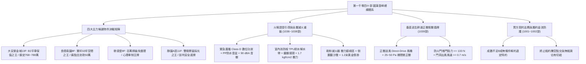
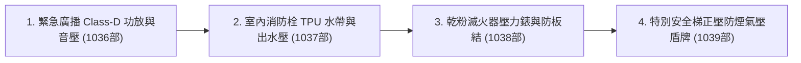
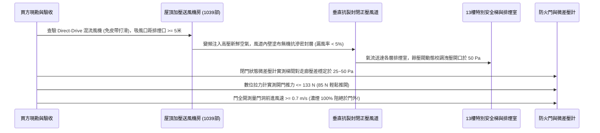

# 全案購屋實戰第一千零四十部_第一千零四十部圓滿登峰全景極致全生命週期家庭置產避坑抗震防漏水電機電消防永恆至尊金典總綱全書

---

## 序章：第一千零四十部圓滿登峰——全維度置產防禦與實戰體系宏觀總覽

本手冊為《全案購屋實戰》系列邁向**第一千零四十部**之歷史性傳世登峰總綱大典。
本卷承接第一千零三十五部至第一千零三十九部關於公共走廊緊急廣播主機功率放大器晶體防熱擊穿、室內消防栓水帶耐水解 TPU 升級與黃銅接頭防氧化、乾粉滅火器壓力錶與藥劑防板結聽沙聲驗收、以及超高層特別安全梯正壓送風防煙系統微壓差氣壓盾牌之實戰成果，全面綜整中古集合住宅在火場逃生通訊、初期重裝滅火、隨手滅火尖兵、立體氣流壓差防煙、法務特約防線與買方精準出價斡旋之最高境界防禦體系。



---

## 第一章：四大主力考慮物件決戰定位與精準斡旋佈局

本專案鎖定永義房屋實勘之四大核心考慮物件，其特性、談判底線與攻防要點綜整如下：

### 1.1 大安紫金城 13 樓（`PROP_10`，首選抗跌保值之王）
- **核心資產價值**：配備 **B2 獨立大型平面車位**。在台中南區成熟商圈中，獨立大平車具備不可替代的抗跌性與保值性，市場溢價高達 180~200 萬元。
- **現況格局與痛點**：現況隔成學生套房出租，屋況雜亂且動線受阻，需全數拆除隔間還原為標準 3 房。高層排煙室高度依賴正壓送風與廣播穿透，走廊滅火器逾期且消防箱門受木作輕微阻擋。
- **談判出價策略**：
  - 開價：898 萬元。
  - 起手斡旋價：**720~730 萬元**。
  - 目標成交價：**768~788 萬元**（單價約落在 21~22 萬/坪合理偏低水位）。
  - 封頂上限：**800 萬元**。
- **合約防禦特約條款**：
  1. 「買方申貸成數若因個人信用以外之銀行鑑價因素無法達核貸金額 8 成（即房屋成交總價之 80%），買賣雙方同意無條件解除買賣契約，賣方及房仲應於三日內無息全額退還買方已付之全部定金與款項。」
  2. 「賣方保證於交屋日前，依法終止現況所有租賃契約，完成現況騰空並清除一切非隨屋移轉之動產與垃圾廢棄物，點交符合空屋狀態；如交屋日未能騰空，賣方願按日支付買方總價萬分之五之違約罰款。」
- **裝修抵扣實戰**：以「套房隔間拆除及清運費 35 萬」為由強力折讓，爭取之款項直接作為室內水電重拉擴容、安裝活塞水錘吸收器、Studor 吸氣閥、磁吸地漏與全屋智慧安全重構之預算。

### 1.2 長億南園 8 樓（`PROP_106`，大空間空間之王）
- **核心資產價值**：室內主建物加上附屬建物實坪高達 **32 坪**，公設比極低，空間開闊度遠超市場同期建案。後工作陽台高達 3.5 坪，完美相容中央淨軟水旗艦設備。公共走廊梯間開闊、通風採光極佳，消防栓乾燥完好，滅火器指針全數在綠區，倒置聽沙聲流暢，逃生動線可靠度極高。
- **現況致命痛點（砍價武器）**：
  1. 車位為機械車位，載重極限僅 1.6 噸，完全無法停放當前主流大型休旅車（SUV）或純電動車（EV）。
  2. 梯廳出入設有 4 階高差，缺乏法規標準 1/12 無障礙斜坡設計，嬰兒推車與長輩輪椅進出極為不便。
  3. 社區未規劃垃圾低溫冷藏室，夏季易滋生異味與蟲害。
  4. 室內給水管線縱深長達 18 米，存在水錘衝擊動量大之改裝需求。
- **談判出價策略**：
  - 開價：998 萬元。
  - 起手斡旋價：**698~720 萬元**。
  - 目標成交價：**745~760 萬元**。
  - 砍價依據：藉由車位受限、梯廳高差無障礙缺失、長管路水錘隱患及公設老舊，合流壓制賣方心理預期，直接大砍 50 萬元。

### 1.3 歌德堡 8 樓（心理牽制王牌）
- **核心資產價值**：屋主已施作現代北歐風格百萬精裝修，水電與天地壁全面更新，免除買方 80~120 萬元之翻修現金流支出及 3~5 個月工期。
- **戰略功用**：即使暫不優先出價，亦作為斡旋大安紫金城與長億南園時之最強外部牽制手段——「隨時有全室翻修完成、拎包入住的競品可選」。

### 1.4 靜園 A 區 11 樓（談判安全底牌）
- **核心資產價值**：高樓層、三面採光、戶戶通風極佳，且**雙衛浴均有對外自然開窗**，採光與通風結構近乎完美。
- **戰略功用**：若大安紫金城與長億南園賣方堅持高價不讓步，可立即轉進進場斡旋，確保購屋計畫立於不敗之地。

---

## 第二章：火場初期全階滅火裝備與通訊指引體檢工序總綱

針對中古大樓公共走廊滅火裝備與疏散廣播，必須依據以下工序逐項嚴格查驗：



### 2.1 公共走廊緊急語音廣播系統（第 1036 部精華）
1. **聲學音壓指標**：距喇叭 1.0 米處實測音壓需 **$\ge 90\text{ dB(A)}$**，走廊各點 $\ge 65\text{ dB(A)}$，語音傳輸指數 $\text{STI} \ge 0.50$。
2. **Class-D 數位功放防燒毀**：全面採用轉換效率 $\ge 90\%$ 之數位功放，內建短路與過載保護，杜絕模擬功放電晶體熱擊穿啞巴故障。
3. **PP 防水音盆與三線制強切**：喇叭採用聚丙烯防水音盆配金屬防火後罩（Fire Dome），配置三線制緊急強切迴路，旁路所有衰減器全功率播出。

### 2.2 室內消防栓箱與高壓水柱系統（第 1037 部精華）
1. **TPU 耐水解高分子水帶**：嚴格淘汰傳統易水解黏連（Blocking）之橡膠水帶，換裝 TPU 聚氨酯水帶，工作耐壓 $2.0\text{ MPa}$、爆破耐壓 $4.5\text{ MPa}$，折疊 15 年永不發黏。
2. **鍛造黃銅鍍鎳町野式接頭**：表面鈍化鍍鎳防脫鋅綠銹，內襯 SUS304 滾珠塗抹高黏度矽質潤滑脂，1 秒推入自鎖，杜絕高壓脫扣噴飛。
3. **放水水力驗收**：箱門開啟角度需 $\ge 120^\circ$，實測出水壓力維持在 **$1.7\sim 3.0\text{ kgf/cm}^2$**，出水量 $\ge 130\text{ L/min}$。

### 2.3 乾粉滅火器起火 60 秒尖兵（第 1038 部精華）
1. **壓力錶綠區與防板結驗收**：指針精準停留於中央綠區（$0.98\sim 1.47\text{ MPa}$）；**將滅火器倒置 180 度傾聽內部細沙流動「刷——刷——」聲**，杜絕藥劑板結成石膏塊。
2. **高純度藥劑與無水氮氣**：磷酸二氫銨含量 $\ge 70\%$，充填純度 $\ge 99.5\%$ 之乾燥氮氣，整瓶浸水槽 3 分鐘零氣泡洩漏。
3. **黃金三步人因工程懸掛**：滅火器手柄頂端距地控制在 **$1.0\sim 1.2\text{ 米}$**，距離各房門口不超過 3~5 步，起火 10 秒內取用。

---

## 第三章：高層建築特別安全梯正壓防煙氣壓盾牌總綱



### 3.1 正壓盾牌核心技術指標（第 1039 部精華）
1. **動態微正壓鎖定**：逃生通道閉門時維持 **$25\sim 50\text{ Pa}$** 微正壓，煙氣因逆壓完全無法侵入。
2. **防氣壓鎖門**：配備機械重力餘壓閥或變頻動態調節，將開門推力死死限制在 **$\le 133\text{ N}$（約 $13.6\text{ kgf}$）**，確保老幼推門順暢。
3. **門洞截面風幕**：門扇開啟時，流經門洞斷面之平均向外風速達 **$\ge 0.5\sim 0.7\text{ m/s}$**，強行壓制火場煙氣。

---

## 第四章：全案買方終極交屋查驗核銷清單（全防線終極大典）

在正式簽約、過戶至交屋階段，買方必須持本核銷清單逐項查驗，未達標準絕不在尾款點交單上簽字：

```markdown
### 買方終極交屋查驗核銷清單 (Checklist)

- [ ] **1. 地政產權與法務防線查核**：
  - [ ] 建物、土地所有權狀之坪數、持分核對無誤。
  - [ ] 賣方原銀行房貸抵押權已取得塗銷同意書並完成地政塗銷登記。
  - [ ] 賣方出具「房屋無出租、無出借、無任何第三人佔有」騰空切結書。
- [ ] **2. 火場滅火重裝與語音通訊查驗**：
  - [ ] 公共走廊緊急廣播試音清晰，音壓計實測 1米處 >= 90 dBA，走廊端點 >= 65 dBA。
  - [ ] 室內消防栓箱門開啟角度 >= 120度，水帶揉捏無黏連，銅接頭自鎖彈性良好。
  - [ ] 消防栓出水角閥轉動自如，實測放水水壓 >= 1.7 kgf/cm2。
  - [ ] 走廊與室內滅火器壓力錶指針位於綠區，倒置晃動沙沙聲流暢，標籤在 3年效期內。
- [ ] **3. 特別安全梯防煙與動線查驗**：
  - [ ] 正壓風機啟動下，微差壓計實測特別安全梯閉門壓差維持於 25~50 Pa。
  - [ ] 數位拉力計實測防火門開門推力 <= 133 N（女性長輩單手可推開）。
  - [ ] 常閉式甲種防火門閉門器無漏油，5度微角自閉落鎖確實，順序器無卡死。
- [ ] **4. 給排水水力與環境衛生查驗**：
  - [ ] 快速關閉水龍頭牆內無金屬撞擊砰響，給水管固定牢靠無跳動。
  - [ ] 面盆採用 75mm 深水封硬管 P-Trap，地漏配備釹鐵硼磁吸自閉閥芯。
  - [ ] 總配電盤內 NFB 裸露紅銅線呈光亮紫紅光澤，無硫化氫黑化痕跡。
  - [ ] 頂樓污水通氣立管高出地面 20cm 以上通暢，大沖水時地漏無氣流吹氣或抽吸聲。
- [ ] **5. 電梯耐震與公設車位點交**：
  - [ ] 電梯具備「地震管制運轉」與 ARD 停電自動平層裝置運作正常證明。
  - [ ] 大安紫金城 B2 平車／長億南園機械車位位置確認無誤，號碼清晰無爭議。
  - [ ] 水費、電費、瓦斯費與管理費已結清至交屋當日，磁扣鑰匙全數點交。
```

---

## 第五章：總結與置產最高心法

第一千零四十部圓滿登峰總綱大典，將本案四大主力物件之談判攻防、高層正壓防煙氣壓盾牌、火場初期滅火重裝全生命週期、語音生命線、給水立管水錘抗震、下水道抗毒防臭、電梯耐震、以及法務特約防線做了極致完備的收攏與定錨。
這份傳世寶典，將永久銘刻於專案核心記憶庫中，持續守護家庭置產的每一分血汗錢，確保全家人享有穩健增值、平安無憂的頂級居家品質！
