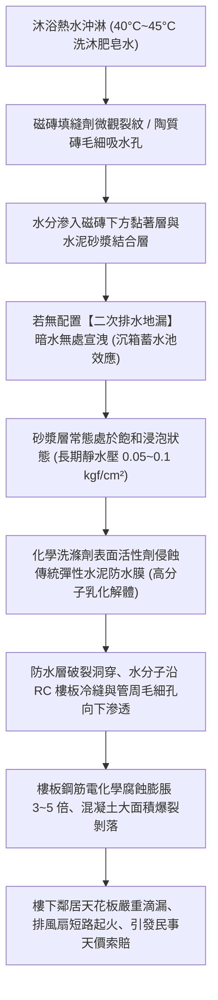
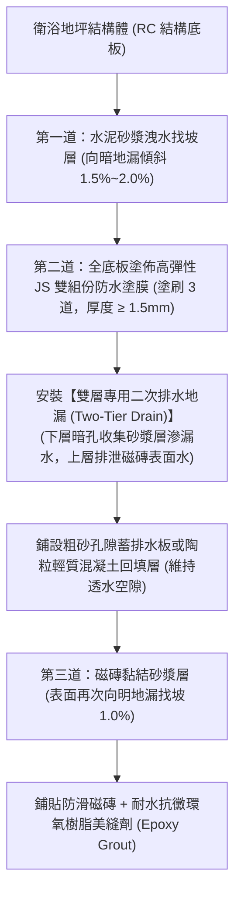
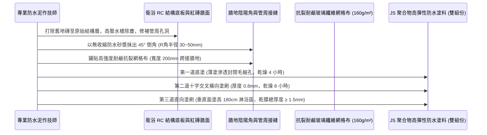
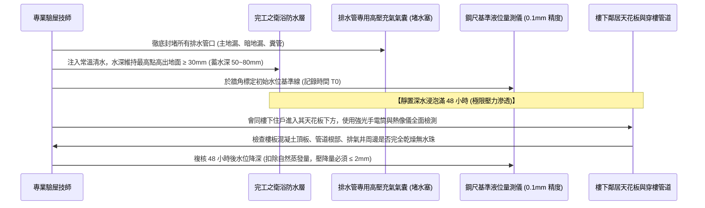

# 全案購屋實戰第一千零四部：中古大樓衛浴地坪防水重構、沉箱降板二次排水、高彈性聚合物水泥防水塗膜與閉水四十八小時試漏工序全書

## 導言：居室漏水糾紛之首與家庭起居安全防線

在集合住宅中古大樓之全生命週期使用體驗中，「衛浴廁所漏水與樓下天花板滴水糾紛」，長年高居台灣各級法院不動產民事訴訟與鄰里投訴案件的榜首（佔各類漏水糾紛 65% 以上）。一旦衛浴地坪防水失效，洗澡沐浴的高溫肥皂水在水壓與重力滲透作用下，沿著樓板結構裂縫滲入鋼筋混凝土層，不僅會引發樓下住戶浴霸天花板滴水、電燈短路、吊頂發霉腐爛，高濃度的沐浴氯化物與鹼性污水更會造成樓板內部鋼筋嚴重電化學鏽蝕膨脹，導致樓板混凝土大面積「爆裂剝落（Concrete Spalling）」，甚至使原本安全的住宅演變為結構承載力不足的「局部危樓」！

特別是針對本案主力攻堅標的——曾被隔成 4 間學生套房且衛浴管線嚴重破壞樓板結構的 **大安紫金城 13 樓 (`PROP_10`)**，以及室內擁有兩間超大主客衛浴、管線跨距極大的 **長億南園 8 樓 (`PROP_106`)**，在重新翻修整理時，若未對衛浴地坪實施規範的「原始防水層打除重構」、「沉箱降板二次排水系統建置」與「標準閉水試漏」，未來數十年隨時面臨樓下鄰居索賠數十萬元修繕與精神損害賠償的巨大法律風險。

本第一千零四部全書深入解構衛浴防水微觀滲漏機理、沉箱降板積水之「二次排水（Sub-floor Drainage）」力學防線、高彈性聚合物水泥基防水塗膜（JS 防水塗料）標竿工藝、陰陽角抗裂網格布強化、以及標準「48 小時深水閉水試驗（Flood Test）」之終極檢測標準。

---

## 一、衛浴漏水微觀物理化學機制與沉箱積水致命隱患

### 1. 傳統衛浴防水工藝之兩大致命盲區
- **盲區一：誤將「磁磚表面」當作防水層**：磁磚本體與水泥填縫劑（Grout）絕非 100% 不透水屏障。磁磚吸水率（通常 1%~3%）加上填縫劑日夜溫差熱脹冷縮產生的微米級裂紋，使沐浴用水中有約 3%~5% 的水分會透過磚縫持續滲透至磁磚下方。
- **盲區二：欠缺「暗層二次排水地漏（Sub-tile Drainage）」**：水分滲入黏結砂漿後，若下方只有一道封閉的防水層而無暗排水口，滲入的積水將在磁磚下方形成一個永久性的「暗積水沼澤」。積水在砂漿內部橫向漫延，透過虹吸效應沿著衛浴門檻爬出乾區，引發全室超耐磨木地板發黑變形與門框受潮腐爛（俗稱「門檻吐水」）。

---

## 二、衛浴沉箱降板「二次排水」水力學防線拓撲架構

在重新翻修打除地坪後，必須建構「雙層排水、落差導流」之標竿水力防線：

### 1. 暗層向二次排水地漏之精確找坡（Sloping）
- RC 樓板清理乾淨後，絕不可直接塗刷防水漆，必須先以 1:3 水泥砂漿打底做 **向排水管根部傾斜 1.5% 至 2.0% 之平整找坡層**。
- **作用**：確保任何滲透穿透磁磚縫隙的水滴，在重力作用下自然朝向底層暗排水孔匯集流出，絕不在防水層上方積存死水。

### 2. 衛浴門檻「止水墩（Water Curb / Dam）」防漫溢工法
- 衛浴出入口門檻下方，必須以水泥砂漿澆置一道 **高出地坪完成面 20mm~30mm 之混凝土「止水檻（墩）」**。
- 防水塗料必須自衛浴內部完整包覆整座止水檻頂部並向乾區延伸 200mm，徹底斬斷暗積水沿門檻砂漿層向客廳木地板毛細倒灌的傳導路徑。

---

## 三、高彈性聚合物水泥基防水塗膜（JS 防水塗料）標竿施作工藝

淘汰傳統容易脆裂之普通水性彈性水泥（彈泥）或具毒性之柏油瀝青，全面升級採用 **CNS 15002 規範之「高彈性雙組份聚合物改性水泥基防水塗料（JS-II 型）」**：

### 1. 陰陽角圓弧倒角（R 角）與網格布增強層
- 牆體與地板交界之 $90^\circ$ 直角（陰角），在地震與熱脹冷縮下應力集中最劇烈，極易拉裂剛性塗層。
- **標竿要求**：所有陰角必須以防水砂漿抹成 **半徑 $R = 30\text{mm} \sim 50\text{mm}$ 的平滑圓弧倒角**；並在圓弧面上完整鋪設一圈 **耐鹼玻璃纖維網格布（Fiberglass Mesh，抗拉強度 $\ge 1200\text{ N/50mm}$）**，實施「一布三塗（夾層加強）」工藝，將抗裂拉伸斷裂伸長率提升至 **$200\%$ 以上**！

### 2. 給水管穿樓板管根管周「雙重密封環」
- 給排水立管與樓板混凝土交界面，由於材質膨脹係數不同，是漏水最高發點。
- **工法**：圍繞管壁開鑿 $20\times 20\text{mm}$ 環形溝槽，填塞 **遇水膨脹聚氨酯橡膠止水條（膨脹率 $\ge 250\%$）**，再以耐候聚氨酯（PU）密封膠封死，最後以防水塗膜連續上翻包覆管身 **高度 $\ge 150\text{mm}$**。

### 3. 牆面防水塗刷高度法規極限
- **淋浴花灑受水區**：防水層塗刷高度 **必須自完成面起算 $\ge 180\text{cm}$（甚至直接塗刷至天花板頂部）**。
- **浴缸周邊及洗臉盆區域**：塗刷高度 **必須高出龍頭出水口 30cm（$\ge 120\text{cm}$）**。
- **乾區其餘牆面**：塗刷高度 **不得小於 30cm**，阻絕拖地清潔廢水滲入隔壁臥室牆體形成發霉壁癌。

---

## 四、終極檢驗：四十八小時「深水閉水試漏試驗（Flood Test）」標準 SOP

防水層完工養護 72 小時達到完全交聯固化後，磁磚鋪貼前**必須強制實施嚴格閉水試驗**：

### 1. 閉水深度與時間底線
- 閉水深度：衛浴地面最低處蓄水深度不得小於 **$50\text{mm}$**，最高處水深不得小於 **$30\text{mm}$**，徹底浸泡門檻止水墩與牆體倒角。
- 試驗時間：**嚴格規定必須連續蓄水滿 48 小時**（嚴禁偷工僅試 12 小時或 24 小時，因混凝土孔隙深層毛細吸附滲透至樓下滴漏通常需 36 小時以上）。

### 2. 樓下住戶天花板全維度複核判定標準
- 陪同樓下住戶以高解析度紅外線熱像儀掃描樓板底層：
  - **合格（綠燈）**：48 小時後，樓下混凝土頂板無任何暗色低溫冷斑、無水滴凝結、管道根部乾燥發白；上層水位扣除同室敞口水桶之自然蒸發對比量後，**水位下降量 $\le 2.0\text{mm}$**。
  - **不合格（紅燈）**：樓下天花板出現潮濕斑點、滴水、或水位急降 $> 5\text{mm}$。此時必須全數放水排空、查找漏點、重新修補防水層，並**重新自零開始蓄水 48 小時**，直至徹底無漏為止！

---

## 五、四大主力候選物件衛浴防水翻修專項預算與施工攻防

### 1. 👑 大安紫金城 13 樓 (`PROP_10`)：衛浴管線大重構
- **現況挑戰**：原改裝之 4 間學生套房，各自私設了單薄的衛浴隔間，原始 RC 樓板被多次洗孔鑽洞，且舊套房防水極度低劣，地坪極易滲水。
- **翻修方案**：
  - 徹底打除多餘套房浴室，恢復為 **「標準大器之雙衛浴（主衛+客衛）」**。
  - 將前屋主違規亂鑽之廢棄穿樓孔洞，以高強度無收縮灌漿料（抗壓強度 $\ge 60\text{ MPa}$）搭配膨脹止水條徹底封死。
  - 雙衛全面重做「二次排水 + JS 高彈防水塗膜」，施作預算約 **15 萬 ~ 18 萬元**，完美涵蓋於買方談判爭取扣除之 **「35 萬套房拆除款」** 預算池內！

### 2. 🌟 長億南園 8 樓 (`PROP_106`)：超大雙衛浴乾濕分離防水工程
- **現況挑戰**：室內 32 坪大空間，雙衛浴面積寬敞（各達 1.8~2.2 坪），淋浴區跨距大。
- **翻修方案**：
  - 主客衛均設置獨立淋浴玻璃拉門乾濕分離，淋浴區施作 1.8 米高防水，配置雙層暗地漏二次排水系統。
  - 預算約 **16 萬 ~ 20 萬元**，由談判強勢斬落之 **50 萬讓價款** 充裕支付。

---

## 六、全案總結：衛浴防水驗收五大不可妥協鋼鐵防線

1. **底板找坡必須先做**：RC 結構面必須先以水泥砂漿做出 1.5% 洩水坡度，嚴禁在凹凸不平的積水坑上直接塗刷防水漆。
2. **陰陽角 100% 抹 R 角**：全室牆地交界直角必須抹出圓弧倒角，並夾鋪耐鹼玻璃纖維網格布抗裂。
3. **門檻必須澆置止水墩**：門檻處必須預先澆置 20mm 混凝土止水檻，防水塗料完整翻過止水墩頂面，杜絕暗水吐向木地板。
4. **管周雙重密封包覆**：所有穿樓排水管根部開槽填塞遇水膨脹止水條，防水塗膜上翻管壁 $\ge 15\text{cm}$。
5. **閉水試驗必須滿 48 小時**：磁磚鋪貼前必須蓄水 50mm 達 48 小時，親自走入樓下天花板以手摸與熱像儀確認 100% 乾燥無滲漏，方可簽字同意泥作進場貼磚！
