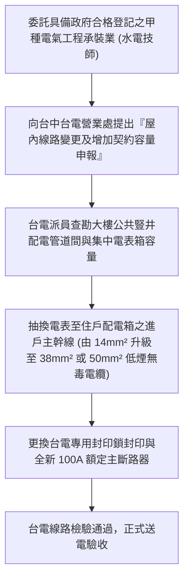
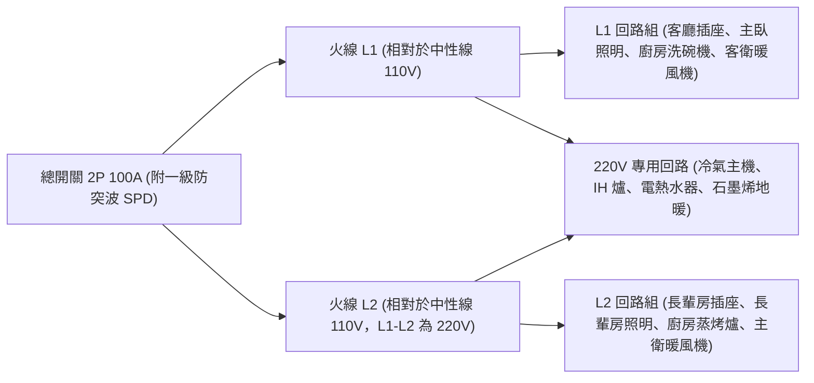

# 全案購屋實戰第一百一十一部：老屋配電箱全回路負載平衡計算與防跳電擴容規劃全書

## 一、 核心戰略定位與目標
在購買台中南區 20~28 年之中古電梯大樓（如大安紫金城 13 樓、長億南園 8 樓、歌德堡、靜園 A 區）時，原始建商配置的入戶總用電容量普遍僅為 **單相三線（110V/220V）50A ~ 60A**，配電箱回路數量通常僅有 8~12 回路。

在現代高功率家庭電器普及的今日，室內翻新往往會大量增設：
1. **廚房高功率電器**：IH 電磁爐（220V / 3000W~3500W）、嵌入式高溫蒸烤箱（220V / 2800W）、洗碗機（110V / 1400W）、瞬熱式飲水機（110V / 1500W）；
2. **長輩衛浴與微氣候空調**：四合一暖風乾燥機（110V/220V / 1400W~2200W）、儲熱/瞬熱式電熱水器（220V / 4000W~6000W）、第 85 部之乾式石墨烯地暖（220V / 2000W）；
3. **多聯變頻冷暖空調**：客廳一對一 7.1kW + 房間一對三多聯機組（總功率約 4000W~5000W）。

若未在全室水電翻新時重新計算負載平衡並向台電申請入戶擴容，極易造成**夏季冷氣與烤箱同時啟動時總開關瞬間過載跳脫（黑畫面跳電）、三線負載不平衡導致中性線（N 線）過載發熱燒熔、配電箱內部銅排溫升過高引發電氣火災**。

本手冊嚴格依據經濟部《用戶用電設備裝置規則》（最新電工法規），制定配電箱回路負載平衡精算法、台電入戶線擴容申請工序、雙層匯流排（Busbar）配電箱規劃與溫升驗收標準。

---

## 二、 全戶用電負載需量計算與容量規劃公式

依電工法規規定，總用電容量不得單純將所有電器瓦數盲目相加，而必須導入「參差率（需量因數, Demand Factor）」進行精確計算：

### 1. 負載分類與設備額定容量核算表

| 負載類別 | 包含設備項目 | 電壓 (V) | 額定功率 (W) | 需量因數 (DF) | 計算計算需量 (W) |
| :--- | :--- | :---: | :---: | :---: | :---: |
| **一般照明與插座** | 全室 LED 筒燈、吸頂燈、一般電視、電腦、手機充電插座（底層基準） | 110V | 3,000 W | 第一個 3000W 算 100% | 3,000 W |
| **廚房高負載電器** | IH 爐、蒸烤爐、微波爐、洗碗機、氣炸鍋、咖啡機 | 110V/220V | 8,500 W | 超過部分算 35%~50% | 4,250 W |
| **衛浴暖風與熱水** | 兩間衛浴暖風機（各 1400W）+ 熱水器預備回路 | 110V/220V | 4,800 W | 70% | 3,360 W |
| **空調與地暖系統** | 全室變頻冷暖主機（最大運轉負載）+ 石墨烯地暖 | 220V | 6,500 W | 最大單一負載算 100% | 6,500 W |
| **總計算用電需量** | - | - | **22,800 W** | - | **17,110 W** |

### 2. 入戶總開關安培數（Amperes）精算公式
$$\text{計算總電流 } I = \frac{\text{總計算需量 } P}{\text{單相三線電壓 } V} = \frac{17,110 \text{ W}}{220 \text{ V}} \approx \mathbf{77.77 \text{ A}}$$

- **容量結論**：老舊大樓原有的 50A~60A 總開關已達過載臨界點，必須全面向台電申請**入戶線擴容至 75A ~ 100A**！

---

## 三、 向台灣電力公司申請入戶線增設擴容工序

### 1. 進戶主幹線線徑規格標竿
- 原中古大樓進戶線多為 $14 \text{ mm}^2$ 銅絞線（安全載流量約 65A）。
- 擴容至 100A 時，進戶幹線必須強制抽換為 **$38 \text{ mm}^2$ 或 $50 \text{ mm}^2$ CNS 認證交聯聚乙烯（XLPE）絕緣電纜**，嚴禁沿用老舊舊線。

### 2. 社區公共立管與管道間穿線紅線
- 在下斡旋與翻新前，必須請水電師傅至梯間電表箱勘查「水電管道間是否有足夠管徑容納粗電纜抽換」。大安紫金城與長億南園均為標準電梯管道間，抽換動線順暢。

---

## 四、 現代化 24~32 回路匯流排（Busbar）配電箱配置工藝

翻修時必須將老舊雜亂的傳統跳線配電箱拆除，更換為**工業級鍍錫紅銅匯流排模組化配電箱（24~32 Ways）**：

### 1. L1 與 L2 兩相負載絕對平衡原則（Phase Balancing）
- **平衡指標**：在全室電器正常運轉狀態下，測量火線 L1 與火線 L2 之工作電流差額，**不得超過 10%**！
- **避免中性線發熱燒斷**：若負載嚴重失衡（例如所有 110V 電器全接在 L1，L2 幾乎空載），中性線（Neutral Wire）將流經巨大不平衡電流，引發中性線過熱燒熔，甚至造成 110V 插座因中性線斷路浮接瞬間承受 220V 突波電壓，將全室電器瞬間燒毀！

### 2. 獨立專用回路（Dedicated Circuits）劃分紅線
下列高負載設備**絕對嚴禁共用回路**，必須一機一掣（單獨配置 1P/2P 斷路器與專屬線路）：
1. 廚房 IH 電磁爐（2P 30A / $5.5\text{mm}^2$ 線徑）；
2. 廚房嵌入式蒸烤爐（2P 20A / $5.5\text{mm}^2$ 線徑）；
3. 廚房洗碗機（1P 20A / $2.0\text{mm}$ 線徑，附漏電保護）；
4. 兩間衛浴多功能暖風乾燥機（各獨立 1P/2P 20A / $2.0\text{mm}$，附漏電保護）；
5. 全室冷氣室外機（各獨立 2P 20A~30A）；
6. 冰箱專用回路（獨立配置不斷電迴路，外出旅遊關閉全室總電源時，冰箱仍保持常通電供電）。

---

## 五、 配電箱極限負載壓測與紅外線熱成像驗收標準

全室翻修送電後，必須實施 2 小時極限負載模擬壓測：

| 查驗工項 | 測試方法 | 合格標準 | 違規危害 |
| :--- | :--- | :---: | :--- |
| **滿載電流測試** | 開啟全室冷氣、IH 爐、烤箱、熱水器、暖風機運轉 60 分鐘，以鉤錶量測 | 總電流 $\le 80\text{ A}$（總容量 80% 安全範圍內） | 長期滿載易引發無熔絲開關疲乏跳脫 |
| **L1/L2 平衡度** | 鉤錶同時量測 L1 與 L2 電流 | $|I_{L1} - I_{L2}| / I_{\text{avg}} \le \mathbf{10\%}$ | 避免中性線浮接與過載發熱 |
| **中性線電流** | 鉤錶量測中性排總 N 線電流 | 實測電流必須小於單相火線電流之 20% | 杜絕零線發熱氧化火災 |
| **紅外線熱成像檢驗** | 以 FLIR 熱像儀掃描配電箱所有螺絲接點與斷路器本體 | **所有接點溫升 $\le 15^\circ\text{C}$，最高溫不得高於 $45^\circ\text{C}$** | 發現局部紅熱熱點，代表接線螺絲鬆動或虛接，必須立即重新超音波冷壓擰緊 |
| **壓降測試** | 末端插座滿載 15A 運轉時測量電壓 | 終端電壓降 $\le \mathbf{2\%}$（110V 降至不低於 107.8V） | 電壓不足易損壞冷氣變頻壓縮機與電腦電源 |
