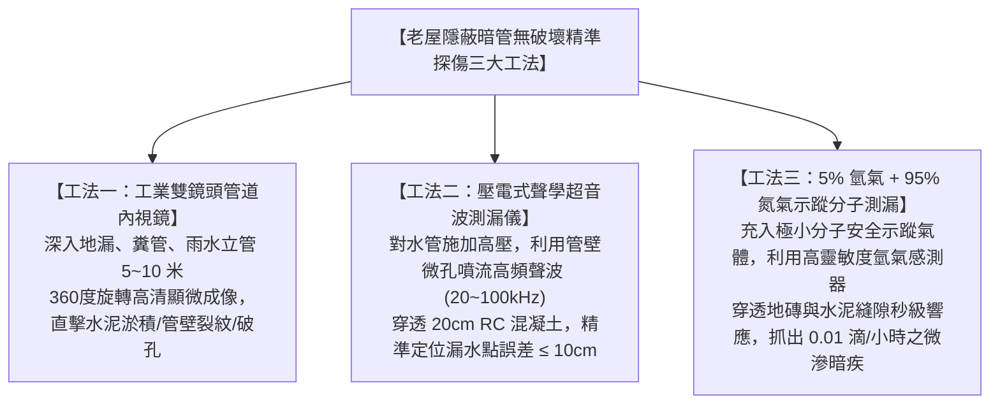
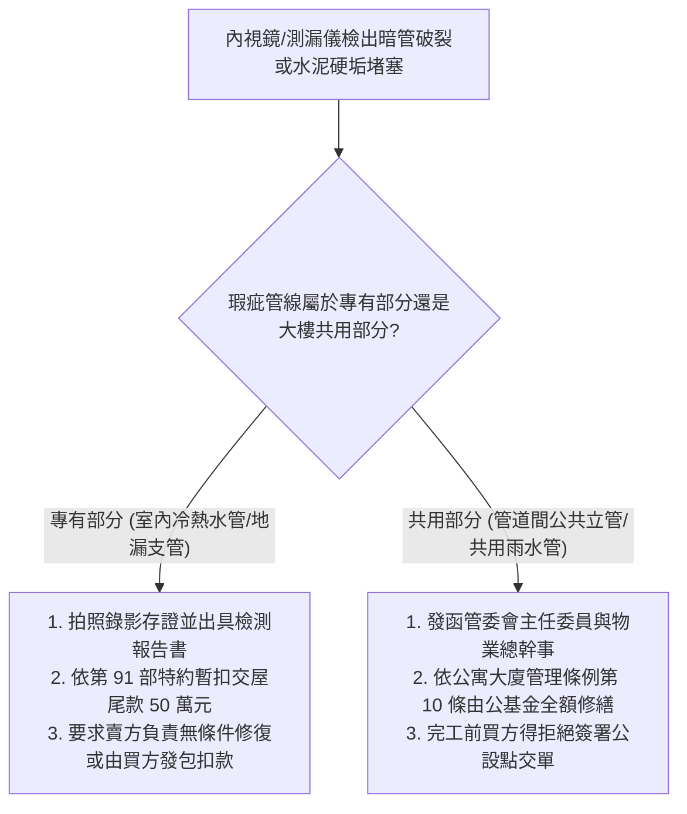

# 全案購屋實戰第一百一十九部：老屋暗管給排水內視鏡探傷與無破壞聲波測漏工序全書

## 一、 核心戰略定位與目標
在購買台中南區中高齡中古大樓（如大安紫金城 13 樓、長億南園 8 樓、歌德堡、靜園 A 區）時，買方最深層的焦慮往往來自於**深埋在 RC 結構樓板、紅磚隔間與管道間內部的隱蔽給排水暗管**。

中古大樓給排水暗管經歷二十餘年的水壓衝擊、地震拉扯與金屬化學腐蝕，常存有：
1. **給水暗管微小砂孔慢滲（微漏水）**：每日滲出微量水滴，未達爆管程度卻使牆體內部長期含水，引發大面積壁癌發霉並滲透至樓下住戶天花板，引發曠日持久的鄰損賠償訴訟；
2. **排污立管與地漏下水管道內部水泥塊淤積**：過去裝修工人惡意將洗刀具的水泥砂漿倒入地漏，在管道轉彎處結塊鈣化，將管徑縮小 50% 以上，隨時引發馬桶倒灌溢流；
3. **排水吊管吊架鬆脫與坡度反翹（逆坡倒灌）**：廢水沉積發酵，產生惡臭沼氣並腐蝕金屬管件。

若在全室裝修敲打完工後才發現暗管漏水，拆除全新磁磚重挖暗管將損失數十萬元！

本手冊制定交屋前/裝修前的「無破壞精準探傷工藝」——**工業級雙鏡頭 360 度管道內視鏡檢查工序**、**聲學壓電超音波測漏儀定位工法**、**氫氮示蹤氣體分子級測漏技術**，以及「管道修復與驗收防禦標準」。

---

## 二、 隱蔽暗管無破壞精準探傷三大核心技術體系

---

## 三、 工業管道內視鏡地毯式巡檢工序（Endoscopic Inspection）

在交屋驗收當天（第 91 部七大系統點驗時），必須將內視鏡伸入全屋每一處排水孔：

### 1. 內視鏡硬體規格標竿
- **鏡頭直徑**：採用 $\le 5.5\text{mm} \sim 8.0\text{mm}$ 超細雙鏡頭探頭（前視 + 側視一鍵切換）；
- **照明與防水**：IP68 級完全防水，配備 6~8 顆高亮度可調 LED 環形輔助光源；
- **探管長度**：配備 5 米至 10 米半硬性玻璃纖維蛇形蛇管（可自主塑形穿越多個 90 度彎頭）；
- **影像紀錄**：支援 1080P 高清拍照與 60fps 影音錄製，自帶米數計數器（精確標記堵塞/破損點距管口公分數）。

### 2. 五大必檢點位與判讀標準
1. **廚房流理台排水支管**：
   - 檢查重點：管壁是否附著厚達數公分之白灰色鈣化「油脂皂化物（Grease Berg）」，轉彎接頭有無開裂；
2. **客衛與主衛淋浴區地漏**：
   - 檢查重點：管內有無沉積裝修磁磚填縫泥、水泥沙漿硬塊；存水彎（P-Trap）水封深度是否達到標準的 **$50 \sim 100\text{mm}$**；
3. **馬桶排污管（糞管）法蘭接口處**：
   - 檢查重點：管口四周混凝土有無發黑滲水痕跡，管內有無異物卡阻或偏心移位管錯位；
4. **陽台洗衣機與冷氣排水立管**：
   - 檢查重點：立管內部有無青苔生長，與大樓共用雨水管交接處有無防蟲逆止閥；
5. **管道間天花板上方公共立管吊管**：
   - 檢查重點：立管膨脹節（伸縮縫）橡膠密封圈有無老化脫出，不鏽鋼抱箍吊架是否緊固無晃動。

---

## 四、 壓電聲學超音波與氫氮示蹤氣體測漏工序

針對給水管（自來水冷熱水暗管）懷疑有微滲漏水時的「免砸牆、精確定位」工藝：

### 1. 壓電式聲學聽漏儀定位工序
- **原理**：當受壓水管（加壓至 $6 \sim 8 \text{ kgf/cm}^2$）存在微小砂孔裂紋時，水流高速噴出與周圍混凝土砂漿摩擦，會產生特徵性高頻微振動與噪聲（聲頻集中於 $200 \text{ Hz} \sim 5000 \text{ Hz}$）。
- **探測工序**：
  1. 關閉全室其他噪聲源，技術人員配戴專業降噪立體聲耳機；
  2. 手持高靈敏度壓電拾音傳感探頭，沿著地磚與牆壁給水管暗埋路徑以 **20 公分間距** 逐點貼地聽測；
  3. 觀察主機頻譜顯示屏上的信號強度峰值與聲波波形，信號最強點即為暗管破裂中心點（**定位誤差 $\le 10\text{cm}$**），避免全面亂砸地磚。

### 2. 5% 氫氣 + 95% 氮氣（Forming Gas）分子級示蹤測漏
- 當暗管滲漏極微小（每小時僅滲幾滴水，超音波噪聲微弱）時，啟動終極分子示蹤技術：
  - **安全性**：使用 5% 氫氣（$\text{H}_2$）與 95% 氮氣（$\text{N}_2$）之不可燃、無毒混合氣體（符合 ISO 10156 國際防爆安全規範）；
  - **超高穿透力**：氫氣是元素週期表上分子直徑最小、質量最輕的分子，擴散速度為空氣的數十倍；
  - **探測反應**：將混合氣注入吹乾的水管內施壓至 $4 \text{ kgf/cm}^2$，氫分子會瞬間自破孔逸出，垂直穿透數十公分厚的水泥混凝土與磁磚微孔隙；地面上的氫氣檢知儀於 **數秒內** 即刻發出蜂鳴警報並鎖定座標！

---

## 五、 暗管瑕疵修復與責任界定法律處置

若在交屋點驗或翻新拆除前探傷檢出管路破裂，立即啟動法律與工程處置程序：

---

## 六、 驗收簽署查核清單（Checklist）

在進行給排水暗管全面體檢時，逐項在工程查驗單上核驗確認：

- [ ] **全室排水管內視鏡錄影存查**：廚衛地漏、糞管無水泥塊、無碎石卡阻，管壁平整通暢（附高清影片檔存入 10TB 外接硬碟）。
- [ ] **存水彎水封有效性**：所有地漏存水彎內部注滿水，水封深度 $\ge 50\text{mm}$，排煙機全速抽風時水封無被吸乾破壞。
- [ ] **冷熱水管靜壓測漏驗收**：水管打壓至 $8 \text{ kgf/cm}^2$ 保壓 2 小時，超音波/壓力計監測零壓降、無漏水噴流噪聲。
- [ ] **糞管排污通暢度實測**：馬桶管道一次性投入 10 張專用衛生紙與模擬試塊，連續沖水 3 次，秒級順暢排空無反湧。
