# 全案購屋實戰第一百一十二部：智慧全宅防火防漏防氣爆安防聯動系統規劃全書

## 一、 核心戰略定位與目標
在購買台中南區中高齡中古大樓（如大安紫金城 13 樓、長億南園 8 樓、歌德堡、靜園 A 區）全案翻新時，最令人擔憂的致命居家意外為：
1. **天然瓦斯洩漏或一氧化碳中毒引發氣爆死傷**；
2. **給水暗管或淨水器/洗碗機高壓軟管脫落引發「全室水浸泡水」，甚至滲漏至樓下住戶面臨數十萬元巨額鄰損求償**；
3. **廚房油鍋起火或老舊電器微放電引發不可挽回之火災**。

傳統中古屋僅依賴電池式獨立煙霧偵測器，一旦長輩重聽、熟睡或外出無人時，警報響徹屋內卻無法阻止災害擴大。

本手冊融合現代物聯網（IoT）與機械自動切斷硬體技術，制定「三級主動防禦智慧安防架構」——**秒級瓦斯機械臂切斷閥、全戶水浸感應電動球閥聯動、全區光電感煙感溫聯鎖警報與緊急告警推播系統**。

---

## 二、 智慧全宅安防三維主動防禦架構

```mermaid
flowchart TD
    subgraph S1 ["【防禦一：瓦斯與一氧化碳防爆系統】"]
        A1["欣中天然氣表後管網 / 瓦斯爐台上方"] --> A2["催化燃燒式瓦斯偵測器 + 電化學 CO 感測器"]
        A2 -- "濃度達 5% LEL 或 CO > 50ppm" --> A3["1. 瓦斯管道電磁閥/機械臂 1 秒強制斷氣<br>2. 廚房防爆排風扇全速負壓排風<br>3. 撥打屋主與物業電話警報"]
    end
    
    subgraph S2 ["【防禦二：全戶給水防漏水浸自閉系統】"]
        B1["廚房水槽底、浴室地暖、軟水機旁、洗碗機旁"] --> B2["金屬雙探針水浸感測器 (Zigbee/Thread)"]
        B2 -- "探針接觸積水深度 ≥ 0.5mm" --> B3["1. 自來水入戶總管電動不鏽鋼球閥 3 秒自動關閉<br>2. 全室給水瞬間斷水，終止積水擴散<br>3. 手機推播『某分區水浸警報』"]
    end
    
    subgraph S3 ["【防禦三：全區智慧火災早期預警系統】"]
        C1["客廳、玄關、走廊、長輩房天花板"] --> C2["光電感煙火災偵測器 (多室互聯聯鎖)"]
        C2 -- "偵測到微弱煙霧粒子" --> C3["1. 全室所有探測器同步發出 85dB 高音警報<br>2. 自動解鎖大門電子門鎖與長輩房滑門<br>3. 第 88 部 DC 12V 應急地腳燈全開導引逃生"]
    end
```

---

## 三、 天然瓦斯防爆主動切斷工序（Gas Safety）

### 1. 偵測器點位安裝黃金原則
- **天然氣（甲烷 $\text{CH}_4$）特性**：比空氣輕，洩漏後會向上飄升聚積於天花板。
  - **安裝位置**：瓦斯表或瓦斯爐半徑 **1.5 米以內之天花板下方 30 公分以內** 牆面上，嚴禁安裝於正上方（防油煙直吹誤報）。
- **一氧化碳（CO）偵測器**：瓦斯熱水器或燃氣設備半徑 **1.5 ~ 3 米處，離地高度 1.5 米**（人體呼吸帶高度）。

### 2. 瓦斯專用機械手夾爪自動閥（Manipulator Valve）
- **非破管安全安裝**：直接卡扣安裝於欣中天然氣原本的黃銅手動球閥手柄上，無需切斷既有瓦斯管道，不破壞瓦斯公司鉛封。
- **瞬時切斷與斷電自保**：
  - 當感測器觸發警報，輸出 12V 脈衝信號，機械手於 **$\le 1.5 \text{ 秒}$** 內強力旋轉 90 度，將瓦斯閥門徹底鎖死切斷！
  - 具備手動離合器拉環，若遇突發停電，長輩亦可拉起離合器進行手動開關，兼顧自動化與機械冗餘安全。

---

## 四、 全戶進水電動球閥與分區水浸感應工藝（Flood Prevention）

中古大樓水管破裂多發生於暗管接頭老化或廚衛角閥橡膠墊片脆化：

### 1. 入戶總管大通量不鏽鋼電動球閥（Motorized Ball Valve）
- **安裝位置**：後陽台自來水總表之後、第 109 部軟水淨水系統之前端。
- **規格選型**：
  - **SUS304/SUS316 不鏽鋼全通徑球閥（Full Bore）**，管徑與主幹管一致（6分/1吋），確保水流通過阻力為零、壓降為零；
  - 驅動電機採用金屬齒輪箱，防水等級達到 **IP67 戶外防浸水級別**，具備斷電自動復位或手動旋鈕功能。

### 2. 多點高靈敏水浸感測節點部署清單
於全戶最易發生漏水之五大隱蔽死角部署感應探針：
1. 廚房流理台水槽櫃內部底板（監控角閥與排水軟管）；
2. 洗碗機底部後方地面；
3. 後陽台軟水機、洗衣機龍頭下方地面；
4. 兩間衛浴面盆浴櫃下方及馬桶水箱後方；
5. 全室冷氣室內機排水盤正下方（防冷氣排水管阻塞溢流泡壞天花板）。

---

## 五、 火災早期光電感煙與大門電子鎖逃生聯動工序

依建築技術規則，集合住宅各居室必須配置住宅用火災警報器（住警器）：

### 1. 全室互聯聯鎖（Interconnected Alarm）
- 採用符合 CNS 14569 認證之光電式無線互聯住警器。
- **作戰邏輯**：一旦廚房或客廳偵測到火災微煙，**全室所有房間（含長輩房、主臥、走廊）之警報器在 2 秒內 100% 同步響起**（發出 85 分貝以上「火災！火災！發生火災，請迅速逃生」語音廣播），徹底解決長輩關門吹冷氣睡覺聽不到客廳火警之致命死角。

### 2. 智慧安全逃生自動解鎖機制
- **防火逃生特約聯動**：
  - 當火警確認持續超過 10 秒，智能主機立即向玄關電子防盜門鎖發送「緊急乾接點解除信號」，**自動彈開天地鎖舌與機械防盜栓**；
  - 防止室內煙霧瀰漫時，長輩慌亂中找不到大門鑰匙或忘記電子密碼而被困火場；
  - 同時啟動長輩房與衛浴懸吊橫拉門全開，並點亮全戶 DC 12V 柔光逃生地腳燈，導引視線穿透濃煙。

---

## 六、 驗收測試與極限模擬觸發查核表

翻修完工交屋前，必須攜帶專用測試氣體實施全面實體觸發驗收：

| 驗收項目 | 模擬測試方法 | 合格標準 | 判定結果 |
| :--- | :--- | :--- | :---: |
| **瓦斯洩漏切斷** | 以丁烷氣體測試劑噴向瓦斯偵測器探頭 | **$\le 2 \text{ 秒}$ 內瓦斯閥門完全旋轉關閉**，抽風機啟動 | 100% 合格 |
| **一氧化碳警報** | 出示 CO 檢驗合格氣體噴入 | 儀表數值達 50ppm 即刻發出高音警報並推播通知 | 100% 合格 |
| **水浸自閉斷水** | 將濕紙巾覆蓋於廚房流理台底板水浸探針 | **$\le 3 \text{ 秒}$ 內入戶電動閥完全關閉**，水龍頭出水瞬斷 | 100% 合格 |
| **火災全室互聯** | 使用專業發煙測試劑噴向客廳煙霧探測器 | **全室所有居室警報器於 2 秒內同步高音鳴叫** | 100% 合格 |
| **大門自動解鎖** | 觸發火警警報持續 10 秒 | **大門智慧鎖自動彈開解鎖**，地腳逃生燈全亮 | 100% 合格 |
| **斷電離線自保** | 拔除外部寬頻數據機與 Wi-Fi 分享器電源 | 上述所有聯動全部於 **本地局域網（Local Mesh）100% 正常反應** | 100% 合格 |
