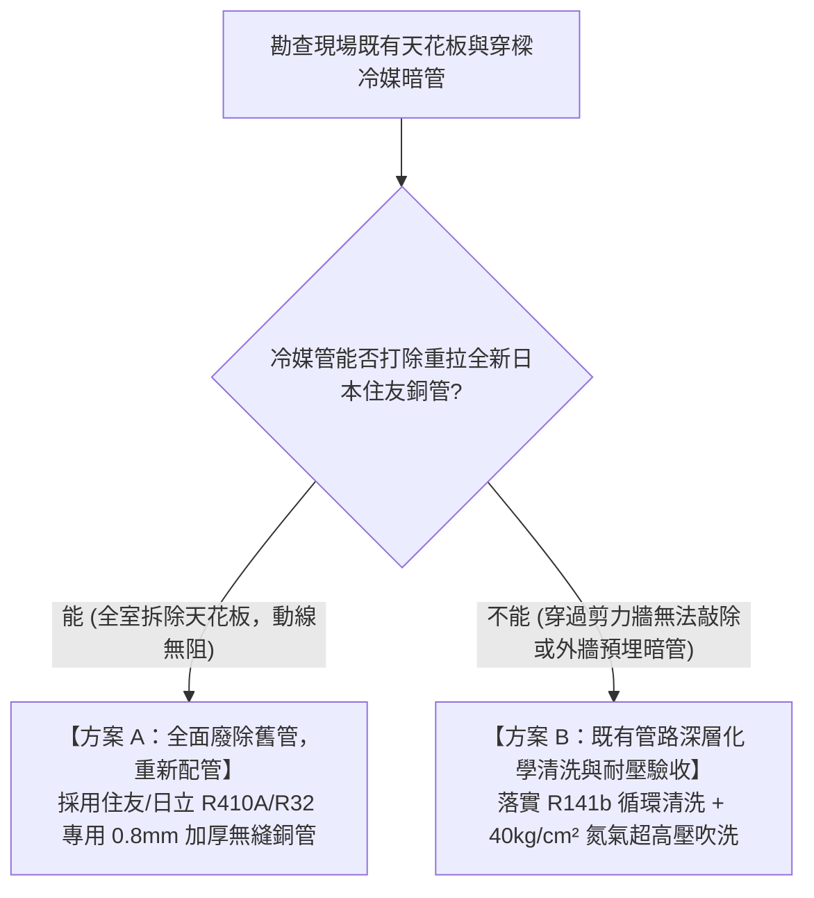
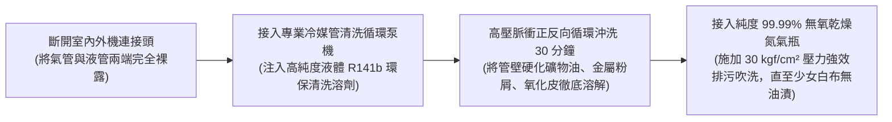
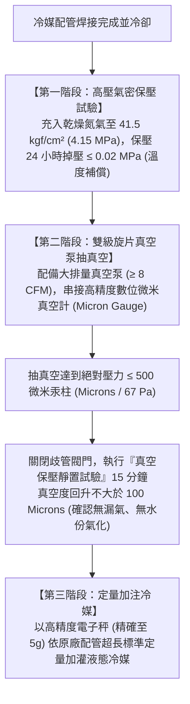

# 全案購屋實戰第一百一十八部：全案冷媒管路深層清洗與變頻多聯空調真空保壓工序全書

## 一、 核心戰略定位與目標
在購買台中南區中高齡中古大樓（如大安紫金城 13 樓、長億南園 8 樓、歌德堡、靜園 A 區）全室翻新時，冷氣空調工程（變頻冷暖一對多或多聯機 VRV/VRF）通常佔據總裝修預算的 **20~35 萬元**。

中古大樓翻新在空調工程上常面臨兩大毀滅性隱患：
1. **沿用既有老舊建商暗埋冷媒管路未經清洗**：舊冷媒管內殘留 R22 礦物冷凍油（Mineral Oil），若直接接入全新 R32 / R410A 環保冷媒機組（使用合成 POE / PVE 酯類油），兩種油質接觸會產生化學酸化反應、生成大量膠狀黏泥，在運轉幾週至數月內**徹底燒毀變頻壓縮機**（原廠判定人為混油直接拒絕保固！）；
2. **安裝師傅偷工減料「未依標準抽真空」**：抽真空未達極限負壓即草率通瓦斯，管內殘存微量水分與不凝性氣體，在低溫膨脹閥處結冰堵塞（冰堵），使壓縮機排氣溫度飆升、能耗暴增 30% 且壽命縮減一半。

本手冊嚴格遵循日本大金（Daikin）與日立（Hitachi）變頻空調安裝工程規範，制定「老舊暗埋冷媒管專用 R141b 化學深層清洗工藝」、「無氧乾燥氮氣（OFDN）焊接保護」、「極限真空度（≤ 500 Microns）雙指針保壓標準」與「冷媒精準定量電子秤加灌工序」。

---

## 二、 舊管沿用 vs. 全新重拉決策樹與管徑壁厚規範

### 1. R32 / R410A 高壓冷媒銅管壁厚紅線（Wall Thickness）
- R32 與 R410A 之最高工作壓力高達 **$4.15 \text{ MPa} \; (42.3 \text{ kgf/cm}^2)$**，為傳統 R22 系統的 1.6 倍！
- 銅管必須強制選用符合 CNS 5127 或 JIS H3300 規定之加厚被覆銅管：
  - **2分管（外徑 6.35mm）**：銅壁厚度必須 **$\ge 0.80\text{mm}$**；
  - **3分管（外徑 9.52mm）**：銅壁厚度必須 **$\ge 0.80\text{mm}$**；
  - **4分管（外徑 12.70mm）**：銅壁厚度必須 **$\ge 0.80\text{mm}$**；
  - **5分管（外徑 15.88mm）**：銅壁厚度必須 **$\ge 1.00\text{mm}$**。
- 嚴禁使用壁厚僅 0.5~0.6mm 之老舊 R22 薄銅管（極易在高壓運轉下發生爆管漏氣！）。

---

## 三、 老舊冷媒銅管 R141b 液相脈衝化學深層清洗工序

若因大樓外觀或樑柱結構限制必須利舊暗管，必須在進場安裝新機前實施專業管路清洗：

### 1. 溶劑選型與溶解性能
- 使用專用 **三氯三氟乙烷替代溶劑（R-141b）**，其對礦物冷凍油具備強效互溶溶解力，且不腐蝕銅管內壁。
- 嚴禁使用揮發性易燃之汽油、去漬油或酒精（極易在吹氮氣時發生管內燃爆！）。

### 2. 氮氣排污吹洗驗收判定
- 將高壓乾燥氮氣減壓閥調至 **$3.0 \text{ MPa} \; (30 \text{ kgf/cm}^2)$**，向清洗管內實施脈衝吹洗。
- 在出氣管口放置一塊乾淨純白棉布或白濾紙，連續吹洗 10 秒；
- **合格標準**：棉布上**無任何淡黃色油斑、無黑色金屬雜質微粒**，管內乾燥無殘液氣味，方可通過驗收。

---

## 四、 銅管焊接「氮氣置換充氮焊接」不可退讓鐵律

空調施工中最普遍的致命違規：師傅直接用氧乙炔火雞對著銅管燒焊（無氮氣保護）：
- **無氮焊接之惡果**：高溫加熱時，銅管內壁與空氣中的氧氣瞬間劇烈氧化，在管內生成大量黑色脆硬的「氧化銅（CuO）黑皮」；
- 機器運轉時黑皮脫落，隨冷媒高速沖刷，直接卡死電子膨脹閥濾網，磨損變頻壓縮機渦旋盤。

> **【無氧焊接唯一標準施工法】**
> 焊接全程，必須向銅管內部持續通入微壓 **99.999% 高純度乾燥氮氣（微流量：$0.02 \sim 0.05 \text{ MPa}$）**，維持管內無氧環境！
> 焊後冷卻拆開檢視，銅管內壁必須保持原廠金黃色金屬光澤，**氧化皮生成率為 0%**！

---

## 五、 超極限真空度（≤ 500 Microns）與雙表保壓工藝

抽真空是決定變頻空調壽命與能效的最核心工序：

### 1. 拒絕傳統指針式複合壓力表蒙混
- 傳統機械指針表在接近負壓時（$-0.1 \text{ MPa}$）刻度極粗，無法分辨管內是 5000 微米還是 500 微米（水分沸騰氣化壓力在常溫下約為 2000 微米）。
- 必須強制使用 **數位電子微米真空計（Digital Vacuum Micron Gauge）**，讀數實測低於 **$500 \text{ Microns}$**。

### 2. 真空保壓防漏判定
- 抽至 500 微米後關機靜置 15 分鐘：
  - 若數值迅速爬升回大氣壓：代表**管路存有肉眼不可見之砂孔或擴口接頭微漏**；
  - 若數值爬升至 1500~2000 微米後停滯不變：代表**管路未漏氣，但管內深處存有未抽乾的液態水分正在緩慢蒸發**，必須重新開機加抽 30 分鐘！

---

## 六、 驗收簽署查核清單（Checklist）

翻修現場空調工程驗收時，由屋主會同監工逐項在現場工程紀錄單上簽字：

- [ ] **銅管規格核對**：現場游標卡尺抽檢銅管壁厚，2分/3分管 $\ge 0.8\text{mm}$，日立/住友原廠標記清晰。
- [ ] **焊接充氮確認**：現場目視焊接施工時氮氣瓶減壓表有出氣聲音，焊後抽檢接頭內壁光亮無黑渣。
- [ ] **高壓氮氣保壓表**：充氮至 $4.15 \text{ MPa}$，拍照記錄初始壓力與環境溫度，24 小時後覆核零掉壓。
- [ ] **數位真空度實測**：數位真空計讀數 $\le \mathbf{500 \text{ Microns}}$，靜置 15 分鐘回升 $\le 100 \text{ Microns}$。
- [ ] **排水管滿水倒水測試**：每台室內機排水槽現場注入 1000ml 自來水，觀察後陽台排水立管秒級順暢排空，防沼氣存水彎無堵塞無溢水。
