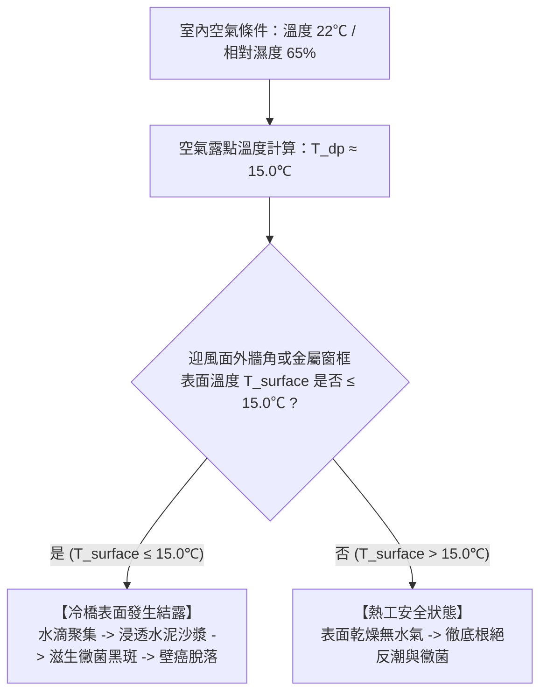
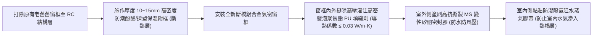

# 全案購屋實戰第一百一十六部：老屋窗邊與外牆冷橋阻斷與抗反潮防結露工序全書

## 一、 核心戰略定位與目標
在購買台中南區 20~28 年之中古電梯大樓（如大安紫金城 13 樓、長億南園 8 樓、歌德堡、靜園 A 區）全室翻新時，許多屋主在更換了頂級氣密窗與全新油漆後，卻在入冬或梅雨季遭遇令人生厭的現象：
1. **窗框四周牆角發霉發黑、甚至油漆起泡剝落**；
2. **冬天室內開暖氣時，大面積玻璃與金屬窗框「淚流滿面」（嚴重結露凝水），積水順著窗台漫流浸泡窗簾與木地板**；
3. **長輩房迎風面外牆背後摸起來冰冷潮濕，衣櫃背板長出厚厚一層青黴**。

絕大多數工班會敷衍解釋為「大樓通風不好」或「老房子自然反潮」，但建築物理學與熱工學證實，其根本癥結在於——**嚴重的「熱橋 / 冷橋效應（Thermal Bridge）」與「室內空氣露點溫度（Dew Point）控制失敗」**。

本手冊融合德國被動房（Passivhaus）外圍護結構保溫工藝，制定「鋁窗附框冷橋切斷工序」、「外牆內保溫阻濕複合構造」、「露點溫度計算控制模型」與「防結露驗收檢測標準」。

---

## 二、 建築物理熱工學：露點溫度與冷橋結露原理

結露的本質是：**當室內特定相對濕度下的濕熱空氣，接觸到溫度低於其「露點溫度（$T_{dp}$）」的固體表面時，空氣中的水蒸氣即刻在冷表面凝結成液態水滴**。

### 1. 中古大樓四大致命冷橋點位
- **冷橋點一：鋁合金窗框周邊與 RC 結構接觸面**（金屬導熱係數為混凝土的 100 倍以上，室外嚴寒直接穿透鋁框凍透內側水泥牆角）；
- **冷橋點二：迎風面 RC 剪力牆與樑柱陰角**（幾何熱橋，散熱面積大於吸熱面積）；
- **冷橋點三：外凸景觀窗台底部混凝土懸挑板**；
- **冷橋點四：冷氣銅管穿牆套管周圍空隙未密封**。

---

## 三、 窗框斷熱阻斷冷橋施工工序（Thermal Break Installation）

針對大安紫金城 13 樓或長億南園 8 樓進行鋁窗翻新時，必須徹底摒棄「金屬框直接貼死紅磚/RC 牆」的傳統落後工法：

### 1. 斷橋附框隔熱墊片工藝
- 在鋁窗安裝固定膨脹螺栓時，膨脹螺絲與鋁框之間必須加裝 **特戊樹脂/尼龍斷熱套管與絕緣墊片**，切斷金屬螺絲將冷量傳導至室內牆面的熱通道。
- 窗框周邊預留 **$15 \sim 20\text{mm}$ 填縫間隙**，全面高壓注入發泡聚氨酯（PU 泡沫），發泡閉孔率必須 $\ge 85\%$，確保無空洞虛接。

### 2. 德系「內外雙面氣密隔氣膠帶」工法
- **室外側**：黏貼「單向透氣防水透汽膜（Vapor Permeable Membrane）」，室外雨水進不來，但牆體內部濕氣能向外蒸發排出；
- **室內側**：黏貼「高阻隔氣密防潮膠帶（Vapor Barrier Tape）」，徹底封死室內生活產生的洗澡做飯高濕度水氣進入窗框填縫深處，杜絕暗處發霉。

---

## 四、 迎風面外牆「內保溫阻潮夾層」工藝

針對大安紫金城 13 樓（朝北/朝東迎風面）或長億南園長輩臥室靠外牆面，實施輕質內保溫阻斷工法：

### 1. 斷熱防潮四層複合構造
1. **基層處理**：外牆室內面全面刮除舊漆，塗刷兩道滲透型矽酸質防潮結晶抗鹼底漆；
2. **保溫芯材**：使用環保無毒、阻燃 B1 級之 **20mm 高密度擠塑聚苯乙烯保溫板（XPS）** 或 **真空絕熱板（VIP, Vacuum Insulation Panel）**，以專用聚合物保溫砂漿點框滿貼；
3. **反射阻氣層**：覆蓋一層 **0.1mm 純鋁箔耐撕裂防潮反射膜**，將室內熱輻射反射回屋內，並徹底隔絕水氣；
4. **面層封板**：以 9mm 日本麗仕防焰一級矽酸鈣板雙層錯縫封板，批土打磨後噴塗得利抗甲醛竹炭乳膠漆。

- **熱工效能提升**：外牆傳熱係數（U 值）由原本的 $2.8 \text{ W/m}^2\cdot\text{K}$ 驟降至 **$0.45 \text{ W/m}^2\cdot\text{K}$ 以下**，冬天天氣再冷，牆面溫度永遠保持在 **$19^\circ\text{C}$ 以上**，完全高於露點溫度，終身杜絕牆角反潮與黴菌！

---

## 五、 冬季室內微氣候：全熱新風除濕與露點智能聯動

預防反潮除了物理斷熱，更必須動態調節室內絕對含水量：

1. **第 70 部全熱交換新風智能聯動**：
   - 當室內溫濕度感測器偵測到相對濕度超過 **$60\%$** 時，全熱新風系統自動啟動中速排風換氣，將烹飪與沐浴產生的多餘濕氣迅速排向戶外；
2. **石墨烯地暖（第 85 部）低溫烘牆效應**：
   - 寒冬時地暖維持在 20~22℃ 運行，遠紅外線輻射波使地面與迎風外牆內側同步受熱，牆面溫度遠遠脫離露點凝結危險區。

---

## 六、 驗收測試與熱成像冷橋檢驗標準

工程完工後，在冬季室內外溫差達 $10^\circ\text{C}$ 以上時實施紅外線熱成像驗收：

| 檢驗點位 | 檢驗方法 | 合格標準 | 判定意義 |
| :--- | :--- | :---: | :--- |
| **窗框四周水泥收邊** | FLIR 熱成像儀掃描內側陰角溫度 | **表面溫度與室內氣溫溫差 $\le 3^\circ\text{C}$** | 斷熱層完整，無冷橋外洩 |
| **玻璃表面結露測試** | 開啟室內加濕器至濕度 65%、暖氣 22℃ 連續 4 小時 | **玻璃下緣與窗框鋁料零水珠凝結** | 膠合 Low-E 與斷橋型材隔熱合規 |
| **迎風外牆整面掃描** | 熱成像色溫對比 | 整面牆體色溫均勻，無局部深藍色低溫冷點 | XPS 內保溫層連續無斷點 |
| **氣密隔氣膠帶黏著** | 現場拉拔探查 | 膠帶與水泥基層黏著牢固，無起泡脫膠漏風 | 水氣隔絕率 100% |
