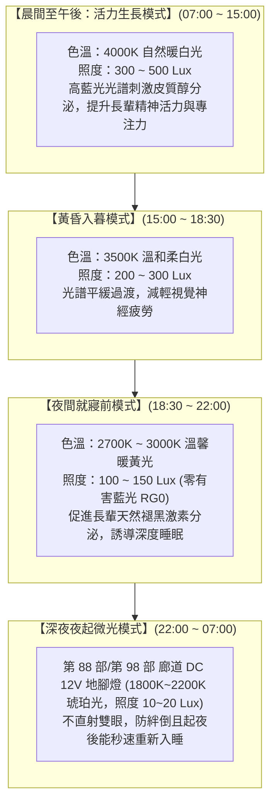

# 全案購屋實戰第一百一十四部：全室照明健康光學設計與防眩光節律照明全書

## 一、 核心戰略定位與目標
在購買台中南區中高齡中古大樓（如大安紫金城 13 樓、長億南園 8 樓、歌德堡、靜園 A 區）全室拆除翻修時，絕大多數屋主最容易忽略的隱形健康殺手為**燈光照明的品質缺陷**。

傳統裝修常陷入兩大極端誤區：
1. **老式「一室一燈」高色溫白光（6000K~6500K）暴曬**：夜間藍光過量抑制長輩體內褪黑激素（Melatonin）分泌，引發長期嚴重失眠、偏頭痛與內分泌失調；
2. **網紅「滿天星無主燈」盲目開孔與劣質低價 LED 驅動器**：產生肉眼不易察覺但大腦神經極度疲勞的「高頻頻閃（Flicker）」、極高刺眼的「直接眩光（Glare, UGR > 25）」，嚴重損害長輩退化性黃斑部與白內障視力。

醫學與人因工程學證實，老年人的視網膜照度僅為青壯年人的三分之一至五分之一，對眩光的敏感度卻高出數倍。

本手冊嚴格遵循國際照明委員會（CIE）與 WELL 健康建築標準，制定「長輩友善節律光學架構」、「防眩光深杯筒燈選型（UGR < 16）」、「高顯色指數（Ra ≥ 97 / R9 ≥ 90）」與「分區照度計算工序」。

---

## 二、 長輩視覺生理特性與健康人因節律照明體系

---

## 三、 防眩光與顯色指數四大硬體選型指標

在水電採購燈具與估價單審查時，必須強制指定以下四大物理光學指標，嚴禁使用未標註參數之雜牌 LED：

### 1. 統一眩光值（Unified Glare Rating, UGR）
- **合格基準**：辦公室標準通常為 UGR < 19，**本手冊長輩房與客廳必須達到 $\mathbf{UGR \le 13 \sim 16}$（極致防眩，見光不見燈）**。
- **硬體構造**：選用「深藏防眩杯（光源內縮深度 $\ge 35\text{mm}$）」搭配「黑光/啞光黑微晶蜂窩防眩網格」或「二次光學 TIR 透鏡」，遮光角（Cut-off Angle）必須 **$\ge 45^\circ$**。

### 2. 顯色性指標：Ra $\ge 97$ 與飽和紅 R9 $\ge 90$
- 一般廉價 LED 僅標註 $Ra \ge 80$，光譜中極度缺乏紅色波段（R9 常為負數或小於 20），導致長輩面色慘白、菜餚暗沉食慾不振，甚至影響對藥品藥丸顏色的辨識。
- 本工法強制選用 **全光譜 LED 晶片（Full Spectrum, SunLike / Bridgelux Thrive 技術）**：
  - 一般顯色指數 **$Ra \ge 97$**；
  - 特殊顯色指數 **$R9 \ge 90$（高飽和紅色真實還原）**；
  - 逼真還原日光連續光譜，保護長輩眼睛色彩辨識力。

### 3. 波動深度與頻閃安全性：IEEE 1789 無危害標準
- 採用 **無頻閃雙級帶 PFC 恆流隔離驅動電源（Flicker-Free Driver）**。
- 漣波率（Ripple Ratio）$< 1\%$，符合 IEEE 1789 規範之「高頻無危害（No Effect）綠色區域」，即使開啟手機 240fps 慢動作錄影，螢幕亦完全零滾動條紋。

### 4. 藍光危害防護等級：RG0（豁免級）
- 通過 IEC 62471 國際光生物安全認證，達到 **RG0 豁免級（無藍光危害）**，徹底消除視網膜光化學損傷隱患。

---

## 四、 全室各功能空間精準照度與配光設計

依據 CNS 12112《室內工作場所照明》標準，針對長輩退化視覺提高照度補償：

| 空間區域 | 照度標準 (Lux) | 色溫推薦 (K) | 配光手法與燈具組合 |
| :--- | :---: | :---: | :--- |
| **客廳交誼區** | $300 \sim 400 \text{ Lux}$ | $3000\text{K} \sim 4000\text{K}$ 雙色溫 | 磁吸軌道泛光條（基礎均勻面光）+ 24° 深防眩聚光燈（局部洗牆/掛畫）+ 漫射反射燈帶 |
| **長輩臥室** | $150 \sim 250 \text{ Lux}$ | $2700\text{K} \sim 3000\text{K}$ | **天花板正上方嚴禁安裝射燈直射床頭**；採天花板邊緣回光槽間接反射照明 + 床頭 30cm 柔光可旋轉閱讀壁燈 |
| **餐廳料理與餐桌** | $400 \sim 500 \text{ Lux}$ | $3000\text{K} \sim 3500\text{K}$ | 餐桌正上方吊燈距桌面 65~70cm（集中聚光，顯色真實刺激食慾）；廚房流理台吊櫃下方預埋 4000K 工作感應燈條 |
| **衛浴洗手台與淋浴** | $300 \sim 500 \text{ Lux}$ | $3500\text{K} \sim 4000\text{K}$ | 鏡前雙側發光無影化妝壁燈（面部無死角陰影，便利刮鬍修容）+ IP65 防水防霧防眩筒燈 |
| **走廊與轉角動線** | $100 \sim 150 \text{ Lux}$ | $2700\text{K} \sim 3000\text{K}$ | 偏光洗牆燈條（拉伸視覺開闊感）+ 離地 20cm 嵌入式感應夜起地腳燈（10 Lux） |

---

## 五、 光學驗收測試與光譜儀檢驗標準（Checklist）

翻修完工交屋前，使用手持式高精度分光輻射照度計（如 Hopoo / Lisun 專業光譜儀）實測全室各點：

- [ ] **照度均勻度測試**：主要活動區域地面與桌面照度均勻度 $U_0 \ge 0.7$，全室無刺眼亮斑與黑洞暗角。
- [ ] **防眩光盲測檢驗**：長輩正常平躺於床上或端坐於沙發上，視線平視與仰角 45 度範圍內，**肉眼看不到任何燈珠裸露或強烈刺眼反光**。
- [ ] **頻閃儀器驗收**：開啟手機專業錄影模式（快門 1/1000 秒以上），對準所有運轉燈具，螢幕零水波紋、零高頻頻閃。
- [ ] **顯色指數實測核對**：現場光譜儀實測 $Ra \ge 97.0$ 且 $R9 \ge 90.0$，數據 100% 達標。
