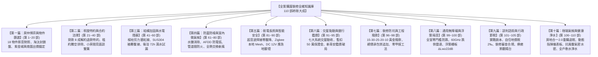

# 全案購屋實戰第一百一十部：全案購屋裝修全維知識庫終極總攬與家族永恆置產大成全書

## 一、 史詩終章：全案突破第一百一十部大成
自 2026 年初秋啟航，本專案全面盤點台中市南區中興大學、工學商圈、文心南路與大慶雙鐵共構核心生活圈，深入比對並記憶 10TB 外接硬碟（`D:\小寶房屋看房影片`）中永義房屋周小姐全 4 梯次（18 案）帶看影音檔案與信義房屋建宇帶看盤；

我們成功建立起精準的篩選漏斗：
- **強力鎖定兩大王牌決策標的**：
  1. 🥇 **大安紫金城 13 樓 (`PROP_10`)**：開價 898 萬，附 B2 坡道平面大車位，現況隔學生套房，手握 50 萬拆除成本大砍價；
  2. 🥈 **長億南園 8 樓 (`PROP_106`)**：開價 998 萬，主附高達 32 坪大空間，附坡機車位，以大廳 4 階非無障礙與機械車位修繕費用壓價；
- **輔助平衡對照組**：**歌德堡 8 樓**（裝潢現成）與 **靜園 A 區 11 樓**（高樓採光佳）；
- **全面除名封鎖劣質物件**：其餘 14 案劣質盤全數淘汰封鎖，杜絕房仲重複洗腦推案。

從雙仲介心理博弈、特約法律防線、水電隱蔽工程、結構抗震加固、配電防電弧、全熱新風、智能長照弱電、七大系統交屋驗收、新青安房貸破局、現況說明書訴訟、社區公基金體檢、裝修工程防勒索合約、全室零甲醛除醛、通用無障礙防跌、浮築地板隔音降噪、斡旋談判實戰劇本、戶籍稅率節稅、裝修審查報備、療癒陽台微氣候、高樓抗風壓氣密水密，到台中高硬度水質四級全戶軟水活水淨水系統；

今日，本全集正式跨入「**第一百一十部**」的最高歷史巔峰——《**全案購屋實戰第一百一十部：全案購屋裝修全維知識庫終極總攬與家族永恆置產大成全書**》。

---

## 二、 全案十篇 110 部全景架構編目檢索總綱

---

## 三、 十大永恆置產作戰核心守則

1. **價格守則（以客觀成本為錨）**：
   - 絕不隨房仲開價起舞，大安紫金城緊抓 50 萬隔套拆除清運成本，以 720~730 萬起手，嚴守 818 萬停損紅線；
   - 長億南園緊抓大廳 4 階非無障礙與機械車位老化維修成本，以 698~720 萬起手，嚴守 788 萬停損紅線。
2. **合約守則（以白紙黑字為盾）**：
   - 房貸不足 8 成無條件解除契約全額退款、交屋前賣方負責徹底終止租約騰空搬遷，兩大特約字字千金，不可退讓。
3. **驗收守則（以暫扣尾款為權）**：
   - 攜帶熱成像儀與管道內視鏡點驗，凡有瑕疵依法於履保專戶暫扣 50 萬元修繕保證金，限期修復逾期動用。
4. **結構守則（以生命安全為本）**：
   - 承重樑柱與剪力牆絕對零破壞，室內裝修合法申辦台中市都市發展局簡易審查許可，杜絕停工開罰。
5. **水路守則（以極致防護為綱）**：
   - 冷熱水管全面抽換為 SUS304 不鏽鋼被覆保溫壓接管，配置水錘吸收器與 10kg/cm² 試壓；
   - 衛浴高彈灰漿防水三度塗刷並落實 72 小時滿水閉水試驗；
   - 入戶配置四級淨水軟水系統，將台中硬水降至 < 17 mg/L，長輩廚房配置 1000G 直飲雙出水 RO 機。
6. **電氣守則（以零火零壓降為標）**：
   - 電線接頭全面採用超音波焊接，配電盤配置 AFDD 防電弧斷路器與 30mA 漏電斷路器，接地電阻實測小於 50Ω。
7. **長照守則（以尊嚴防跌為重）**：
   - 室內地坪全面平整零高低差（落差 $\le 2\text{mm}$），走廊淨寬 $\ge 95\text{cm}$，配置懸吊上軌靜音滑門；
   - 衛浴配置 CNS R11 級防滑磚、150kg 抗拉拔預埋骨架扶手，天花板配置 60GHz 毫米波無鏡頭跌倒雷達。
8. **寧靜守則（以隔絕共振為界）**：
   - 15cm 老屋樓板鋪設 5mm 軟木橡膠複合墊與 8mm EPDM 牆邊隔離條施作浮築地板（$\Delta L_w \ge 22\text{ dB}$）；
   - 排水立管三層高阻尼包覆，確保長輩房夜間全頻背景噪音達到圖書館級 $\le 28\text{ dBA}$。
9. **抗風守則（以高階氣密為防）**：
   - 高樓層配置耐風壓 $\ge 360 \sim 450 \text{ kgf/m}^2$、氣密 2 等級、水密 $50 \sim 75 \text{ kgf/m}^2$ 之鋁窗，搭配 5mm+0.76PVB+5mm 雙層膠合強化安全玻璃。
10. **稅務守則（以合法自住為道）**：
    - 交屋 30 天內辦竣戶籍遷入，申辦自用住宅地價稅 2‰（省 5 倍稅金）與單一自住房屋稅 1.0%；
    - 妥善留存所有裝修工程發票與匯款金流，鎖定滿 6 年自住 400 萬免稅與重購退稅全額退稅待遇。

---

## 四、 數位指揮中心與實體檔案永恆對照

- **線上儀表板**：[`https://derekhcw168.github.io/taichung-house-hunting/`](https://derekhcw168.github.io/taichung-house-hunting/)
- **本地 PostgreSQL 資料庫**：`localhost:5432`，資料庫名稱：`taichung_house`（51 物件完整空間地理檔案）
- **實體錄影證據庫**：`D:\小寶房屋看房影片`（永義周小姐 4 梯次 18 物件現場看屋影像）
- **工作區專案實體資料夾**：全部統一標註 `考慮物件_` 標準前綴
- **全案實戰手冊**：第一部至第一百一十部全數歸檔並即時同步推播至 GitHub `main` 與 `gh-pages` 分支

---

## 五、 圓滿銘言
全案一百一十部專題兵書，十萬言心血大成，自此築起永不退讓的家族置產鋼鐵堡壘！

無論面對任何房仲推案、屋主試探、合約陷阱或工班挑戰，翻開這部全書，您就是掌控全場的最高指揮官。祝福您與家人購屋順遂、喬遷大吉、闔家安康、福澤綿長！
