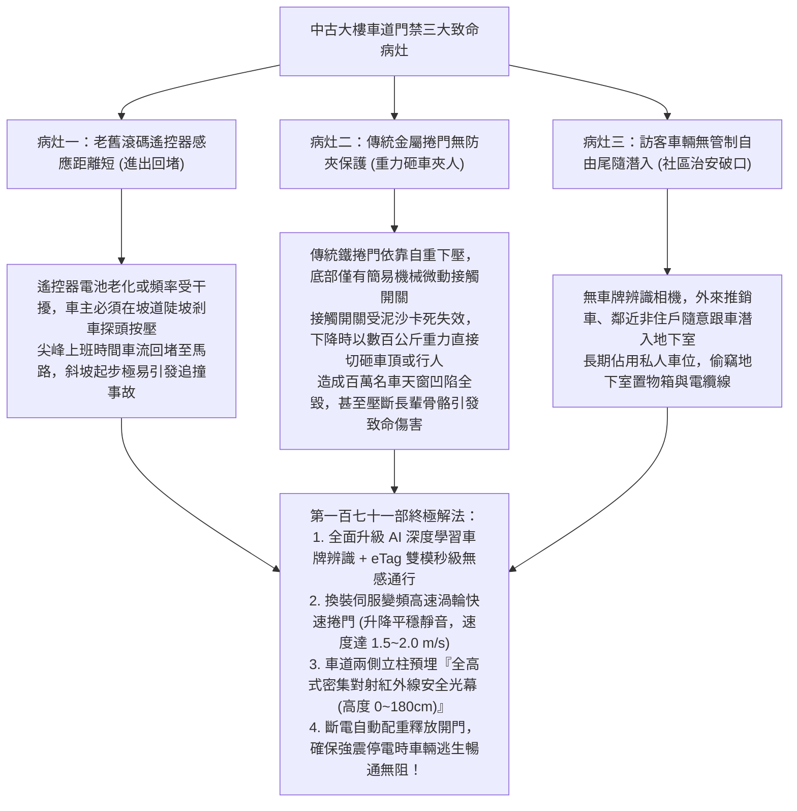
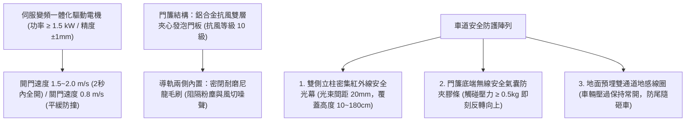
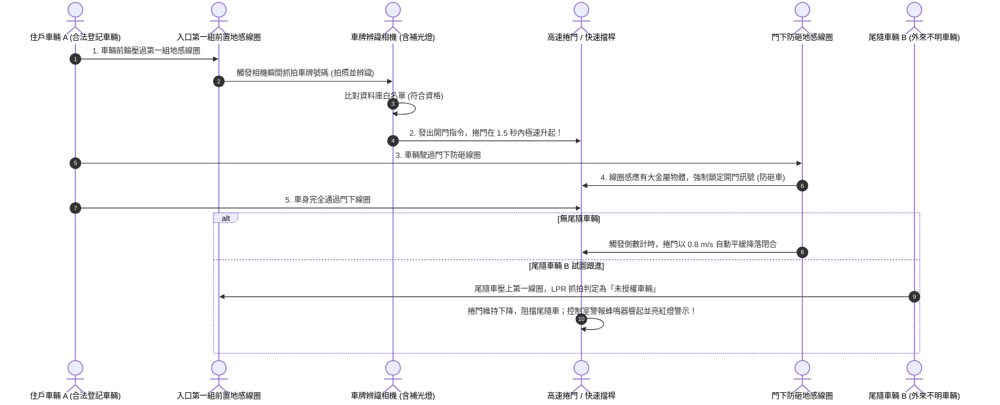
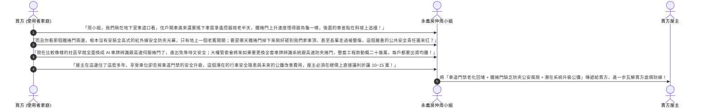

# 全案購屋實戰第一百七十一部：中古大樓地下室車牌辨識eTag門禁系統與防夾快速捲門紅外線安全光幕體檢全書

> **核心宗旨**：在高層電梯住宅集合住宅（如大安紫金城 13 樓、長億南園 8 樓等設有地下室坡道停車場之社區）中，車道出入口之「自動門禁管制與車道快速捲門（High-Speed Roll-up Door）」是全社區車輛進出動線順暢度、防盜防非訪客潛入與長輩乘車進出安全的咽喉關卡。然而，屋齡 20~30 年中古大樓常面臨「早期遙控器按壓頻率衰退或遭人側錄拷貝、車道大排長龍堵塞回堵至馬路幹道」、「傳統金屬捲門下降速度過慢且缺乏多重防夾安全機構，發生重壓砸車或夾傷行人長輩重大公安意外」、「紅外線對射感應器老化失效或受雨水污垢遮蔽導致誤動作」等重大公設通病。本手冊專攻「車牌辨識（LPR）結合遠距離 eTag RFID 雙模感應門禁選型、伺服變頻高速螺旋快速捲門（上升速度 ≥ 1.5 m/s）升級、全高度密集型紅外線安全光幕（Safety Light Curtain）防夾工藝、斷電自動手動雙模解鎖及利用車道門禁老化瑕疵狠砍買賣總價 10~15 萬戰術」，為家庭車輛進出安全與社區智慧門禁構築第一道鋼鐵咽喉防線。

---

## 第一章：老舊大樓車道門禁三大致命痛點與捲門砸車機理

---

## 第二章：車道門禁辨識系統三大主流架構比較

在公設體檢中，必須會同房仲與大樓管委會機電人員勘查車道坡道頂端之門禁感應主機：

| 門禁辨識技術類型 | 辨識速度與通行效率 | 防偽造與安全性 | 天候適應力 (暴雨/反光) | 本案評價與管委會升級建議 |
| :--- | :--- | :--- | :--- | :---: |
| **傳統射頻遙控器 (315/433MHz)** | 慢（需手動按壓，反應時差 2~4 秒） | 極差（頻率易被盜錄拷貝，外流嚴重） | 普通（車內隔熱紙阻擋信號） | ❌ **中古大樓常見，全面淘汰** |
| **遠距離 eTag RFID (超高頻 920MHz)** | 快（車距 3~5 米自動感應讀取） | 高（一車一標籤，撕下即毀無法轉移） | 極佳（不受大雨、大霧、黑夜影響） | ⭐ **通行穩定，適合高出勤率社區** |
| **👑 AI 智能車牌辨識 (LPR) + eTag （雙模冗餘旗艦規格）** | **最快（0.1 秒極速辨識，秒級抬桿/開門）** | **最高（白名單/黑名單雙重比對，防尾隨報警）** | **極佳（雙目星光級寬動態鏡頭，強光抗逆光）** | 👑 **本案唯一指定頂級智慧社區標準** |

---

## 第三章：伺服變頻高速渦輪快速捲門與防夾光幕工藝

傳統金屬捲門升降速度僅 $0.15 \sim 0.2 \text{ m/s}$，開門需耗時長達 15~20 秒。現代智慧大樓全面採用**伺服變頻高速門**：

### 3.1 車道防夾安全系統三大不可妥協之鐵則：
1. **全高度密集型安全光幕（Safety Light Curtain）**：
   - 淘汰傳統僅有一道或兩道紅外線的點狀感應器（車頭穿過後，兩軸之間是盲區，極易砸中車身中央或推嬰兒車的長輩）。
   - 門框兩側必須安裝 **高度達 $1.8 \text{ 公尺}$ 之連續光幕**，內部由 32~64 組紅外線發射與接收管交錯構成密集光網。
   - 只要有任何物體（甚至一根拐杖或寵物繩）阻斷任意一道光線，捲門在 **$0.02 \text{ 秒}$ 內** 立即強制煞車並以全速向上回彈反轉開門！
2. **門底無線安全氣囊（Wireless Safety Edge）**：
   - 門簾底端包裹高彈性空心 EPDM 導電橡膠密封條，內建無線氣壓變化感知器。
   - 即使光幕在極端暴雨中失效，門底一旦觸碰到車頂或長輩肩膀（下壓受力超過 $500\text{g}$），氣壓波傳感器瞬時發送信號，捲門瞬間反彈上升，絕不造成二次擠壓傷害。
3. **停電應急手動釋放機構（Manual Release Mechanism）**：
   - 控制箱內置 $24\text{V}$ 蓄電池不斷電系統（UPS），台電斷電時仍可自動開門放行至少 20 次。
   - 門機側邊必須配有「鋼索拉繩手動離合煞車釋放裝置」，遇火災或電機故障時，人員拉動手柄，捲門依靠頂部平衡扭簧在 3 秒內自動靠自重升至頂端常開。

---

## 第四章：社區車道門禁地感線圈與車輛防尾隨邏輯

---

## 第五章：看屋現場車道門禁排查與殺價戰術

在實地勘查大安紫金城 13 樓或長億南園 8 樓時，買方必須在車道坡道口停留，觀察車輛進出感應靈敏度與捲門升降安全，並將其轉化為**狠砍買賣總價 10~15 萬元的公設門禁瑕疵談判武器**：

---

## 第六章：車道門禁公設健康體檢核對表（現場看屋必備）

| 查核項目 | 標準合格判定條件 | 現場重大異常判定（致命警訊） | 處置戰術 |
| :---: | :--- | :--- | :--- |
| **門禁感應方式** | 具備車牌辨識或 eTag 感應，車輛免停 3 秒內自動開門 | 必須手動遙控器長按、或搖窗刷卡、常態性回堵 | ⚠️ 通行效率極差，列入日常使用抗性殺價 |
| **捲門升降速度** | 伺服變頻高速門，升起時間 $\le 2.5\text{ 秒}$，運轉平順無噪聲 | 傳統鐵捲門升起需耗時 15~20 秒，伴隨巨大鏈條刮擦聲 | ⚠️ 機械老化嚴重，隨時有跳齒卡死風險 |
| **防夾安全機構** | 門框兩側具備全高式紅外線光幕，手伸入瞬間反彈上升 | 僅靠底部接觸開關，手擋無反應，甚至無任何防夾光電 | 🔴 **隨時有砸車傷人致命危險**，列入重大公安瑕疵扣款 |
| **停電手動釋放** | 側邊手動拉繩順暢，拉下後捲門在 3 秒內自動升起 | 無手動拉繩、拉繩卡死或斷裂，斷電時車輛全數受困 | 🔴 屬重大消防逃生阻礙，要求管委會立即檢修換新！ |
