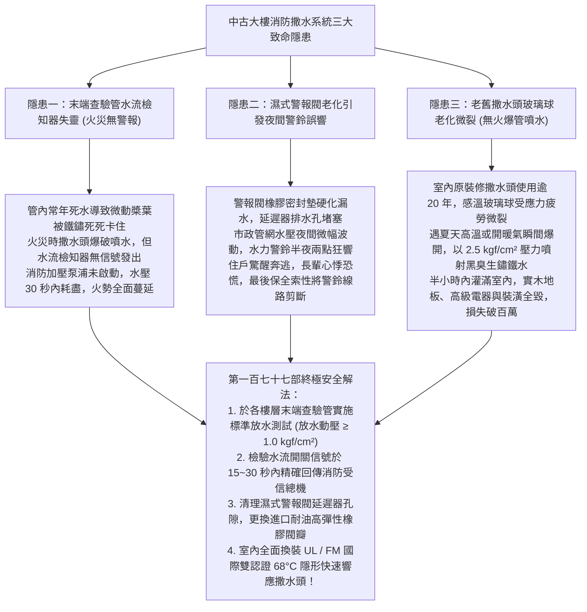
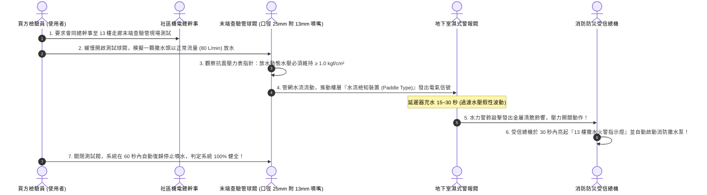
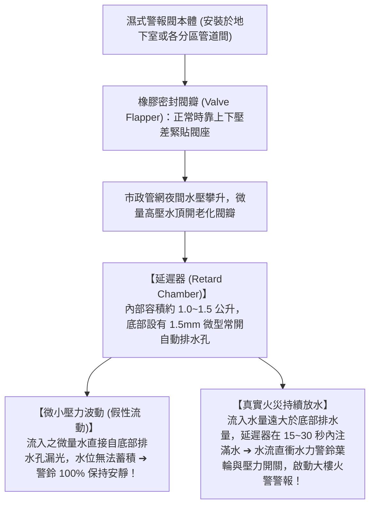
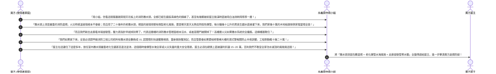

# 全案購屋實戰第一百七十七部：中古大樓社區消防自動撒水系統末端查驗管壓力檢測與濕式警報閥老化防誤響全書

> **核心宗旨**：在高層電梯住宅集合住宅（特別如大安紫金城 13 樓、長億南園 8 樓等依建築技術規則 11 樓以上依法必須全面強制設置自動撒水設備之物件）中，「消防自動撒水系統（Automatic Fire Sprinkler System）」為天花板上全天候 24 小時守護全家睡眠安全的「終極消防天使」，但若維護不當，亦是極易引發「天花板爆管水淹全家百萬裝潢」的滅頂災難。20~30 年中古大樓最常面臨「樓層末端查驗管（Inspector's Test Connection）長年未放水檢驗，管內沉積黑色生鏽鐵泥且水壓不足無法啟動警報閥」、「濕式警報閥（Wet Alarm Valve）內部橡膠閥瓣老化碳化變形，微小壓力波動即引發警報逆止閥誤動作，警鈴三更半夜無故狂響引發全社區恐慌」、「住戶室內裝修擅自拆除或改動撒水頭，採用劣質低熔點易熔合金頭引發熱水澡或夏日高溫假性爆破噴水」等重大公私域安全弊端。本手冊專攻「末端查驗管動態放水壓力與水流檢知裝置（Waterflow Detector）時序檢測、濕式警報閥延遲器（Retard Chamber）防誤響調校、閉式玻璃球型撒水頭（68°C 紅色標稱）選型規格及利用消防撒水系統老化瑕疵狠砍買賣總價 15~20 萬戰術」，為家庭消防安全與昂貴裝潢築起 100% 免疫水患與火災的鋼鐵防線。

---

## 第一章：高樓層自動撒水系統三大致命隱患與管網物理機理

---

## 第二章：室內自動撒水頭法規規格與標稱動作溫度選型

依據《各類場所消防安全設備設置標準》，住宅天花板撒水頭絕不可隨意更動或噴漆塗抹：

| 撒水頭類型與規格 | 標稱動作溫度與色標 | 響應時間指數 (RTI) | 適用場合與安全性評價 |
| :--- | :--- | :--- | :---: |
| **劣質平價易熔合金撒水頭** | 易熔合金銲接片（受熱金屬熔化） | $\text{RTI} > 80\text{ (m}\cdot\text{s)}^{0.5}$（標準響應，反應慢） | 易受潮濕腐蝕氧化，早期老屋常見，**強烈建議汰換**。 |
| **👑 玻璃球型標準型撒水頭 （本案客廳與臥室標準）** | **$68^\circ\text{C}$（液體為紅色）** | $\text{RTI} \le 50\text{ (m}\cdot\text{s)}^{0.5}$（快速響應型，反應極速） | 👑 **住宅最通用標準：達到 68°C 瞬間爆破，平時極其穩定不誤爆。** |
| **高溫區專用撒水頭 （廚房天花板專用）** | **$93^\circ\text{C}$（液體為綠色）** | 快速響應型 | 避免廚房大火爆炒或烤箱熱氣引發假性誤爆噴水。 |
| **👑 天花板齊平隱形型撒水頭 （Concealed Type / 裝潢首選）** | **$68^\circ\text{C}$ 內部玻璃球 + 57°C 外部平整裝飾蓋板** | 快速響應超薄型 | 👑 **頂級美觀：外觀與白色天花板完全平齊一體化，火災時外蓋先脫落，噴頭自動彈出噴水！** |

### 2.1 撒水頭裝修四大絕不可妥協之禁忌：
1. **嚴禁在撒水頭本體上塗刷油漆或壁紙包覆**：
   - 很多木作油漆工班為圖省事，噴天花板乳膠漆時順便把撒水頭噴成白色。
   - **這是極度致命的違規行為**！油漆會形成堅硬隔熱外殼，火災時感溫玻璃球無法及時吸收熱量，動作延遲達數分鐘以上，**一經查獲必須全數報廢換新**！
2. **防碰撞保護防護罩（Sprinkler Guard）**：
   - 在更衣室、儲藏室等易被行李箱或梯子碰撞之區域，撒水頭外部必須加裝金屬鋼絲保護罩，防範外力機械性撞碎玻璃球。
3. **有效撒水半徑（Protection Radius）**：
   - 住宅用撒水頭之保護半徑為 **$r \le 2.3 \text{ 公尺}$**（任一點距撒水頭直線距離不得超過 2.3 米），天花板隔間變更時必須重新精算點位，絕不留設任何消防滅火死角。

---

## 第三章：樓層末端查驗管（Inspector's Test Connection）放水檢測 SOP

末端查驗管設置於該樓層管網的最遠端（通常位於走廊管道間或安全梯旁），專用於模擬單顆撒水頭爆破時的系統反應：

---

## 第四章：濕式警報閥（Wet Alarm Valve）防誤響與延遲器檢修

老舊社區住戶最痛恨半夜「水力警鈴（Water Motor Gong）大響」擾人清夢，90% 是因為警報閥缺乏維護：

### 4.1 消除警鈴半夜誤響三大關鍵工藝：
1. **清理延遲器底部節流排水孔（Orifice Drain）**：
   - 底部 1.5mm 的小排水孔極易被管道鐵鏽泥沙堵死。一旦堵死，任何微小的管網水壓波動都會直接蓄積推動警鈴大響。
   - 每年必須拆下延遲器，以細鋼絲疏通排水節流孔，確保無淤泥堵塞。
2. **更換耐老化 EPDM 橡膠閥瓣墊圈**：
   - 閥瓣橡膠在 20 年後常硬化開裂失去彈性。必須更換原廠高韌性耐高壓密封橡膠圈，確保閥瓣平時與閥座金屬密封圈 100% 嚴絲合縫。
3. **管網頂部自動排氣閥（Air Release Valve）排氣**：
   - 撒水管網內部若殘存大量空氣，空氣具高彈性壓縮比，水壓變動時空氣反覆被壓縮膨脹，極易造成閥瓣反覆彈跳引發誤響。
   - 頂樓最遠端必須配置不銹鋼微量自動排氣閥，將管內殘留氣泡全數排淨。

---

## 第五章：看屋現場撒水系統排查與殺價戰術

在實地勘查大安紫金城 13 樓或長億南園 8 樓等高樓層住宅時，買方抬頭檢視天花板撒水頭與走廊末端查驗管，並將其轉化為**狠砍買賣總價 15~20 萬元的消防公私域瑕疵談判武器**：

---

## 第六章：消防撒水系統公私域健康體檢核對表（現場看屋必備）

| 查核項目 | 標準合格判定條件 | 現場重大異常判定（致命警訊） | 處置戰術 |
| :---: | :--- | :--- | :--- |
| **撒水頭外觀與色標** | 玻璃球液體鮮紅（68°C），金屬光亮無油漆覆蓋無銅綠 | 撒水頭被油漆完全噴白、金屬嚴重氧化起綠斑、玻璃球有刮痕 | 🔴 **隨時有誤爆噴水或火災不爆致命危險**，要求全換砍價 |
| **走廊末端查驗管** | 壓力表指針穩定指示在 $2.0 \sim 3.5 \text{ kgf/cm}^2$ | 指針掉入零位（無水壓）、或測試閥嚴重滴水漏水 | 🔴 **高樓層撒水管網處於癱瘓無水狀態**，屬重大公安瑕疵！ |
| **撒水頭防護間距** | 撒水頭下方 45cm 範圍內 100% 淨空，無高櫃阻擋 | 系統櫃直接頂到天花板，將撒水頭包在櫃子內或緊貼櫃頂 | ⚠️ 嚴重阻擋水幕散布，裝修需花費數萬元移位改管 |
| **地下室警報閥狀態** | 濕式警報閥進出口閥門全開且鏈條鎖固，延遲器乾燥 | 警報閥被私自關閉、警鈴線路被拔除、閥體大量滲水 | ⚠️ 社區常態性受誤響困擾而擺爛停用，主張折抵修復款！ |
