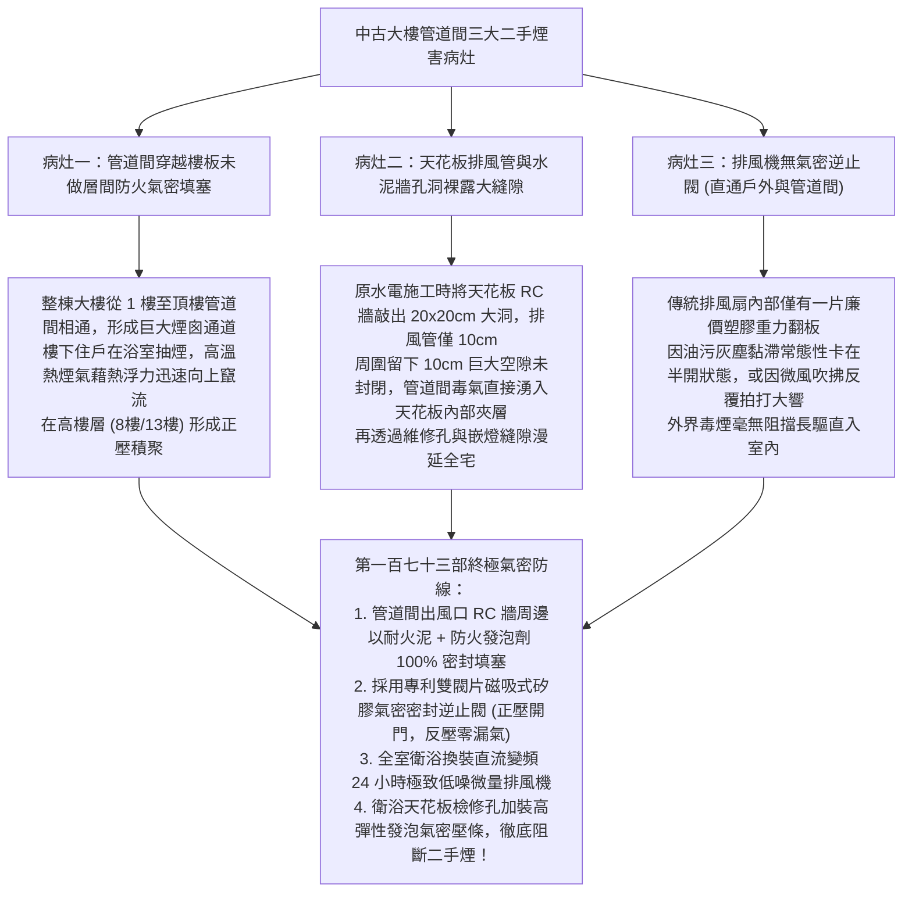
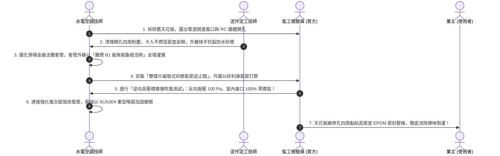
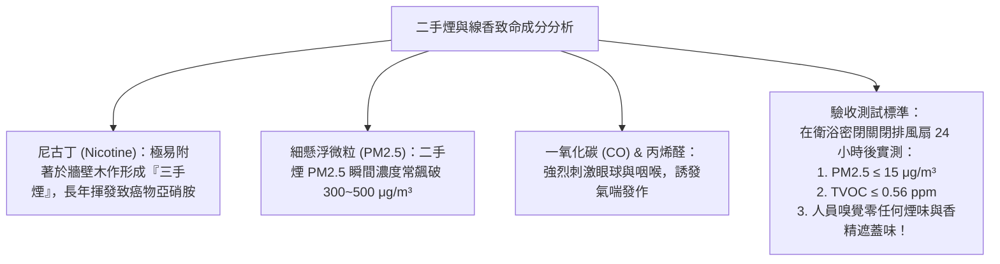
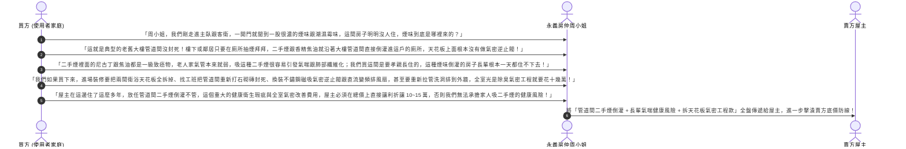

# 全案購屋實戰第一百七十三部：中古大樓梯間管道間排氣孔逆止閥與防止相鄰住戶二手煙味倒灌全室氣密工序全書

> **核心宗旨**：在高層電梯集合住宅（特別如大安紫金城 13 樓、長億南園 8 樓等早期規劃之 20~30 年社區）中，衛浴與廚房之「垂直共用管道間（Pipe Chase / Utility Shaft）」是整棟建築最常引發住戶身心折磨與健康危害的「毒氣互通走廊」。中古大樓常見「相鄰或樓下住戶在廁所抽煙、燒香拜拜或煮飯，刺鼻的二手煙（Secondhand Smoke）、三手煙焦油致癌物、線香懸浮微粒與甲醛沿管道間未封閉的破口直接倒灌入室內衛浴」、「建商原附排風扇無氣密止回閥，強風倒灌使排風管如同煙囪向室內狂吹毒氣」、「長輩吸入二手煙誘發慢性阻塞性肺病（COPD）、支氣管哮喘與心肌梗塞」等滅頂級痛點。本手冊專攻「管道間開孔全封閉發泡封堵工藝、磁吸式雙向矽膠密封排氣逆止閥選型、全戶靜音變頻排風扇微正壓防護機制、室內空氣甲醛及尼古丁殘留檢測及利用二手煙味倒灌瑕疵狠砍買賣總價 10~15 萬戰術」，為家庭呼吸道健康與無煙純淨衛浴築起 100% 氣密隔絕防線。

---

## 第一章：老舊大樓管道間二手煙互通三大致命病灶與氣體擴散機理

---

## 第二章：管道間氣密封堵與止回逆止閥選型規格對照表

在中古屋翻新泥作與水電進場時，衛浴天花板拆除後必須實施嚴格的節點整改：

| 組件與工藝分類 | 傳統中古大樓劣質現況（漏煙根源） | 本案全氣密旗艦升級標準 | 實質防護效益與評價 |
| :--- | :--- | :--- | :---: |
| **排風管與 RC 孔縫隙** | 水泥袋塞入孔洞、或直接裸露 5~10cm 大洞不處理 | **以不燃無機岩棉塞實，雙面厚塗「膨脹型防火密封膠」+ 阻燃發泡劑** | **徹底阻斷管道間毒煙、沼氣、蟑螂沿牆洞湧入天花板夾層！** |
| **排風逆止閥 (Backdraft Damper)** | 廉價塑膠重力擺頁（無密封條，微漏風率高達 30%） | **SUS304 不鏽鋼或強化 ABS 雙蝶片磁吸式逆止閥（配備氟矽橡膠密封圈）** | **關閉時強力磁鐵緊密吸合，漏風率 $< 0.01\%$，反向暴風零漏氣零拍打聲！** |
| **排風軟管材質** | 易撕裂的薄鋁箔波紋管（老鼠啃咬穿孔、易下垂積水） | **雙層夾網 PVC 複合強化厚鋁箔風管（耐溫 120°C，耐磨抗老鼠啃咬）** | 風阻極小，耐用 20 年不破損、不滲漏。 |
| **衛浴排風扇** | 交流 AC 定頻風機（噪聲大、風壓小、無持續換氣） | **DC 直流變頻 24 小時微量低噪換氣扇（功率僅 3W，風量 ≥ 120 m³/h）** | 室內常態性微排氣，即使有微量煙氣在開門瞬間即被強迫排出。 |

---

## 第三章：衛浴天花板全氣密防倒灌五大核心工序（SOP）

### 3.1 氣密防煙四大不可妥協之鐵則：
1. **雙蝶片磁吸式結構（Magnetic Soft-Close）**：
   - 排風扇啟動時，風壓推開左右兩扇蝶片進行排氣；排風扇關閉瞬間，兩扇蝶片在彈簧與磁鐵吸力作用下迅速靠攏，**磁鐵將閥片與四周矽膠密封圈牢牢吸合鎖死**。
   - 徹底杜絕強風吹拂時閥板拍打的「啪嗒啪嗒」擾人噪音，並抵禦管道間強大正壓回風。
2. **水平向下傾斜坡度（Anti-Backflow Slope）**：
   - 自排風扇至管道間的排風管路，必須保持 **$3^\circ \sim 5^\circ$ 的由室內向管道間下斜坡度**。
   - 即使管道間有冷凝水氣滴落，水滴也會自然順坡排入管道間，絕不倒流積聚在室內天花板上方。
3. **天花板檢修孔與嵌燈孔氣密處理**：
   - 很多翻新只注意排風管，卻忽視了石膏板天花板的檢修孔與 LED 嵌燈孔。
   - 檢修孔外框必須預貼厚度 $3\text{mm}$ 的閉孔 EPDM 泡棉膠條；LED 嵌燈必須選用後方帶防塵氣密罩之封閉式燈具，杜絕天花板夾層空氣滲透入室內。
4. **獨立專用管路排向戶外（若條件允許）**：
   - 若衛浴緊鄰工作陽台或外牆，強烈建議 **直接在外牆洗洞（直徑 100mm）排向戶外**，徹底脫離大樓共用管道間，將舊管道間開孔以磚牆完全封死砌平，從物理根源上 100% 杜絕鄰舍煙味！

---

## 第四章：二手煙與尼古丁殘留空氣檢驗標準

在交屋勘查或翻新驗收時，必須檢測室內空氣中是否有鄰舍滲入的煙害毒素：

---

## 第五章：看屋現場二手煙味倒灌排查與殺價戰術

在實地勘查大安紫金城 13 樓或長億南園 8 樓衛浴時，買方必須在現場實施「嗅覺與手感深層排查」，並將其轉化為**狠砍買賣總價 10~15 萬元的管道間瑕疵談判武器**：

---

## 第六章：管道間氣密健康體檢核對表（現場看屋必備）

| 查核項目 | 標準合格判定條件 | 現場重大異常判定（致命警訊） | 處置戰術 |
| :---: | :--- | :--- | :--- |
| **衛浴常態空氣氣味** | 衛浴關門 10 分鐘後打開，空氣清新乾燥無異味 | 剛開門即撲鼻而來「菸味、拜拜線香味或炒菜油煙味」 | 🔴 **屬嚴重管道間倒灌**，列入重大瑕疵扣款抗性 |
| **天花板檢修口排查** | 推開維修孔，以強光手電筒檢視管道間開孔全密閉 | 牆壁留有巨大孔隙、排風管隨意搭接、夾層滿是灰塵煙味 | ⚠️ 必須全室拆除天花板重新打膠密封，預估費用砍價 |
| **排風扇開關風向** | 開啟排風扇水氣迅速排出，關閉時無任何反向冷風倒灌 | 關閉排風扇時，站在下方能明顯感受到「冷風向室內直吹」 | ⚠️ 逆止閥完全缺失或卡死，要求更換為磁吸氣密閥 |
| **管道間通氣立管** | 大樓頂樓通氣立管通暢，無鳥巢雜物堵塞 | 頂樓排氣孔被雜物封閉，致使管道間處於高正壓積煙狀態 | ⚠️ 責令管委會立即疏通頂樓通氣孔，消除全棟倒灌！ |
