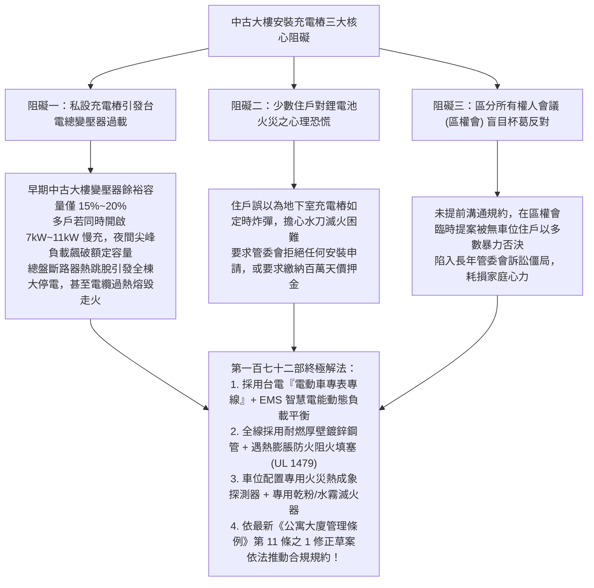
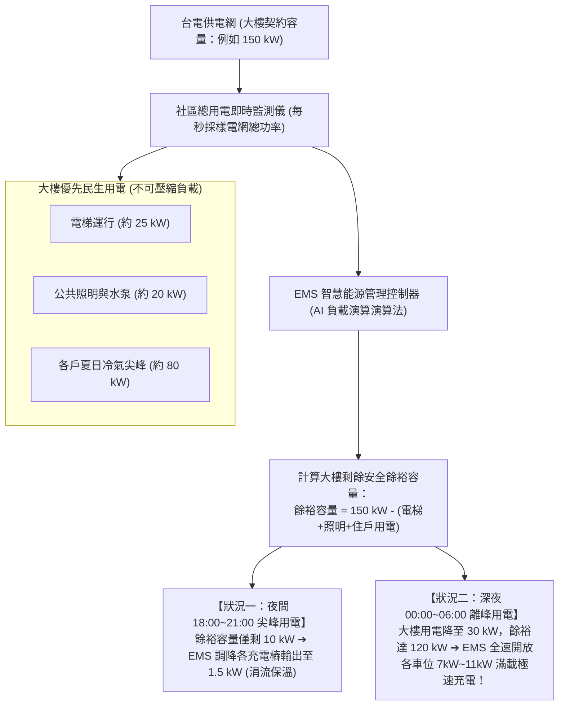
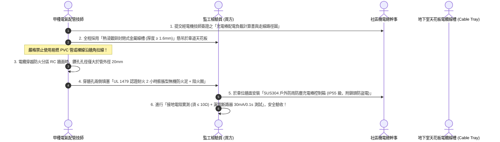
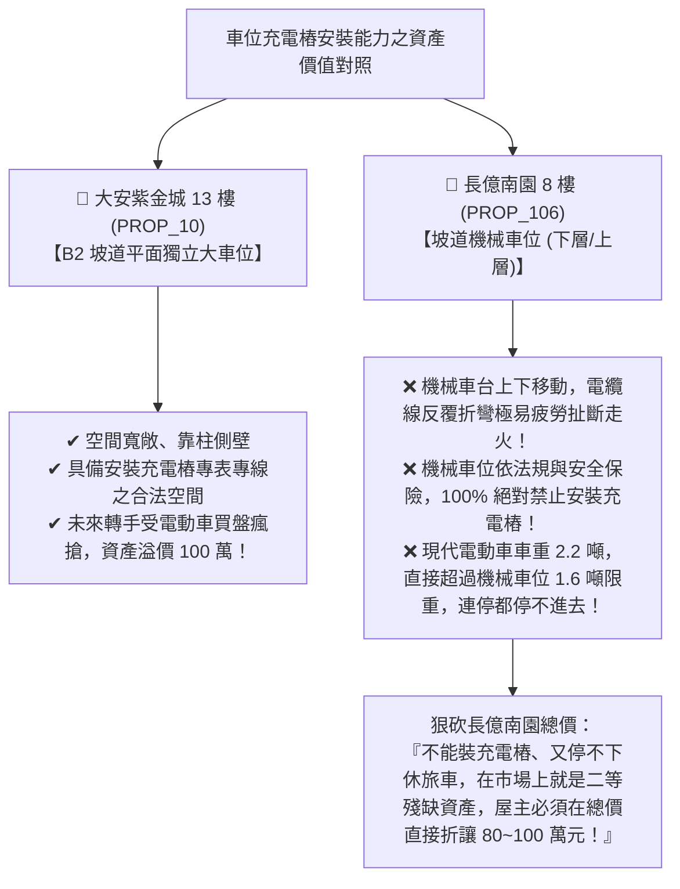

# 全案購屋實戰第一百七十二部：中古大樓地下室車位私設電動車充電樁EMS能源管理系統與規約表決防線全書

> **核心宗旨**：在高層電梯住宅集合住宅（特別如大安紫金城 13 樓配備之 B2 坡道平面獨立大車位，以及長億南園等物件）中，電動車（EV）充電設施為未來 20~30 年房產保值、轉手流動性與日常科技生活之決定性分水嶺。然而，中古大樓常面臨「早期電氣設計總容量不足，若每戶隨意自私宅電表拉線將引發大樓配電盤過載跳電起火」、「社區規約未明定充電樁安裝規範，管委會與少數保守住戶以『電池燃燒起火氣爆恐慌』為由全面封殺杯葛阻撓」、「施工穿樑洗洞破壞 RC 結構主筋引發結構安全疑慮」等重大公設治理難題。本手冊專攻「社區專設電動車一戶一表（專表專線）台電饋線申請流程、智慧電能管理系統（EMS, Energy Management System）動態負載平衡調配標準、耐火 2 小時金屬線槽與防火阻火圈穿牆工序、公寓大廈區權會規約修正防守戰術及利用『大安紫金城可裝充電樁 vs 長億南園機械車位無法安裝』實施降維打擊議價戰術」，為家庭長遠用車能源與資產增值構築鋼鐵防線。

---

## 第一章：中古大樓充電樁三大致命阻礙與用電過載機理

---

## 第二章：充電樁供電三大架構比較（為何必須唯一指定 EMS 專表專線）

在中古社區推動充電樁，絕不能採取「野蠻施工」自自家電表私拉，必須透過標準化三種架構進行評估：

| 供電架構類型 | 施工方式與路徑 | 對大樓電力負載之影響 | 電費計價與公私界線 | 本案評價與管委會核准率 |
| :--- | :--- | :--- | :--- | :---: |
| **架構一：由各戶私宅電表私拉** | 從各戶位於梯間之電表，沿管道間拉線至地下室車位 | **極差**：管道間爆滿、各戶電錶後開關容量不足，易造成私宅跳電 | 計入各戶自有電費單，無公私爭議 | ❌ **中古大樓嚴格禁止（管委會必否決）** |
| **架構二：接大樓公共電表 (公電)** | 由地下室公電盤拉線，各車位自設分電表計算度數 | **差**：公電總容量有限，車位多時公電變壓器燒毀 | 需由總幹事每月人工抄表分攤，帳務極易糾紛 | ❌ **不推薦（公私帳混亂易引發訴訟）** |
| **👑 架構三：台電專設電表 + EMS 智慧能源管理系統 （本案唯一合法標準）** | **台電新設獨立高壓/低壓受電箱（專表），統一建置母線槽，各車位設子表** | **👑 頂級完美**：EMS 依大樓即時負載動態調配充電電流，**100% 保證大樓總盤不跳電** | **各自獨立台電時間電價（尖峰/離峰差 3 倍），帳單直接繳台電** | 👑 **管委會 100% 放心核准通過之唯一正軌** |

---

## 第三章：智慧能源管理系統（EMS）動態負載平衡技術原理

EMS（Energy Management System）是充電樁大規模進駐集合住宅的核心中樞：

### 3.1 EMS 系統三大不可妥協之硬體規範：
1. **秒級動態響應（Dynamic Load Shedding）**：
   - 當大樓突發大功率負載（如消防泵測試或兩台電梯同時高速運行）時，EMS 必須在 **$0.5 \text{ 秒}$ 內** 主動發出降頻指令，調降或暫停充電樁功率，確保台電總開關絕對不超載跳脫。
2. **符合台電「電動車充換電設施電價」時間電價標準**：
   - 離峰電價（深夜）每度僅約 $2.0 \sim 2.5 \text{ 元}$，尖峰電價每度約 $8.0 \sim 9.0 \text{ 元}$。
   - EMS 系統預設「預約深夜離峰充電」，替家庭省下 70% 以上之充電成本，且完全避開社區用電高峰。
3. **雲端 OCPP 1.6 / 2.0.1 開放通訊協議**：
   - 系統不得綁定特定單一品牌充電樁，必須支援開放國際標準，未來特斯拉（Tesla）、保時捷、現代等各品牌家用充電樁皆可無縫接入。

---

## 第四章：地下室穿牆走線耐火施工與消防阻火工藝（SOP）

為消除住戶對地下室管線施工之火災疑慮，施工工藝必須達到醫療級防護標準：

---

## 第五章：兩大核心物件之車位價值降維打擊與殺價戰術

在實戰斡旋談判中，買方必須將充電樁的可安裝性，作為**抬高大安紫金城、狠壓長億南園**之最強心理槓桿：

### 5.1 對永義房屋周小姐的精準殺價話術劇本：
> 「周小姐，我們仔細評估過這兩間。**大安紫金城 13 樓** 雖然室內要花 50 萬拆除學生隔間，但它附的是 **B2 坡道平面獨立大車位**，現在全世界都在換電動車，大平車將來可以合法申請台電 EMS 專表裝充電樁，在二手市場上這種大平車多值 100 萬！
> 反觀 **長億南園 8 樓**，開價 998 萬，配的卻是 **機械車位**！機械車台天天上下升降，電線拉過去不用半年就被夾斷走火，管委會跟法規 100% 禁止機械車位裝充電樁；而且電動車動輒 2 噸重，機械車位限重 1600kg 根本停不進去！
> 一個能裝充電樁的平面車位，跟一個連休旅車都停不進去的機械車位，價值天差地遠！如果長億南園屋主不把這個車位致命劣勢直接在總價折让 80~100 萬，我們毫不猶豫直接出價買大安紫金城！」

---

## 第六章：充電樁公設健康體檢核對表（現場看屋必備）

| 查核項目 | 標準合格判定條件 | 現場重大異常判定（致命警訊） | 處置戰術 |
| :---: | :--- | :--- | :--- |
| **車位類型與產權** | B2 獨立坡道平面大車位，靠柱或靠牆，走線路徑短 | 機械式上下層車位、或中間無固定牆面之狹窄車位 | 🔴 **機械車位 100% 無法裝充電樁**，狠砍 80~100 萬！ |
| **社區充電樁規約** | 區權會已通過合法「電動車充電設備設置管理辦法」 | 規約明文禁止、或管委會完全未曾討論過充電樁 | ⚠️ 需走 EMS 專表專線流程推進，預留法規溝通期 |
| **地下室配電盤空間** | 機電房有預留空間可增設台電充電專表箱與電纜線槽 | 機電房爆滿無立足之地、牆面無任何穿管空間 | ⚠️ 需額外付費申請外線擴容，預估工程款砍價 |
| **車位消防設備** | 車位上方設有自動灑水噴頭，15米內有專用滅火器 | 車位處於消防盲區、無灑水頭、天花板無防火批覆 | ⚠️ 需自費加裝局部滅火設備，列入裝修成本扣款！ |
