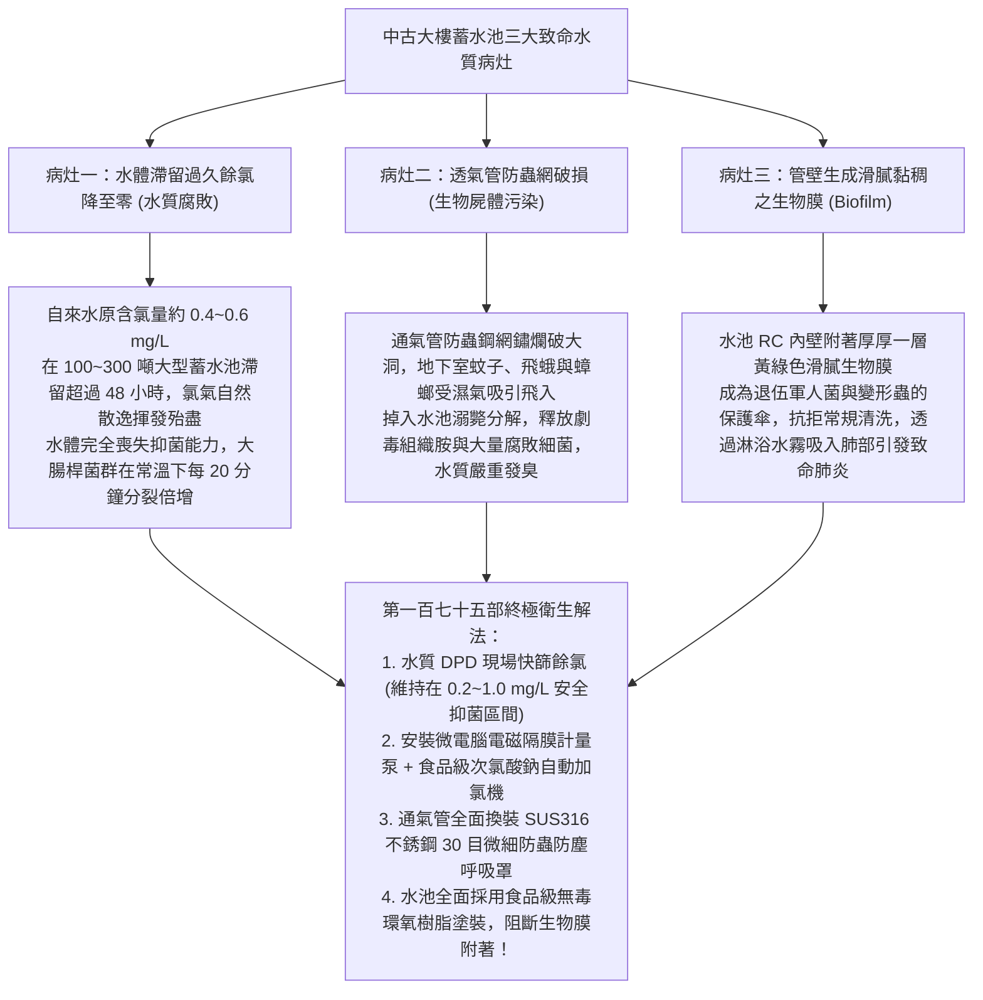
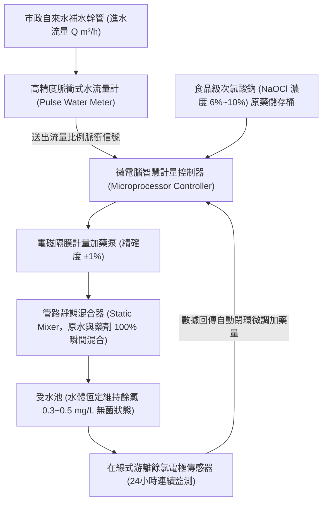
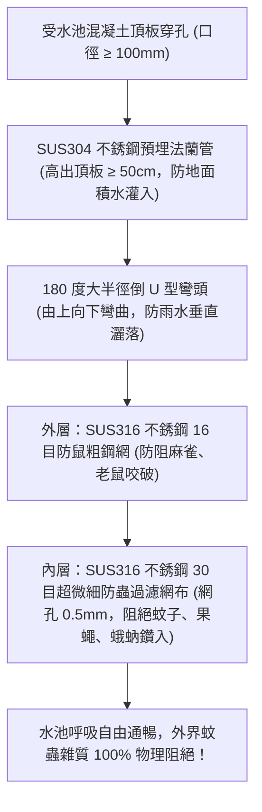
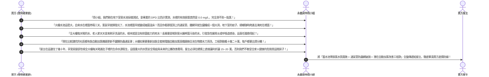

# 全案購屋實戰第一百七十五部：中古大樓社區地下室受水池自來水餘氯檢測與自動加氯消毒機及水箱透氣管防蟲網全書

> **核心宗旨**：在高層電梯住宅集合住宅（特別如大安紫金城 13 樓、長億南園 8 樓等早期規劃之 20~30 年社區）中，地下室自來水「受水池（蓄水池）」與頂樓水塔為每日進入全家人口鼻、沐浴與洗滌之生命水源。然而，中古大樓常面臨「自來水自市政管網注入受水池後，在巨大蓄水容積中滯留時間過長（長達 2~4 天），水中有效餘氯（Free Residual Chlorine）完全揮發耗盡降至 0.0 mg/L，水池淪為大腸桿菌群、退伍軍人菌（Legionella）與綠膿桿菌瘋狂繁殖之細菌溫床」、「池頂倒 U 型通氣管之防蟲網鏽蝕穿孔或脫落，蚊蠅、蛾蚋、蟑螂甚至壁虎鑽入池中溺斃腐爛」、「長輩常年飲用退氯死水引發急性腸胃炎、皮膚紅腫過敏與呼吸道感染」等重大公共衛生弊端。本手冊專攻「自來水遊離有效餘氯 DPD 比色計檢測標準、微電腦智慧比例式次氯酸鈉自動加氯機選型、SUS316 不鏽鋼 30 目微細雙層防蟲通氣罩工序、受水池水質生物膜清洗及利用蓄水池退氯細菌污染瑕疵狠砍買賣總價 15~20 萬戰術」，為家庭飲水安全與長輩免疫健康築起 100% 無菌防護線。

---

## 第一章：老舊大樓蓄水池三大致命水質病灶與致病機理

---

## 第二章：飲用水水質餘氯檢驗標準與 DPD 比色法現場檢測

在社區公設體檢中，必須隨身配備「便攜式水質餘氯 DPD 比色計」或「數位餘氯測定儀」，會同總幹事於地下室受水池採樣測試：

| 檢驗項目與數值範圍 | 飲用水水質標準規範 | 水質生物安全狀態評估 | 對長輩健康之影響與處置 |
| :--- | :--- | :--- | :--- |
| **$< 0.1 \text{ mg/L}$（甚至 0.0） ❌ 老舊社區常見現況** | 嚴重不合格（國家標準下限 $0.2\text{ mg/L}$） | **水體完全喪失自淨與抑菌力，細菌指數超標千倍** | 🔴 **極度危險**：誘發長輩急性腹瀉、菌血症；必須立即啟動自動補氯系統。 |
| **$0.2 \sim 0.6 \text{ mg/L}$ 👑 本案旗艦標準** | **100% 完美達標（世界衛生組織推薦區間）** | **兼具極致無菌安全性，且完全無刺鼻消毒水氣味** | 👑 **頂級安全**：保障家庭淋浴、洗滌與煮沸飲水絕對純淨無菌。 |
| **$0.6 \sim 1.0 \text{ mg/L}$** | 合格（國家標準上限 $1.0\text{ mg/L}$） | 抑菌效果強，但水體帶有輕微游離氯氣味 | 🟢 **合格**：建議廚房生飲端配置高品質活性碳濾芯脫氯。 |
| **$> 1.5 \text{ mg/L}$** | 超標不合格 | 次氯酸鈉過量添加，刺激皮膚黏膜 | ⚠️ 產生致癌三鹵甲烷（THMs）副產物，調降加氯泵衝程。 |

---

## 第三章：微電腦智慧比例式「自動加氯消毒機」系統架構

當自來水在大型受水池中餘氯不足時，優質社區全面配置**微電腦自動補氯消毒設備**：

### 3.1 自動加氯機三大不可妥協之硬體規範：
1. **流量比例閉環控制（Flow Proportional Control）**：
   - 嚴格禁止定時器盲目定時注藥！系統必須依照進水流量計回傳之脈衝信號，進多少噸水就精確注入多少毫升藥劑，**濃度精確度控制在 $\pm 0.05 \text{ mg/L}$ 以內**。
2. **食品級添加劑認證（NSF 60 認證）**：
   - 消毒藥劑必須採用取得 **美國 NSF/ANSI 60 飲用水化學處理劑認證** 之高純度食品級次氯酸鈉，嚴格禁止使用工業級漂白水（其含有高濃度重金屬砷與汞雜質）。
3. **PVDF / PTFE 耐強腐蝕泵頭**：
   - 次氯酸鈉具強氧化腐蝕性，加藥泵頭與輸送管線必須採用 **PVDF（聚偏氟乙烯）或鐵氟龍（PTFE）** 材質，杜絕管路被藥劑腐蝕穿孔漏藥。

---

## 第四章：受水池倒 U 型透氣管「SUS316 雙層防蟲防塵呼吸罩」工藝

通氣管是水池吸入外界空氣平衡水位的呼吸口，也是蟲鼠入侵的第一破口：

### 4.1 通氣防蟲四大施工鐵則：
1. **法蘭管立柱高度 $\ge 50\text{ cm}$**：
   - 穿越頂板之通氣管基座，必須高出地下室完成地面或水箱頂板 **至少 $50 \text{ 公分}$**，即使地下室水喉破裂積水，污水也絕不自通氣管流入。
2. **SUS316 雙層金屬網（拒絕塑膠紗網）**：
   - 嚴禁使用一般紗窗之尼龍塑膠網（老鼠兩秒鐘即可咬爛鑽入）。
   - 必須採用 **耐酸鹼耐鹽霧之 SUS316 不鏽鋼編織網**，雙層固定於倒 U 型管口，以不鏽鋼喉箍緊密鎖固。
3. **定期拆洗檢驗機制**：
   - 通氣罩必須設計為「快拆式結構」，管委會物業保全每季可旋開螺栓卸下金屬網，以高壓水槍沖洗累積之灰塵蜘蛛網，維持通氣截面積 100% 暢通，防範水泵抽水時水池內部產生負壓抽癟池體。

---

## 第五章：看屋現場蓄水池排查與殺價戰術

在看房大安紫金城 13 樓或長億南園 8 樓時，買方在會同房仲周小姐（或信義建宇）勘查地下室受水池時，實地拿出水質比色計檢驗，並將其轉化為**狠砍買賣總價 15~20 萬元的公共衛生瑕疵談判武器**：

---

## 第六章：受水池水質公設健康體檢核對表（現場看屋必備）

| 查核項目 | 標準合格判定條件 | 現場重大異常判定（致命警訊） | 處置戰術 |
| :---: | :--- | :--- | :--- |
| **現場游離餘氯** | 實測值在 $0.2 \sim 0.6 \text{ mg/L}$ 之間，水質清澈無腐臭味 | 實測餘氯為 $0.0 \text{ mg/L}$，水體帶有發酵微酸味或死水味 | 🔴 **水體已完全喪失抑菌力**，列入重大公設瑕疵砍價 |
| **通氣管防蟲網** | 倒 U 型管口包覆雙層 SUS316 鋼網，網目完整無破損 | 鋼網生鏽破大洞、完全脫落缺失、或甚至管口朝天直接淋雨 | 🔴 蚊蠅蟑螂隨意掉入，要求管委會立即整改換新 |
| **自動加氯機設備** | 設有微電腦自動加氯計量泵，藥桶有藥，指示燈正常 | 無任何加氯設備、或加氯機斷電停擺、藥桶空空如也 | ⚠️ 社區無水質自動維持能力，預估設備工程款砍價 |
| **水池清洗紀錄** | 牆面張貼近 6 個月內由合格水質廠商出具之清洗紀錄與合格水質報告 | 超過 1 年以上未清洗水池，無任何官方水質檢驗報告 | 👑 以「公設供水管理癱瘓」狠砍 15~20 萬房價！ |
