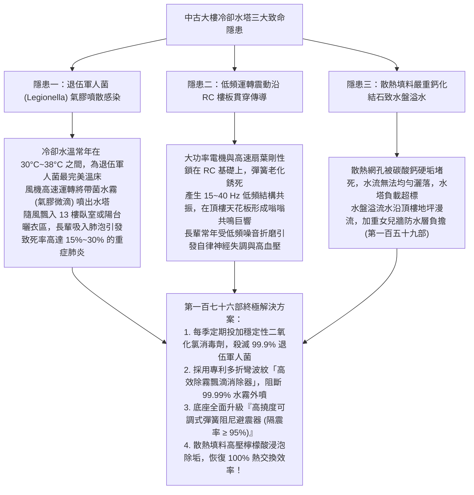
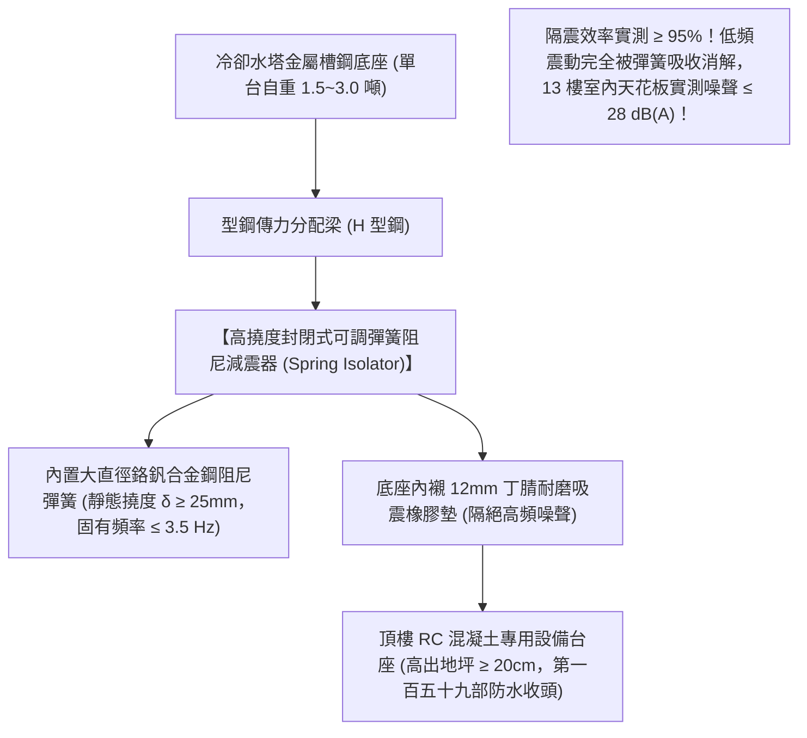
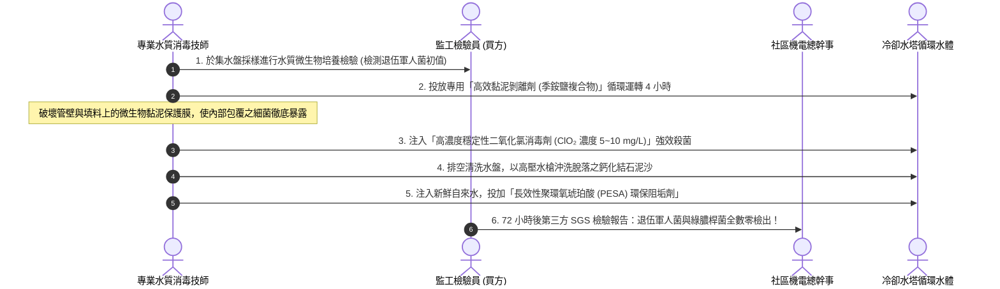
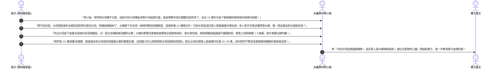

# 全案購屋實戰第一百七十六部：中古大樓頂樓冷卻水塔散熱填料鈣化清洗與防退伍軍人菌滅藻及減振彈簧工序全書

> **核心宗旨**：在高層電梯住宅集合住宅（如大安紫金城 13 樓、長億南園 8 樓等設有中央空調冰水主機或公共梯廳冷卻水系統之社區）中，頂樓平台設置之「冷卻水塔（Cooling Tower）」是高樓層住戶頭頂上的巨大衛生與震動隱患。20~30 年中古大樓最常面臨「冷卻水塔內部 PVC 散熱填料（Cooling Infill）常年受硬水侵蝕嚴重鈣化結石結垢、水流散熱效率崩跌且滋生大量嗜肺性退伍軍人菌（Legionella pneumophila）、水塔高速風機噴出之氣膠微沫隨風飄散直灌頂樓與次頂樓住戶陽台與臥室窗戶」、「冷卻水塔循環水泵與巨大扇葉未加裝阻尼彈簧避震器，低頻共振沿 RC 樓板貫穿直達 13 樓天花板引發住戶夜間失眠」、「水塔底部集水盤長年積厚泥生青苔引發底盤鏽蝕穿孔漏水」等重大公設通病。本手冊專攻「冷卻水塔散熱填料高壓化學除垢阻垢工序、氯化二氧化碳與季銨鹽複合殺菌滅藻標準、低頻彈簧雙向阻尼減震器安裝調校、飄滴水消除器（Drift Eliminator）選型及利用冷卻水塔噪音與細菌氣膠瑕疵狠砍買賣總價 15~20 萬戰術」，為頂樓住戶呼吸道安全與夜間睡眠寧靜構築萬全防線。

---

## 第一章：老舊大樓冷卻水塔三大致命隱患與氣膠感染機理

---

## 第二章：冷卻水塔散熱填料清洗除垢與阻垢化學工法

冷卻水在高溫循環過程中，水分不斷蒸發，水中鈣鎂離子濃度急速濃縮，在 PVC 蜂巢狀填料表面生成堅硬石質水垢：

| 評估項目 | 傳統中古社區劣質現況（嚴重扣分） | 本案頂級化學與物理整改規範 | 實質健康與運轉效益 |
| :--- | :--- | :--- | :---: |
| **填料結垢狀況** | 填料蜂窩孔隙堵塞 $> 60\%$，表面覆蓋厚層黃白石垢 | **採用食品級無毒檸檬酸 + 緩蝕阻垢劑循環循環清洗，孔隙暢通率 100%** | **熱交換溫差恢復至 $5^\circ\text{C}$ 標準，大幅降低主機耗電 25%！** |
| **退伍軍人菌檢測** | 水質每毫升菌落數（CFU/mL）飆破 $1000 \text{ CFU/mL}$ | **定期檢驗水質退伍軍人菌落數嚴格控制在 $< 10 \text{ CFU/mL}$（安全無害區）** | **徹底根除高樓層住戶吸入致病氣膠引發致命肺部感染之風險！** |
| **除霧飄滴水器** | 傳統直線百葉，風機吹拂時水霧如毛毛雨噴灑周邊 | **安裝 SUS304 / PVC 雙折線迷宮式飄滴消除器（飄水率 $< 0.005\%$）** | 水霧 100% 被碰撞截留回流集水盤，絕無水花飄灑至住戶窗台。 |
| **集水底盤防腐** | 鍍鋅鋼板底盤生鏽爛穿、長滿綠色青苔與爛泥 | **底盤塗刷雙組份玻璃鱗片耐酸鹼防腐膠泥（膜厚 $\ge 1.0\text{mm}$）** | 底盤永不鏽穿漏水，無淤泥沉積，蚊蠅孑孓零孳生。 |

---

## 第三章：低頻結構共振消除——高撓度彈簧阻尼隔震器安裝工法（SOP）

頂樓冷卻水塔與加壓水泵對 13 樓頂樓或次頂樓住戶產生的最大折磨，就是夜深人靜時地板傳來的「低頻嗡嗡共振聲」：

### 3.1 消除水塔低頻震動三大不可妥協之鐵則：
1. **彈簧固有頻率（Natural Frequency）精算**：
   - 冷卻水塔風機與水泵運轉轉速通常在 $750 \sim 1450 \text{ RPM}$（激勵頻率約 $12.5 \sim 24 \text{ Hz}$）。
   - 避震器彈簧之固有頻率必須 **低於激勵頻率的 $1/3$（即 $f_n \le 3.5 \sim 4.0 \text{ Hz}$）**，靜態受載壓縮撓度必須 **$\ge 25\text{ mm}$**，才能達到真正的共振隔離；嚴禁使用僅有幾厘米厚的劣質硬橡膠墊（在低頻下完全失去隔震效果）。
2. **水管進出口柔性防震不鏽鋼波紋軟管（Flexible Connector）**：
   - 冷卻水進水管與出水管連接處，必須各串接一組 **SUS304 雙球型不銹鋼波紋伸縮防震軟接頭**。
   - 杜絕水塔震動經由剛性金屬水管直接傳導至建築物牆體與管道間大樑。
3. **動平衡校準（Dynamic Balancing）**：
   - 每年定檢必須使用紅外線動平衡儀校準風機鋁合金扇葉，不平衡量控制在 **$\le 2.5 \text{ g}\cdot\text{mm/kg}$（ISO 1940 G2.5 級）**，從根本振動源頭消除晃動。

---

## 第四章：退伍軍人菌化學滅藻消殺標準維護流程

---

## 第五章：看屋現場頂樓水塔排查與殺價戰術

在看房大安紫金城 13 樓或長億南園 8 樓等高樓層物件時，買方必須要求房仲周小姐（或信義建宇）陪同走上頂樓平台，實地檢視冷卻水塔與空調機房，並將其轉化為**狠砍買賣總價 15~20 萬元的公設公害瑕疵談判武器**：

---

## 第六章：冷卻水塔公設健康安全體檢核對表（現場看屋必備）

| 查核項目 | 標準合格判定條件 | 現場重大異常判定（致命警訊） | 處置戰術 |
| :---: | :--- | :--- | :--- |
| **避震器彈簧狀態** | 彈簧伸縮有彈性，防銹塗層良好，底座無直接硬碰硬接觸 | 彈簧嚴重生鏽壓死到底、橡膠墊碎裂、樓板明顯共振 | 🔴 **低頻噪音直穿室內引發失眠**，列入重大瑕疵扣款 |
| **飄滴水霧噴散** | 風機上方無可見水霧溢出，1 米外手掌感覺完全乾燥 | 水霧如細雨隨風飄灑、周邊地面潮濕積水、青苔遍布 | 🔴 存在退伍軍人菌氣膠感染極度危險，要求更換除霧器 |
| **散熱填料狀況** | PVC 蜂巢網眼光潔透光，無大面積白色水垢結晶 | 網孔結滿黃白色石質硬垢（堵塞 $> 50\%$）、填料脆裂脫落 | ⚠️ 熱交換崩潰且滋生細菌，要求全面更換填料並殺價 |
| **軟管接頭外觀** | 不銹鋼雙球型防震接頭無龜裂、無變形滲水 | 剛性金屬管直接死鎖水塔、接頭滲漏鏽蝕發黑 | ⚠️ 震動直傳室內管道間大梁，主張折抵工程款！ |
