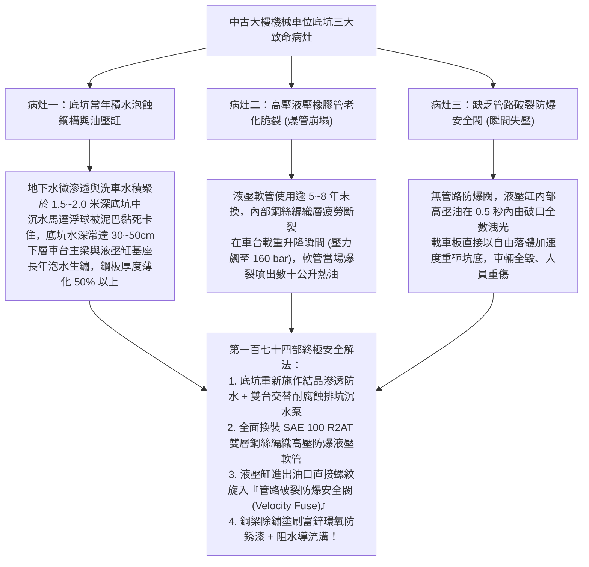
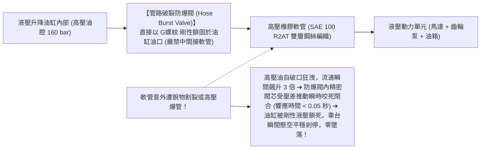
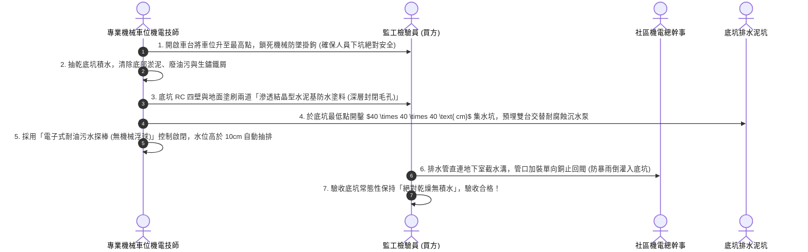
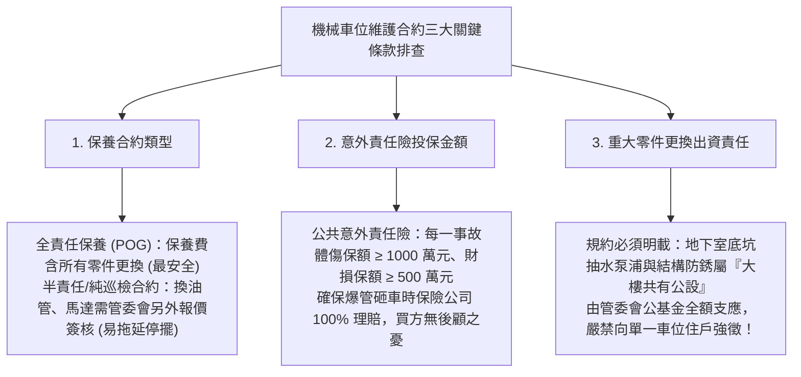
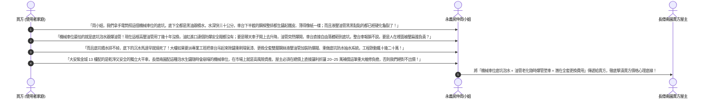

# 全案購屋實戰第一百七十四部：中古大樓社區地下室機械車位排坑積水防銹防蝕與油壓管路防爆閥更換工序全書

> **核心宗旨**：在高層電梯住宅集合住宅（特別如第二順位核心 **長億南園 8 樓** 配備之坡道機械車位，以及歌德堡、大墩人文等物件）中，機械車位之「地下底坑（Pit）」常年處於陰暗、潮濕與地下水微滲透環境。20~30 年中古大樓最常面臨「底坑積水成池如水族箱，沉水泵浦燒毀無人知曉致車台下半部鋼樑泡水生鏽薄化穿孔」、「高壓液壓軟管常年承受 140~180 bar 油壓脈衝，橡膠老化龜裂隨時爆管噴油、車台瞬間失壓垂直崩落砸扁下層車輛」、「缺乏管路防爆安全閥（Hose Burst Valve）致使爆管時無機械液壓鎖定保護」等滅頂級事故隱患。本手冊專攻「機械車位底坑乾濕分離排坑抽水工序、高抗磨耐油防爆液壓管路更換標準、進口單向管路防爆閥（液壓切斷閥）安裝調校、鋼結構熱浸鍍鋅冷塗防蝕及利用機械車位底坑積水生鏽瑕疵狠砍買賣總價 20~25 萬戰術」，為車輛停放安全與資產定價構築鋼鐵防線。

---

## 第一章：老舊大樓機械車位底坑三大致命病灶與爆管墜車機理

---

## 第二章：高壓液壓管路規格與防爆安全閥（Hose Burst Valve）工作原理

機械車位之升降動力，完全仰賴液壓泵浦將液壓油加壓推動單作用或雙作用柱塞油缸。一旦軟管破裂，防爆閥是唯一能阻止車台墜落之機械底牌：

### 2.1 液壓系統三大不可妥協之配件指標：
| 檢驗組件 | 劣質危險品（常見於中古老社區） | 本案頂級安全標準規範 | 實質安全效益 |
| :--- | :--- | :--- | :--- |
| **液壓高壓軟管** | 單層鋼絲普通橡膠管（使用逾 10 年，外膠龜裂露鋼絲） | **SAE 100 R2AT / EN 853 2SN 雙層高強度鋼絲編織膠管（爆破壓力 $\ge 640\text{ bar}$）** | 承受脈衝衝擊 20 萬次不爆裂，耐油耐磨耐臭氧老化。 |
| **管路防爆閥 (Velocity Fuse)** | 根本未安裝防爆閥（爆管即自由落體） | **歐洲進口直動式螺紋插裝防爆閥（調定截止流量為額定流量之 1.3 倍）** | 爆管時在 $0.05\text{ 秒}$ 內鎖死油路，車台下沈距離 $< 10\text{mm}$。 |
| **液壓油品質** | 長年未換之黑色乳化液壓油（含水率超標、有金屬粉屑） | **國光牌 / Mobil ISO VG 46 抗磨液壓油（具備優異抗乳化與抗泡性能）** | 閥芯運轉滑順不卡阻，油溫維持在 $< 55^\circ\text{C}$，油封壽命延長 3 倍。 |

---

## 第三章：機械車位底坑乾濕分離排坑抽水工序（SOP）

底坑積水是腐蝕鋼梁與電氣短路的元兇。標準底坑防水防潮整改流程如下：

### 3.1 鋼結構除鏽與重防蝕四大標準：
1. **動力工具打磨除鏽（St 3 級）**：
   - 使用手持鋼絲輪打磨機，徹底清除下層車台 C 型鋼樑與液壓缸支座表面之鬆動鐵鏽與舊漆皮，露出金屬基體光澤。
2. **環氧富鋅防銹底漆（Zinc-Rich Primer）**：
   - 滾塗兩道高純度環氧富鋅底漆（鋅粉含量 $\ge 80\%$，乾膜厚度 $\ge 80\mu\text{m}$），利用鋅的化學犧牲陽極效應，為鋼材提供長達 15 年的電化學防銹保護。
3. **聚氨酯耐磨抗油面漆（Polyurethane Topcoat）**：
   - 塗刷耐機油、抗酸鹼之黃黑相間警示面漆（乾膜厚度 $\ge 60\mu\text{m}$），即使底盤滴落煞車油或機油，漆面亦不發軟起泡。
4. **液壓缸柱塞鍍鉻面保護**：
   - 柱塞表面必須塗抹耐水防銹矽質潤滑脂，升降行程中由聚氨酯防塵圈自動刮除泥沙，杜絕柱塞表面拉傷漏油。

---

## 第四章：機械車位保養合約與年度特檢責任排查

在購屋洽談中，買方必須透過仲介周小姐向管委會調閱機械車位之維護合約：

---

## 第五章：看屋現場機械車位底坑排查與殺價戰術

在看房長億南園 8 樓（配機械車位）或相關物件時，買方必須手持強力手電筒照射機械車位底坑，並轉化為**狠砍買賣總價 20~25 萬元的殺價重槌**：

---

## 第六章：機械車位底坑安全健康體檢核對表（現場看屋必備）

| 查核項目 | 標準合格判定條件 | 現場重大異常判定（致命警訊） | 處置戰術 |
| :---: | :--- | :--- | :--- |
| **底坑積水狀況** | 底坑乾燥無水、集水坑沉水泵運作正常、無異味 | 底坑積水深達 10~50cm、漂浮廢機油、散發死水臭味 | 🔴 **鋼梁長期泡蝕受損**，列入重大公安瑕疵扣款 |
| **液壓軟管外觀** | 軟管表面黑亮柔軟無龜裂，金屬接頭乾燥零滲油 | 外層橡膠龜裂露鋼絲、接頭滲漏黑色油滴、油管硬化如木頭 | 🔴 **隨時有爆管墜車致命危險**，要求立即停用更換！ |
| **管路防爆閥** | 油缸進油口剛性鎖固防爆閥（標示 Velocity Fuse） | 無任何防爆閥，油管直接用普通接頭鎖入油缸 | ⚠️ 缺乏失壓保護，要求加裝防爆閥並列入砍價依據 |
| **車台下樑防銹** | 鋼梁漆面完整，無起泡生鏽，焊道厚實平整 | 梁身大面積剝落起鐵皮、鋼板敲擊聲音空洞、局部穿孔 | 🔴 結構強度已失，主張扣減 20 萬元結構重置費！ |
