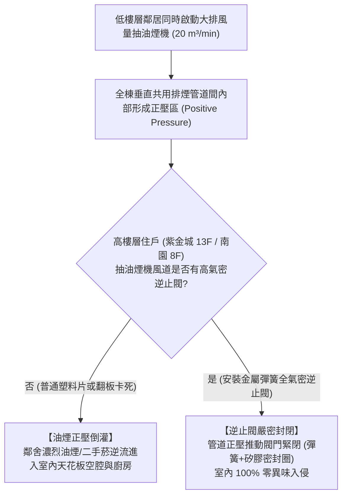
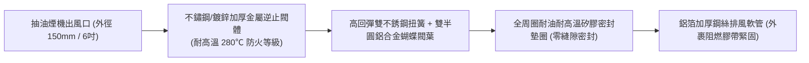

# 全案購屋實戰第一百三十一部：廚房排煙風道排氣逆止閥與防鄰舍油煙倒灌工序全書

## 一、 核心戰略定位與目標
在購買台中南區 20~28 年之中古電梯大樓（如大安紫金城 13 樓、長億南園 8 樓、歌德堡、靜園 A 區）全室翻新時，許多屋主在搬入新居後常遭遇難以忍受的困擾：
1. **明明自家沒煮飯，廚房甚至全屋卻瀰漫鄰居煎魚、炒辣椒或重油煙味**；
2. **夜間偶爾聞到濃烈二手菸味自廚房天花板排油煙管竄出**；
3. **強烈東北季風吹襲時，抽油煙機風道發出「呼呼」風嘯聲與風葉空轉逆拍異音**。

台灣中高齡中古集合住宅在 921 震災前（甚至民國 90 年代初期），建築法規尚未強制要求「衛浴與廚房單層當層獨立對外排放」，極多中古大樓廚房排煙採用**全棟垂直共用管道間（Common Shaft）**，或是當層外牆排煙孔僅配置廉價的薄塑料重力翻板：
- **塑料翻板受油污沾黏卡死**：日久失去密閉回彈功能，常開不閉；
- **排煙管道正壓倒灌效應**：低樓層大火炒菜時，管道間內部氣壓暴增，油煙沿著高樓層排煙管倒灌侵入大安紫金城 13 樓或長億南園 8 樓！

本手冊制定「全密封金屬雙葉彈簧防火逆止閥工藝」、「當層外牆鑽孔加裝不鏽鋼防風深型防雨罩工序」與「抽油煙機風量風壓匹配計算標準」。

---

## 二、 中古大樓共用管道排煙倒灌流體力學與排查工序

---

## 三、 全金屬重力彈簧複式密閉逆止閥工藝（Check Valve Installation）

徹底杜絕油煙倒灌，必須於吊頂天花板內部更換原廠附贈的脆弱塑料止回閥：

### 1. 核心五金構造規範
- **閥體材質**：嚴禁使用 ABS 塑料（高溫油煙烘烤 1~2 年即變形脆化），必須採用 **SUS304 不鏽鋼或加厚冷軋鍍鋅鋼板本體**；
- **雙扭簧輔助閉合**：葉片由兩片半圓形鋁合金板構成，依靠不銹鋼扭力彈簧輔助復位；當抽油煙機關機瞬間，**彈簧拉力於 0.1 秒內強制將葉片拉回密封面**，不受管內微小負壓抽吸影響；
- **耐油矽膠密封環**：閥座與閥片接合面配置耐溫 $200^\circ\text{C}$ 之發泡矽膠密封環，閉合時達到氣密級密封，完全阻絕微氣壓油煙滲入。

### 2. 管道間貫穿接口密封（Critical Sealing）
- 當排風管接入共用磚砌管道間時，開孔四周必須先以 **無收縮防水水泥砂漿固定金屬套管**；
- 逆止閥基座與套管之間，滿打 **防霉耐火中性矽利康（Fireproof Silicone）**，嚴禁單純用膠帶纏繞草率了事。

---

## 四、 當層外牆直排方案：加裝深型防風防雨不鏽鋼風罩

若目標物件（如大安紫金城 13 樓或長億南園 8 樓）具備廚房外牆開孔條件（或原建商為當層排氣）：

### 1. 外牆開孔坡度「內高外低」防倒灌鐵律
- 排風管穿透外牆時，開孔角度必須維持 **$3^\circ \sim 5^\circ$ 向外下斜坡度**（室內側比室外側高出至少 15~20mm）；
- 確保颱風暴雨或管內冷凝水能順利向戶外重力滴流排空，絕不倒流滴回室內天花板。

### 2. 深型抗風防鳥外牆風罩（Deep Hood Vent）
- 傳統扁平百葉風罩在 13 樓強風迎面吹襲時，風力會將出風口硬生生堵死；
- 必須選用 **SUS304 深型防風防雨半球型/斜坡型外牆風罩**：
  - 下緣自帶鳥網（防麻雀、野鴿築巢鑽入）；
  - 出風口朝向下斜 45 度，附滴水鷹嘴收邊，防止雨水沿外牆磁磚漫流滲入套管。

---

## 五、 抽油煙機風量與靜壓匹配計算工序

高樓層外牆風壓大、排煙管道長（若轉彎超過 2 個 90 度彎頭），傳統低風壓抽油煙機會產生「排風打不出去」的悶堵現象：

### 1. 風量與最大靜壓標竿
- **排風量（Air Volume）**：必須選配 **$\ge 18 \sim 22 \text{ m}^3/\text{min}$**（每分鐘排風 18 立方米以上）；
- **最大靜壓（Maximum Static Pressure）**：
  - 傳統舊機靜壓僅 300~350 Pa；
  - **本手冊高樓層指定選配變頻直流（BLDC）無刷電機機型，最大靜壓必須達 $\mathbf{\ge 650 \sim 1000 \text{ Pa}}$**；
  - 具備「自動巡航增壓功能」：當感測到共用管道間或外牆逆風阻力增加時，電機自動升頻提高轉速，以千帕級強大靜壓將油煙強制破風排空！

---

## 六、 驗收測試與氣密煙霧查核表（Checklist）

翻修廚房天花板封板前，實施實體氣密與防倒灌驗收：

| 檢驗工項 | 測試方法 | 合格標準 | 判定意義 |
| :--- | :--- | :---: | :--- |
| **逆止閥密封性** | 抽油煙機關閉時，於逆止閥外側釋放測試發煙條 | **閥門內側（天花板室內側）零煙霧洩漏** | 徹底杜絕鄰舍油煙倒灌 |
| **彈簧復位靈敏度** | 反覆開關抽油煙機開關 10 次 | 關機時閥片於 **0.1 秒內確實緊密閉合** | 葉片零卡死零卡滯 |
| **外牆穿孔洩水坡** | 以水平尺測量穿牆管段 | **內高外低坡度 $\ge 3^\circ$** | 防颱風暴雨雨水倒灌 |
| **全速運轉風噪** | 最大風量檔位運轉，於操作者耳邊量測 | 噪音值 $\le 65 \text{ dBA}$ | 變頻電機平穩低噪 |
| **防鳥防蟲網** | 外牆風罩孔徑檢驗 | 金屬網孔 $\le 8\text{mm}$，固定牢固 | 杜絕鳥禽與大型昆蟲侵入 |
