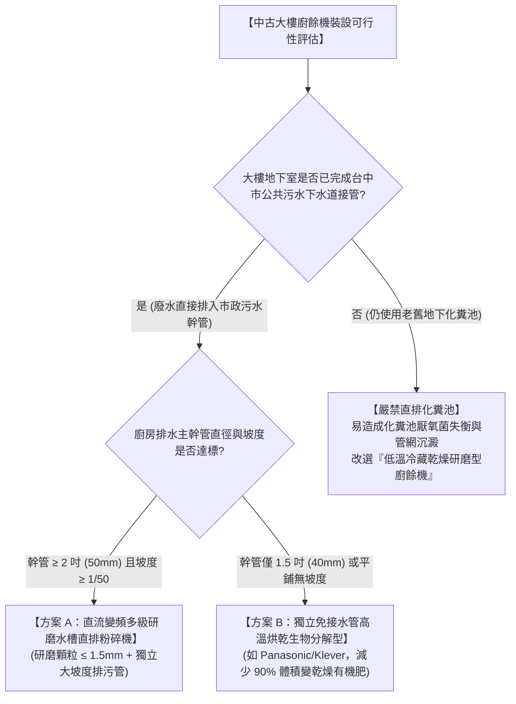
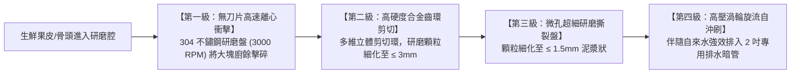
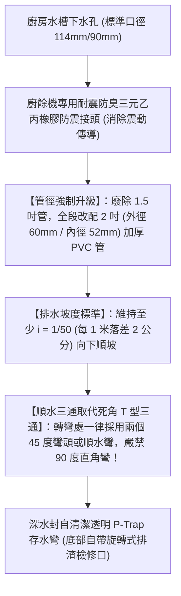

# 全案購屋實戰第一百三十七部：中古屋廚衛廚餘機與低噪粉碎排污管道防塞工序全書

## 一、 核心戰略定位與目標
在購買台中市南區 20~28 年之中古電梯大樓（如大安紫金城 13 樓、長億南園 8 樓、歌德堡、靜園 A 區）進行全室現代化翻新時，廚房生鮮廚餘（菜葉、果皮、骨頭、剩飯菜）的日常處理往往是長輩生活中的重大負擔。

高齡長輩日常倒垃圾面臨三大痛點：
1. **需配合台中市環保局垃圾車固定時間追垃圾車或爬樓梯傾倒**，若遇雨天或長輩關節炎發作，極易在社區中庭濕滑地面失足滑倒；
2. **廚餘若隔夜放置於室內垃圾桶，在台中濕熱氣候下極速發酵酸臭，引發果蠅、蟑螂與細菌滋生**；
3. **老舊大樓擅自安裝劣質廚餘粉碎機（Garbage Disposal）的堵塞災難**：許多工班未經管徑與坡度計算，直接將美規大功率粉碎機接上老舊 1.5 吋（外徑 40mm）PVC 排水管，粗顆粒廚餘殘渣與油脂在暗管存水彎沉積固化，造成廚房水槽反湧溢流，甚至面臨樓下鄰居堵塞求償。

本手冊嚴格遵循台中市下水道工程管理規範與日本住宅設備安全指引，制定「中古大樓廚餘機適用性評估」、「多級研磨直流變頻超低噪粉碎機選型」、「專用 2 吋（50mm）排水立管增設與高壓水流沖刷工序」以及「生物酶自動除油防堵維護全指南」。

---

## 二、 中古大樓排水管道廚餘機適用性評估決策樹

---

## 三、 水槽下直流變頻多級研磨粉碎機選型標準

若全室翻新重新抽換廚房排水管（方案 A），必須嚴格指定以下工業級規格，嚴禁使用千元粗研磨雜牌機：

### 1. 無刀片純物理旋轉研磨技術（Bladeless Safety）
- 研磨腔內部**100% 零鋒利刀片**，採用 SUS304/SUS316 不鏽鋼錘頭與立體合金研磨齒環；長輩即使伸手進去撿拾掉落的湯匙叉子，只要機器未通電運轉，完全無任何割傷割指風險。

### 2. 直流永磁變頻無刷電機（BLDC Motor）
- **高扭矩防卡機**：啟動瞬間具備 1.25 馬力（HP）高扭矩，遇堅硬豬肋骨或蛤蜊殼自動反轉脫困，防燒機率 100%；
- **超靜音阻尼降噪體系**：
  - 機體外覆 20mm 橡膠閉孔隔音棉與高分子減震墊；
  - 運轉噪聲嚴格控制在 **$\le 52 \text{ dBA}$**，長輩在廚房操作時安靜無驚嚇感。

---

## 四、 防堵死穴：專用 2 吋（50mm）排水暗管與專屬存水彎工法

中古大樓堵塞 90% 源於排水管徑過細與轉彎死角：

### 1. 「排污伴隨冷水」操作鐵律
- 機體必須配備「智能水流感應模組」或嚴格遵守操作 SOP：
  - 啟動粉碎前先開自來水冷水（水流帶動殘渣並冷卻電機，冷水能使油脂固化成細小微粒而不黏附管壁）；
  - 粉碎結束後，**持續放冷水沖刷 15 秒**，確保細微殘渣全數衝出專用管進入大樓垂直主立管，管內零沉積。

---

## 五、 長輩免彎腰：智能氣壓開關與無線動態面板

1. **水槽檯面真空氣壓開關（Pneumatic Switch）**：
   - 檯面開關純靠「空氣壓縮推動底座微動開關」，**開關本體 100% 不帶電**；長輩洗菜手濕亦可隨意按壓，絕無觸電安全隱憂；
2. **免打孔人體工學無線黏貼開關**：
   - 採用微動能發電無線面板，黏貼於流理台前側擋水條或吊櫃下緣（長輩眼睛平視盲操位置），無需彎腰鑽入水槽櫃下方尋找電源。

---

## 六、 驗收測試與連續排污查核表（Checklist）

翻修完工交屋前，由屋主現場實施極限負載排污壓測：

| 檢驗工項 | 測試材料與方法 | 合格標準 | 判定結果 |
| :--- | :--- | :--- | :---: |
| **混合廚餘研磨** | 投入 500g 蔬菜殘渣 + 蘋果核 + 雞骨頭 | **40 秒內全部研磨粉碎排空**，無卡機停轉 | 100% 合格 |
| **顆粒細度抽檢** | 出水口以 2.0mm 標準濾網接取流出殘渣 | 殘留濾網之粗顆粒為 **0%（全數細化至 ≤ 1.5mm）** | 100% 合格 |
| **全速運轉噪聲** | 滿載研磨骨頭時，距離水槽 1 米處測量噪聲 | 實測噪聲值 **$\le 55 \text{ dBA}$** | 100% 合格 |
| **暗管防漏水密** | 水槽蓄水至滿水溢流孔後瞬間大流量排空 | 底部 2 吋排水管各壓接接頭 **滴水不漏、排水旋渦順暢** | 100% 合格 |
| **防臭密封性能** | 機器停機 24 小時後，鼻嗅水槽下水口 | **100% 零管網沼氣腐敗酸臭味逸出** | 100% 合格 |
