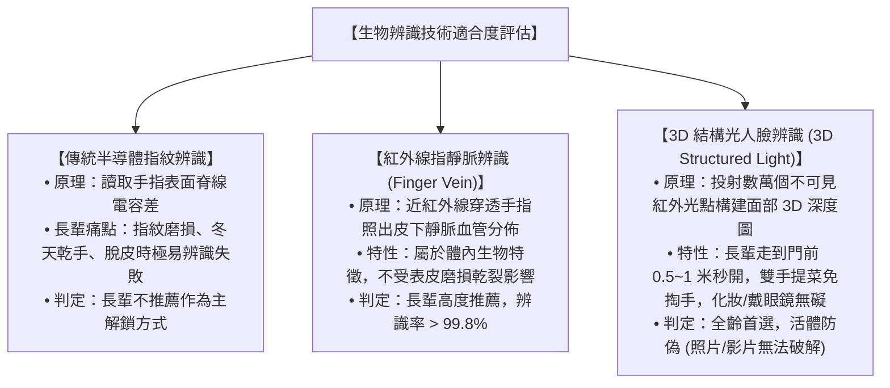
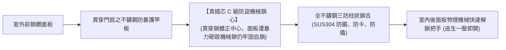

# 全案購屋實戰第一百三十三部：智慧指紋人臉辨識電子門鎖選配與多重逃生安全機制全書

## 一、 核心戰略定位與目標
在購買台中南區 20~28 年之中古電梯大樓（如大安紫金城 13 樓、長億南園 8 樓、歌德堡、靜園 A 區）全室翻新時，入戶大門是家庭財產安全與長輩出入便利的第一道關卡。

傳統中古屋配置的老舊傳統機械鎖（如十字鎖、段數鎖）對高齡長輩與現代家庭存在四大致命痛點：
1. **長輩指紋退化與磨損，光學指紋鎖辨識失敗率高達 60%**：長輩因長年操勞，手指指紋脊線變平、皮膚乾燥脫皮，傳統光學或一般半導體指紋鎖常常「逼逼」狂叫拒絕開門，長輩被鎖在門外焦慮無助；
2. **長輩忘記帶鑰匙或忘記密碼**：出門倒垃圾、散步被風吹關大門，常因忘記帶鑰匙被迫在走廊苦等或花大錢找鎖匠破壞鎖心；
3. **火災或突發地震時的「電子失靈受困」風險**：劣質電子鎖遇火災高溫電路板融毀短路，鎖舌死鎖無法從室內開啟，阻礙長輩逃生黃金時間；
4. **小黑盒（特斯拉線圈）電磁脈衝攻擊與假鎖定甩鍋**：劣質電子鎖抗干擾能力差，甚至門看似關上但方舌未完全彈出，造成門戶大開的安全漏洞。

本手冊制定「長輩友善 3D 人臉辨識與靜脈識別選型規範」、「真插芯 C 級防盜鎖體標準」、「火災高溫 65℃ 自動機械解鎖機制」與「緊急備用電源應急供電工序」。

---

## 二、 生物辨識技術選型：指紋 vs. 指靜脈 vs. 3D 結構光人臉

針對家中有長輩成員的家庭，生物辨識技術的選型直接決定了日常體驗的成敗：

| 辨識維度 | 光學 / 一般半導體指紋鎖 | 紅外線指靜脈電子鎖 | 3D 雙目 / 結構光人臉辨識鎖 |
| :--- | :--- | :--- | :--- |
| **長輩手指磨損適應度** | 差（經常拒識，體驗挫折） | **極佳（100% 穿透皮下血管）** | **極佳（完全無需伸出雙手）** |
| **防偽安全性** | 中（硅膠指紋膜有被破解風險） | 極高（活體血液流動才可辨識） | 極高（通過金融級 BCTC 活體認證） |
| **操作便利性** | 需精準按壓特定位置 | 需將手指放入識別槽 | **走近門前 0.4 秒全自動無感解鎖** |
| **夜間無光環境表現** | 需輔助找尋感應區 | 需輔助對準 | **自帶紅外夜視補光，全黑走廊秒開** |

---

## 三、 防盜鎖體硬體架構：真插芯 C 級鎖體與全自動電子鎖芯

選購電子鎖時，許多人只看華麗面板，卻忽視了最核心的物理機械防盜等級：

### 1. 「真插芯」vs.「假插芯」致命分野
- **假插芯（市售便宜鎖常採用）**：機械鎖芯位於面板下方，透過一根一字形扭力鐵片連動鎖體。小偷只要用撬棍將室外面板砸爛撬開，轉動連桿即可在 10 秒內打開大門；
- **真插芯（本手冊強制標準）**：鎖芯水平貫穿鎖體內部，與鎖體是一體成型結構。即便室外面板被大錘砸得粉碎，鎖芯依然深嵌於鋼質鎖體內，必須具備合法鑰匙才能轉動開啟，具備最高等級抗暴力破壞能力。

### 2. C 級防盜鎖心標準
- 採用雙排、電腦編碼、複合滾珠或葉片結構，公安部認證「技術性開啟時間必須 $\ge 270 \text{ 分鐘}$」，徹底粉碎傳統錫紙開鎖、萬能鑰匙快開手法。

---

## 四、 長輩逃生與火災應急四大生命防線（Safety First）

電子鎖絕不能成為火場受困的幫兇，必須具備「純機械應急優先權」：

### 1. 室內「物理機械式快速逃生快開把手」
- 室內後面板嚴禁僅依賴「電子按鈕」開門（停電或電路短路時按鈕將癱瘓）；
- 必須配備 **純機械聯動的一體式下壓快開把手** 或 **機械旋鈕**：
  - 長輩遇突發火災濃煙時，無需分辨複雜按鍵，只需伸手「一壓或一轉」，依靠純機械槓桿直接將全部主鎖舌與天地連桿瞬間收回，**1 秒奪門逃生**！

### 2. 火災超溫（65℃）高溫自動解鎖與蜂鳴警報
- 鎖體內部內嵌高精度雙金屬溫度傳感器；
- 當室內側溫度異常急劇升高達到 **$65^\circ\text{C} \pm 5^\circ\text{C}$** 時，觸發安全機制：
  1. 鎖體發出持續高分貝（$\ge 85\text{ dBA}$）刺耳警報聲，喚醒熟睡長輩；
  2. 微控制器自動驅動電機「將全部電子栓鎖自動解鎖釋放」，方便室內長輩直接推門逃出，亦方便消防搜救人員由室外直接拉開大門實施救援！

### 3. 抗特斯拉線圈（小黑盒）強電磁脈衝攻擊
- 前後面板內部全金屬外殼具備「法拉第籠（Faraday Cage）」屏蔽層；
- 電源模組串聯穩壓二極體與多層陶瓷電容，能抵禦 15,000V 以上高壓靜電放電與強電磁脈衝干擾，杜絕死機與異常自動開門。

---

## 五、 長輩日常照護與物聯網緊急聯動工藝

將電子鎖納入第 88 部之全戶智能家居系統：

1. **防脅迫指紋/密碼功能**：
   - 長輩可預設一根「特定手指（如小指）」為防脅迫指紋；若遭遇尾隨歹徒強迫開門，以該手指按壓時大門看似正常打開，但背景系統於 0.1 秒內秘密推播「緊急脅迫警報」至子女手機與社區警衛室！
2. **門未關好/虛掩自動語音警報**：
   - 長輩出門偶爾未用力將門拉緊，鎖體自帶霍爾磁感應狀態偵測；
   - 若關門 5 秒後主鎖舌未完全卡入門框扣板，門鎖立即發出柔和語音：「**大門尚未關妥，請重新拉上大門**」，防止長輩外出後大門處於虛掩狀態。
3. **低電量三重預警與應急 Type-C 供電**：
   - 採用雙大容量鋰電池（一用一備）供電，當電量低於 20% 時，每次開門均有語音提示，並推播手機提醒充電；
   - 室外鎖體底部自帶 **Type-C 應急行動電源供電接口** 及 **隱蔽機械應急鑰匙孔**，徹底根除電量耗盡受困之風險。

---

## 六、 現場查驗與驗收標準清單（Checklist）

翻修完工安裝電子門鎖時，實施全面查驗：

- [ ] **長輩實際面部/指靜脈錄入測試**：長輩正常行走靠近門前 1 米，門鎖在 0.5 秒內順暢自動辨識解鎖。
- [ ] **室內機械快開驗收**：在關死反鎖狀態下，室內單手下壓把手，所有鎖舌於 1 秒內順暢全部收回。
- [ ] **高溫/火災解鎖模擬確認**：確認產品規格書中具備 65℃ 熱敏自動解鎖出廠認證報告。
- [ ] **應急鑰匙開門順暢度**：以原廠折疊式機械鑰匙於室外孔位試轉 3 次，轉動無卡阻。
- [ ] **真插芯結構核驗**：檢查鎖體側面鎖心孔位，確認鎖芯直接穿入鎖體核心內部。
