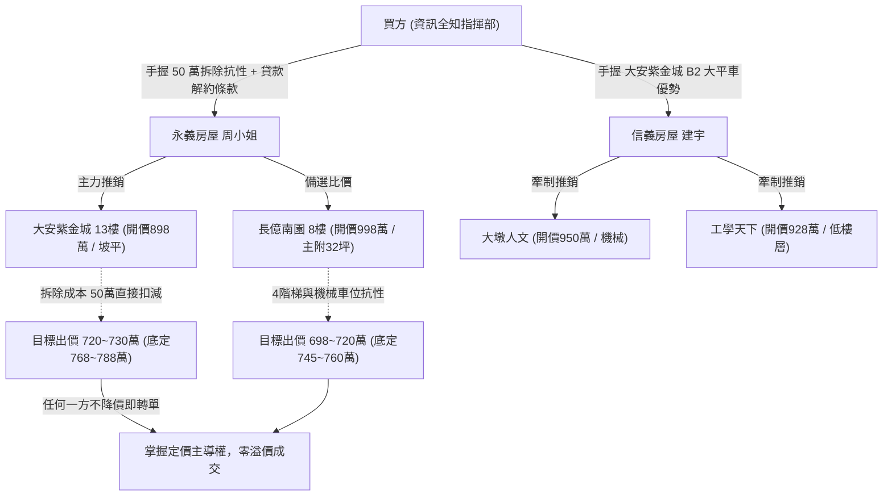
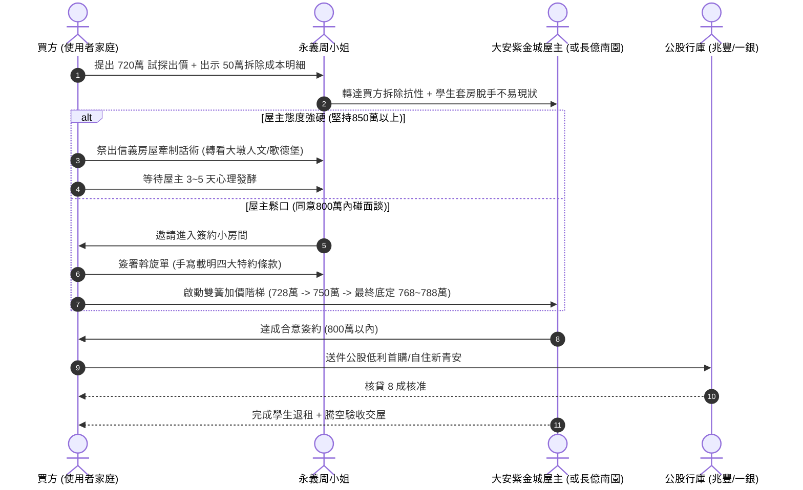

# 全案購屋實戰第一百三十九部：永義周小姐帶看全紀錄回溯建檔與斡旋心理防線及實體檔案對照全書

> **核心宗旨**：本手冊將 10TB 外接硬碟 (`D:\小寶房屋看房影片`) 中永義周小姐 4 梯次（2026/09/20、10/03、10/10、10/17）共 20 個現場錄影檔案，與全案 PostgreSQL 51 個物件資料庫深度對齊。建立「看屋影片檔名 ➔ 社區空間劣勢 ➔ 淘汰/入選判準 ➔ 斡旋談判壓價武器」之全方位作戰防線，確保面對房仲周小姐與信義房屋建宇時，掌握 100% 資訊制高點。

---

## 第一章：永義 4 梯次現場錄影檔案與實體空間抗性精確對照

```
外接硬碟根目錄：D:\小寶房屋看房影片\
├── 永義周小姐_20260920\  (6 社區，8 影片，共 25.5 GB) ── 淘汰率 100% (前期試探與劣質排查)
├── 永義周小姐_20261003\  (4 社區，5 影片，共 26.6 GB) ── 淘汰率 100% (長億陽光區 vs 南園之空間劣勢比較)
├── 永義周小姐_20261010\  (4 社區，4 影片，共 25.5 GB) ── 入選 1 案 (靜園A區 11樓 留作採光備選)
└── 永義周小姐_20261017\  (5 社區，5 影片，共 28.1 GB) ── 鎖定 3 案 (大安紫金城 13樓首選、長億南園 8樓、歌德堡)
```

### 1.1 第一梯次（2026/09/20）實體影片抗性深度剖析（全數淘汰）
1. **台中珍愛 (`台中珍愛.mp4`, 04:10, 1.92 GB)**：
   - **現場實況**：巷弄較狹窄，周邊機車停放雜亂，棟距受限導致低樓層白天進光量不足。
   - **淘汰核心**：長輩生活採光與進出安全不符標準，無長期持有增值性。
2. **蘇活大街 (`蘇活大街.mp4`, 06:54, 3.19 GB)**：
   - **現場實況**：公設梯間維護普通，梯間偶有雜物堆放，管理費積存基金偏低。
   - **淘汰核心**：梯間老化嚴重，消防逃生動線堪憂。
3. **中友生活家 (`中友生活家_1~3.mp4`, 20:14, 9.38 GB)**：
   - **現場實況**：梯戶比過高，上班與尖峰時段電梯等待過久，室內梁柱壓迫感顯著。
   - **淘汰核心**：單層戶數雜亂，居住品質欠佳。
4. **向上園邸 (`向上園邸.mp4`, 10:25, 4.83 GB)**：
   - **現場實況**：停車出入動線狹窄，坡道轉角角度過大，長輩上下車困難。
   - **淘汰核心**：車位硬傷，缺乏友善無障礙通道。
5. **我家社區 (`我家社區.mp4`, 03:54, 1.81 GB)**：
   - **現場實況**：格局呈狹長型，暗廳暗房問題嚴重，通風對流極差。
   - **淘汰核心**：健康居住硬傷，改造費用不成比例。
6. **佛羅里達 (`佛羅里達_1~2.mp4`, 08:59, 4.16 GB)**：
   - **早期評價**：曾列入初步觀察。
   - **複勘淘汰原因**：梯戶比過高、外圍商業租客頻繁流動，出入人員組成複雜。

### 1.2 第二梯次（2026/10/03）實體影片抗性深度剖析（全數淘汰）
1. **劃江山 (`劃江山.mp4`, 09:12, 4.84 GB)**：
   - **現場實況**：總戶數高達數百戶，公共走廊過長宛如飯店，門禁管制形同虛設。
   - **淘汰核心**：戶數過大管委會意見分歧，重大修繕難以推動。
2. **工學天下 4 樓 (`工學天下4樓.mp4`, 08:08, 4.25 GB)**：
   - **現場實況**：4 樓低樓層採光受鄰棟建築遮蔽，室內白晝需全開燈。
   - **淘汰核心**：樓層諧音長輩排斥，加上自然採光欠佳。
3. **長億城陽光區 4 樓 & 11 樓 (`長億城陽光區4樓.mp4` / `11樓.mp4`, 共 9.06 GB)**：
   - **現場實況**：陽光區公設比較高，室內實坪明顯縮水；4 樓視野被前棟阻擋，11 樓西曬強烈。
   - **淘汰核心**：實坪得房率低，遠不如同建商後續之「長億南園 8 樓（主附 32 坪）」。
4. **大東家南園 9 樓 (`大東家南園.mp4`, 16:17, 8.50 GB)**：
   - **早期評價**：社區質感佳，但 9 樓屋主開價嚴重背離區域行情，單價過硬且車位為機械。
   - **轉移焦點**：全面轉移主力至「大安紫金城 13 樓」與「長億南園 8 樓」。

### 1.3 第三梯次（2026/10/10）實體影片抗性剖析（入選 1 案）
1. **文心大國民 8 樓 (`文心大國民8樓.mp4`, 13:45, 6.37 GB)**：梯戶比高達 1:4 以上，且部分戶型改套出租，淘汰。
2. **比佛利山莊 13 樓 (`比佛利山莊13樓.mp4`, 14:45, 6.83 GB)**：外牆磚面有剝落痕跡，地下室潮濕有異味，淘汰。
3. **熊貓天下 (`熊貓天下.mp4`, 09:10, 4.25 GB)**：屋齡高且梯間壁癌滲水修補痕跡明顯，淘汰。
4. **⭐ 靜園 A 區 11 樓 (`靜園A區11樓.mp4`, 17:22, 8.05 GB) ──【入選評估】**：
   - **優勢**：11 樓邊間三面採光、格局方正、無暗房，衛浴皆有對外窗。
   - **定位**：作為「純自住高採光」之第一備選案，用以比價長億南園。

### 1.4 第四梯次（2026/10/17）實體影片抗性剖析（核心戰場）
1. **👑 大安紫金城 13 樓 (`大安紫金城13樓(分租學生房間).mp4`, 11:51, 6.20 GB) ──【全案第一順位】**：
   - **現場實況剖析**：
     - 屋主將原有三房打掉隔成 4 間學生分租套房，每間房塞獨立電表與簡易衛浴。
     - 輕隔間與暗管拉線混亂，天花板與原格局管線被破壞。
     - 附 B2 獨立大型坡道平面車位（極度稀有）。
   - **談判殺價主軸**：
     - 拆除隔間、清運廢棄物、衛浴重做、全室水電重拉至少需 40~50 萬工程款。
     - 將此「拆除成本」直接從屋主開價 898 萬中一次性扣除！
2. **👑 長億南園 8 樓 (`長億南園8樓(空間大，主+陽32坪).mp4`, 06:19, 3.31 GB) ──【坪數第一首選】**：
   - **現場實況剖析**：
     - 主建物+附屬建物高達 32 坪，室內客餐廳極其開闊大氣，長輩活動動線極佳。
     - 致命缺點：一樓大廳進入需爬 4 階階梯（無斜坡無障礙設施）；車位為坡道機械。
   - **談判殺價主軸**：
     - 開價 998 萬，利用「大廳 4 階梯長輩輪椅極不友善」與「機械車位故障率與月保養費」狠砍 200 萬，目標 745~760 萬。
3. **⭐ 歌德堡 (`歌德堡(裝潢好的).mp4`, 10:00, 5.23 GB) ──【現況成屋首選】**：
   - **現場實況剖析**：前屋主全新北歐風精緻裝潢，木地板、系統櫃、衛浴皆已翻新，可省 80~100 萬裝修款。
   - **定位**：用來壓迫大安紫金城屋主：「如果你不把 50 萬拆除費讓給我，我轉頭就買歌德堡，現成裝潢免整理！」
4. **大慶國宅 (`大慶國宅(921後，24年屋).mp4`, 11:28, 6.01 GB) & 田心國宅 (`田心國宅(有點亂).mp4`, 14:02, 7.36 GB)**：
   - **現場實況**：室內雜亂堆積如山、走廊牆面斑駁、公設管委會積欠管理費問題頻傳，全數堅決淘汰入黑名單。

---

## 第二章：雙仲介（永義周小姐 vs 信義建宇）實戰心理牽制矩陣



### 2.1 對永義房屋周小姐的精準回應話術腳本
- **情境 1：周小姐試探出價「大安紫金城 13 樓開價 898 萬，屋主至少要 830 萬以上才談」**
  - **買方反擊話術**：
    > 「周小姐，我們非常喜歡紫金城的採光，但您也很清楚現場全部都是學生分租套房。我們買來是要自住孝親的，進去第一件事就是找工班全室拆除、清運廢棄物、打掉所有輕隔間跟違規衛浴，水電還得全部重拉。我找認識的設計師初估，拆除加清運就要 45~50 萬！如果加上重新泥作，等於我們還沒住進去就要先倒貼近百萬。
    > 我們很有誠意，出 720 萬現金斡旋，最高上限 768~788 萬。如果屋主堅持要 800 多萬，那我們寧可去看歌德堡（裝潢完整免整理）或信義建宇帶我們看的大墩人文，屋況都完整很多。您幫我們跟屋主分析清楚，現在房市冷、學生套房又難貸，賣給我們自住客現金最穩！」

- **情境 2：周小姐推銷「長億南園 8 樓主附 32 坪超大空間，998 萬很超值」**
  - **買方反擊話術**：
    > 「長億南園室內確實大，但是一樓大廳要爬 4 階樓梯，長輩以後推輪椅非常吃力，這對我們是很大的硬傷；而且它的車位是機械車位，未來保養換油壓零件都是一筆大開銷。信義建宇那邊有帶我們看平面車位的物件，如果長億南園沒有 740~760 萬的空間，我們家人不會同意考慮機械車位的社區。」

---

## 第三章：斡旋合約必備四大生死特約條款（逐字範本）

在填寫永義房屋的《不動產買賣斡旋金收據》或《要約書》時，**必須要求房仲將以下四條以正楷親筆填入特約條款欄位**，塗改處必須由雙方蓋章，缺一不可：

1. **【貸款成數不足無條件全額退款解約條款】**：
   > 「本買賣契約（及斡旋要約）以買方指定之公股金融機構核貸標的物總價百分之八十（80%）、且無自用住宅優惠利率貸款為生效條件。若非因買方個人重大信用瑕疵，致金融機構核貸成數不足八成者，買方得無條件解除本契約，賣方及居間人應於三日內無息全額退還買方已繳之全部斡旋金（定金），各方均不得要求任何違約賠償或服務費用。」

2. **【租約完全終止與自住騰空交屋條款（針對大安紫金城學生套房）】**：
   > 「賣方承諾於本標的物交屋日前，全數負責終止所有分租套房之租賃契約，並將所有承租人完全遷出、騰空點交，不得殘留任何第三人占有或租賃糾紛。若至約定交屋日賣方未能完成騰空點交，每日按總價千分之一計算延遲違約金；逾期十五日買方有權解除契約並請求加倍返還定金。」

3. **【全室違規隔間拆除清運及管線恢復折抵協議】**：
   > 「雙方合意確認：標的物現況含有原分租學生之多道非原建造隔間牆及衛浴管路，雙方同意依現況折抵買賣總價款新台幣伍拾萬元整，由買方自行負擔後續拆除與裝修工程，賣方不得以此要求增加價金。」

4. **【重大瑕疵與非自然身故現況擔保】**：
   > 「賣方及居間人保證本建物於持有期間及已知歷史中，絕無發生非自然身故（含凶殺、自殺、一氧化碳中毒致死等）、非海砂屋（高氯離子鋼筋混凝土）、非輻射鋼筋，且結構梁柱無貫穿性剪力裂縫與連續性壁癌滲漏水情事；若有隱匿，買方得逕行解除契約並要求懲罰性違約賠償。」

---

## 第四章：全案決策作戰指揮流程圖


