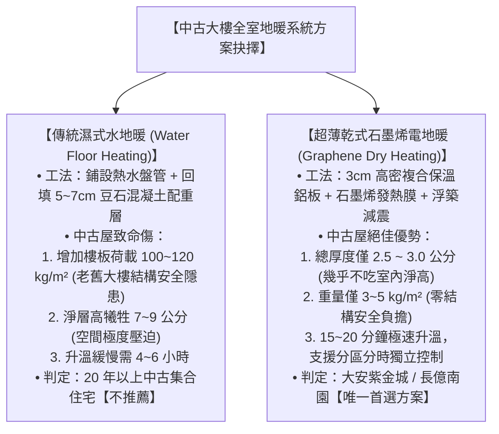
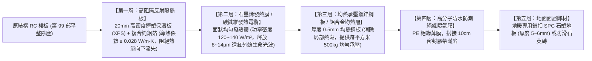

# 全案購屋實戰第一百三十五部：全屋地暖系統選型工藝與長輩關節炎溫控物理治療全書

## 一、 核心戰略定位與目標
在購買台中南區中高齡中古大樓（如大安紫金城 13 樓、長億南園 8 樓、歌德堡、靜園 A 區）進行全室翻新時，許多人常誤以為「台中氣候溫和，不需要裝地暖」。

然而，醫學與高齡人體生理學研究證實：
1. **冬季霸王級寒流與早晚劇烈溫差**：台中冬季受輻射冷卻影響，清晨室內低溫常驟降至 10℃~13℃。傳統變頻冷暖空調由上方吹熱風，因熱空氣上升原理，造成「頭熱腳冷」（天花板 26℃，地面僅 14℃），嚴重刺激長輩交感神經，導致血管急速收縮、血壓飆升，成為心肌梗塞與缺血性中風的最大誘因；
2. **長輩退化性膝關節炎與老寒腿痛楚**：低溫潮濕地面會使關節滑液黏稠度增加、周邊微循環障礙，長輩晨起雙膝僵硬刺痛，大幅增加下床失足跌倒之機率；
3. **空調熱風吹拂引發呼吸道黏膜乾燥發炎**：對有慢性支氣管炎或氣喘的長輩而言，傳統熱風揚起揚塵，令人徹夜難眠。

地暖遵循中醫「溫足而頂涼」與物理學「垂直均勻熱輻射（地面 24℃~26℃，頭部 18℃~20℃）」，是最符合長輩身心健康的極致採暖系統。

本手冊深入剖析「乾式石墨烯電地暖 vs. 濕式水地暖」在中古大樓翻新之取捨、超薄無感施工工藝、分區遠程智慧溫控架構，以及關節炎理療溫控標準。

---

## 二、 乾式石墨烯電地暖 vs. 傳統濕式水地暖在中古屋翻新評估

---

## 三、 超薄乾式石墨烯電地暖五層工藝構造

在客廳拋光磚/SPC 石塑地板或長輩房軟木地板下方，依序施作以下五層結構：

### 1. 遠紅外線（Far Infrared）物理治療生理效應
- 石墨烯通電後，碳原子振動碰撞釋放出波長 **$8 \sim 14 \;\mu\text{m}$ 之遠紅外線**（與人體自身釋放之遠紅外波長高度吻合，醫學上稱為「生命光波」）；
- 遠紅外線能穿透皮下組織深達 3~5mm，產生「分子共振溫熱效應」：
  - 擴張長輩足部毛細血管，加速血液微循環；
  - 緩解膝關節滑膜發炎、減輕退化性關節炎酸痛，長輩清晨下床腳掌溫熱柔軟，徹底擺脫「老寒腿」。

### 2. 綠色低電磁輻射安全認證
- 採用「雙向對稱發熱抵消迴路設計」；
- 實測電磁輻射值 **$\le 0.05 \;\mu\text{T}$（微特斯拉）**，僅為世界衛生組織 WHO 嚴苛限制標準（$0.4 \;\mu\text{T}$）的八分之一，零電磁輻射危害，長輩與幼童安心長年赤腳行走。

---

## 四、 長輩關節炎分區智慧溫控系統架構

配合第 111 部配電箱回路擴容，地暖系統配置獨立 220V 專用回路與分區智慧溫控面板：

### 1. 「雙溫雙控」安全防護機制（Dual Temperature Sensor）
- 每個獨立房間配備一組智能液晶溫控器，內含兩個溫度感測元件：
  - **空間環境感溫探頭**：偵測室內空氣溫度，維持長輩房在舒適的 **$20^\circ\text{C} \sim 22^\circ\text{C}$**；
  - **地面埋入式限溫探頭**：深埋於地磚下方，**嚴格限制地板表面溫度 $\le 28^\circ\text{C} \sim 30^\circ\text{C}$**（防止地板過熱燙傷長輩腳底皮膚或損害 SPC 地板）。

### 2. 分區獨立排程與手機遠程照護聯動
- 客廳、長輩房、主臥各具備獨立控制回路：
  - **長輩房**：設定全天候恆溫模式（日間 22℃ / 夜間睡眠 20℃）；
  - **客廳**：設定生活時鐘模式（清晨 06:30 ~ 08:30 自動預熱至 23℃，長輩晨起打太極拳溫暖舒適；日間外出自動轉入 16℃ 節能保溫）；
- 子女可透過手機 App 遠端查看長輩房地暖即時溫度，若寒流突襲，可在下班前提前開啟，讓長輩回家感受滿室春意。

---

## 五、 長輩房地暖專用地面材質選型禁忌

地暖上方的飾面材選型直接決定了傳熱效率與空氣品質（第 97 部零甲醛標準）：

| 地面材質 | 導熱性與適用度 | 環保安全評估 | 綜合判定 |
| :--- | :--- | :--- | :--- |
| **地暖專用石英防滑磚** | 導熱極佳（熱阻極小，升溫快） | 100% 零甲醛、無任何有機膠水高溫揮發 | **【極度推薦】** 衛浴與客廳首選 |
| **鎖扣式 SPC 石塑地板** | 導熱良好（熱膨脹率 $\le 0.1\%$） | 碳酸鈣與 PVC 高溫熱壓一體成型，零膠水零甲醛 | **【高度推薦】** 長輩房首選，溫潤防滑 |
| **傳統實木地板** | 導熱差（木材熱阻高） | 含水率受熱變化易開裂、翹曲發出唧唧異音 | 嚴禁使用於地暖 |
| **一般平價複合木地板** | 導熱一般 | 底層夾板膠水受熱 28℃ 時，甲醛釋放量暴增 5~8 倍！ | **【絕對禁用】** 嚴重危害長輩健康 |

---

## 六、 驗收測試與絕緣耐壓查核清單（Checklist）

地暖鋪設完成、覆蓋面層前與通電驗收時，必須實施「三道阻抗檢驗」：

- [ ] **鋪設前冷態阻值量測**：使用數位萬用電表測量發熱膜電阻值，實測阻值與原廠標籤誤差在 $\pm 5\%$ 以內。
- [ ] **高壓絕緣電阻測試（搖表）**：使用 1000V 兆歐表量測發熱體與接地鋁箔屏蔽層之絕緣電阻，讀數必須 **$\ge 100 \text{ M}\Omega$**（絕緣優良）。
- [ ] **通電發熱均勻度掃描**：通電 20 分鐘後，使用 FLIR 紅外線熱成像儀掃描全室地面，**整面發熱均勻，無死角、無局部超過 35℃ 之異常高溫點**。
- [ ] **漏電保護斷路測試**：地暖專用回路配置 30mA 高速型漏電斷路器，按下測試鈕 0.1 秒內正常跳脫。
