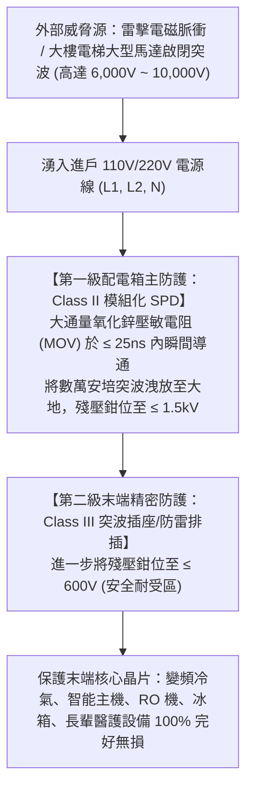
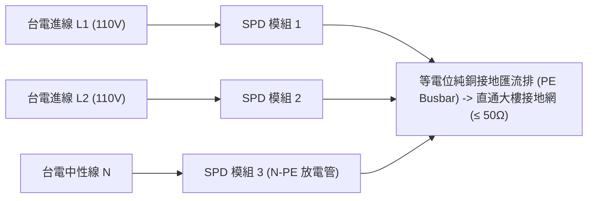

# 全案購屋實戰第一百二十一部：老屋配電箱防突波器SPD與突波保護工序全書

## 一、 核心戰略定位與目標
在購買台中南區中高齡中古大樓（如大安紫金城 13 樓、長億南園 8 樓、歌德堡、靜園 A 區）全室翻新時，隨著現代精密家電、變頻冷暖空調、全熱交換機、智能家居中控主機、RO 淨水器微電腦控制板與高級影音設備的普及，家庭電氣系統最脆弱的隱形殺手為**雷擊突波與電網瞬態過電壓（Surge & Transient Overvoltage）**。

台灣位處亞熱帶多雷暴氣候區，夏季午後雷陣雨頻繁：
1. **感應雷擊突波（Induced Lightning Surge）**：落雷雖未直接命中大樓避雷針，但在周邊數百米電網產生高達數千伏特的電磁脈衝（EMP），順著台電供電立管瞬間湧入室內；
2. **電網開關切換操作過電壓（Switching Surge）**：大樓電梯頻繁啟閉變頻煞車、地下室大功率揚水抽水馬達啟動瞬間，於公共配電幹線上產生數千赫茲的尖峰脈衝雜訊；
3. **設備晶片累積性微擊穿**：現代變頻冷氣主板、冰箱變頻晶片與電視電源模組內部為耐壓極低的微半導體結構，頻繁遭受微小突波衝擊會在幾個月至 1~2 年內因「晶格擊穿」莫名燒毀損壞，維修動輒數千至上萬元。

本手冊嚴格遵循國際電工委員會 IEC 61643 與經濟部《用戶用電設備裝置規則》，制定「配電箱兩級分流突波保護器（SPD, Surge Protective Device）選型工藝」、「納秒級（≤ 25ns）瞬態響應機制」與「單點接地等電位低阻抗（≤ 50Ω）洩放工序」。

---

## 二、 瞬態突波破壞機制與 SPD 防護階梯原理

---

## 三、 第一級（Class II）配電箱防突波器選型核心指標

在進行配電箱（第 111 部匯流排模組）組裝時，必須於進戶總開關後方第一優先安裝專用導軌式 SPD：

### 1. 核心物理性能參數標竿
- **額定放電電流（Nominal Discharge Current, $I_n$）**：
  - 必須標定為 **$\ge 20 \text{ kA} \; (8/20\mu\text{s})$**；
- **最大放電電流（Maximum Discharge Current, $I_{\max}$）**：
  - 必須達到 **$\ge 40 \text{ kA} \sim 65 \text{ kA} \; (8/20\mu\text{s})$**（具備承受近距離感應雷連續衝擊之能力）；
- **電壓保護水平（Voltage Protection Level, $U_p$）**：
  - 鉗位殘壓值必須 **$\le 1.2 \text{ kV} \sim 1.5 \text{ kV}$**（嚴格低於家用電器 2.5kV 衝擊耐受電壓）；
- **響應時間（Response Time, $t_A$）**：
  - 必須達到納秒級 **$\le 25 \text{ ns}$（十億分之 25 秒）**，在突波摧毀半導體晶片前瞬速導通洩流。

### 2. 核心元件與安全脫扣機制
- 內部採用 **高能氧化鋅壓敏電阻（MOV）** 搭配 **氣體放電管（GDT）** 串並聯結構；
- 配備「內部熱脫扣斷路機構（Thermal Disconnector）」：當壓敏電阻因老化劣化短路時，機械指示窗自動由「綠色（正常）」彈出變為「紅色（失效）」，徹底切斷回路防止 SPD 本體過熱起火爆炸。

---

## 四、 單相三線（110V/220V）全模態保護接線工藝

台灣住宅標準為單相三線制（L1, L2, N，對地為 PE），SPD 必須提供「全模態保護（Full Mode Protection）」：

### 1. 「3P+N」或「2P」接線嚴格規範
- **L1-PE 防護**：保護第一相火線對地突波；
- **L2-PE 防護**：保護第二相火線對地突波；
- **N-PE 防護**：配置大容量氣體放電管，杜絕中性線電位漂移與雷擊反擊；
- **L1-L2 防護**：吸收 220V 兩相間線路瞬態差模過電壓。

### 2. 「凱文接線法（Kelvin Wiring / 0.5米法則）」
- **引線長度鐵律**：
  - 連接 SPD 的相線（L1, L2, N）與接地線（PE），導線長度總和必須 **$\le 50 \text{公分（0.5米）}$**，且越短、越直越好（嚴禁盤繞打圈！）；
  - **原理**：高頻雷電流在導線電感上的感應壓降為 $\Delta U = L \cdot \frac{di}{dt}$，每多 1 米導線長度，突波殘壓即額外暴增約 1,000V！因此超短直連才能發揮 SPD 真正鉗位防護力。
- **後備保護專用斷路器（Back-up Fuse）**：
  - SPD 前端必須串接一組 **2P/3P 32A ~ 50A C特性高分斷小型斷路器（MCB）**，當 SPD 壽終正寢短路時，後備開關在 0.1 秒內跳脫，隔離故障點，維持全戶不斷電供電。

---

## 五、 等電位聯結與接地系統匹配（Equipotential Bonding）

突波保護器的核心是「將雷電流安全洩入大地」，若無優良接地，SPD 將形同虛設：

1. **接地電阻實測合規**：
   - 依第 83 部標準，以三線式數位接地電阻測試儀測量，配電箱接地排對大樓結構地網電阻值必須 **$\le 50\Omega$（本手冊頂標要求 $\le 10\Omega$）**；
2. **接地主幹線線徑**：
   - 連接 SPD 接地端至配電箱主接地排之黃綠雙色銅導線，截面積必須 **$\ge 10 \text{ mm}^2$ 或 $16 \text{ mm}^2$ 多股軟銅線**，確保洩放數萬安培瞬間電流時導線零熱融；
3. **金屬管線總等電位聯結（MEB）**：
   - 進戶 SUS304 給水總管、欣中天然氣金屬管、鋁門窗外框，均以 $6\text{mm}^2$ 銅線就近跨接至配電箱接地排，消除各金屬管道間的雷電電位差，杜絕火花放電。

---

## 六、 驗收測試與巡檢運維查核表（Checklist）

翻修完工交屋前，由技術人員出具檢驗紀錄並逐項確認：

| 檢驗項目 | 規範標準 | 檢測方式 / 工具 | 判定標準 |
| :--- | :--- | :--- | :---: |
| **SPD 品牌與認證** | 具備 CE、UL 1449 第四版或 CNS 14835 標章 | 目視銘牌規格與原廠出廠證明 | 拒絕無認證白牌 |
| **防護狀態指示窗** | 視窗顯示正常綠色標記 | 目視檢查 | 100% 綠色 |
| **引線長度核對** | 相線 + 接地線長度總和 $\le 50\text{cm}$ | 捲尺實測配電箱內走線長度 | 合規無盤繞 |
| **接地線截面積** | $\ge 10 \text{ mm}^2$ 綠色/黃綠雙色銅線 | 游標卡尺測銅芯外徑 | 合規達標 |
| **絕緣電阻測試** | 未接入 SPD 時全室回路絕緣電阻 $\ge 100 \text{ M}\Omega$ | 500V 高阻計（搖表）量測 | 絕緣優良 |
| **接地回路電阻** | 配電盤 PE 排對大樓地網 | 數位三相接地電阻儀 | $\le \mathbf{10 \sim 50 \Omega}$ |
