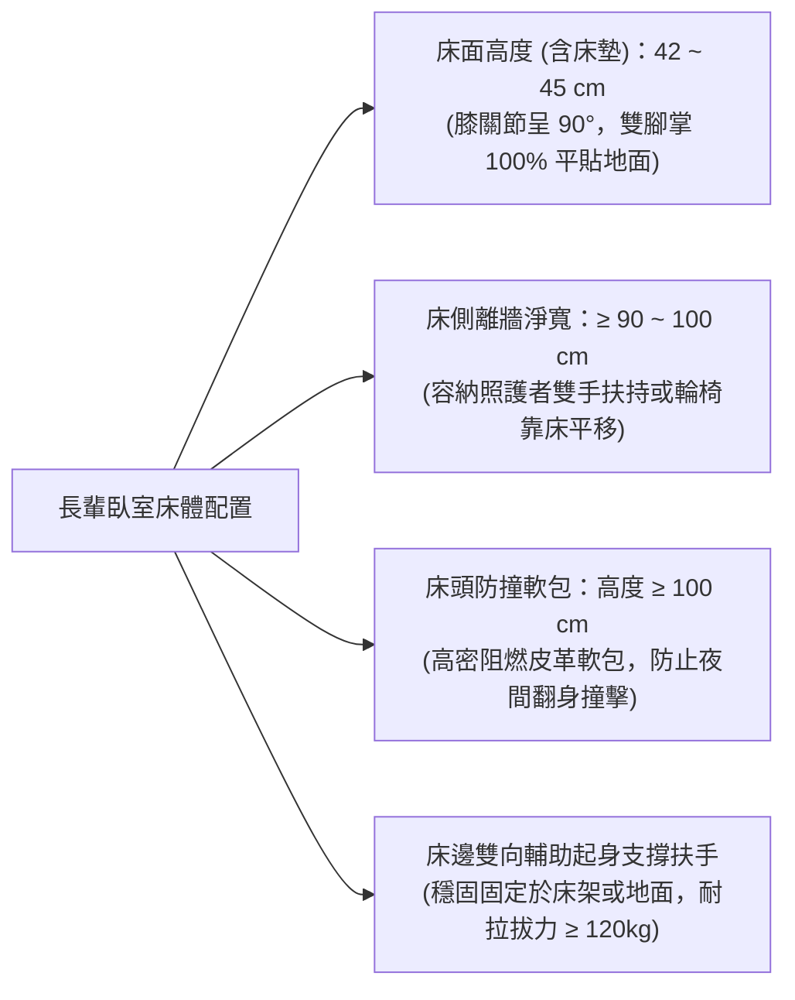
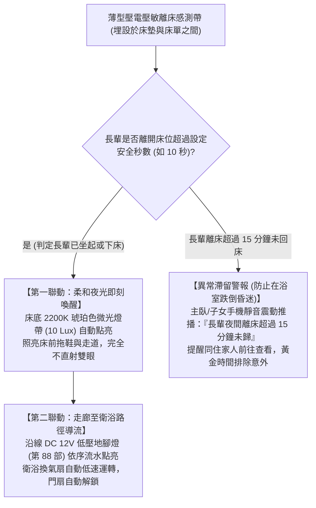
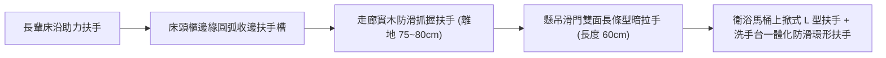

# 全案購屋實戰第一百二十七部：長輩室內跌倒預防人體工學動線與智能離床照護系統全書

## 一、 核心戰略定位與目標
在購買台中市南區中古大樓（如大安紫金城 13 樓、長億南園 8 樓、歌德堡、靜園 A 區）進行全室客製化高齡通用翻新時，醫學與公共衛生統計指出：**65 歲以上高齡者跌倒事故中，高達 56% 發生於居家室內環境**。

其中，最危險的高發時段與地點為：
1. **夜間至凌晨（02:00 ~ 05:00）長輩起夜如廁動線**（剛睡醒時前庭神經平衡感遲鈍、血壓調節反應慢引發姿勢性低血壓頭暈）；
2. **床沿起身與坐下瞬間**（雙腳未踩實即借力失衡滑落）；
3. **臥室至衛浴走廊動線轉角與房門門檻處**。

一旦長輩發生髖關節骨折（Hip Fracture），一年內致殘率與致死率高達 20%~30%，將徹底摧毀長輩的晚年尊嚴與生活品質。

本手冊融合日本介護保險環境整備標準與人體工學動態捕捉分析，制定「床邊安全站立人體工學黃金尺寸」、「智慧無感壓敏離床感測墊工藝」、「臥室至衛浴連續式安全導引扶手動線」與「長照緊急告警聯動系統」。

---

## 二、 床邊起夜防跌人體工學黃金尺寸矩陣

長輩床位擺放與周邊尺寸，必須嚴格依照長輩身形動態計算，嚴禁隨意擺設：

### 1. 床面離地黃金高度（$42 \sim 45\text{ cm}$）
- **過高（$> 50\text{cm}$）**：長輩雙腳懸空，下床瞬間腳尖著地重心不穩，極易向前撲倒跌傷；
- **過低（$< 38\text{cm}$）**：長輩起立時膝關節彎曲角度小於 90 度，股四頭肌需承受自身體重 3~4 倍應力，退化性關節炎長輩會因劇烈疼痛而膝蓋發軟摔倒；
- **黃金標準**：長輩端坐床沿時，**大腿與小腿夾角呈 $90^\circ$、足底 100% 穩固踏平於防滑地面**。

### 2. 床邊「一字型起立支撐助力棒（Bed Rail Support）」
- 緊貼床沿安裝一組包覆防滑抗菌尼龍的外徑 35mm 金屬助力扶手，長輩醒來後可雙手抓握支撐，完成「轉身 -> 垂腿 -> 坐穩 30 秒等血壓平衡 -> 抓握起立」四步安全下床法。

---

## 三、 智慧無感壓敏離床感測與自動照明引導系統

為防止失智、健忘或重聽長輩夜間擅自摸黑下床跌倒，導入「無穿戴、零拘束」智慧感知體系：

### 1. 壓敏感測帶核心工藝
- 厚度僅 **$1.5\text{mm}$** 之高靈敏度壓電薄膜傳感器，鋪設於長輩胸部與臀部下方床單夾層，翻身睡眠零異物感；
- 具備微控制器智能濾波演算法，長輩正常翻身不誤報，唯有身體重心完全脫離床體邊緣時精準觸發。

---

## 四、 臥室至衛浴「零盲區連續式安全導引扶手動線」

夜間長輩意識尚未完全清醒，單靠手掌扶牆極易打滑：

### 1. 連續式導引扶手工藝規範
- **外徑與握持手感**：外徑設定在符合人體工學之 **$32 \sim 35\text{mm}$**，扶手內側與牆面留出 **$45 \sim 50\text{mm}$ 安全抓握淨距**（既方便長輩手指完全環握，又防止手臂失足卡入骨折）；
- **木質包覆溫潤防冰冷**：走廊扶手表面採用天然防滑耐磨櫸木或抗菌樹脂塗層，冬天觸碰溫潤不冰手，避免冰冷金屬刺激引發長輩血管收縮血壓驟升；
- **自發光蓄光導引條**：扶手下方暗藏環保蓄光螢光條，在突發斷電全黑狀態下可自主持續發出微光 8 小時，導引長輩雙手順利摸回臥室。

---

## 五、 長輩臥室室內環境防撞與動線淨空紅線

1. **家具轉角「全室 R 角倒圓」工藝**：
   - 長輩臥室床頭櫃、衣櫃邊角、梳妝台及電視牆下緣，嚴禁存在 90 度直角尖銳邊緣；
   - 所有木作與系統櫃倒角半徑必須 **$R \ge 15\text{mm}$**，或包覆醫療級高彈性透明硅膠防撞護角，長輩即使失足擦撞亦絕不造成皮開肉綻之撕裂傷。
2. **極簡動線零障礙（Clear Floor Space）**：
   - 床鋪四周保持 **$100\text{cm} \times 100\text{cm}$ 輪椅旋轉淨空區**；
   - 地面嚴禁鋪設任何未固定之散裝裝飾地毯或地墊（地毯邊緣翹曲為長輩室內絆倒的第一大隱形元凶！）；
   - 若鋪設地墊，必須採用底部塗布防滑乳膠、邊緣經斜坡扁平收邊條壓實之防滑地毯。

---

## 六、 驗收測試與人因動態查核表（Checklist）

翻修完工交屋前，由家人或監工模擬高齡長輩動作實地盲測：

- [ ] **床面高度實測**：含床墊離地完成面實測為 **$42 \sim 45\text{ cm}$**，端坐時足底完全平踏地面。
- [ ] **助力扶手抗拉拔驗收**：床邊與走廊扶手施加 **120 kg 垂直與水平拉力** 持續 1 分鐘，膨脹螺栓與木心骨架零晃動、零位移。
- [ ] **離床感測觸發測試**：長輩雙腳下地瞬間，床底燈帶與走廊地腳燈於 **0.5 秒內自動點亮**。
- [ ] **超時未歸警報測試**：離床離開房間超過 15 分鐘，同住家人手機 App 準確收到震動提醒。
- [ ] **全室門扇平整無檻**：臥室門與衛浴門開口淨寬 $\ge 80\text{cm}$，地面平整落差 $\le 2\text{mm}$，懸吊滑門滑動阻力小於 2kg。
