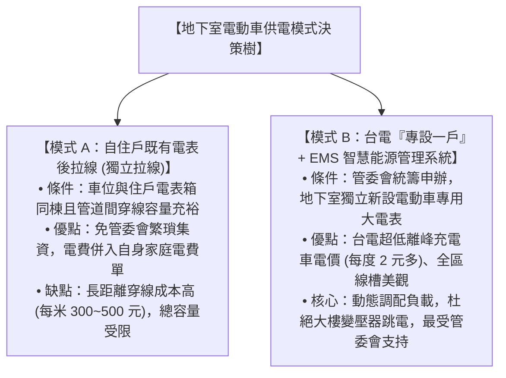
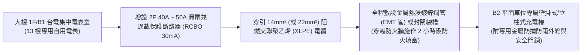

# 全案購屋實戰第一百二十三部：社區地下室電動車充電樁（EV EMS）設置規約評估與電表申請工序全書

## 一、 核心戰略定位與目標
在購買台中南區 20~28 年之中古電梯大樓（如大安紫金城 13 樓、長億南園 8 樓、歌德堡、靜園 A 區）時，隨著台灣 2040 淨零轉型政策推進與電動車（EV）普及，中古大樓地下室車位是否具備「合法安全安裝電動車充電樁」之條件，已直接決定了該社區未來 10~20 年在二手房市場的**保值性、流通性與抗跌溢價能力（通常配備充電樁之車位市值高出 30~50 萬元）**。

在傳統中古大樓中，安裝充電樁面臨三大致命障礙：
1. **老舊社區公用電盤容量不足**：若住戶私自從公共電表或公用配電盤偷接電，極易引發大樓變壓器超載跳電或公共電費爭議；
2. **管委會與傳統鄰居以「火災安全疑慮」百般阻撓**：因缺乏法規依據與專業防護方案，區權會上往往遭到未開電車之長輩或鄰居多數決否決；
3. **電纜走線凌亂破壞消防區劃**：未經統籌規劃之「蜘蛛網式」私拉電線，穿越地下室防火捲門與防煙垂壁，遭台中市消防局安檢查驗開罰。

本手冊嚴格遵循台電《電動車充換電設施電價及供電規範》、內政部營建署《公寓大廈管理條例》最新修法精神與台中市住宅發展工程處指引，制定「社區專設電動車一戶一表（專表專用）工序」、「EMS 能源管理系統動態配電架構」、「安全防火斷電水霧配套」與「區權會提案通過話術指南」。

---

## 二、 兩種充電樁供電架構對比：私設自用電表 vs. 社區專設 EMS 系統

| 評估維度 | 模式 A：由住戶室內電表後引出（表後拉線） | 模式 B：社區專設一戶 + EMS 能源管理系統 |
| :--- | :--- | :--- |
| **適用場景** | **大安紫金城 13 樓**（若社區尚未統籌，先行自費申請） | **長億南園 / 歌德堡**（社區整體規劃升級） |
| **電價計費機制** | 累進電價（家庭用電累計超過 700/1000 度時每度高達 6~8 元） | **專用時間電價**（離峰時間每度僅約 2.1 ~ 2.3 元，省下 60% 電費） |
| **線槽走向規範** | 必須由台電電表室鋪設「鍍鋅鋼管或專用金屬封閉線槽」至 B2 平面車位 | 由台電新設專表引出大通量專用母線槽（Busway），覆蓋全停車場 |
| **跳電安全機制** | 僅依賴住戶自身 50A/75A 主斷路器（第 111 部容量限制） | **EMS 動態負載調節**：電網負載高峰自動降載，深夜離峰全速補電 |

---

## 三、 大安紫金城 B2 平面車位獨立表後拉線施工 SOP

針對我們第一首選「大安紫金城 13 樓」配屬之 B2 坡道平面獨立大車位，買方在交屋後若欲安裝專屬 7kW ~ 11kW AC 交流慢充樁（每小時充入 7~11 度電），標準施工工藝如下：

### 1. 穿線材質與壓降控制
- 由於 13 樓電表位於大樓低層集中電表室，至 B2 車位之電纜走線距離約 30~50 米：
  - 電纜線徑強制選用 **$14 \text{ mm}^2$ 或 $22 \text{ mm}^2$ 低煙無毒（LSFH）阻燃電纜**；
  - 末端工作電流 32A（7kW 滿載）時，全程**線路壓降必須 $\le 2.0\%$**，保證充電樁電壓穩定在 215V~220V，杜絕因壓降發熱引發火警。

### 2. 貫穿防火區劃之阻火填塞（Firestop）
- 電纜管線穿越地下室防煙區劃壁體或樓板開孔處，管內外必須全面填充 **符合 UL 1479 標準之 2 小時級膨脹型防火泥（Firestop Mortar / Putty）**，杜絕地下室濃煙順著管槽擴散至其他樓層。

---

## 四、 破解管委會阻力：安全承諾書與區權會提案通過秘笈

向管委會或區權會正式提出安裝申請時，買方切勿空手陳述，必須附上**「五重安全保障書」**，消弭全體住戶恐懼：

### 1. 「依法申請合規施工」法律保證
- 依營建署最新法規解釋，區分所有權人於其專屬約定專用車位安裝充電設備，只要不破壞結構並具備專業簽證，管委會無正當理由不得任意拒絕。
- 出具「甲種電氣工程承裝業執照」與水電技師簽署之施工圖說。

### 2. 「公共電費獨立切分」絕不佔公家便宜承諾
- 明確保證電源 100% 來自自身自用電表（表後拉線），或透過 EMS 獨立數位電表計費，**完全不使用公共用電一分錢**。

### 3. 「投保千萬元公共意外與產品責任險」
- 提供充電樁原廠投保之 **新台幣 2,000 ~ 5,000 萬元產品責任險保單**，並由安裝廠商加保施工責任險，註明管委會為共同被保險人。

### 4. 「智慧防破壞與過載自動斷電系統」
- 充電樁具備「過電流、過電壓、欠電壓、接地故障、短路、防雷突波、超溫自動斷電」七重保護機制；
- 樁體溫度感測器偵測到內部接點超過 **$75^\circ\text{C}$** 瞬間，0.1 秒內強制切斷輸出並發送警報。

---

## 五、 長億南園機械車位之充電樁限制與評估抗性

針對第二首選「長億南園 8 樓」配屬之**坡道機械車位**，買方在談判出價時必須緊扣此項致命限制：
1. **機械車位無法安裝固定充電樁**：
   - 機械車位上下升降、左右橫移頻繁，電纜線無法隨台架長年反覆折疊拉扯（極易疲勞折斷短路起火）；
   - 機械車位載重上限多為 1,800kg ~ 2,000kg，而現代純電動車（因搭載大底盤電池）空車重常高達 2,100kg ~ 2,500kg，容易造成機械齒輪與鋼索超載損壞。
2. **談判出價壓制話術**：
   > 「周小姐，長億南園配的是坡道機械車位，未來根本沒辦法裝充電樁，電動車也停不進去，這在未來 5~10 年中古市場是很大的折價抗性。
   > 對比大安紫金城是坡道平面大車位，隨時可以拉線裝充電樁，南園的車位條件在市場上必須扣除 50~80 萬元的充電樁升級抗性，我們出 698 萬是非常客觀的理性評估。」

---

## 六、 驗收測試與充電樁安全防護查核表（Checklist）

充電樁完工通電前，實施全面查驗：

- [ ] **獨立接地電阻實測**：充電樁專用接地極或配電箱 PE 排接地電阻 **$\le 10\Omega$**（極高靈敏接地）。
- [ ] **漏電保護器跳脫測試**：按下充電樁專線之 RCBO 測試按鈕，斷路器必須於 **$0.03 \text{ 秒（30ms）}$ 內瞬間跳脫**。
- [ ] **全負載充電溫升測試**：接入電動車實施 32A（7kW）連續滿載充電 2 小時，使用 FLIR 紅外線熱成像儀掃描電表開關、電纜接點與充電槍頭，**所有接點溫升 $\le 15^\circ\text{C}$**。
- [ ] **防撞立柱保護**：車位後方安裝直徑 80mm 黃黑相間金屬防撞警示立柱，防止車輛倒車時撞擊充電樁本體。
