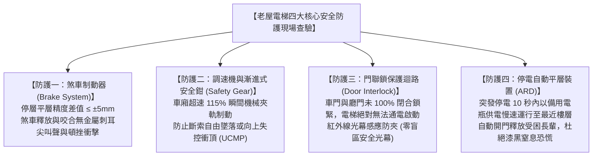
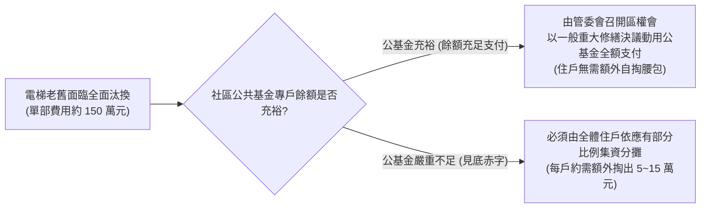

# 全案購屋實戰第一百二十九部：中古大樓電梯系統安全機制體檢與更換集資法規攻防全書

## 一、 核心戰略定位與目標
在購買台中南區 20~28 年之中古電梯大樓（如大安紫金城 13 樓、長億南園 8 樓、歌德堡、靜園 A 區）時，高樓層（如 13 樓、11 樓、8 樓）住戶每天出入最頻繁依賴、直接關乎全家人生命安全與資產價值的公共設施，就是**社區垂直電梯升降機系統**。

台灣中高齡大樓電梯普遍面臨三大致命危機：
1. **主要機件超過 20 年設計使用壽命，故障停機困人頻繁**：主曳引機鋼索磨損變細、變頻控制主機板電容老化爆漿、煞車來令片打滑造成電梯「衝頂」或「溜梯下滑」；
2. **原廠零件斷料停產，淪為「殺肉拼裝車」**：原製造廠（如早期永大、崇友、台灣三菱、大同奧斯汀）公告主機板停產，管委會為省錢改發包給低價民間保養廠商，使用副廠中古拼裝電路板，安全保護迴路形同虛設；
3. **電梯全套更換費用高達百萬，引發住戶集資大戰與管委會癱瘓**：一部 12~15 人座電梯整體更新費用約 **NT$ 120 ~ 180 萬元**。若社區公共基金不足（第 94 部警訊），低樓層（1~2 樓）住戶常強烈抗拒分攤費用，導致電梯帶病運轉甚至被市政府勒令停用封梯！

本手冊嚴格遵循中華民國國家標準 CNS 2866《升降機》、內政部《建築物升降設備管理辦法》與《公寓大廈管理條例》，制定「老屋電梯安全五大核心硬體現場檢驗工法」、「電梯更換全區分攤法定決議流程」與「看屋出價反扣電梯攤提款戰術」。

---

## 二、 老屋電梯四大核心安全防護裝置現場體檢

看屋搭乘電梯上下樓時（特別是勘查大安紫金城 13 樓與長億南園 8 樓），絕不能單純看車廂鏡面與按鈕新舊，必須落實以下四項深層安全查驗：

---

## 三、 電梯車廂與機房六大關鍵指標現場查驗工序

### 1. 平層精度誤差檢驗（Leveling Accuracy）
- **操作方式**：搭乘電梯於各樓層停靠，電梯完全開門後，觀察車廂地坪與樓層地板之高低落差；
- **標準**：CNS 規範平層誤差必須 **$\le \pm 5\text{mm}$**；
- **長輩防跌警訊**：若落差達 **$1.5 \sim 3.0\text{ 公分}$**，代表煞車來令片磨損嚴重或控制系統編碼器失步，長輩進出極易被凸起階差絆倒骨折（第 98 部防跌大忌！）。

### 2. 「電梯安全使用許可證」現場判讀
- 查看車廂內張貼之主管機關（中華民國升降設備安全檢查協會）核發之證照：
  - **有效期限**：是否在 1 年有效期間內；
  - **維修保養廠商資質**：是否為原廠授權或甲級升降設備承裝業；
  - **專業技術人員**：每個月是否確實落實至少 2 次定期維護保養簽到記錄。

### 3. 車廂運行垂直振動與共振噪聲
- **操作方式**：將一枚 10 元硬幣直立於車廂扶手或地面上，電梯自 1 樓直升至 13 樓；
- **合格標準**：硬幣在運行全程**不傾倒**；無橫向晃動、無鋼索滑移頓挫感、無減速時的突發性急墜感。

### 4. 雙向防夾光幕與安全觸板
- 現代電梯門邊必須配備「多光束紅外線安全光幕（至少 128~154 束光束）」，覆蓋離地 10cm 至 180cm 全高度；
- 伸出單手測試，光束被遮擋瞬間電梯門必須於 **0.1 秒內無接觸自動回彈開啟**，嚴防夾傷長輩手掌或拐杖。

---

## 四、 電梯更換集資法規攻防與區權會表決比例（法律自保防線）

當社區電梯已達 20 年以上且故障頻繁，管委會提議更換電梯時，買方必須精通《公寓大廈管理條例》相關法規，防止掉入分攤陷阱：

### 1. 法定決議門檻（公寓大廈管理條例第 31 條）
- **重大修繕決議標準**：
  - 區分所有權人會議應有 **區分所有權人三分之二以上及其區分所有權比例合計三分之二以上出席**；
  - 出席人數 **四分之三以上及其區分所有權比例合計四分之三以上之同意** 行之。
- **1 樓住戶拒絕分攤之最高法院判例攻防**：
  - 1 樓住戶常抗辯「我住一樓從不搭電梯，為什麼要我出錢換電梯？」；
  - **最高法院定錨見解**：依《公寓大廈管理條例》第 10 條第 2 項規定，共用部分之修繕、管理、維護，由管理負責人或管理委員會為之，其費用由公共基金支付或由區分所有權人按其共有之應有部分比例分擔之。**電梯屬於全體住戶共有之共用部分，無論住戶是否實際使用，均負有按持分比例分擔維修更新費用之法定義務！**

---

## 五、 看屋出價談判反扣電梯更新攤提款戰術

在與永義周小姐（或信義建宇）洽談大安紫金城 13 樓或長億南園 8 樓時，調閱管委會會議紀錄若發現「電梯已運轉超過 20 年且尚未更換」，買方立即將此作為**強力壓價反扣籌碼**：

### 實戰談判對話話術（以大安紫金城或長億南園為例）：
> **買方**：「周小姐，我們看過管委會近半年的會議紀錄，社區這兩部電梯已經運轉 24 年了，原廠零件早就停產，最近半年報修紀錄高達 6 次，住戶都在反映常常卡在半空中。
> 社區公共基金帳上只剩下一百多萬，換兩部電梯至少要三百萬，一交屋管委會馬上要開區權會向每戶強制集資攤提 **15 萬到 20 萬元** 的電梯更新款！
> 這筆費用是我們交屋後馬上要自掏現金墊付的沉沒成本。
> 請妳向屋主明確轉達：**這筆預計攤提的 15 萬元電梯更新款，必須直接自買賣底價中全額扣除！** 屋主如果不扣，我們買下來等於幫原屋主承擔過去二十幾年的設備耗損折舊，這完全不符合公平交易原則！」

---

## 六、 電梯現場查驗與合約核檢清單（Checklist）

- [ ] **許可證查核**：確認車廂內升降設備使用許可證在有效期限內，且未被建管處註記列管改善。
- [ ] **平層誤差實測**：各樓層停靠開門時，車廂地坪與走廊地板高低差 $\le 5\text{mm}$。
- [ ] **ARD 停電自救**：詢問管委會電梯是否具備「停電自動平層裝置（ARD）」，停電時是否能自動降至最近樓層開門。
- [ ] **更新保養合約確認**：查核電梯保養合約為「全包式（P.O.）」還是「半包式（F.M.）」，是否包含主鋼索與主機板免費更換。
- [ ] **公基金攤提特約加註**：若交屋前社區已召開區權會通過電梯更新集資決議，買賣合約特約必須載明：「**簽約日（或交屋日）前管委會已決議之任何公共設施專案修繕攤提款（包含電梯更新款），全數由賣方於交屋尾款中負責清結，與買方無涉。**」
