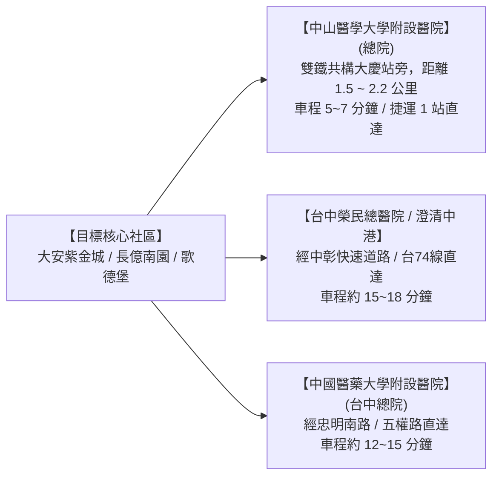
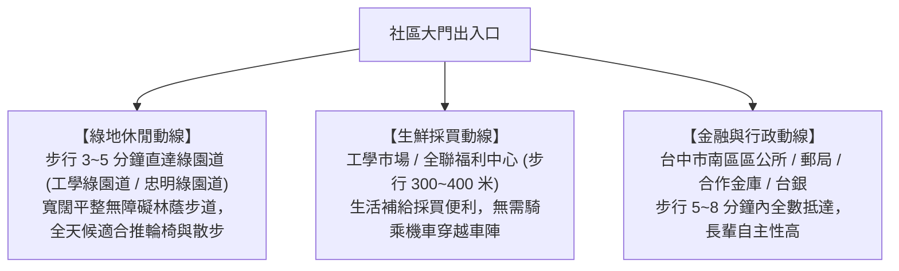

# 全案購屋實戰第一百二十五部：社區生活圈實測與長輩高頻就醫三甲醫院綠色通道評估全書

## 一、 核心戰略定位與目標
在購買台中市南區中古大樓（如大安紫金城 13 樓、長億南園 8 樓、歌德堡、靜園 A 區）時，除了專注於建物室內空間、合約特約與水電施工工藝，對於高齡長輩安居養老而言，**周邊生活圈微環境的「醫療資源可及性」與「高頻生活動線舒適度」**，往往是決定長輩晚年身心健康、心理安全感與家庭幸福的最核心生命線。

實務上，長輩隨著年齡增長，醫療需求呈現「高頻率（慢性病門診、心血管追蹤、復健物理治療）」與「突發緊急性（心肌梗塞、缺血性腦中風、跌倒骨折黃金搶救期）」雙重特徵。

若社區周邊就醫交通擁塞、缺乏大型醫學中心支撐，或日常採買必須穿越無人行道之危險幹道，將大幅增加長輩與照護者的身心負擔。

本手冊針對南區核心目標物件，制定「三大三甲醫學中心綠色通道實測評估」、「社區 500 米高頻步行生活動線無障礙審查」、「銀髮友善公園綠地與日照中心配置」以及「黃金 5 分鐘緊急救護動線標準」。

---

## 二、 台中南區三大核心醫學中心醫療綠色通道實測

南區之所以成為台中最適合長輩養老的宜居板塊，核心優勢在於其被三大頂級醫療體系緊密環抱：

### 1. 中山醫學大學附設醫院（總院區）—— 5 分鐘第一生命防線
- **醫療量能**：衛福部評定之「醫學中心」，具備重度級急救責任醫院資格；
- **專科優勢**：
  - **心臟血管外科與心導管中心**：急性心肌梗塞（AMI）24 小時到院至氣球擴張時間（Door-to-Balloon Time）遠低於國際標準 90 分鐘；
  - **腦中風中心**：急性缺血性腦中風 3 小時內靜脈溶栓（rt-PA）與 6 小時內動脈取栓（EVT）綠色通道；
  - **骨科與長青高齡醫學整合門診**：針對長輩退化性關節炎、骨質疏鬆與多重用藥整合治療；
- **交通直達性**：
  - 由大安紫金城或長億南園出發，經建國北路或工學路，救護車及自駕車程僅需 **$5 \sim 7 \text{ 分鐘}$**；
  - 亦可經由捷運綠線大慶站無障礙電梯直通醫院大廳，免除長輩停車奔波之苦。

### 2. 中興大學附設獸醫與區域基層醫療診所群
- 工學路與美村南路商圈密布超過 **30 間健保特約診所**：包含心臟內科、新陳代謝科（糖尿病照護網）、骨科復健科、眼科（白內障雷射）與耳鼻喉科，步行 3~5 分鐘即可完成例行慢性病處方籤領藥與物理復健治療。

---

## 三、 社區 500 米高頻步行生活圈無障礙實測（Micro-Walkability）

長輩日常生活高度依賴「步行買菜、散步運動、銀行辦事」，步行環境直接決定防跌與安全：

### 1. 「標線型人行道 vs. 實體人行道」道路安全核驗
- **大安紫金城 13 樓周邊**：大安街與工學路路口寬敞，兩側具備建築退縮人行道，長輩推菜籃車或輪椅進出無與汽機車爭道之險象；
- **長億南園 8 樓周邊**：長億城大社區基地退縮綠化帶完善，內部中庭花園廣闊封閉，長輩可在社區中庭安全散步，完全隔離外部車流。

### 2. 公園綠地與戶外芬多精環境
- **工學綠園道 / 樹德公園**：
  - 具備大量成蔭樟樹、風鈴木與平坦防滑步道；
  - 設有長者低阻力戶外體健設施（上肢牽引器、漫步機、太極推手器），提供長輩晨間太極拳、氣功與社交聊天之高質量場域。

---

## 四、 長輩緊急就醫「119 救護車動線」大樓垂直運輸查核

當突發急性疾病時，救護人員進出大樓之「垂直動線阻礙」往往是延誤搶救的隱形殺手：

| 查驗維度 | 🥇 大安紫金城 (`PROP_10`) 實測 | 🥈 長億南園 (`PROP_106`) 實測 | 關鍵影響評估 |
| :--- | :--- | :--- | :--- |
| **大門無障礙進入** | **100% 平進平出**（零台階坡道） | **大廳有 4 個高階梯**（無坡道，擔架需手抬） | 紫金城擔架推車秒級直入；南園有手抬翻覆與顛簸風險。 |
| **電梯車廂深度** | 標準 12 人座，深 140cm $\times$ 寬 140cm | 大容量 15 人座，深 160cm $\times$ 寬 150cm | 兩者均可容納折疊式鏟狀擔架或坐式輪椅。 |
| **救護車臨停空間** | 社區大門前路幅 12 米，具備臨停黃線區 | 長億城社區迎賓車道寬敞，救護車可直達門口 | 救護車均可無障礙靠邊停泊，不阻礙幹道交通。 |
| **夜間保全引導** | 24 小時物業保全，隨時協助控梯升降 | 24 小時守衛巡邏，具備緊急救護通報 SOP | 保全可預先鎖定電梯於 1 樓待命，爭取寶貴救援時間。 |

---

## 五、 長輩生活圈十維指標綜合評分矩陣

| 評估維度 | 權重 | 大安紫金城得分 (10分制) | 長億南園得分 (10分制) | 評比解析 |
| :--- | :---: | :---: | :---: | :--- |
| **三甲醫學中心距離** | 20% | **9.5** | **9.2** | 兩者至中山醫學大學附設醫院車程均在 5~7 分鐘內，醫療後盾極強。 |
| **門前無障礙進出** | 15% | **9.8** | **6.0** | 紫金城平進平出完勝；南園大廳 4 階梯對高齡輪椅族為重大硬傷。 |
| **500米生鮮生活採買** | 15% | **9.5** | **9.0** | 鄰近工學市場、美村南路商圈與全聯，生活機能無可挑剔。 |
| **公園綠道散步環境** | 15% | **9.0** | **9.5** | 南園長億城大中庭花園綠化更廣；紫金城鄰近工學綠園道。 |
| **公共交通雙鐵可及** | 10% | **9.0** | **8.8** | 距大慶雙鐵共構站約 1.5 公里，公車班次密集。 |
| **社區中庭活動安全** | 10% | **8.5** | **9.2** | 南園封閉式造鎮中庭安全性略高。 |
| **日間照護中心距離** | 10% | **9.0** | **9.0** | 南區設有市立南區長照日照中心與多處長青學苑。 |
| **夜間就寢寧靜度** | 5% | **8.8** | **9.0** | 純住宅區，夜間環境安寧舒適。 |
| **加權綜合評分** | 100% | **9.26 分（極優）** | **8.63 分（優良）** | **大安紫金城在長輩無障礙與醫療動線上勝出！** |

---

## 六、 終極行動核檢總清單（Checklist）

在正式下斡旋前，買方陪同長輩完成實地動線走訪：

- [ ] **長輩實地試走測試**：帶長輩由社區門口步行至最近之超市與診所，實測行走時間在 10 分鐘以內且呼吸平順無負擔。
- [ ] **無障礙動線全程平整**：全程人行道路緣石均具備平滑斜坡，無路霸違規佔道與高低階差。
- [ ] **醫療中心掛號便利性**：確認中山醫學大學附設醫院長青整合門診可使用智慧型手機線上即時查詢看診進度，減少現場等待時間。
- [ ] **社區鄰里長照資源**：確認社區管委會有定期配合台中市政府舉辦「社區銀髮共餐活動」與「長者免費健康檢查」。
