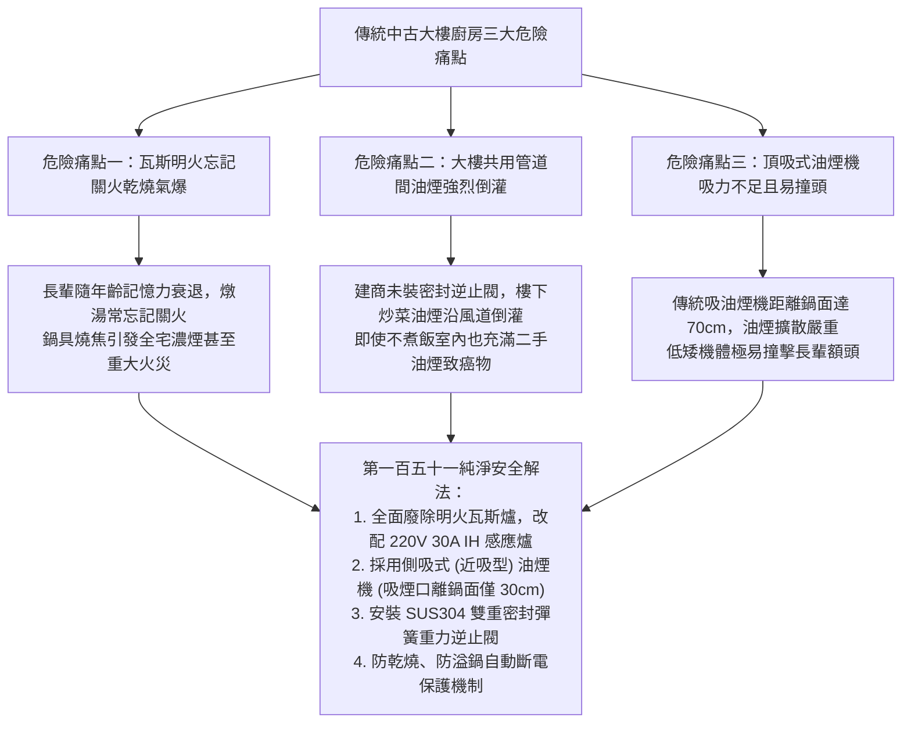
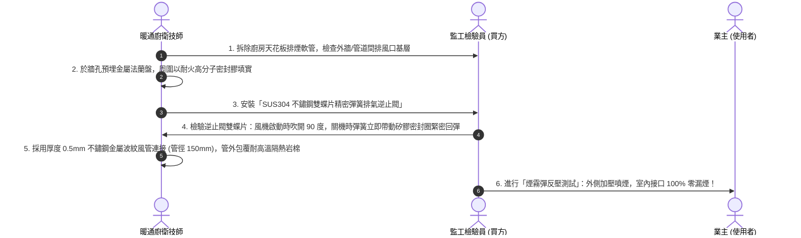
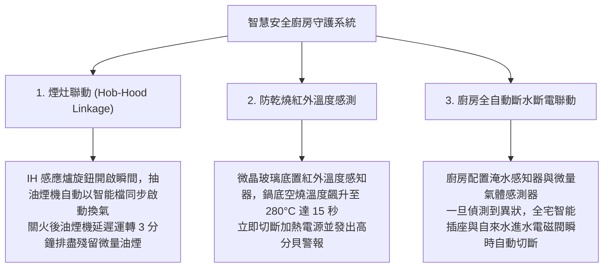

# 全案購屋實戰第一百五十一部：中古大樓廚房無明火IH感應爐專用回路擴容與大排風量側吸式油煙機排煙逆止閥工序全書

> **核心宗旨**：在高齡長輩與全家健康生活中，傳統廚房瓦斯明火常伴隨「忘記關火乾燒引發火災、燃氣不完全燃燒釋放高濃度一氧化碳（CO）、廢氣與油煙四溢誘發長輩肺腺癌」等巨大安全隱患。本手冊專攻台中 20~30 年中古電梯大樓（特別如大安紫金城 13 樓、長億南園 8 樓等）之廚房電氣化與無煙革命。針對「220V 30A 專用單一耐熱純銅回路配置、全平滑微晶玻璃雙口/三口 IH 感應爐選型、大排風量（≥ 20 m³/min）側吸式近吸低噪油煙機、止回密閉排氣逆止閥及金屬防火排煙風管」制定嚴密的標準工序，打造零明火、零油煙、零一氧化碳之極致安全廚房。

---

## 第一章：傳統中古屋廚房三大隱形殺手與無明火轉型

---

## 第二章：IH 感應爐（Induction Hob）專用大功率電氣配置工藝

IH 感應爐係利用電磁感應渦電流直接加熱鐵磁性鍋底，熱效率高達 **$90\% \sim 95\%$**（傳統瓦斯爐熱效率僅約 $40\% \sim 50\%$），室內不散發多餘廢熱，夏日下廚清爽不悶熱：

| 規格維度 | 傳統瓦斯明火爐（本案全面淘汰） | 劣質電陶爐/黑晶爐 | 本案頂級雙口/三口 IH 感應爐 |
| :--- | :--- | :--- | :--- |
| **運作原理** | 液化瓦斯/天然氣燃燒加熱 | 鎳鉻發熱絲紅外線加熱 | **電磁感應渦電流自體發熱** |
| **熱轉換效率**| 約 40% ~ 50%（大量熱能散逸至空氣中） | 約 60% ~ 65% | **$\ge 90\% \sim 95\%$（極速加熱沸騰）** |
| **火災乾燒風險**| 極高（忘記關火引燃油煙或鍋底） | 高（面板高溫達 500°C 易燙傷） | **極低（鍋具離鍋自動斷電、防乾燒 2 小時自動關機）**|
| **清潔維護度**| 爐架死角多、油垢難以刷洗 | 面板易焦黑碳化 | **全平滑一體式微晶玻璃，抹布一擦即淨** |
| **電力配置標準**| 僅需 110V 點火電池或插座 | 110V 或 220V | **專用單一 220V 30A 回路，5.5mm² 專線直送配電箱** |

### 2.1 IH 感應爐電氣施工三大鐵則：
1. **單一獨立專用回路（Home Run）**：
   - 總額定功率通常介於 $3000\text{W} \sim 3500\text{W}$。
   - 必須自總配電箱單獨配管配線（嚴禁中途並接任何插座或照明回路），採用 **台灣太平洋 CNS 認證 5.5mm²（或 8.0mm²）單芯耐熱純銅線**。
2. **斷路器規格配置**：
   - 配置 **2P 30A 高感度高速型漏電兼過載保護斷路器（RCBO）**，額定靈敏度電流 $30\text{mA}$、跳脫時間 $\le 0.1\text{ 秒}$。
3. **金屬櫥櫃通風散熱通道**：
   - IH 爐底部配置大功率冷卻風扇與散熱片。下嵌櫥櫃底板必須預留進風口與排風口（進氣截面積 $\ge 100\text{ cm}^2$），嚴禁在完全密閉之抽屜內緊貼放置雜物，確保散熱順暢避免過熱保護降頻。

---

## 第三章：大排風量側吸式油煙機選型與安裝黃金尺寸

### 3.1 側吸式油煙機核心優勢與安裝參數：
1. **吸風口距離黃金法則**：
   - 傳統頂吸式油煙機距鍋面達 $65 \sim 75 \text{ cm}$，油煙容易在升騰過程中受室內橫向氣流吹散。
   - 側吸式油煙機吸煙口下緣距鍋面僅 **$30 \sim 35 \text{ cm}$**，在油煙剛自鍋邊升起之「臨界擴散區」即被高負壓瞬間吸入，油煙吸淨率高達 **$95\%$ 以上**。
2. **排風量與靜壓門檻**：
   - 排風量必須達到 **$\ge 20 \text{ m}^3\text{/min}$**（在爆炒模式下可達 $22 \sim 24 \text{ m}^3\text{/min}$）。
   - 最大靜壓值必須 **$\ge 450 \text{ Pa}$**，確保在公共煙道高峰期時，具備強大推力克服管道風阻順暢排出。
3. **長輩防撞人體工學**：
   - 側吸式採用向後傾斜 $30^\circ \sim 40^\circ$ 之幾何造型，完全釋放爐灶上方視野空間，長輩料理炒菜時視野開闊，再無碰頭撞傷之虞。

---

## 第四章：雙重彈簧密閉排煙逆止閥與防鄰舍油煙倒灌工法

大樓住戶常抱怨「家中沒煮飯，卻聞到隔壁炒辣椒、煎魚的刺鼻味道」，主因是建商原附之塑膠重力翻板逆止閥因油污黏滯無法閉合：

### 4.1 防倒灌施工四大不可妥協之鐵則：
1. **全不鏽鋼閥體與矽膠密封圈**：
   - 嚴格禁止使用廉價 ABS 塑膠逆止閥（高溫油煙烘烤半年即變形卡死）。
   - 必須採用 **SUS304 不鏽鋼閥體**，閥門閉合接觸面鑲嵌耐油、耐酸鹼之「雙唇食品級氟矽橡膠密封圈」，閉合漏風率 $< 0.1\%$。
2. **雙精密不銹鋼扭力彈簧**：
   - 傳統重力翻板在水平風道中極易因微風吹動而開闔拍打產生異音。
   - 雙彈簧結構可在油煙機關閉時，主動施加彈力緊壓閥片，即使公共管道間有巨大正壓氣流倒灌，閥門依然緊閉如山。
3. **風管斜度與滴油盤**：
   - 排風管通往外牆部分必須保持 **$3^\circ \sim 5^\circ$ 的「外低內高」斜度**，防止雨水自外立面逆流；管路最低點安裝專用冷凝油水收集盒，方便半年旋開清洗。

---

## 第五章：長輩安全智慧聯動與自動斷電防護

---

## 第六章：工程驗收標準簽認單（附於廚衛裝修合約）

> 「乙方（廚衛電氣工程承攬商）保證廚房 IH 感應爐配備符合最新國家法規之 220V 30A 獨立單一回路，導線採用 5.5mm² 以上太平洋一級純銅線材，並配置 30mA / 0.1 秒高感度漏電斷路器。抽油煙機排煙系統全線採用直徑 150mm 之阻燃金屬風道，出風口安裝通過氣密檢驗之 SUS304 雙彈簧密閉逆止閥。完工後乙方須進行排煙全速排風測試與逆向煙霧防倒灌測試，確認零漏煙、零風切異音。乙方對廚衛電氣及排煙管路提供自交屋日起五（5）年之工程品質保固。」
