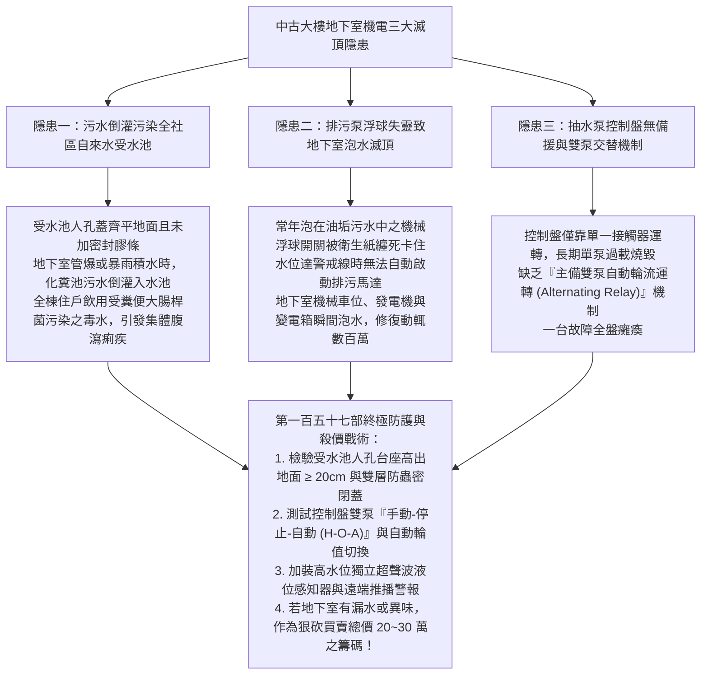
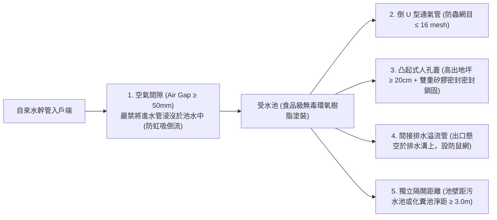
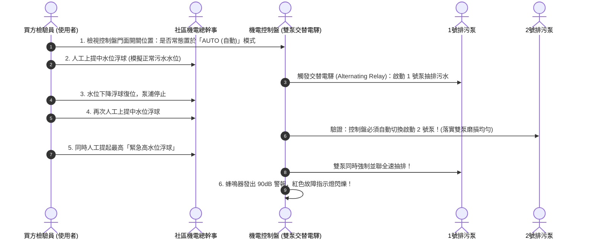
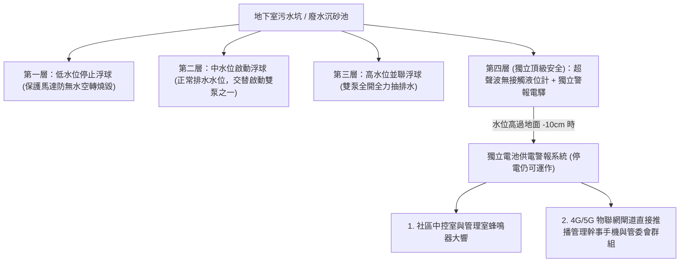
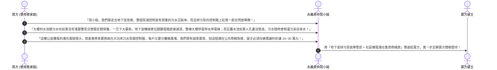

# 全案購屋實戰第一百五十七部：中古大樓地下室蓄水池防倒灌回流與污水抽水泵雙泵交替控制盤體檢全書

> **核心宗旨**：在高層電梯集合住宅（特別如大安紫金城 13 樓、長億南園 8 樓等屋齡 20~30 年社區）中，地下室機電房（包含自來水受水池、消防水池、污水坑與廢水抽排泵浦）為全社區供水衛生與防洪防淹之最核心心臟。然而，中古大樓常面臨「自來水受水池人孔蓋未密閉或凸出地面不足、暴雨時地下室污水倒灌污染全社區飲用水源致集體感染」、「污水排污泵浮球開關老化失靈、雙泵未交替運轉致使單泵過載燒毀、雨季地下室變電箱與車位泡水滅頂」、「控制盤無遠端缺相保護與高水位蜂鳴警報」等滅頂級公設隱患。本手冊專攻「自來水受水池防污染回流五大物理屏障排查、沉水式排污泵（Submersible Sewage Pump）雙泵自動交替控制盤體檢、浮球液位感知器與超聲波液位計校準、管委會機電維護公設抗性砍價戰術」，為家庭飲水衛生與地下室車位資產構築萬全防護。

---

## 第一章：中古大樓地下室供排水機電三大滅頂隱患

---

## 第二章：自來水受水池（蓄水池）防污染回流五大物理屏障

自來水進入各戶水龍頭前，必須先儲存於地下室之「受水池（低位水池）」，再由揚水泵抽至頂樓水塔。受水池之衛生防護直接攸關全家性命：

### 2.1 受水池現場排查四大不可妥協之鐵則：
1. **防虹吸回流空氣間隙（Air Gap）**：
   - 自來水進水管出水口之最低點，與受水池最高溢流水位之間，必須維持出水管徑 **$2 \text{ 倍以上}$ 且不得小於 $50\text{ mm}$ 之淨垂直空間（空氣間隙）**。
   - 嚴格禁止水電為消除落水聲音而私自加裝延長管浸入水面下，此舉一旦外線水壓驟降，池內死水會因「虹吸作用」倒吸回自來水主管網造成嚴重污染。
2. **人孔台座高度（Curb Height）**：
   - 受水池檢修人孔之基座，必須高出地下室完成地坪 **$\ge 20 \text{ cm}$**，人孔蓋必須為防水不鏽鋼材質附橡膠密封墊圈與機械鎖頭。
   - 嚴禁平整齊平於地面之鑄鐵蓋，地下室任何積水（清洗地板水、車底油水）極易從縫隙直接流入飲用水中。
3. **通氣管與溢流管防蟲防鼠防護**：
   - 頂部通氣管必須呈 $180^\circ$ 倒 U 型彎曲，管口包覆 **SUS316 不鏽鋼 16 目（Mesh）微細防蟲網**。
   - 溢流管嚴禁直接插進污水排水管中，必須「間接排水（懸空高度 $\ge 150\text{mm}$）」排入排水明溝，避免污水管沼氣與蟑螂沿溢流管爬入蓄水池。

---

## 第三章：地下室排污沉水泵（雙泵交替控制盤）體檢標準

集合住宅地下室沉水坑內，通常配置兩台大功率排污泵（一用一備）：

### 3.1 排污控制盤體檢五大關鍵指標：
| 檢驗組件 | 標準合格狀態 | 老舊社區常見致命缺陷 |
| :--- | :--- | :--- |
| **運轉切換開關** | 具備「HAND-OFF-AUTO (手動-停止-自動)」三段開關，常態置於 AUTO | 開關損壞或被切至 OFF，導致無法自動排水 |
| **自動交替電驛 (21X)** | 每次排水後自動切換先發順序，使雙泵運轉時數均衡 | 無交替電驛，長期只操爆單一泵浦，另一泵生鏽卡死 |
| **過載保護熱動電驛 (TH-RY)**| 具備過載跳脫與手動復歸功能，額定電流設定吻合馬達銘牌 | 電驛跳脫被膠帶黏死強制通電，馬達線圈過熱燒毀 |
| **欠相/逆相保護器 (APR)** | 三相電壓失衡或缺相時，0.1 秒內自動切斷電源防馬達燒毀 | 早期無配置，台電停電後單相復電時馬達當場燒死 |
| **浮球開關線路** | 採用耐酸鹼防油型電纜，浮球外表光潔無油泥包覆 | 浮球被衛生紙、抹布與油脂硬化結塊卡住，無法上下漂浮 |

---

## 第四章：地下室防洪防泡水——三重獨立液位警戒機制

---

## 第五章：看屋現場地下室機電排查與殺價戰術

在看房大安紫金城或長億南園時，必須請房仲周小姐（或信義建宇）陪同走入地下最底層機電房，現場排查並作為議價談判武器：

---

## 第六章：地下室機電公設健康驗收核對表（現場看屋必備）

| 查核項目 | 標準合格條件 | 現場異常判定（重大警訊） | 處置戰術 |
| :---: | :--- | :--- | :--- |
| **受水池人孔蓋** | 高出地面 $\ge 20\text{cm}$，雙層密封，上鎖無異味 | 齊平地面、蓋子生鏽有縫隙、周圍有積水 | ❌ 屬嚴重衛生隱患，列入議價重大抗性扣款 |
| **排污泵控制盤開關** | 開關置於「AUTO」，綠色指示燈亮，無跳脫 | 開關切在「OFF」或「HAND」，紅色警報燈長亮 | ⚠️ 系統處於半殘或故障狀態，責令管委會出示維修單 |
| **沉水坑周邊環境** | 坑口密閉蓋板完整，地面乾燥，無惡臭 | 污水外溢地面、異味撲鼻、有蚊蠅孑孓孳生 | ⚠️ 浮球卡死或泵浦已堵塞，預估修繕費用殺價 |
| **發電機緊急供電** | 排污泵控制盤有接入「緊急發電機回路」 | 控制盤全無發電機配線，停電時無法排水 | 🔴 颱風停電時必淹水，屬於重大防洪設計缺失！ |
