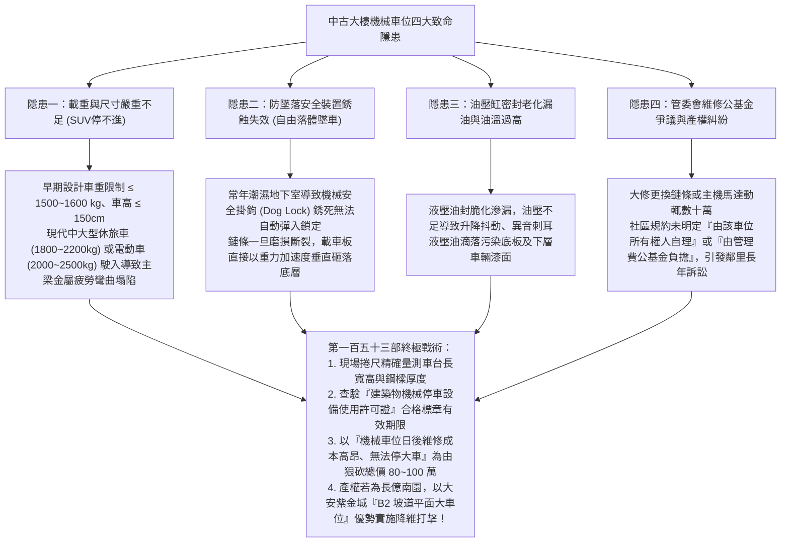
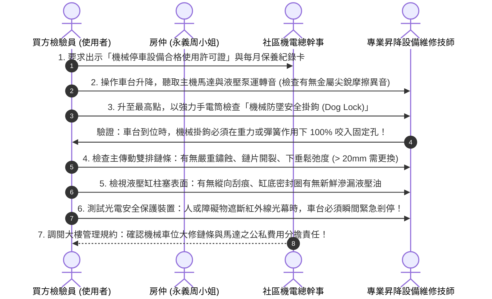
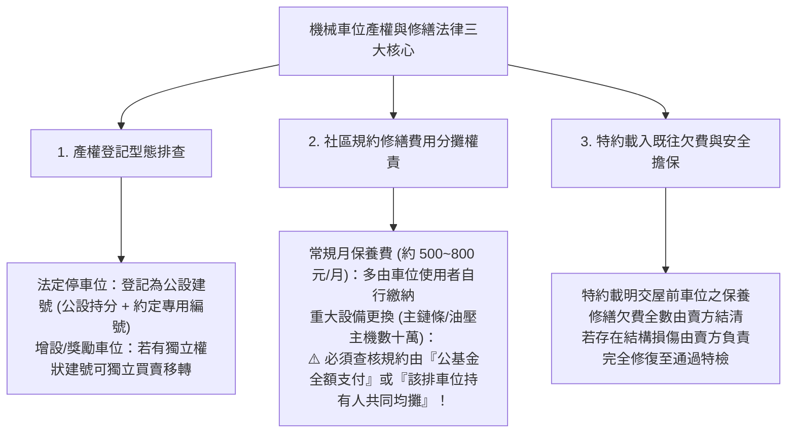
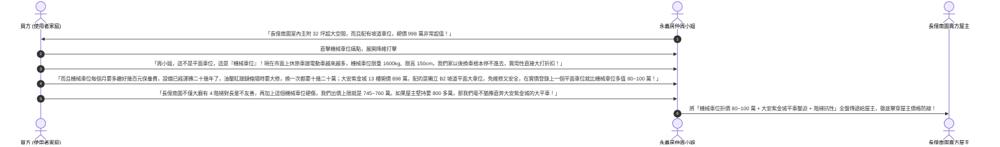

# 全案購屋實戰第一百五十三部：中古大樓地下室機械車位安全極限載重評估與昇降油壓系統體檢及年度特檢工序全書

> **核心宗旨**：在中古電梯大樓（特別如第二順位核心 **長億南園 8 樓** 配備之坡道機械車位，以及歌德堡、大墩人文等物件）中，機械車位（機械停車設備）是全案最大的日常使用痛點與潛在資產負債。傳統 20~30 年中古社區之機械車位常面臨「設計載重僅 1500~1600kg 無法停放現代休旅車（SUV）或電動車（EV）」、「油壓缸內漏油與鏈條磨損疲勞跳齒導致車台傾斜墜落」、「未落實中華民國升降設備安全協會年度安全檢查取得使用許可證」等致命風險。本手冊專攻「機械車位三種常見構型分析、安全載重與車高長寬尺寸物理極限測量、七大關鍵安全防墜機構體檢、管委會公基金維修分攤權責劃分及議價狠砍 80~100 萬殺價戰術」，為家庭車輛停放安全與購屋定價構築鋼鐵防線。

---

## 第一章：中古大樓機械車位四大隱形殺手與物理失效機理

---

## 第二章：機械車位三大常見構型與規格極限對照表

| 車位類型 | 運作機構 | 空間與動線優缺點 | 現代休旅車/電動車適用度 | 長輩使用安全性評價 |
| :--- | :--- | :--- | :--- | :---: |
| **坡道平面大車位 👑（如大安紫金城 13 樓）** | 無任何機械結構，直接坡道駛入平面停放 | **隨到隨停、出入零等待、零維護費、零故障率、可申請安裝充電樁（EMS）** | **👑 100% 完美適用（任何車型通吃）** | **👑 頂級五星（長輩上下車寬敞安全無絆倒階梯）** |
| **坡道機械上層 ⭐（長億南園可接受備選）** | 平時停在地面層，下層車要出時才升高 | 出入相對便利，若機械故障平時仍停於地面；無淹水滅頂風險 | 限制車重 $\le 1800\text{kg}$，車高限制較寬容（可停部分小型休旅） | ⚠️ 三星（車台邊緣有高起金屬導軌，長輩開門需小心腳步） |
| **坡道機械下層（坑道式） ❌（強烈不建議）** | 平時沉在地下坑道中，取車需等上層移開或上升升起 | **取車等待時間長（2~3分鐘）、地下坑道潮濕易積水、暴雨時有淹水滅頂風險** | **嚴格受限：車高多限 150cm 以下，休旅車完全無法停放** | ❌ 一星（地下坑道視野暗、取車不便、長輩極度排斥） |
| **二柱/四柱昇降橫移式 ⚠️（高故障率構型）** | 矩陣式多車位連動，左右橫移與垂直升降 | 戶數密集型大樓常見，任一馬達或感應開關故障全排癱瘓 | 限制最嚴格，機械磨損率最高，每月保養費用沉重 | ❌ 一星（機械噪聲大、故障率極高） |

---

## 第三章：機械停車設備七大核心安全機構體檢工序（SOP）

現場勘查長億南園或相關機械車位物件時，必須會同房仲與大樓管委會機電管理人員逐項實施現場操作點驗：

### 3.1 機械車位檢驗三大絕不可妥協之指標：
1. **內政部國土管理署合格使用許可證（年度特檢）**：
   - 依法由「中華民國升降設備安全協會」等經認可之檢查機構每年檢查一次，合格後核發合格證並張貼於操作箱醒目處。
   - 若現場無許可證、或許可證已過期，**屬違法違規使用**，一旦發生事故保險公司拒賠，主管機關可處 3,000~15,000 元罰鍰並勒令停止使用！
2. **機械防墜安全扣（防墜棘輪）必須 100% 靈活咬合**：
   - 嚴防部分黑心保養廠商為避免故障卡死，私自用鐵絲將防墜掛鉤綁死懸空（形成無防墜保護狀態）。
   - 現場必須確認車台升至定位後，主動切斷升降動力時，防墜掛鉤能獨立承載全車重量。
3. **車台鋼板結構鏽蝕穿孔檢測**：
   - 長年受底盤滴水與雨水侵蝕，載車板下方的「C 型鋼支承梁」與「花紋鋼板」底層極易生鏽薄化。
   - 檢查鋼板表面有無嚴重起泡生鏽或踏踩下陷彈動感。

---

## 第四章：買賣契約產權法律責任與修繕費用歸屬排查

機械車位在台灣公寓大廈產權登記中，多屬於「公共設施專有使用權（約定專用）」：

---

## 第五章：買方斡旋談判殺價話術與抗性反擊戰術

針對**長億南園 8 樓（開價 998 萬，配坡道機械車位）**，買方應當著仲介周小姐的面，將機械車位的抗性發揮至極致，作為狠砍總價的重型攻城槌：

---

## 第六章：工程驗收排查標準核對表（機械車位現場勘驗必備）

| 檢驗項目 | 標準合格條件 | 現場重大異常判定（致命警訊） | 處置戰術 |
| :---: | :--- | :--- | :--- |
| **許可證有效性** | 具備內政部認可特檢合格標章，在有效期限內 | 標章逾期或根本未張貼許可證 | ❌ 屬非法運轉，責令賣方取得合格證前扣留 10 萬元交屋款 |
| **主機運轉聲音** | 運轉平順低沉，無金屬尖銳刮擦撞擊聲 | 液壓泵高頻刺耳哀鳴、鏈條跳齒巨響 | ⚠️ 油壓泵或鏈條齒輪已磨損，要求由賣方負責更換完畢 |
| **油壓缸與管路** | 柱塞鍍鉻面光滑如鏡，閥件乾燥零油漬 | 柱塞有刮痕，缸底大量黑色液壓油滴落 | ⚠️ 油封損壞，要求立即更換油封與全套液壓油 |
| **機械防墜掛鉤** | 車台到位時，左右兩側掛鉤靈敏卡入到位 | 掛鉤銹蝕卡死或被鐵絲綑綁懸空 | ❌ 存在自由落體墜車風險，立即拍照要求管委會停用檢修 |
| **車台鋼板結構** | 鋼板平整厚實，塗層完整，踏踩無晃動 | 底層 C 型鋼銹蝕穿孔、鋼板踩踏鬆動起伏 | ⚠️ 載重強度已失，主張折抵 15 萬元車台重置費用！ |
