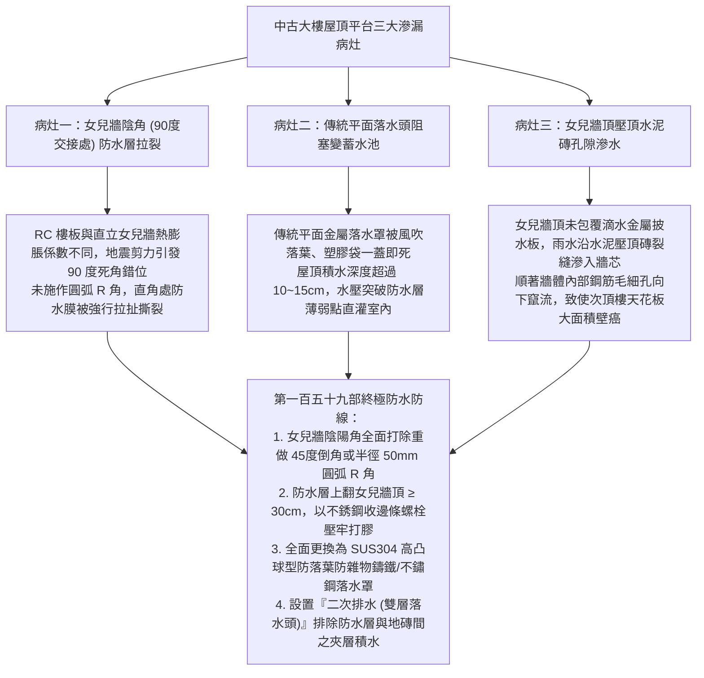
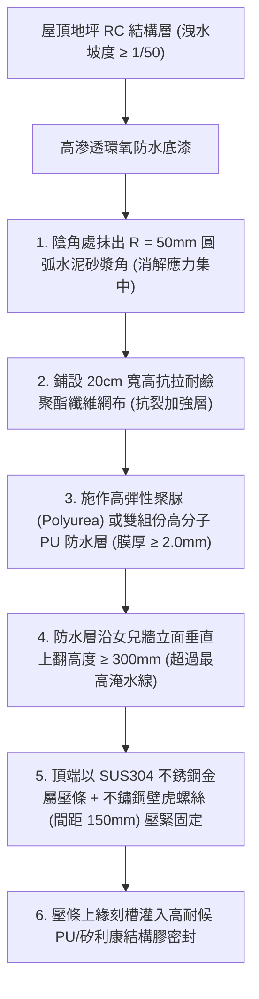
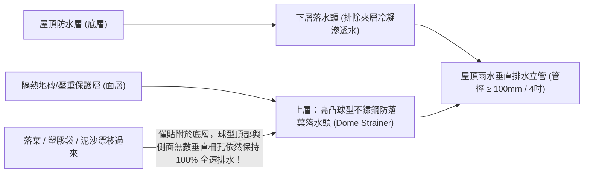
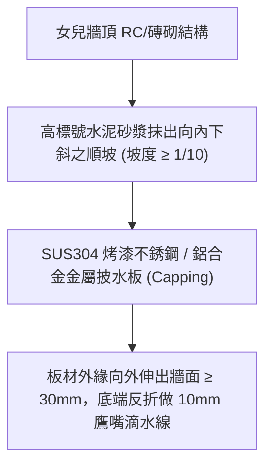
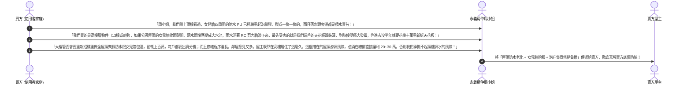

# 全案購屋實戰第一百五十九部：中古大樓屋頂女兒牆防水收頭與落水頭周邊排水抗積水防漏全書

> **核心宗旨**：在高層電梯集合住宅（特別如大安紫金城 13 樓、長億南園 8 樓等頂樓或次頂樓物件）中，屋頂平台（公設屋頂）為整棟建築阻擋狂風暴雨之第一道天靈蓋防線。然而，20~30 年中古大樓最常引發頂樓與次頂樓住戶痛不欲生的「頑疾滲漏」莫過於「屋頂女兒牆（Parapet Wall）根部與陰角防水收頭破裂、女兒牆頂壓頂磚接縫滲水、屋頂圓形排水落水頭被落葉淤泥堵塞致使屋頂變成蓄水池、水壓沿結構微裂縫直灌樓下室內天花板與大樑」。本手冊專攻「女兒牆圓弧 R 角圓滑過渡工序、金屬收邊壓條（Flashing Termination）機械固定嵌填矽利康、球型落葉防阻落水頭（Dome Strainer）選型、雙層落水頭導水工法及利用頂樓防水瑕疵向賣方狠砍總價 20~30 萬戰術」，為頂樓結構防水與家庭資產築起永恆滴水不漏之天靈防線。

---

## 第一章：老舊大樓屋頂漏水三大致命通病與毛細滲流機理

---

## 第二章：女兒牆陰角圓弧 R 角與防水收頭五大核心工序

屋頂防水失敗有 70% 發生在「平面與立面的交接處（陰陽角）」，必須嚴格執行標準節點構造：

### 2.1 防水收頭三大不可妥協之鐵則：
1. **上翻高度嚴格標準（Upstand Height $\ge 30\text{ cm}$）**：
   - 防水層在女兒牆的垂直立面塗刷高度，自完成地坪起算 **絕對不得低於 $30 \text{ 公分}$**（若為颱風迎風面或大樓女兒牆較矮，強烈建議直接翻過牆頂完全包覆）。
   - 嚴禁只塗刷到地坪邊緣，暴雨時水浪拍打女兒牆，水氣直接自防水層背部滲入。
2. **金屬壓條機械收口（Termination Bar）**：
   - 防水膜頂端絕不可單純抹水泥或貼膠帶了事。
   - 必須採用厚度 $\ge 1.5\text{mm}$ 的 SUS304 不鏽鋼壓條，以不鏽鋼膨脹螺栓（間距 $\le 15\text{cm}$）將防水卷材緊緊夾固在混凝土牆體上。
3. **收頭上緣斜面刻槽打膠（Reglet Joint）**：
   - 在壓條上方之混凝土牆面上，以切石機切出深度 $10\text{mm}$、高度 $15\text{mm}$ 之水平凹槽。
   - 壓條固定後，在凹槽內打滿耐紫外線耐候型「聚氨酯結構密封膠（如 Sika / Dow Corning）」，形成 $45^\circ$ 倒水斜面，徹底杜絕自牆壁順流而下之雨水竄入防水層背後。

---

## 第三章：屋頂落水頭選型與「二次排水（雙層落水）」防積水體系

傳統中古大樓屋頂落水頭多為「平鋪金屬孔網」，一旦有三五片落葉或塑膠袋貼附，落水口瞬間被封死：

### 3.1 落水頭規格與二次排水核心要點：
1. **球型高凸防阻罩（Dome Strainer）必選**：
   - 淘汰所有平面落水網，全面更換為高度 $\ge 10\text{cm}$ 之 **SUS304 球型或半球型落水罩**。
   - 即使底部被落葉泥沙堆積環繞，上方與側面數十道垂直排水縫隙依然暢通無阻，排水截面積為傳統平面落水頭的 5 倍以上。
2. **二次排水構造（Double Drainage System）**：
   - 屋頂通常在防水層上方鋪設泡沫水泥隔熱磚或壓重砂漿。
   - 長期受雨水浸潤，地磚與防水層之間的砂漿層常積滿「夾層死水」。
   - 二次排水落水頭在防水層交接處設有「環形暗排孔」，能將滲透至隔熱層下方的積水迅速導出排入立管，杜絕防水層終年泡水水解老化。

---

## 第四章：女兒牆頂金屬披水壓頂板（Capping Flashing）工藝

女兒牆頂端的水泥壓頂磚常因地震產生微裂紋，是雨水垂直滲透牆芯之隱蔽通道：

### 4.1 金屬披水板三大不可妥協之規範：
1. **內斜順水坡度（Slope to Inside）**：
   - 牆頂金屬板必須向「屋頂內部（地坪方向）」傾斜，嚴禁向大樓外立面傾斜。
   - 確保雨水順坡流向屋頂排水管，避免雨水順大樓外立面流淌，形成難看的黑色淚痕水垢並侵蝕外牆磁磚。
2. **外凸雙側鷹嘴滴水線（Drip Edge）**：
   - 披水板兩側外伸突出牆體至少 $30\text{mm}$，底部向內反折勾邊（形成滴水鷹嘴）。
   - 雨水流至邊緣即直接垂直滴落於空中，絕無毛細作用沿女兒牆外壁倒吸回滲。

---

## 第五章：看屋現場屋頂排查與殺價戰術

在看房大安紫金城或長億南園時，必須要求房仲周小姐（或信義建宇）陪同搭電梯上頂樓平台，實地踩踏檢查女兒牆與地坪，並轉化為**狠砍買賣總價 20~30 萬元的殺價重槌**：

---

## 第六章：屋頂平台公設健康體檢核對表（現場看屋必備）

| 查核項目 | 標準合格判定條件 | 現場重大異常判定（致命警訊） | 處置戰術 |
| :---: | :--- | :--- | :--- |
| **女兒牆陰角防水** | 施作半徑 50mm 圓弧 R 角，防水層上翻 $\ge 30\text{cm}$ 無脫膠 | 90 度直角未做弧角，PU 膜嚴重拉裂、剝離翹起 | 🔴 **隨時有滲水直灌室內危險**，列入重大瑕疵砍價 |
| **屋頂落水頭型式** | 採用 SUS304 高凸球型防落葉落水頭，周邊乾淨無阻 | 採用傳統平面金屬片，落水孔被淤泥落葉完全覆蓋 | ⚠️ 暴雨時必成大水池，責令管委會立即清理更換 |
| **屋頂地坪洩水坡度** | 雨後 1 小時全地坪自然排乾，積水深度 $< 3\text{mm}$ | 大面積積水如水窪、青苔滋生、水窪深達 3~5cm | ⚠️ 地坪倒斜水嚴重，主張每坪折價 5000 元作為修整費 |
| **女兒牆頂壓頂板** | 安裝完整金屬披水板，向內傾斜，外伸帶鷹嘴滴水線 | 裸露水泥抹灰磚，頂部有多道貫穿性縱向黑裂縫 | 🔴 水氣直接滲入牆芯，次頂樓天花板必發霉壁癌！ |
