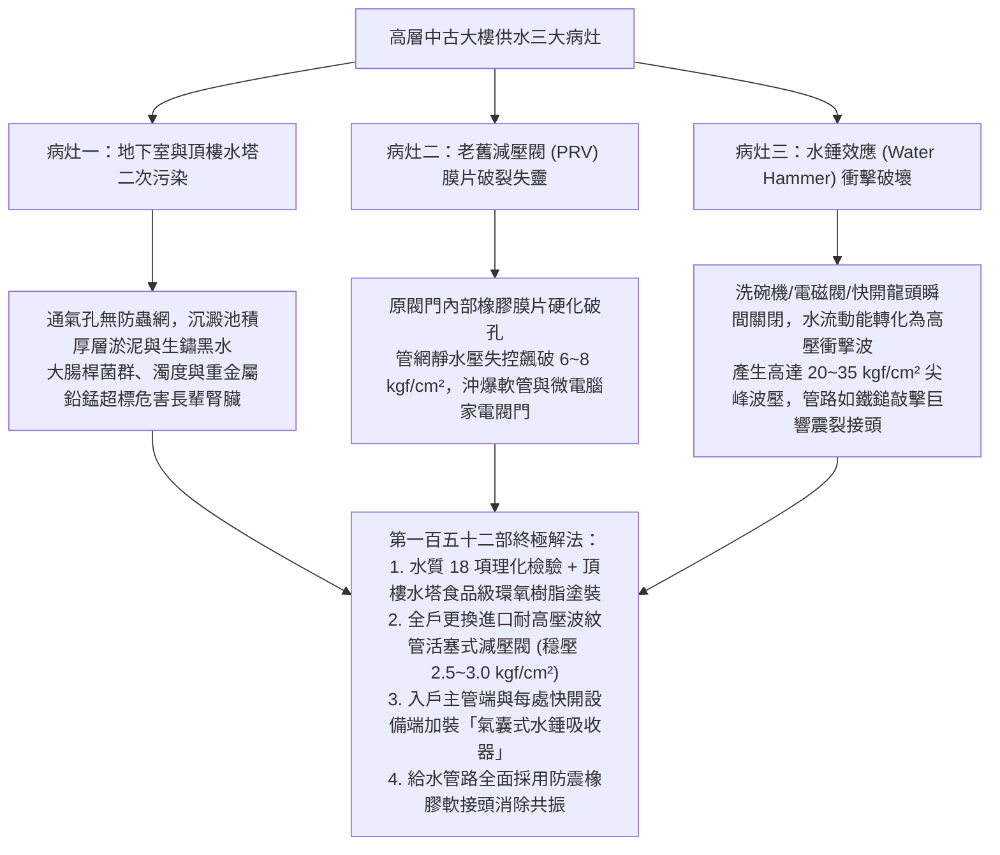
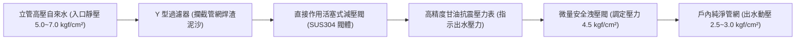
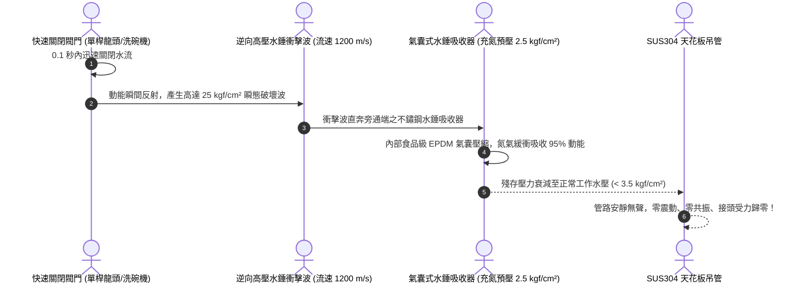
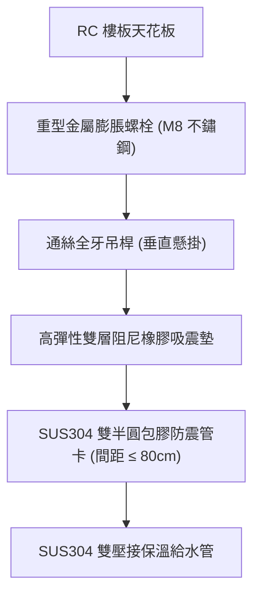

# 全案購屋實戰第一百五十二部：中古大樓自來水水塔水質檢測與揚水減壓閥更換及水錘吸收器消除水錘震動工序全書

> **核心宗旨**：在高層電梯住宅集合住宅（如大安紫金城 13 樓、長億南園 8 樓等）中，供水系統為每日生存之生命線。然而 20~30 年中古大樓常見「地下室蓄水池與頂樓水塔長年未徹底清洗消毒、蓄積沉澱重金屬泥沙鐵鏽與大腸桿菌群超標」、「高樓層揚水泵與低樓層減壓閥（PRV）膜片疲勞老化失效致水壓忽大忽小爆管」、「龍頭快速開關時引發劇烈震動與金屬敲擊巨響之『水錘效應（Water Hammer）』震裂暗管接頭」等重大威脅。本手冊專攻「全水質理化與微生物檢測指標、義大利/日本進口直接作用式減壓閥更換、全不鏽鋼水錘吸收器（氣囊式）配置及管路防震柔性接頭整合」，為全宅用水安全與長輩睡眠寧靜構築萬全防護。

---

## 第一章：高層中古集合住宅供水三大物理病灶與水錘破壞機理

---

## 第二章：中古大樓水塔二次污染排查與水質檢驗標準

在交屋簽約前或交屋後管委會移交時，必須調閱該社區近三年之「水塔清洗紀錄」與「水質檢測報告」：

| 檢驗項目 | 自來水國家飲用水水質標準 | 中古大樓常見超標現況 | 危害與淨化處置標準 |
| :--- | :--- | :--- | :--- |
| **濁度 (Turbidity)** | $\le 2.0 \text{ NTU}$ | 常高達 $5.0 \sim 15.0 \text{ NTU}$（黃濁泥沙） | 損壞免治馬桶濾芯與熱水器；需加裝全戶 40μm 自動反沖洗前置過濾器 |
| **大腸桿菌群 (Coliform)**| 每 100mL 檢驗樣品中不得檢出 | 水塔蓋未密閉或鳥糞雨水滲入時常超標 | 誘發高齡長者急性腸胃炎；督促管委會半年定期清洗並以次氯酸鈉消毒 |
| **自由有效餘氯** | $0.2 \sim 1.0 \text{ mg/L}$ | 管道末端常降至 $< 0.1 \text{ mg/L}$（失去抑菌力） | 需於廚房生飲端配置醫療級高密度活性碳與 RO 逆滲透純水機 |
| **重金屬（鉛 Pb / 鐵 Fe）**| 鉛 $\le 0.01 \text{ mg/L}$、鐵 $\le 0.3 \text{ mg/L}$ | 早期鍍鋅鐵管脫落導致鐵錳嚴重超標（紅水/黃水） | 體內蓄積損害長輩中樞神經系統；全面廢除舊鐵管換 SUS304 不鏽鋼管 |

---

## 第三章：入戶端減壓閥（PRV）選型與精準調壓工藝

高樓層大樓（如大安紫金城 13 樓，總樓層若為 15~18 樓，或長億南園位於中高樓層），自來水自頂樓重力流下或由加壓泵輸送時，樓層越低靜水壓力越大。通常在各戶管道間（管道豎井）內均設有減壓閥：

### 3.1 減壓閥更換與調試四大不可妥協之鐵則：
1. **老舊膜片式更換為「活塞式（Piston Type）」**：
   - 早期橡膠膜片式減壓閥壽命僅 3~5 年，極易因水中泥沙磨損穿孔而失效。
   - 本案全面更換為 **SUS304 不鏽鋼或抗脫鋅黃銅活塞式減壓閥（如日本兼工業 / 義大利 Caleffi）**，耐壓等級達 $16 \text{ kgf/cm}^2$，使用壽命長達 15 年以上。
2. **前後加裝隔離球閥與旁通管（Bypass）**：
   - 減壓閥組前後必須配置 SUS316 全通徑不鏽鋼球閥，並預留帶閥門之旁通管路，未來更換維護時全戶無需停水。
3. **出水動態與靜態壓力標準**：
   - **靜水壓（全室龍頭關閉時）**：調定於 **$3.0 \text{ kgf/cm}^2$**，嚴禁超過 $3.5 \text{ kgf/cm}^2$。
   - **動水壓（兩處淋浴與龍頭全開時）**：維持於 **$2.2 \sim 2.5 \text{ kgf/cm}^2$**，出水充沛有力且水流柔和不刺痛。
4. **過壓安全防線（安全洩壓閥）**：
   - 減壓閥後端必須並聯一組設定為 $4.5 \text{ kgf/cm}^2$ 的小型彈簧安全閥，一旦減壓閥遭異物卡死失效時，安全閥自動向排水管洩壓，徹底保全戶內全室高級水件與家電。

---

## 第四章：水錘效應（Water Hammer）消除與氣囊式吸收器安裝工法

當長輩使用單桿陶瓷閥芯龍頭「快速向下推閉」、或是洗衣機/洗碗機之電磁閥在 0.05 秒內瞬間關閉時，管內高速流動的水流突然受阻，動能轉為極端壓力波，引發管路如金屬鐵鎚重擊般的「匡噹」巨響與劇烈跳動：

### 4.1 水錘吸收器全宅配置黃金點位：
1. **入戶總進水端減壓閥後側（第一道主防線）**：
   - 安裝口徑 $1 \text{ 吋 (28mm)}$、容積 $\ge 0.5 \text{ L}$ 之大型活塞氣囊式水錘吸收器，吸收大樓立管與水表端傳入之外部衝擊波。
2. **洗碗機與洗衣機專用給水栓端（第二道局部防線）**：
   - 在電磁閥進水三通處，就近（距離 $\le 30\text{cm}$）垂直向上安裝口徑 $1/2 \text{ 吋}$ 小型水錘吸收器。
3. **長輩主臥浴室衛浴進水冷熱管端（第三道靜音防線）**：
   - 於臉盆單桿快開龍頭下方之冷熱三角凡爾後方，各並聯一組微型吸收器，徹底消除夜間如廁開關水龍頭產生的敲擊噪聲，守護長輩睡眠品質。

---

## 第五章：給水管路抗震消音吊架與穿牆套管工法

### 5.1 管道降噪防裂三大工法細節：
1. **EPDM 阻尼橡膠包膠管卡**：
   - 所有固定在天花板上的金屬管卡，內側必須包覆厚度 $\ge 3.0\text{mm}$ 的耐磨 EPDM 橡膠襯墊。
   - 消除金屬管與管卡之間的剛性硬碰硬接觸，隔絕水流高頻噪聲傳播至樓板，並容許管路熱脹冷縮之微幅軸向滑移。
2. **穿牆柔性套管（Wall Sleeve）**：
   - 給水管穿越 RC 隔間牆或磚牆時，必須預埋內徑大於水管外徑 $20\text{mm}$ 的 PVC 阻燃保護套管。
   - 水管與套管之間的空隙，使用耐候彈性發泡材料及防火密封膠雙面封堵，絕對禁止用水泥砂漿將金屬水管直接死死焊固在牆體中（防震動拉裂管身）。

---

## 第六章：工程驗收標準簽認單（附於水電工程合約）

> 「乙方（水電工程承攬商）保證入戶自來水管路配置通過國家標準檢驗之活塞式減壓閥組與全不鏽鋼氣囊式水錘吸收器。全戶減壓閥調定出水靜壓為 3.0 kgf/cm²（動態出水壓力不低於 2.2 kgf/cm²）。完工驗收時，由甲方會同在全室各處快開水龍頭、洗碗機及洗衣機進行連續十次快速啟閉測試：全宅管路系統須達到零金屬水錘撞擊聲、管路晃動振幅小於 1.0mm。乙方對減壓閥組及水錘防震系統提供自交屋日起五（5）年之工程安全保固。」
