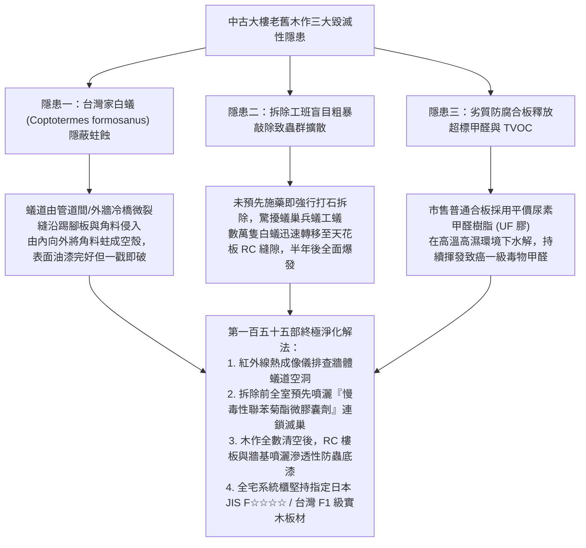
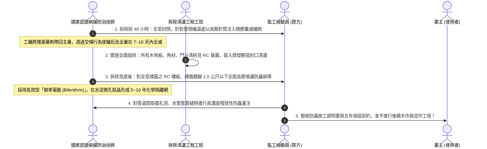
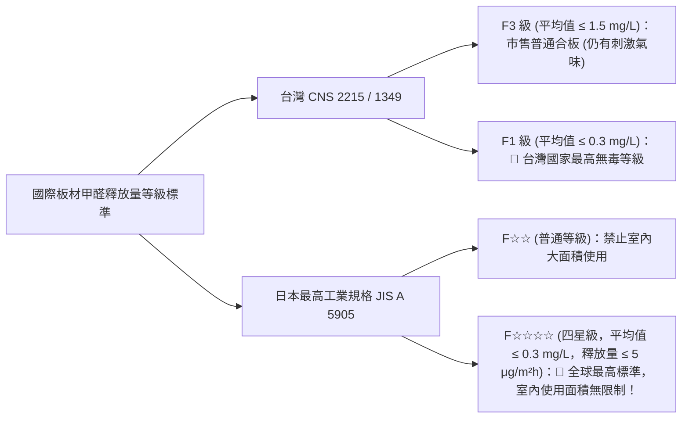
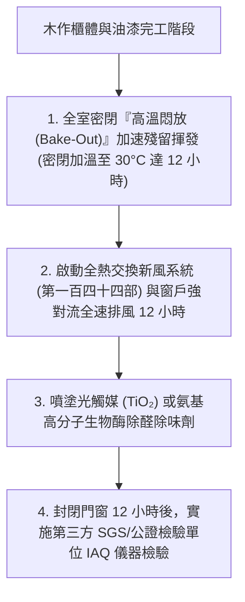

# 全案購屋實戰第一百五十五部：老屋木作櫃體拆除防蟲防白蟻土壤藥劑處理與無醛防潮實木板材選配全書

> **核心宗旨**：在高齡長輩與全家自住環境中，木作裝潢最常引發的「隱形災難」莫過於「原屋主留下的老舊木作隔間與系統櫃長年受潮孳生白蟻（Subterranean Termites）、蛀蟲在牆體內部蛀蝕空洞、拆除不當引發白蟻群向全室及鄰舍擴散爆發」，以及「新做木作大量使用劣質黏膠與普通波麗板，連續釋放高濃度甲醛（Formaldehyde）長達 3~15 年誘發氣喘與血液疾病」。特別針對如 **大安紫金城 13 樓** 原屋主隔成 4 間學生套房之龐大老舊木作隔間與架高木地板，本手冊專攻「白蟻活體與蟻道紅外線熱成像排查、聯苯菊酯（Bifenthrin）微膠囊慢毒連鎖滅巢、RC 牆地面深層殘留防蟲屏障噴灑、F1 / 日本 JIS F☆☆☆☆ 級無醛防潮實木多層板選型」，徹底根絕蟲害與甲醛隱患，構建百年安穩無毒居所。

---

## 第一章：老屋木作隱形蟲害機理與白蟻地下王國破壞力

---

## 第二章：白蟻活動現場排查四大特徵與檢測工法

現場勘查中古物件（如大安紫金城學生套房隔間、長億南園木作包梁）時，必須配備強光手電筒與橡膠小槌進行地毯式檢驗：

| 檢驗特徵 | 物理外觀與現場跡象 | 危害判定等級 | 處置戰術與工程標準 |
| :--- | :--- | :--- | :--- |
| **泥土質蟻道 (Mud Tubes)** | 踢腳板、門框邊緣、天花板角隅出現細長褐色泥土線條 | 🔴 **極度危險（活躍蟻巢正在搬運木纖維）** | 嚴禁私自刮除！必須先由專業除蟲技師鑽孔注藥連鎖感染。 |
| **空鼓敲擊聲 (Hollow Sound)** | 橡膠槌輕敲門框下方 30cm 或踢腳板，發出「咚咚」空心脆響 | 🔴 **嚴重損壞（木材內部已被蛀成蜂窩狀）** | 該處木結構強度已失，拆除時必須專車封袋清運，嚴禁殘留。 |
| **分飛孔與落翅 (Alates Wings)** | 窗台、燈具下方或地板角隅堆積半透明長橢圓形脫落蟲翅 | 🟡 **警戒狀態（每年 4~6 月梅雨季繁殖蟻群已分飛築新巢）** | 說明該社區環境周邊存在成熟大蟻巢，全室必須築起化學防蟲屏障。 |
| **排泄堆積物 (Frass)** | 木地板接縫或系統櫃抽屜底部發現細小如細砂之沙狀粉末 | 🟡 **乾木白蟻或粉蠹蟲害** | 木材含水率過高，需全面更換防潮防蟲抗蛀材。 |

---

## 第三章：老舊木作拆除前後標準「三階段白蟻化學阻絕屏障」SOP

針對大安紫金城 13 樓包含多道分租學生隔間木作，必須嚴格執行三階段滅蟲工序：

---

## 第四章：無甲醛健康板材等級標準（台灣 CNS vs 日本 JIS）

舊屋翻新切忌「剛趕跑白蟻，卻引來甲醛毒氣」。全宅固定收納櫃、更衣室與床頭造型板，必須嚴格鎖定最高綠建材等級：

### 4.1 板材選型四大不可妥協之鐵則：
1. **唯一指定日本 JIS F☆☆☆☆（四星級）或台灣 F1 級**：
   - 全室櫃體桶身與門板，合約必須載明採用符合 **JIS F☆☆☆☆** 認證之低甲醛防潮板（如進口 EGGER 歐松板、或台灣 F1 級實木夾板）。
   - 嚴格禁止使用 F3 級甚至無標籤之黑心合板（其甲醛釋放量高達 F1 的 5 倍以上）。
2. **採用 MDI 生態聚氨酯無醛黏著劑**：
   - 傳統板材使用含甲醛的「脲醛樹脂（UF 膠）」，遇濕熱環境會終身持續分解揮發。
   - 本案選用採用 **MDI（二苯基甲烷二異氰酸酯）無醛生態黏合劑** 之原木微粒板或定向刨花板（OSB），生產過程中不添加任何甲醛，達到「零甲醛添加（NAF, No-Added Formaldehyde）」級別。
3. **六面全封邊工藝（PUR 封邊）**：
   - 櫃體所有層板之四邊及五金開孔處，必須採用 **德國 PUR（聚氨酯熱熔膠）無縫激光或熱風封邊技術**。
   - 封邊膠線細緻無黑線，將板材內部木纖維與外界空氣 100% 物理隔離，兼具極致防潮與微量氣體鎖閉雙重效果。
4. **耐水防潮等級（V313 / P3 級）**：
   - 在台中潮濕氣候下，板材必須通過 **V313 嚴苛測試**（經 3 天高溫水浸、1 天零下急凍、3 天高溫烘乾，三次循環後膨脹率 $\le 6\%$），即使衛浴乾區櫃體也絕不膨脹變形發霉。

---

## 第五章：室內裝修除醛通風與空氣品質檢測驗收

### 5.1 室內空氣驗收合格標準（中華民國室內空氣品質管理法）：
- **甲醛（HCHO）**：1 小時平均值 **$< 0.08 \text{ ppm} \ (0.096 \text{ mg/m}^3)$**（本案要求高標準 $< 0.05 \text{ ppm}$）。
- **總揮發性有機物（TVOC）**：1 小時平均值 **$< 0.56 \text{ ppm}$**。
- **合格方可入住**：未達標準前，裝修承攬商必須負責免費重複實施全室光觸媒催化與強制排風，直至數據完全合格。

---

## 第六章：工程驗收標準簽認單（附於木作裝潢合約）

> 「乙方（木作裝潢及系統櫃工程承攬商）保證全宅現場製作與工廠訂製之木作板材，100% 符合台灣 CNS F1 級或日本 JIS F☆☆☆☆ 最高無毒標準，全數附原廠出廠檢驗證明與防偽雷射標籤，嚴禁使用任何 F3 級或含醛劣質黏著劑。在木作進場前，基層 RC 牆地面均已完成合格病媒防治藥劑屏障。完工後經室內密閉 12 小時甲醛實測值須低於 0.06 mg/m³。乙方對全室木作系統提供五年防白蟻、防蛀蟲及防起拱脫膠之安全結構保固。」
