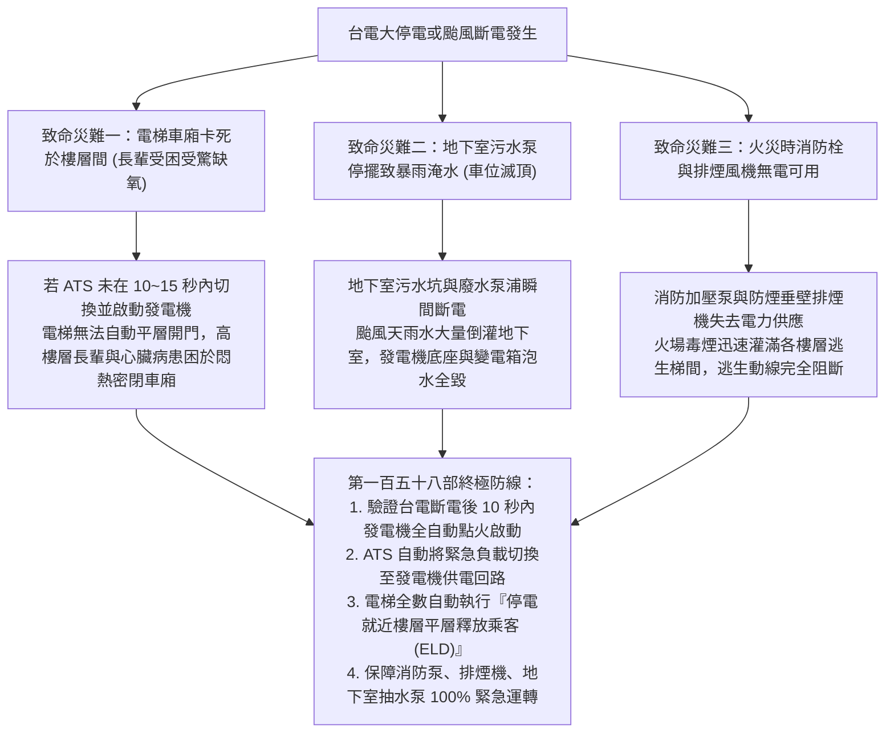
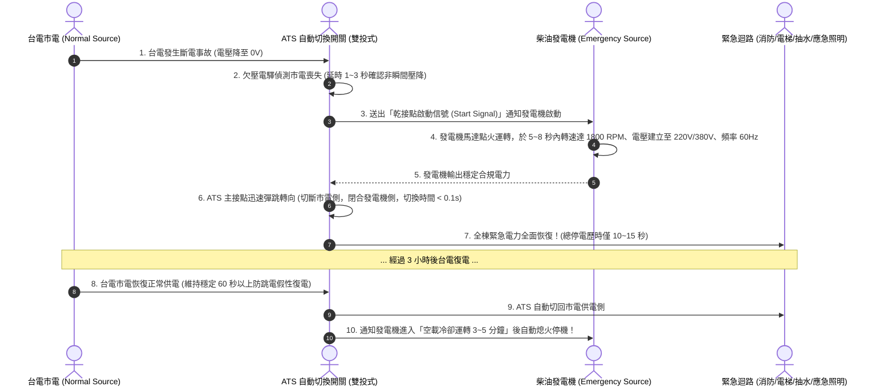
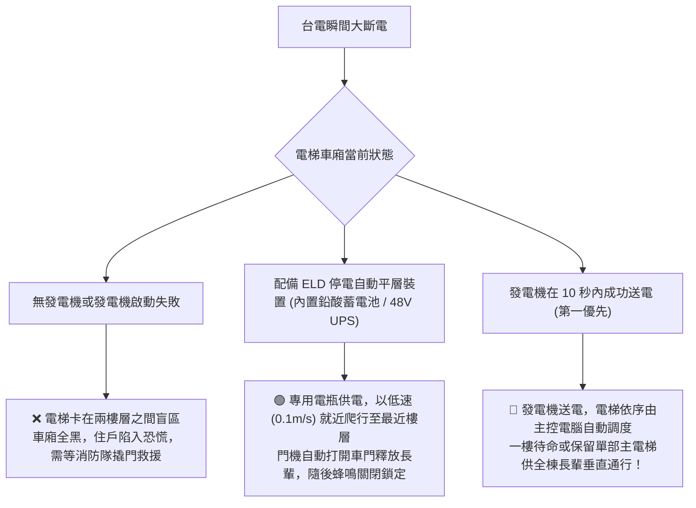
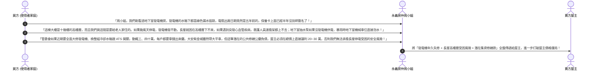

# 全案購屋實戰第一百五十八部：中古大樓柴油緊急發電機負載測試與ATS自動切換開關及停電消防應急供電全書

> **核心宗旨**：在高層電梯集合住宅（特別如大安紫金城 13 樓、長億南園 8 樓等總樓層高達 10~18 樓之社區）中，一旦遭遇夏季區域跳電、雷擊或颱風強風導致台電大停電，「柴油緊急發電機（Diesel Generator Set）」與「自動電源切換開關（ATS, Automatic Transfer Switch）」是全大樓住戶生死攸關之最後能源底牌。老舊中古社區最常見的滅頂公設弊端為「緊急發電機常年僅『無載發動』幾分鐘做做樣子，燃燒室積碳嚴重且散熱水箱生鏽漏水、台電斷電時 ATS 接點卡死碳化無法切換、蓄電池（啟動電瓶）硫化無電導致發電機無法啟動、高樓層住戶與長輩困在電梯中數小時甚至緊急排煙排污泵浦全數停擺」。本手冊專攻「發電機假負載（Load Bank）100% 滿載放電測試標準、ATS 毫秒級自動投切檢驗、發動電瓶浮充體系排查、管委會機電合約審查及利用公設發電機瑕疵狠砍買賣總價 20~30 萬戰術」，確保家庭置產獲得全天候永不斷電的安全保障。

---

## 第一章：高樓層大停電三大致命災難與應急機電物理機理

---

## 第二章：柴油發電機組四大核心組件現場排查標準

在看房大安紫金城或長億南園時，必須陪同房仲周小姐（或信義建宇）會同社區總幹事，走入地下室或發電機專用機房，實施現場點驗：

| 檢驗組件 | 國家安全標準規範 | 老舊中古社區常見重大弊端 | 危害程度與處置對策 |
| :--- | :--- | :--- | :--- |
| **啟動蓄電池 (Battery)** | 採用 24V 重負載鉛酸免加水電瓶，配置全自動智慧浮充電器 | **電瓶使用逾 3~4 年未換，極板硫化嚴重，電壓降至 < 22V 無法啟動馬達** | 🔴 **致命級**：一旦斷電發電機直接變廢鐵！要求管委會出示電瓶更換單據。 |
| **散熱水箱與防凍液** | 水箱冷卻水添加 30%~50% 乙二醇防凍防鏽劑，散熱片光潔 | **冷卻水混濁生鏽、水箱底部滲漏綠色水漬、皮帶龜裂鬆弛** | 🔴 **過熱保護停機**：運轉 10 分鐘水溫飆破 100°C 自動跳脫停機。 |
| **燃油儲存槽 (Diesel Tank)**| 保持至少 8~12 小時滿載運轉之柴油儲量（約 200~500 公升），油品乾淨 | **油箱油位見底（僅剩底油）、柴油變質生菌沉澱黑色油泥** | ⚠️ **燃油系統堵塞**：噴油嘴卡死無法供油，需抽乾清洗油箱並加滿新柴油。 |
| **排氣消音器與排煙管** | SUS304 排煙管外包覆厚度 $\ge 50\text{mm}$ 耐高溫玻璃棉，引至頂樓或通風井 | **排氣管鏽蝕穿孔，發電機發動時劇毒柴油廢氣灌滿地下室機電房** | ⚠️ **人員窒息危險**：機電人員無法進入搶修，需重新更換隔熱排煙管。 |

---

## 第三章：自動電源切換開關（ATS）動作時序與接點體檢

ATS（Automatic Transfer Switch）是發電機的「指揮大腦」，負責在台電斷電時自動將大樓「緊急回路」由市電切換至發電機，並在台電復電後平順切回市電：

### 3.1 ATS 現場點檢三大不可妥協之指標：
1. **主接點銀合金塗層碳化排查**：
   - 經多次切換弧光燒灼，老舊 ATS 接點表面極易產生黑色碳化與熔焊（黏死）現象。
   - 碳化會導致接觸電阻暴增，發電機送電時接點高溫發熱甚至引發配電箱火災，**接點接觸電阻必須 $\le 50 \mu\Omega$**。
2. **具備機械式互鎖機構（Mechanical Interlock）**：
   - ATS 內部必須具備剛性機械連桿互鎖與電氣互鎖雙重防線，**絕對禁止市電側與發電機側同時閉合**！
   - 若無互鎖，發電機電力可能反向逆送至台電高壓電網，當場電死在外搶修的台電工程人員，並在市電復電時引發相角衝突劇烈短路爆炸！
3. **具備手動切換手柄（Manual Handle）**：
   - 當內部電磁線圈燒毀或微電腦控制模組故障時，機電人員必須能插入手動操作手柄，以人力強制扳動切換。

---

## 第四章：電梯停電自動平層裝置（ELD）聯動救命工藝

---

## 第五章：發電機與公設機電缺失之「斡旋殺價實戰戰術」

在現場勘查大安紫金城或長億南園時，若發現地下室發電機有漏油、電瓶過期、無定期保養紀錄單，買方應立即將此公共安全抗性升級為**狠砍買賣總價 20~30 萬元的殺價重槌**：

---

## 第六章：社區發電機公設健康體檢核對表（現場看屋必備）

| 查核項目 | 標準合格判定條件 | 現場重大異常判定（致命警訊） | 處置戰術 |
| :---: | :--- | :--- | :--- |
| **發電機控制箱模式** | 選擇開關常態切在「AUTO (自動)」，指示燈正常 | 切在「OFF (關閉)」或「MANUAL (手動)」 | ❌ 停電時完全不會自動啟動，形同擺設虛設！ |
| **電瓶製造年份** | 電瓶本體烙印日期在 2 年以內，浮充電壓 $\ge 26.5\text{V}$ | 電瓶表面膨脹變形、漏白霜、出廠逾 3 年 | ⚠️ 隨時有啟動無力打不著火風險，要求管委會換新 |
| **水箱冷卻水與機油** | 機油尺油位在上限，油質金黃微褐；水箱滿水位 | 機油黑濁起泡乳化（汽缸墊漏水）、水箱乾涸 | 🔴 引擎有內部損壞或拉缸風險，需花巨資大修 |
| **柴油日用油箱** | 油位計指示在 $3/4$ 以上，油料清澈無雜質沉澱 | 油位低於 $1/4$，或油箱底部積滿黑色死油泥 | ⚠️ 颱風天長時間停電時運轉不足 2 小時即斷油熄火 |
| **年度保養特檢紀錄** | 牆面張貼近 12 個月之專業柴油機電廠商保養紀錄卡 | 無任何紀錄卡，或最近一次簽核為一年前 | 👑 以「公設維護癱瘓、潛在修繕負債高」狠壓房屋開價！ |
