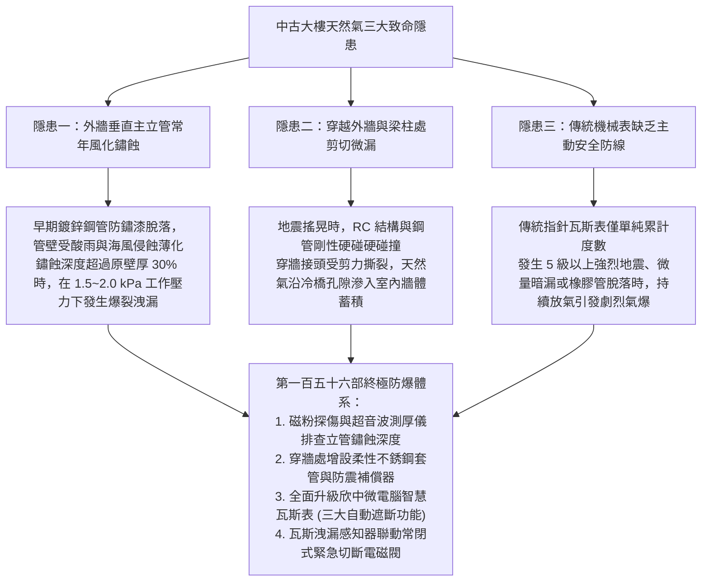
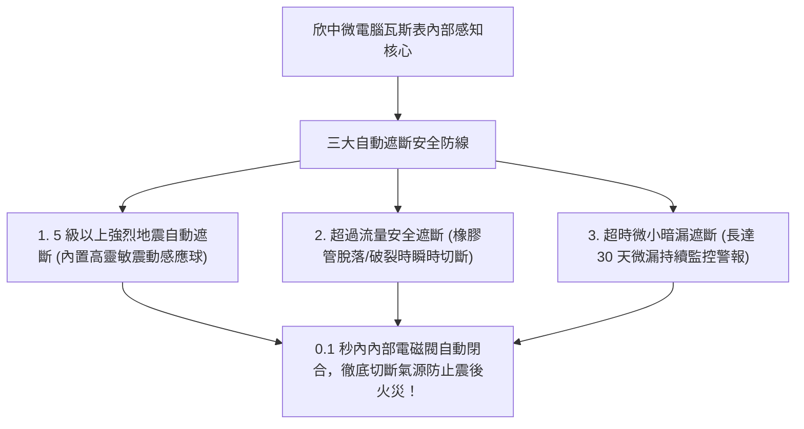
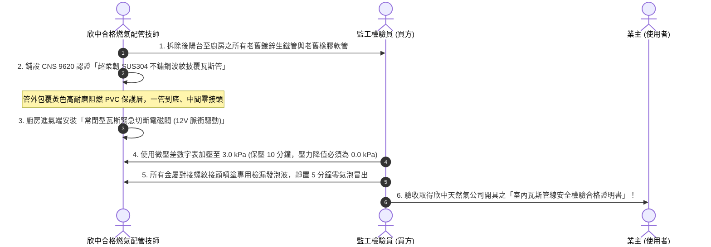
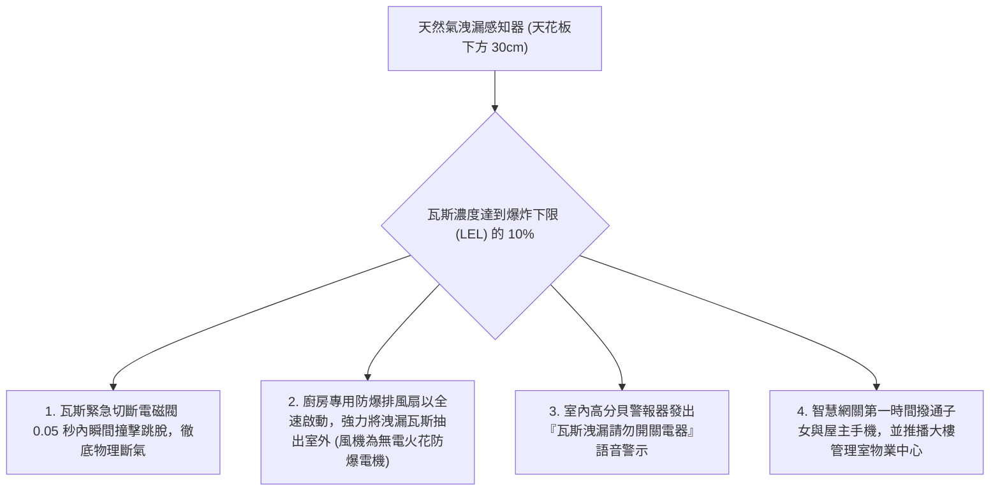

# 全案購屋實戰第一百五十六部：中古大樓天然氣外管鏽蝕檢測與微電腦瓦斯表自動遮斷防漏氣爆工序全書

> **核心宗旨**：在高層電梯集合住宅（如大安紫金城 13 樓、長億南園 8 樓等屋齡 20~30 年社區）中，天然氣（欣中天然氣）管線為潛在破壞力最巨大之公共安全因子。老舊大樓常面臨「外牆垂直供氣鍍鋅鋼管長年風吹雨淋嚴重生鏽剝落、穿越外牆進入廚房處未加保護套管引發剪切斷裂、傳統機械式瓦斯表在地震或暗漏時無任何主動防護能力」等毀滅性隱患。本手冊專攻「超音波外管壁厚測量與探傷標準、立管除鏽與重防腐環氧煤焦油冷纏帶包覆、欣中微電腦瓦斯表（Microcomputer Gas Meter）主動智慧遮斷機制整合、瓦斯漏氣自動緊急遮斷電磁閥與廚房防爆排風聯動」，為全宅居家生命財產構築 100% 氣爆免疫防線。

---

## 第一章：中古大樓天然氣管線三大致命隱患與氣爆物理機理

---

## 第二章：外牆天然氣立管檢測與除鏽防腐包覆標準

在社區公設體檢中，必須會同房仲與大樓管委會機電人員勘查建築外立面與後陽台之外牆天然氣主管：

| 檢驗項目 | 國家安全標準要求 | 老舊社區常見超標現況 | 危害程度與整改工法 |
| :--- | :--- | :--- | :--- |
| **立管壁厚 (Wall Thickness)** | CNS 4626 鍍鋅鋼管（公稱口徑 1½"~2"，標稱厚度 $\ge 3.2\text{mm}$） | 實測厚度剩餘 $< 2.0\text{mm}$（薄化嚴重） | 🔴 **極度危險**：需報請欣中天然氣更換整段外管，費用由管委會或公基金分攤。 |
| **外管防腐塗層** | 塗刷環氧富鋅底漆 + 聚氨酯耐候面漆（總乾膜厚度 $\ge 150\mu\text{m}$） | 塗層完全粉化剝落，鋼管呈現大面積黃褐色鐵鏽斑 | 🟡 **警戒狀態**：高壓鋼絲刷除鏽至 St 3 級，重包冷纏防腐膠帶。 |
| **管道支撐固定架** | 每層樓（間距 $\le 3.0\text{m}$）配置熱浸鍍鋅重型管卡，附橡膠絕緣襯墊 | 固定螺栓鏽蝕斷裂，鋼管懸空晃動 | 🔴 **結構危險**：地震時立管受自重晃動甩裂，需全面換新不鏽鋼固定架。 |
| **穿牆防震套管** | 穿越外牆必須預埋鋼質或厚壁 PVC 套管，間隙填塞不燃彈性防火膠 | 鋼管直接被水泥砂漿死死封固在 RC 牆內 | 🔴 **剪切危險**：打除外圍水泥，加裝防震橡膠襯套與柔性波紋膨脹節。 |

---

## 第三章：欣中微電腦瓦斯表（三大核心智慧安全遮斷機制）

傳統機械瓦斯表為純機械齒輪帶動，缺乏電子保護。本案在交屋翻新後，必須主動向欣中天然氣申請更換為**「微電腦智慧瓦斯表（Microcomputer Gas Meter）」**：

### 3.1 微電腦瓦斯表三大安全遮斷參數解析：
1. **地震感應遮斷（Seismic Sensor）**：
   - 當遭遇震度 **5 級以上（地震加速度 $\ge 250 \text{ Gal}$）** 之劇烈地動時，表內之精密加速度傳感球在 **0.1 秒內** 觸發關閉電磁閥，防止強震震斷室內瓦斯管或扯脫軟管引發大火。
2. **大流量遮斷（Excess Flow Shut-off）**：
   - 當軟管因老鼠啃咬破裂、或是熱水器連接管意外脫落致使瓦斯流量暴衝超過額定最大流量時，微電腦判定為管路爆裂，立即強制遮斷氣源。
3. **微小暗漏超時遮斷（Micro-Leak Monitoring）**：
   - 當室內暗管或凡爾有極微量瓦斯滲漏（例如每小時僅洩漏幾公升），連續計量超過設定時間且未曾歸零時，微電腦即亮起紅色警示燈並自動切斷供氣，徹底消除慢性毒氣中毒與微爆隱患。

---

## 第四章：室內瓦斯管路全金屬波紋管與防震工法

---

## 第五章：智慧防爆安防系統多重聯動矩陣

在廚房瓦斯管道周邊（天花板下方 30cm 處，因天然氣甲烷比空氣輕會向上漂浮）設置工業級高靈敏「催化燃燒型天然氣洩漏感知器」：

### 5.1 防爆安全四大不可妥協之禁忌：
1. **嚴禁在瓦斯外洩現場開關任何電器**：
   - 包含吸頂燈、排油煙機開關、拔除插頭甚至使用室內固網電話；微小的電氣火花即足以引爆高濃度天然氣。
2. **防爆排風機必須採用無刷防爆馬達**：
   - 與感知器聯動之強制排風系統，必須採用取得 **CNS 3376 / 防爆認證（Ex d IIB T4）** 之無電刷馬達，從根本上杜絕電機運轉產生電弧火花。

---

## 第六章：工程驗收標準簽認單（附於天然氣管線合約）

> 「乙方（合格甲種燃氣設備工程承攬商）保證全宅天然氣管線採用符合 CNS 9620 國家標準之 SUS304 不鏽鋼波紋披覆管，嚴禁使用任何一般橡膠管或未披覆銅管。完工後乙方須實施 3.0 kPa 微壓氣密保壓試驗，持續 10 分鐘壓降值為零，並完成微電腦智慧瓦斯表及常閉型瓦斯切斷電磁閥之連動測試。乙方對天然氣管道系統提供五年結構安全與零洩漏保固，並協助甲方取得欣中天然氣官方檢驗合格文件。」
