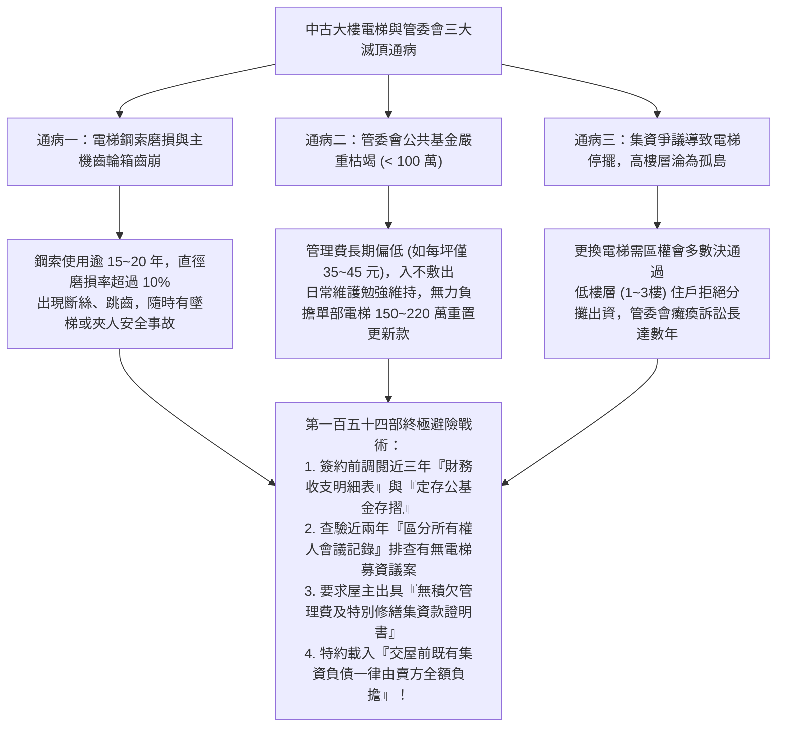
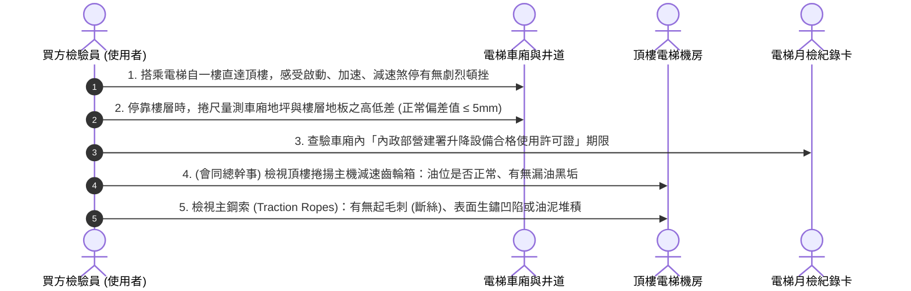
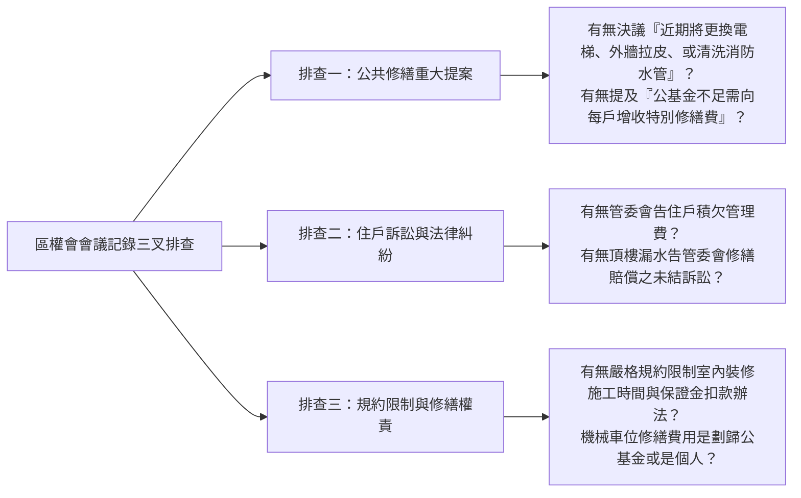

# 全案購屋實戰第一百五十四部：中古大樓社區管委會財務公基金體檢與電梯鋼索汰換集資合約風險全書

> **核心宗旨**：買房不僅是買「室內專有部分」，更是買下「大樓公共設施的共有持分與潛在負債」。特別針對屋齡 20~30 年中古電梯大樓（如大安紫金城 13 樓、長億南園 8 樓等早期規劃物件），最常爆發的滅頂危機莫過於「社區公共基金（修繕積斂金）枯竭、主電梯鋼索與控制主機壽命已盡面臨數百萬重置更換費用、住戶意見分歧陷入長年訴訟導致電梯停擺、甚至管委會私下向每戶強徵 10~20 萬元特別修繕費」。本手冊專攻「社區資產負債表與收支損益表深度穿透審查、電梯鋼索磨損超音波探傷標準、管委會區權會會議記錄三叉排查法、特約條款排除前手公基金欠費與集資負債」，確保買方不當接盤俠，安穩進駐健全社區。

---

## 第一章：老舊大樓電梯三大致命通病與公共基金陷阱機理

---

## 第二章：社區管委會財務健康體檢四大穿透指標

在看房洽談階段，買方必須透過仲介向管理室或總幹事索取近期的「財務報表」與「公告資訊」，以四大指標精準量化社區體質：

| 評估指標 | 健全優質社區標準 | 瀕臨破產警戒標準（重大警訊） | 風險後果與處置對策 |
| :--- | :--- | :--- | :--- |
| **公共基金定存餘額** | 總戶數 100 戶以下：$\ge 300$ 萬元 總戶數 100~200 戶：$\ge 600$ 萬元 | **公共基金總額 $< 150$ 萬元，甚至無定存** | 社區無重大修繕抗風險能力；外牆剝落、電梯更換時將立即向每戶攤提巨款。 |
| **每月經常性收支差額** | 每月結餘率 $\ge 15\% \sim 20\%$ （總收入扣除物業、保全、清潔後有盈餘入公基金） | **每月收支打平（赤字邊緣），甚至連續數月動用老本** | 管理費勢必在近期大幅調漲（如由 50 元/坪調至 70~80 元/坪），增加持有成本。 |
| **管理費積欠率** | 積欠戶數比例 $< 3\%$，欠繳總額 $< 5$ 萬元 | **長期欠繳率 $> 10\%$，甚至有釘子戶積欠數十萬** | 社區住戶向心力低，管委會執行力癱瘓，爛帳無法追回，居住品質直線下滑。 |
| **電梯與公共設備保養合約** | 採用 **原廠（三菱、崇友、永大、奧的斯）全責任合約（POG）** | 採用副廠外包「半責任合約」或「僅巡檢點檢合約」 | 副廠零件多為拼裝二手翻新品，故障率高且安全係數低。 |

---

## 第三章：電梯系統三大核心硬體體檢與鋼索探傷標準

高樓層物件（如大安紫金城 13 樓、長億南園 8 樓等），每日垂直通行完全依賴電梯。現場勘查必須親自搭乘並觀察以下細節：

### 3.1 鋼索報廢與更換國家標準（CNS 2866 / CNS 10594）：
1. **鋼索直徑磨損率超過 10% 即刻報廢**：
   - 原鋼索公稱直徑若為 $12\text{ mm}$，實測直徑磨損至 **$\le 10.8\text{ mm}$**，必須全組（通常為 4~6 條）同時換新，嚴格禁止單條抽換。
2. **斷絲（Broken Wires）密度限制**：
   - 在任一個捻距（Lay Length，約為鋼索直徑之 6~8 倍，約 10cm 長度內），斷絲數量達到總鋼絲數的 **$10\%$ 以上**，即達強制報廢標準。
3. **電梯全套更換費用分攤概算**：
   - 15~18 樓中古電梯更換全套主機、控制盤、鋼索、車廂內部裝潢，單部預算約 **180 ~ 240 萬元**。
   - 若單棟 30 戶均攤，每戶需一次性自掏腰包 **$60,000 \sim 80,000 \text{ 元}$**！若買方未在合約中排查，此筆費用將直接落入買方頭上！

---

## 第四章：區分所有權人會議記錄（三叉排查法）

在支付斡旋金前，要求房仲周小姐（或信義建宇）協調調閱該大樓近兩次之**《區分所有權人會議手冊與會議記錄》**，重點排查「三項潛在炸彈」：

---

## 第五章：買賣契約必備之「公基金負債排除特約條款」

為防止前屋主知悉「社區即將向每戶增收 10 萬元電梯修繕款」而急於脫手，買方必須在不動產買賣契約書中手寫增訂以下特約條款，築起堅不可摧的法律防火牆：

> **【公共修繕集資分攤款與既有債務排除特約條款】**：
> 「雙方合意確認：賣方保證截至本買賣標的物產權移轉交屋日止，本建物未積欠任何公寓大廈管理費、公共清潔費、停車位維護費及水電瓦斯公攤費。凡於交屋日前經區分所有權人會議或管委會已決議通過、或已公告推動之任何重大修繕分攤款（包含但不限於電梯系統更新、外牆修繕拉皮、地下室抓漏防水、消防機電重置等集資工程款），不論其繳納期限是在交屋日前或交屋日後，**其全部費用概由賣方全額負擔繳清**；若交屋後始接獲管委會催繳交屋日前已決議之修繕款，買方得自買賣價金履約保證專戶中直接抵扣，或由賣方於收受通知三日內全額清償，賣方絕無異議。」

---

## 第六章：管委會財務與公設健康查核表（交屋前關鍵確認）

| 查核項目 | 合格標準判定 | 異常警戒狀況 | 買方應對戰術 |
| :---: | :--- | :--- | :--- |
| **管理費繳納證明** | 賣方出具管委會蓋章之「無欠繳管理費證明單」 | 屋主拖延無法出具，或由私下口頭承諾 | ❌ 於履約保證專戶扣留 5 萬元尾款，直至取得證明 |
| **電梯許可證** | 許可證在一年有效期限內，保養單位為知名原廠 | 許可證逾期，或保養卡已連續三個月未簽名 | ⚠️ 責令房仲查明管委會是否涉訴訟或經費不足 |
| **地下室排污馬達** | 雙泵交替運轉正常，控制箱無警報閃爍 | 控制箱常態性故障警報，地下室有污水異味 | ⚠️ 估算 20 萬元公設泵浦重置成本，列入社區議價抗性 |
| **頂樓公共防水** | PU/瀝青防水層平整，落水口順暢無積水 | 頂樓大面積積水、青苔叢生、PU起泡破裂 | 👑 以「未來頂樓重做防水每戶需均攤」狠壓買賣總價！ |
