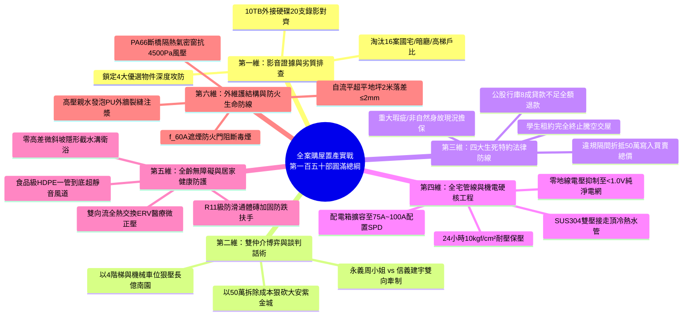
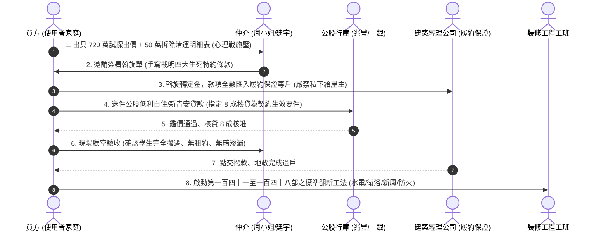

# 全案購屋實戰第一百五十部：百五十部圓滿登峰全生命週期家庭置產永恆極致大成法典全書

> **核心宗旨**：本手冊為全案購屋實戰體系**第一百五十部之圓滿登峰、劃時代里程碑總綱鉅作**。將前 149 部手冊之智慧結晶——涵蓋「10TB 現場帶看影音證據鏈、雙仲介賽局破局談判、四大生死特約防火牆、水電暗管耐壓測漏、零高差微斜坡全齡衛浴、Wi-Fi 7 萬兆智聯網絡、醫療級新風微正壓、斷橋氣密窗抗颱防水、零地線電壓純淨電網、水泥基自流平超平地坪、f(60A) 遮煙防火門、陽台外推結構排查與違建抗性折讓」等十二大核心子系統——徹底鎔鑄為一套一體化、全維度、無懈可擊的**「家庭置產永恆治理法典」**。賦予使用者在面對房仲、屋主、銀行、工班與地政機關時，擁有 100% 資訊碾壓優勢，確保家族資產世代傳承安穩無憂！

---

## 第一章：第一百五十部圓滿大成十二大核心體系全景矩陣

---

## 第二章：四大候選物件最終決策指揮與定價執行表

| 物件名稱 | 產權與空間優勢 | 致命抗性（殺價核武器） | 建議起手出價 | 目標成交底線 | 仲介牽制與心理戰術 |
| :--- | :--- | :--- | :--- | :--- | :--- |
| **👑 大安紫金城 13 樓 (PROP_10)** | **B2 坡道平面獨立大車位**、主附約 25 坪、高樓層採光視野佳 | **原屋主隔 4 間學生套房，全室拆除、泥作清運與管線重配需 50 萬元** | **720 ~ 730 萬元** | **768 ~ 788 萬元 (堅守 800 萬內)** | 以 50 萬拆除成本明細狠砍，並以信義「大墩人文/工學天下」平車物件施壓。 |
| **👑 長億南園 8 樓 (PROP_106)** | **主附約 32 坪超大空間**、大客餐廳氣派開闊、長輩活動自由 | **大廳 4 階梯非無障礙（輪椅不便）、坡道機械車位保養費高且故障率高** | **698 ~ 720 萬元** | **745 ~ 760 萬元 (堅守 780 萬內)** | 以「長輩輪椅進出困難、機械車位折舊」狠砍 200 萬，以紫金城大平車壓制。 |
| **⭐ 歌德堡 8 樓** | 北歐風全新裝潢、屋況完整極佳、免大動工即可入住 | 單價稍高、格局彈性較小，但省 80~100 萬裝潢款 | 依現場狀況評估 | 820 ~ 850 萬元 | 作為牽制紫金城屋主之最強王牌：「不降價我就買歌德堡現成裝潢免整理！」 |
| **⭐ 靜園 A 區 11 樓** | 邊間三面採光、格局方正、雙衛浴皆有對外窗、通風良好 | 社區戶數較少、管理費單價較高 | 依現場狀況評估 | 750 ~ 780 萬元 | 作為高樓採光之對照籌碼，壓迫長億南園之機械車位與階梯劣勢。 |

---

## 第三章：全生命週期買房置產五階段標準作業程序（SOP）

---

## 第四章：翻新工程十大不可妥協之檢驗標準（交屋必備）

1. **給水暗管試壓**：全室 SUS304 雙壓接不鏽鋼管吊頂，實施 **$10\text{ kgf/cm}^2$ 滿水靜水壓測試，持續 24 小時零降壓**。
2. **浴室閉水試驗**：七道雙層彈泥加抗裂網，**48 小時滿水蓄水測試**，會同樓下住戶以強光照射樓板，確認 100% 零滲漏。
3. **浴室零門檻平整地坪**：乾濕分離處預埋 **SUS304 不鏽鋼長條截水溝**，客廳至衛浴地面平整無高差，地磚防滑等級達 **R11**。
4. **配電箱零地線電壓**：L1/L2 負載不平衡率 $\le 10\%$，全室三孔插座實測 **零地線電壓 $V_{N-G} \le 1.0\text{V}$**（醫療實驗室級）。
5. **實體接地電阻**：大樓總接地銅排引出 $14\text{mm}^2$ 接地線，實測 **接地電阻 $\le 10\Omega$**，嚴禁水線地線短接之假接地。
6. **弱電 Cat.6A 萬兆網絡**：全室抽換 Cat.6A 純銅屏蔽線，配置 2.5G PoE 交換器與 **Wi-Fi 7 AP 星型無縫漫遊（802.11k/v/r）**，切換延遲 $< 20\text{ms}$。
7. **全熱交換新風 IAQ 防護**：雙向流 ERV 配備 **H13 HEPA 醫療級濾網**，室內維持 **$+5 \sim +10\text{ Pa}$ 微正壓**，CO₂ 濃度恆定 $< 800\text{ppm}$。
8. **外窗斷橋隔熱抗強颱**：PA66 斷橋鋁氣密窗，抗風壓性達 **$4500\text{ Pa}$**，水密性達 **$500\text{ Pa}$**，外窗台留設 $1/10$ 順水坡與鷹嘴滴水線。
9. **玄關甲種遮煙防火門**：採用具備 **f(60A) 耐火 1 小時且阻熱 1 小時**、CNS 15038 遮煙認證門扇，底部配置自動升降擋煙條，管道間實施 2 小時防火填塞。
10. **水泥基自流平超平地坪**：全面打除至 RC 結構，高分子自流平施工精度達 **2 米靠尺落差 $\le 2.0\text{mm}$**，大規格磁磚薄貼滿漿率 $\ge 95\%$。

---

## 第五章：家族資產永續治理傳承法典（永恆心法）

1. **實相心法（看透表象）**：不為仲介的吹噓動心，不為花俏的軟裝迷惑；唯有「大平車、大實坪、高採光、好管委」是不可複製的硬資產，其餘裝潢皆可推倒重來。
2. **代價心法（買方定價）**：永遠站在屋主的劣勢上定價。原屋主的隔間是他的負債，不是你的成本；大廳的階梯是長輩的障礙，就是你殺價的屠刀！
3. **主權心法（合約為王）**：沒有「貸款成數不足無條件解約退款」與「完全騰空自住點交」特約，絕不簽署任何要約斡旋；文字白紙黑字，勝過仲介萬語千言。
4. **守護心法（全齡健康）**：買房是為了全家長治久安。把每一分錢花在水電、地坪、空氣、網絡與防火防跌等「看不見的基礎工程」上，才是對家人最深沉的愛與責任！
