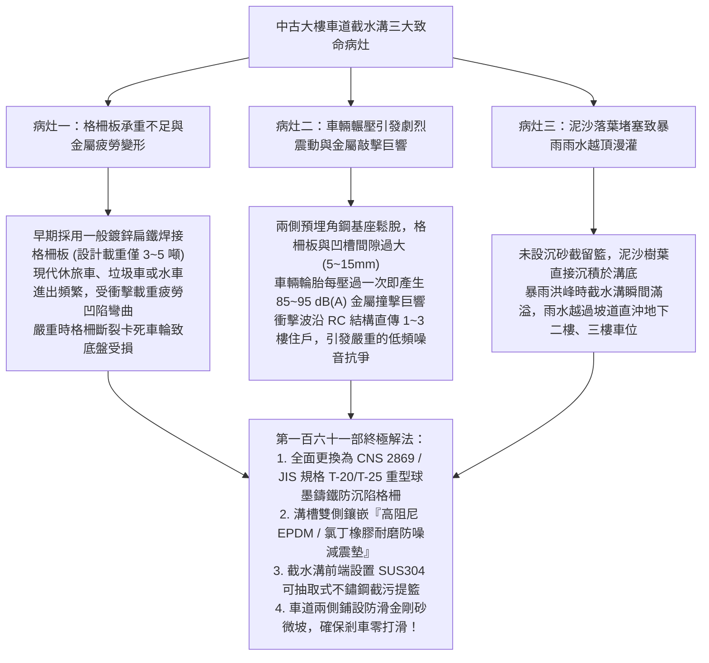
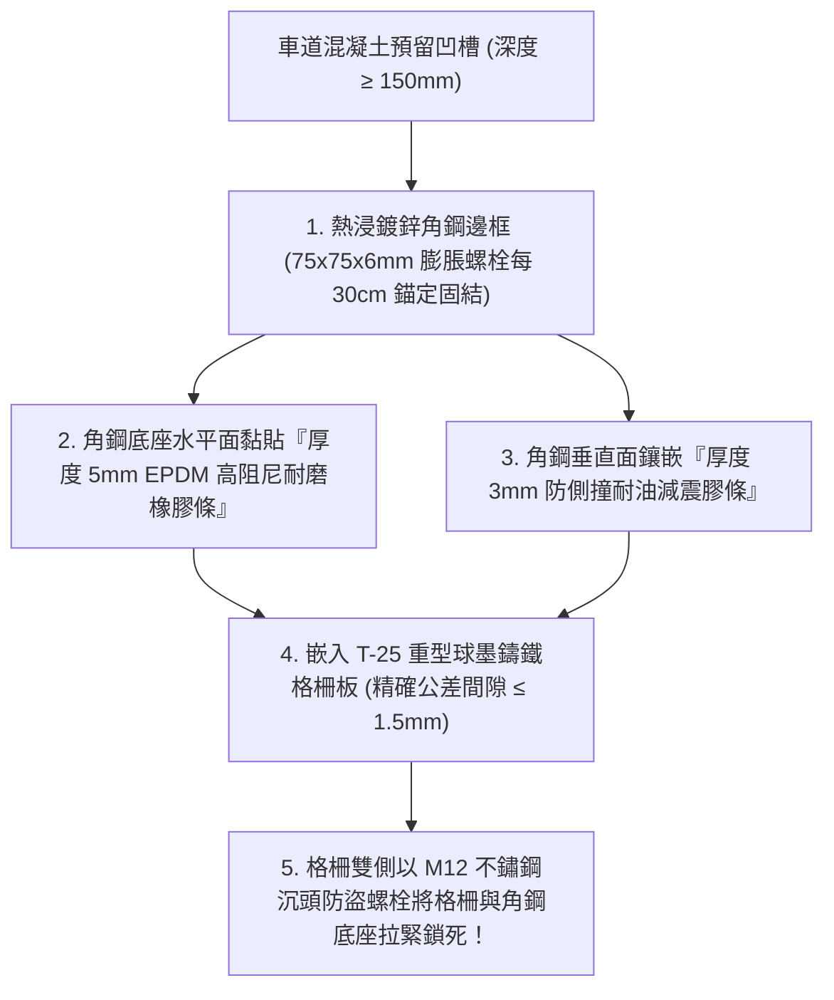
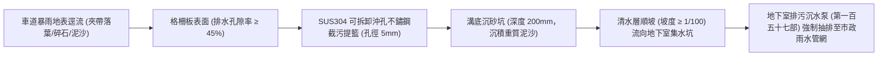
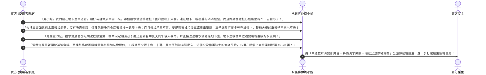

# 全案購屋實戰第一百六十一部：中古大樓地下室車道截水溝重型格柵板承重與防滑降噪橡膠阻尼減震工序全書

> **核心宗旨**：在中古電梯住宅集合住宅（如大安紫金城 13 樓、長億南園 8 樓等設有地下室坡道停車場之社區）中，車道坡道出入口與轉彎處之「車道截水溝（Trench Drain）」是整棟建築防禦強烈暴雨地表逕流灌入地下室之第一道咽喉防線。然而，屋齡 20~30 年中古大樓最常面臨「早期鑄鐵或鍍鋅鋼格柵板受重車反覆輾壓疲勞變形破裂、固定角鋼底座鬆動斷裂、車輛每次經過發出震耳欲聾的『匡噹匡噹』金屬撞擊巨響干擾低樓層住戶安寧，以及暴雨時格柵孔隙遭落葉垃圾堵塞引發雨水漫過截水溝直灌地下室車位」等重大公設通病。本手冊專攻「車道截水溝 T-20 / T-25 重型球狀石墨鑄鐵格柵板選型、耐酸鹼高彈性丁基橡膠防噪減震條預埋、截水溝兩側防滑金屬金剛砂防滑斜坡、沉砂截污提籃設置及利用車道截水設施老化瑕疵狠砍買賣總價 15~20 萬戰術」，為地下室停車安全與社區寧靜構築鋼鐵防線。

---

## 第一章：老舊大樓車道截水溝三大致命痛點與結構破壞機理

---

## 第二章：車道截水溝格柵板承載等級與材質嚴格選型

在公設體檢中，必須會同房仲與大樓管委會機電人員勘查車道斜坡底端與轉角處之截水溝格柵：

| 格柵板材質與規格 | 承載等級 (Load Class) | 耐衝擊與防腐壽命 | 噪音抑制效果 | 適用場合與本案評價 |
| :--- | :--- | :--- | :--- | :---: |
| **傳統鍍鋅扁鐵格柵板** | T-2 ~ T-5（僅耐 2~5 噸輕載） | 易焊點脫落、生鏽脆化，壽命僅 3~5 年 | 金屬撞擊聲極大（無彈性） | ❌ **中古大樓常見，嚴格淘汰** |
| **一般灰口鑄鐵格柵板** | T-14（耐 14 噸普通載重） | 質脆抗衝擊差，重車輾壓易脆裂崩角 | 噪聲大，易鬆動跳動 | ⚠️ **普通規格，抗震不足** |
| **👑 球墨鑄鐵格柵板 (Ductile Iron) （本案推薦規格）** | **T-20 / T-25（耐 20~25 噸重載，破壞載重 $\ge 300\text{ kN}$）** | **高韌性、抗拉強度 $\ge 500\text{ MPa}$，耐腐蝕熱浸鍍鋅或環氧樹脂塗裝，壽命 30 年以上** | **自重厚實，沉陷咬合緊密，跳動異音極低** | 👑 **本案唯一指定頂級車道格柵** |
| **不鏽鋼 SUS304 齒狀格柵** | T-20 強化型 | 永不生鏽、外觀美觀大氣，成本較高 | 需搭配橡膠條使用 | ⭐ **豪宅首選，性價比稍低** |

---

## 第三章：防噪降噪「三層橡膠阻尼減震墊」專利級施工工法

車輛經過截水溝之金屬敲擊巨響，是引發大樓 1~3 樓住戶精神衰弱的元兇。本案制定徹底消音之標準節點：

### 3.1 消除截水溝異音三大不可妥協之鐵則：
1. **雙向包覆耐衝擊橡膠條（EPDM Strip）**：
   - 嚴禁鋼碰鋼！角鋼底座水平承重面與垂直擋牆面，必須全面鋪設耐候、耐機油之 **高密度三元乙丙（EPDM）橡膠條**。
   - 車輛輪胎重壓瞬間，衝擊動能被橡膠阻尼吸收 90% 以上，噪音值由 95 dB(A) 驟降至 **$\le 55 \text{ dB(A)}$**，低樓層室內完全無感。
2. **防跳動機械鎖固（Anti-Bounce Bolt Locking）**：
   - 每一片格柵板兩端，必須預留沉頭螺孔，使用 **M12 SUS304 不鏽鋼膨脹螺栓與防鬆螺帽** 直接鎖死在預埋角鋼上。
   - 徹底杜絕車輛輪胎快速駛離時，因後輪剪力造成格柵板尾端向上翹起彈跳的二次敲擊聲。
3. **無縫微落差設計（Flush Transition）**：
   - 格柵板表面與兩側車道完成面之間的高低差，必須嚴格控制在 **$\pm 1.0\text{ mm}$ 以內**。
   - 嚴格禁止格柵板高於或低於車道地面超過 5mm（形成輪胎撞擊凸階）。

---

## 第四章：暴雨防淹——沉砂截污提籃與雙側快速導水溝工法

### 4.1 防堵塞與維護三大設計規範：
1. **沖孔截污提籃（Debris Basket）**：
   - 在截水溝內部每隔 $2.0 \text{ 公尺}$ 設置一組 SUS304 不鏽鋼手提式過濾籃。
   - 樹葉、塑膠袋與大顆粒泥沙被攔截於籃內，物業清潔人員每週僅需掀開單片格柵即可在 1 分鐘內將提籃提起倒掉垃圾，免除人工清掏淤泥之苦。
2. **截水溝斷面淨尺寸門檻**：
   - 車道截水溝淨寬度必須 **$\ge 300\text{ mm}$**，淨深度必須 **$\ge 250\text{ mm}$**。
   - 確保在百年一遇暴雨（降雨強度 $\ge 100\text{ mm/hr}$）時，截水溝具備足夠水力斷面，瞬間排乾逕流，絕不發生雨水越頂回漫。
3. **車道防滑金剛砂微坡（Anti-Slip Ramp）**：
   - 截水溝前後各 $1.5 \text{ 公尺}$ 範圍內之車道地坪，必須塗裝 **金剛砂耐磨防滑環氧地坪（防滑係數 BPN $\ge 70$）**。
   - 避免雨天車輛輪胎沾水後在鐵板上打滑失控撞牆，保障長輩進出車庫安全。

---

## 第五章：看屋現場車道截水溝排查與殺價戰術

在實地勘查大安紫金城或長億南園地下停車場時，買方必須在車道坡道現場停留，觀察車輛進出時截水溝的震動與聲響，並轉化為**狠砍買賣總價 15~20 萬元的公設折讓籌碼**：

---

## 第六章：車道截水溝公設健康體檢核對表（現場看屋必備）

| 查核項目 | 標準合格判定條件 | 現場重大異常判定（致命警訊） | 處置戰術 |
| :---: | :--- | :--- | :--- |
| **格柵平整與變形度** | 格柵板平整，踏踩無晃動，無下凹變形 | 鐵板中央明顯凹陷 $> 10\text{mm}$、焊點斷裂起翹 | 🔴 **隨時有斷裂卡車底盤危險**，列入議價扣款抗性 |
| **車輛輾壓噪聲** | 休旅車以 20km/h 輾過時，發出沉悶微小悶響 | 發出清脆刺耳金屬撞擊巨響，回音震盪整個地下室 | ⚠️ 橡膠條完全老化脫落或根本未安裝，要求折價修復 |
| **預埋角鋼固結狀況** | 角鋼牢牢嵌於混凝土中，無任何碎裂空隙 | 角鋼四周水泥碎裂脫落、膨脹螺栓鬆脫晃動 | ⚠️ 需動用破碎機重做泥作與角鋼焊接，預估工程款砍價 |
| **溝內積污與排水** | 溝內清澈無異味，無大量泥沙淤積，水流暢通 | 溝底堆滿黑色爛泥、落葉腐爛散發臭味、水流停滯 | ⚠️ 管委會清潔維護完全怠惰，暴雨時極高淹水風險！ |
