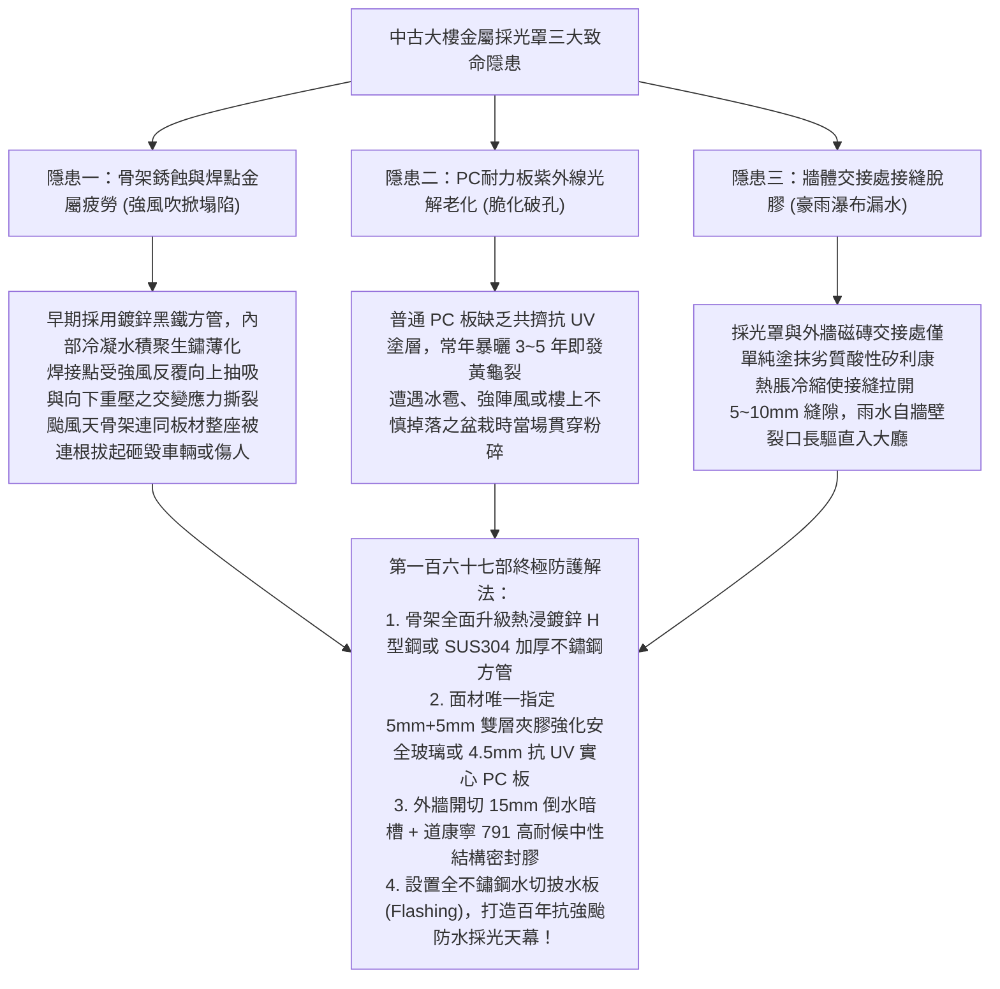
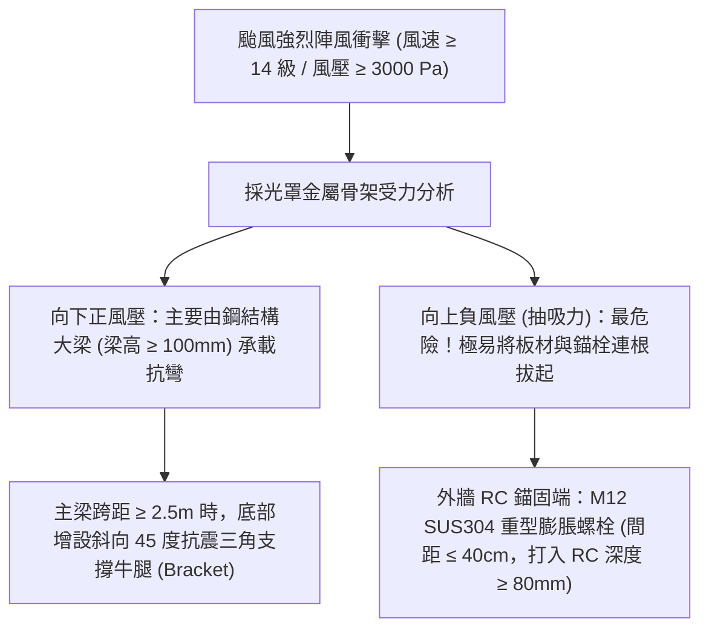
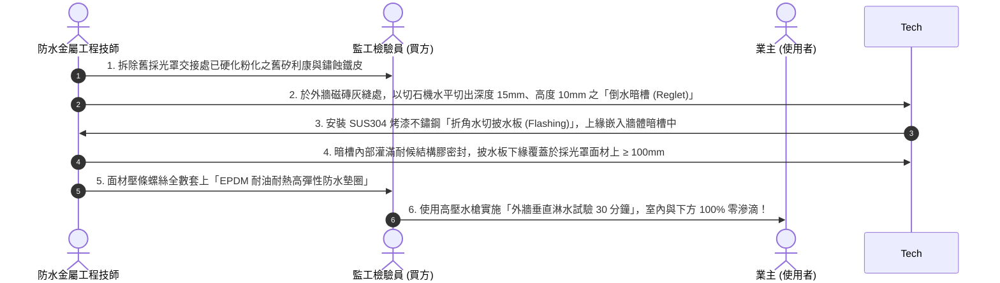
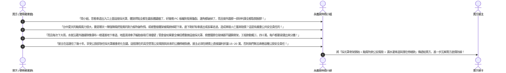

# 全案購屋實戰第一百六十七部：中古大樓社區中庭採光罩結構抗風壓與耐候PC耐力板矽利康老化防漏工序全書

> **核心宗旨**：在高層電梯住宅集合住宅（如大安紫金城 13 樓、長億南園 8 樓等早期規劃物件）中，一樓中庭花園、地下室車道出入口上方、天井採光井及頂樓公設陽台常大量架設「金屬骨架採光罩（Canopy / Skylight）」。然而，20~30 年中古大樓最常面臨「早期採用薄型烤漆鐵管或一般鋁方管，焊點嚴重生鏽蝕斷失去抗風壓剛度」、「PC 耐力板受常年強烈紫外線（UV）曝曬脆化發黃、遭遇強颱強風或高空墜物時整片碎裂砸落」、「採光罩與大樓外牆 RC 銜接處之矽利康硬化龜裂脫膠，豪雨時雨水沿外牆瀑布般滲入一樓大廳或地下室車道」等毀滅性公設隱患。本手冊專攻「採光罩結構風載荷力學計算、SUS304 不鏽鋼加厚方管/鋁合金結構梁選型、雙層膠合強化安全玻璃 vs 抗 UV 聚碳酸酯 PC 實心耐力板對照、耐候型結構矽利康打膠收頭工法及利用採光罩鏽蝕老化瑕疵狠砍買賣總價 15~20 萬戰術」，為中庭安全與公設結構維護築起鋼鐵遮護防線。

---

## 第一章：老舊大樓採光罩三大致命病灶與高空墜裂機理

---

## 第二章：採光罩覆蓋面材性能嚴格選型對照表

在公設體檢中，必須會同房仲與大樓管委會人員勘查中庭花園或車道上方之採光罩板材材質：

| 面材種類與規格 | 抗衝擊強度與抗颱能力 | 耐候壽命與防紫外線 | 隔音與下雨撞擊噪聲 | 破損安全表現與本案評價 |
| :--- | :--- | :--- | :--- | :---: |
| **傳統波浪板 / 中空板** | 極差（風速 10 級即吹碎吹飛） | 2~3 年脆化粉化，透光率暴跌 | 下雨如打鼓，噪聲高達 80 dB(A) | ❌ 碎片鋒利極度危險，中古老舊違建常見，**嚴格淘汰** |
| **普通單層 PC 耐力板 (2mm)** | 普通（抗衝擊是玻璃的 200 倍，但薄板易凹陷） | 4~5 年表面起毛龜裂，發黃變形 | 下雨噪音大，熱脹冷縮劈啪異音 | ⚠️ 易老化漏水，性價比普通 |
| **抗 UV 實心 PC 耐力板 (≥ 4.5mm) ⭐（車道出入口推薦規格）** | **極高（耐高空落物砸擊，抗風壓 $\ge 3500\text{ Pa}$）** | **表面共擠 50μm 雙面抗 UV 塗層，保用 15 年不發黃** | 板材加厚，有效抑制震動噪音 | ⭐ **高韌性不碎裂，適合跨距較大之車道坡道遮雨棚** |
| **👑 雙層膠合強化安全玻璃 (5mm+0.76PVB+5mm) （中庭與頂樓公設旗艦規格）** | **最高（完全剛性承載，耐暴風雨與高空衝擊）** | **半永久性壽命（30 年以上零老化、透光如新）** | **PVB 夾層吸收 90% 衝擊波，下雨安靜無金屬噪聲** | 👑 **本案唯一指定頂級規格（即使破裂碎片黏著於膠膜不墜落）** |

---

## 第三章：採光罩結構骨架抗風壓計算與防鏽固定標準

台中地區秋冬季受東北季風強風灌入、夏季受颱風直接衝擊，採光罩結構必須具備足夠抵抗「向下正風壓」與「向上負風壓（抽吸力）」之能力：

### 3.1 採光罩金屬骨架三大不可妥協之工藝：
1. **骨架管材厚度規範**：
   - 採用 SUS304 不鏽鋼方管時，主管尺寸必須 **$\ge 50 \times 100 \times 2.0\text{ mm}$**，副管尺寸 **$\ge 50 \times 50 \times 1.5\text{ mm}$**。
   - 嚴格禁止使用厚度 $< 1.2\text{mm}$ 之平價薄鐵管（颱風受風面瞬間彎折塌陷）。
2. **全熔透焊接與酸洗鈍化（Pickling）**：
   - 不鏽鋼方管拼接處必須實施 **$360^\circ$ 氬焊全熔透焊接**，焊道平整無氣孔焊渣。
   - 焊接完成後，焊道四周必須塗刷酸洗鈍化膏徹底清除熱影響區黑斑，避免焊點在酸雨中優先發生電化學晶間腐蝕。
3. **排水天溝（Gutter）大口徑配置**：
   - 採光罩前端必須一體化配置 SUS304 不鏽鋼斜坡排水集水天溝（厚度 $\ge 1.5\text{mm}$）。
   - 落水孔徑必須 **$\ge 75\text{ mm}$（$2\frac{1}{2}$ 吋以上）**，確保暴雨洪峰時雨水瞬間排出，絕不積水回溢至骨架內部。

---

## 第四章：外牆接縫「水切金屬披水板 + 倒水暗槽」防漏工藝

採光罩最嚴重的漏水點，永遠出現在「金屬骨架與外牆磁磚相接的長條接縫」：

---

## 第五章：看屋現場採光罩排查與殺價戰術

在看房大安紫金城 13 樓或長億南園 8 樓時，買方在走出中庭或地下室車道時，應刻意抬頭觀察採光罩現況，並將其轉化為**狠砍買賣總價 15~20 萬元的公共設施老化瑕疵談判武器**：

---

## 第六章：社區採光罩公設健康體檢核對表（現場看屋必備）

| 查核項目 | 標準合格判定條件 | 現場重大異常判定（致命警訊） | 處置戰術 |
| :---: | :--- | :--- | :--- |
| **金屬骨架塗層** | SUS304 不鏽鋼或熱浸鍍鋅漆面光潔，焊道無鏽蝕 | 鐵方管表面油漆起泡剝落、接頭焊點鏽爛穿孔 | 🔴 **隨時有強風吹折坍塌危險**，列入重大公安瑕疵扣款 |
| **覆蓋面材現況** | 雙層膠合玻璃完整清澈、或 PC 板無發黃龜裂 | PC 板嚴重發黃發黑、局部破孔、表面布滿龜裂紋 | ⚠️ 耐衝擊力完全喪失，高空墜物必擊穿，要求更換 |
| **外牆接縫防水** | 設有不鏽鋼水切披水板，結構矽利康飽滿有彈性 | 矽利康硬化脫膠裂開、牆體磁磚有長期漏水黃水痕 | ⚠️ 豪雨時雨水直灌室內大廳或車道，主張折價修繕 |
| **排水水溝暢通** | 集水天溝坡度良好，無泥沙青苔堆積，落水暢通 | 天溝堆積厚泥爛葉長雜草、大雨時水漫過天溝瀑布倒灌 | ⚠️ 排水斷面嚴重不足，要求管委會立即疏通清潔！ |
