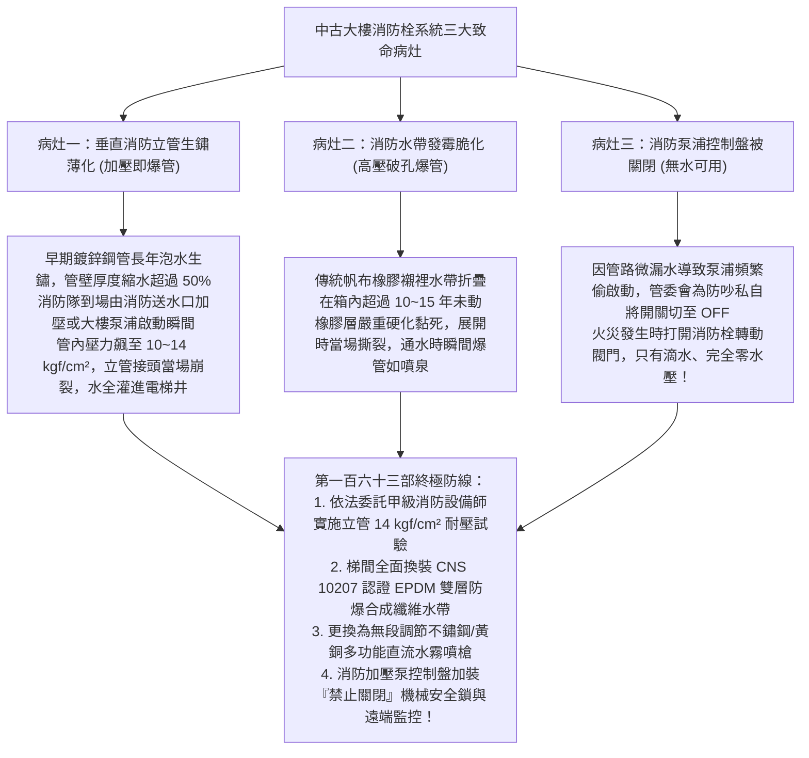
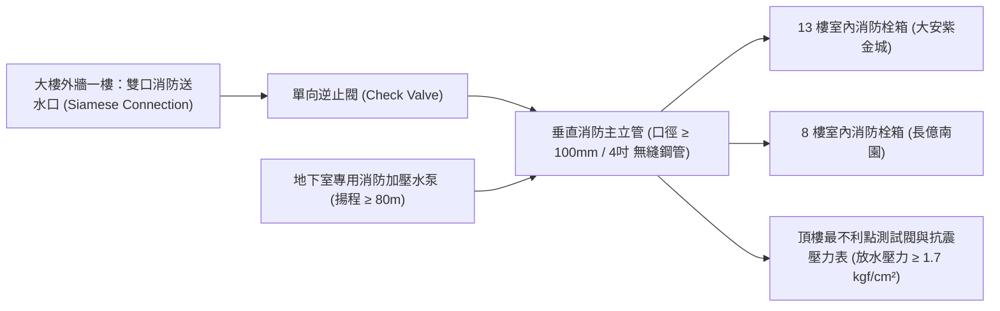
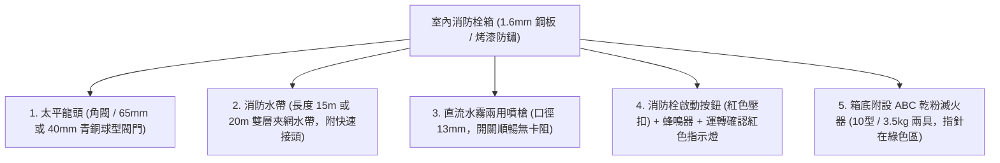
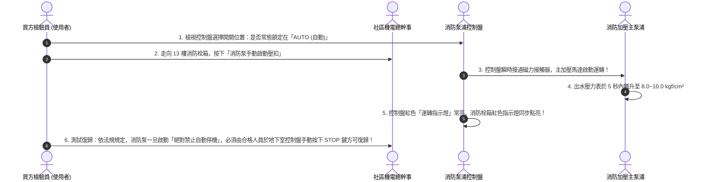
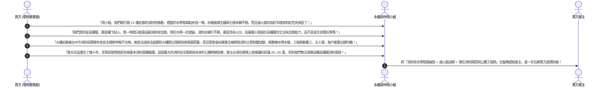

# 全案購屋實戰第一百六十三部：中古大樓社區消防乾式與濕式立管耐壓試驗及消防栓水帶水槍老化汰換全書

> **核心宗旨**：在高層電梯集合住宅（特別如大安紫金城 13 樓、長億南園 8 樓等 10~18 樓高樓層社區）中，火災初期的「黃金撲滅期（3~5 分鐘）」完全取決於樓層「室內消防栓（Fire Hose Cabinet）」與垂直「消防立管（Standpipe System）」能否正常出水噴射。然而，20~30 年中古大樓最常面臨「垂直消防鍍鋅鋼管常年受水質酸蝕管壁薄化生鏽、火災加壓時水管當場爆裂大漏水」、「消防栓箱內橡膠水帶硬化龜裂、帆布水帶發霉黏結一拉即破」、「銅質水霧瞄子（水槍）接頭氧化卡死無法旋接、消防泵浦手動/自動開關被私自切至 OFF 無法自動加壓送水」等毀滅性公安弊端。本手冊專攻「消防立管 14 kgf/cm² 靜水壓耐壓測試標準、EPDM 橡膠雙層防爆夾層消防水帶選型、多功能旋轉水霧水槍配置、消防專用水泵（Fire Pump）自動加壓控制盤體檢及利用消防系統老化瑕疵狠砍買賣總價 20~25 萬戰術」，為全家生命安全築起不可摧毀的水火護盾。

---

## 第一章：高樓層消防栓系統三大致命病灶與滅火失效機理

---

## 第二章：消防立管系統規格與 14 kgf/cm² 靜水壓檢驗標準

集合住宅消防立管分為「濕式立管（管內常年注滿加壓水）」與「乾式立管（由消防車外部加壓灌水）」：

### 2.1 消防立管耐壓測試四大不可妥協之鐵則：
1. **測試壓力門檻（CNS / 消防安全設備檢修標準）**：
   - 消防立管試壓，必須加壓至 **設計工作壓力之 1.5 倍以上、且不得低於 $14.0 \text{ kgf/cm}^2$（約 1.4 MPa）**。
   - 封閉所有樓層消防栓閥門，使用手動/電動高壓試壓泵加壓，**持續保壓 2 小時，壓力降值必須 $\le 0.2 \text{ kgf/cm}^2$**，且全線鋼管與接頭無任何滲水變形。
2. **最不利點（頂樓）動態放水壓力**：
   - 在建築物最高樓層（如頂樓或 13 樓）開啟測試閥實施放水測試。
   - 水槍噴嘴口徑 $13\text{mm}$ 時，實測之放水動壓必須維持在 **$1.7 \text{ kgf/cm}^2 \sim 7.0 \text{ kgf/cm}^2$ 之間**，出水量必須達 **$\ge 130 \text{ L/min}$**（水柱有效射程 $\ge 10 \text{ 公尺}$）。
3. **管徑規格限制**：
   - 垂直主管公稱口徑必須 **$\ge 100\text{ mm}$（4 吋管）**，各樓層支管口徑 **$\ge 65\text{ mm}$（2½ 吋管）**，確保多處消防栓同時開啟時水壓不驟降。
4. **管材標準（拒絕黑鐵管薄管）**：
   - 必須採用 **CNS 6445 配管用碳鋼鋼管或 SUS304 不鏽鋼管**，外壁塗裝專用紅色耐火防腐環氧樹脂漆，標示「消防專用管」。

---

## 第三章：消防栓箱內五大組件現場排查與汰換標準

在勘查大安紫金城 13 樓或長億南園 8 樓走廊之消防栓箱時，必須親自打開箱門逐項檢驗：

### 3.1 水帶與水槍選配三大頂級規範：
| 組件名稱 | 劣質淘汰品（常見於中古老社區） | 本案頂級安全標準規範 | 實質安全效益 |
| :--- | :--- | :--- | :--- |
| **消防水帶** | 傳統天然橡膠內襯帆布水帶（使用逾 10 年硬化脆裂） | **CNS 10207 認證 EPDM 雙層防爆耐磨水帶（耐壓 $\ge 16\text{ kgf/cm}^2$）** | 折疊 20 年不黏結、通水瞬間膨脹平順，絕不爆管漏水。 |
| **快速接頭** | 鋁合金接頭氧化起白粉，卡爪生鏽無法咬合 | **CNS 快速鍛造黃銅/鍛造不鏽鋼快拆公母接頭** | 0.5 秒瞬間推入卡緊，承受 20 kgf/cm² 衝擊不脫落。 |
| **放水水槍** | 單一柱狀直衝式老舊噴嘴（反作用力極大長輩抓不住） | **無段調節式「直流水柱 / 寬幅水霧」多功能瞄子** | 水霧模式可形成直徑 3 米保護水幕，隔絕火場熱輻射並迅速降溫。 |
| **水帶懸掛架** | 簡易金屬鉤（水帶散落一地打結纏繞） | **SUS304 快速旋轉單手展開型搖臂轉盤（Swing Hose Rack）** | 長輩單手輕輕一拉，水帶即順暢直線展開，完全不打結。 |

---

## 第四章：地下室消防加壓泵控制盤體檢與防關閉機制

### 4.1 消防控制盤三大致命違規排查：
1. **開關被切至「手動（MANUAL）」或「停止（OFF）」**：
   - 許多老社區因管道有微漏，壓力桶失壓導致消防泵頻繁自動啟動產生噪音，保全私自將開關切至 OFF。
   - **這是極度嚴重的違法行為**！火災發生時打開消防栓將完全無水，依《消防法》可處管委會 3~15 萬元罰鍰並限期改善。
2. **具備「自動保持運轉（Non-Auto Stop）」功能**：
   - 消防法規嚴格規定：消防泵啟動後，即使消防栓龍頭暫時關閉，泵浦也必須持續強制運轉，嚴禁因壓力升高而自動停機，防止滅火過程中水壓忽有忽無。
3. **安全洩壓閥（Relief Valve）調校**：
   - 消防泵出水端必須配置全量型彈簧安全閥，當管內壓力超過 $12 \text{ kgf/cm}^2$ 時自動向水槽洩壓，保護全樓層管道免於超壓爆管。

---

## 第五章：看屋現場消防公設排查與殺價戰術

在看房大安紫金城 13 樓或長億南園 8 樓時，買方必須打開該樓層消防栓箱，拍照記錄水帶與閥門現況，並將其轉化為**狠砍買賣總價 20~25 萬元的消防公安瑕疵談判武器**：

---

## 第六章：樓層消防栓公設健康體檢核對表（現場看屋必備）

| 查核項目 | 標準合格判定條件 | 現場重大異常判定（致命警訊） | 處置戰術 |
| :---: | :--- | :--- | :--- |
| **消防栓太平龍頭** | 青銅角閥手輪旋轉滑順，閥體乾燥無滴水鏽斑 | 閥門嚴重生鏽卡死無法轉動、出水口有漏水水痕 | 🔴 **火災時無法開水**，列入重大公安瑕疵扣款 |
| **水帶折疊狀況** | EPDM 雙層水帶柔軟無發霉，快速接頭金屬光亮 | 帆布水帶發霉黑斑、橡膠層黏結硬化如石板 | ⚠️ 通水必爆，要求更換全棟水帶並主張折價 |
| **滅火器檢驗環** | 滅火器在 3 年有效期限內，壓力表指針在綠色區 | 指針掉入紅色區（無壓力）、無合格檢驗標籤 | ⚠️ 失去初期滅火能力，要求房仲責令管委會換新 |
| **消防泵啟動按鈕** | 紅色透明壓扣保護蓋完好，按下後指示燈明亮 | 按鈕破損、指示燈不亮或開關線路被拔除 | 🔴 無法由現場啟動地下水泵，屬重大消防違規！ |
