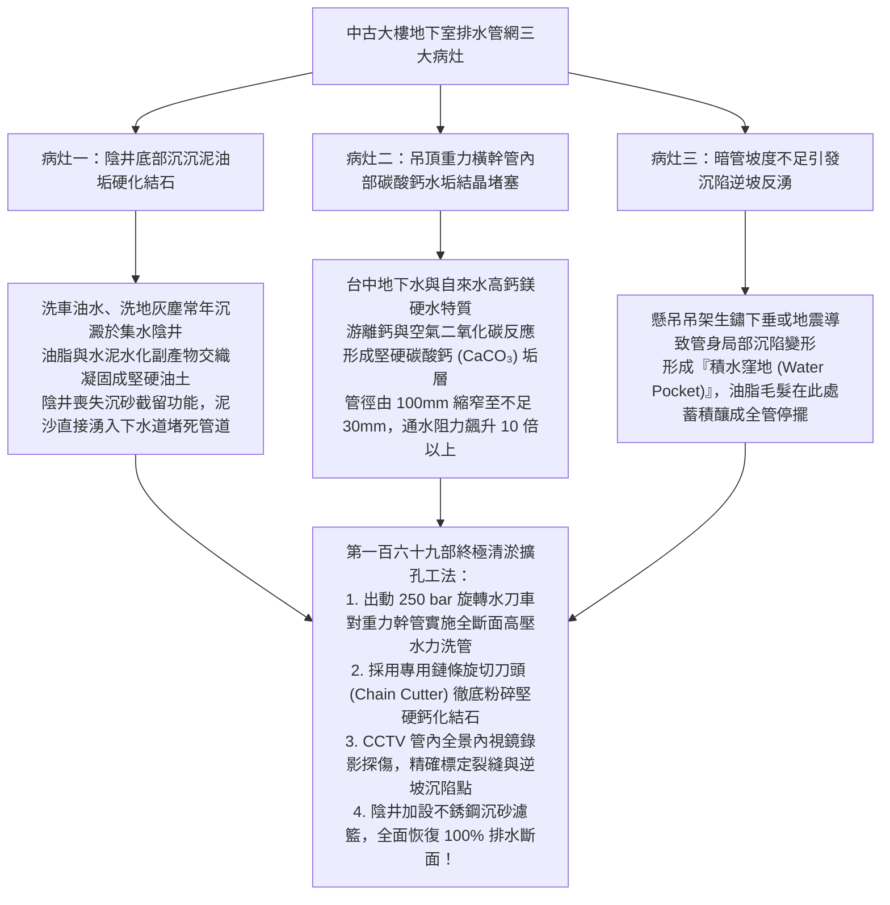
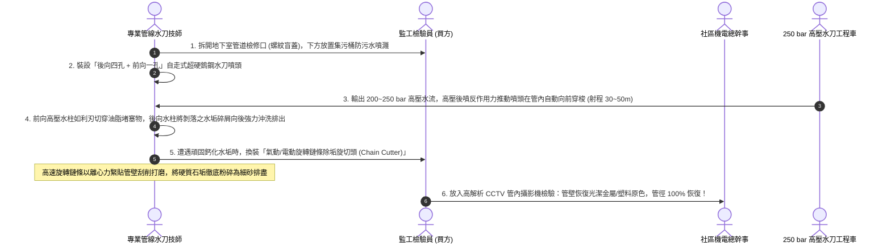
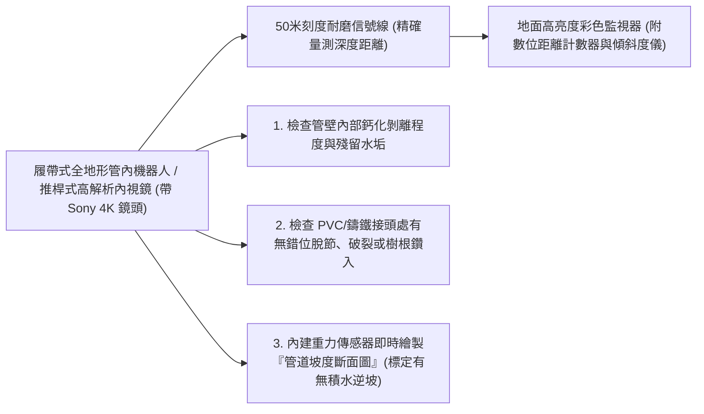
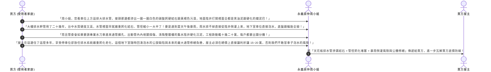

# 全案購屋實戰第一百六十九部：中古大樓社區地下室截水溝陰井沉積污泥清淤與重力排水管內視鏡探傷及管徑鈣化擴孔工序全書

> **核心宗旨**：在高層電梯住宅集合住宅（如大安紫金城 13 樓、長億南園 8 樓等早期規劃之 20~30 年社區）中，地下室各樓層車道兩側之「重力排水暗溝、轉角集水陰井（Catch Basin）與吊頂重力排水幹管」是全社區抵禦地表逕流、清洗車道廢水與暴雨滲透水排入沉砂池的關鍵靜脈血管。然而，中古大樓常面臨「車輛常年帶入之黃泥細砂與底盤油污混合硬化，在陰井底層形成厚達 30~50cm 的堅硬油土塊」、「懸吊於地下室天花板的鑄鐵或厚壁 PVC 重力排水主管，受硬水鈣鎂離子結垢結晶（水垢結石）侵蝕，管徑內部有效通水斷面縮水逾 60% 甚至完全鈣化卡死」、「暴雨洪峰時水流排洩不及自陰井反湧漫灌車位」等重大公設通病。本手冊專攻「工業級旋轉高壓水刀噴頭管內洗管（Hydro Jetting）、排水管內部高解析閉路電視內視鏡（CCTV）探傷定位、物理機械式旋轉旋切刀片擴孔除垢工序、沉積泥砂無害化抽除及利用排水系統嚴重鈣化通病狠砍買賣總價 15~20 萬戰術」，為地下室停車環境與公共衛生構築暢通無阻之排洪防線。

---

## 第一章：老舊大樓地下室排水系統三大致命病灶與鈣化水垢物理機理

---

## 第二章：重力排水管道水垢鈣化嚴重程度分級與診斷標準

在公設機電檢查中，必須會同房仲與大樓管委會人員勘查地下室天花板吊管之檢修口（Cleanout）：

| 鈣化堵塞等級 | 管道有效通水截面積縮水率 | 管內物理現況特徵 | 排水表現與危害後果 | 整改工法與技術要求 |
| :--- | :--- | :--- | :--- | :---: |
| **一級：輕度附著** | 截面積縮水 $\le 20\%$ | 管壁附著薄層黑色油泥與軟性污垢（厚度 $< 5\text{mm}$） | 排水速度略顯遲緩，偶有水流咕嚕異音 | 常規高壓溫水循環沖洗即可清除。 |
| **二級：中度結垢** | 截面積縮水 $20\% \sim 50\%$ | 出現黃白色硬質碳酸鈣結石結晶（厚度 $10 \sim 25\text{mm}$） | 尖峰排水時管頂排氣不良，陰井水位大幅上升 | 採用 **200 bar 前進後退自走式水刀噴頭** 剝離垢層。 |
| **三級：嚴重鈣化** | 截面積縮水 $50\% \sim 80\%$ | 管芯僅剩一條細小縫隙，結石堅硬如岩石（厚度 $\ge 35\text{mm}$） | 大雨時雨水漫過截水溝溢出，地下車位嚴重積水 | 必須採用 **機械式剛性旋轉鏈條滾刀** 強力打磨擴孔。 |
| **四級：完全盲死** | 截面積縮水 $> 80\%$ 至 100% | 鈣化結石與毛髮油脂徹底卡死，固化成實心圓柱體 | 排水完全停擺，管壁承受內壓破裂或自接頭爆開 | 拆除該段老舊硬化鑄鐵管，全面換裝 SUS304 不鏽鋼管。 |

---

## 第三章：工業級高壓水刀洗管（Hydro Jetting）與旋切刀擴孔標準工序（SOP）

針對地下室 100mm~150mm（4吋~6吋）之水平懸吊排水橫幹管，標準清潔擴孔作業程序如下：

### 3.1 水刀洗管三大不可妥協之鐵則：
1. **控制水壓防爆管（Pressure Threshold）**：
   - 針對使用逾 20 年之薄壁老舊 PVC 管或生鏽鑄鐵管，高壓水刀壓力必須精確調定在 **$150 \sim 200 \text{ bar}$ 之間**。
   - 嚴格禁止盲目使用超過 350 bar 的超極限壓力，避免高壓水流打穿脆化管壁或震脫老舊膠水接頭。
2. **逆向沖洗防回灌（Reverse Flushing）**：
   - 清洗作業必須 **自下游（靠近出水口/集水池端）向上游（進水陰井端）逆向推進**。
   - 確保被水刀打碎的大塊鈣化硬垢隨水流順暢流向下游大口徑集水坑抽除，絕對禁止自上游往下游盲目硬推，防止大塊石垢在下游彎頭處塞死卡死！
3. **管路吊架加固防震晃（Support Reinforcement）**：
   - 水刀在橫幹管內高速旋轉推進時會產生強烈反作用力與管身震動。
   - 洗管前必須全面檢查天花板吊管角鋼與全牙吊桿，間距超過 $1.5\text{m}$ 處必須加裝臨時防跳動加固管卡。

---

## 第四章：CCTV 閉路電視管內內視鏡探傷檢驗工法

### 4.1 內視鏡合格判定標準：
- **圓度與通水截面**：全線通水斷面恢復率必須達到 **$\ge 95\%$**，無殘留大塊結石。
- **坡度要求**：管路全程維持 **$\ge 1/100$ 之順水洩水坡度**，管內任意點積水深度不得超過管徑的 $10\%$。
- **存檔備查**：檢測完成後必須由專業廠商出具完整之管內彩色錄影光碟與《管道缺陷評估報告書（PACPRated）》。

---

## 第五章：看屋現場地下室排水排查與殺價戰術

在實地勘查大安紫金城 13 樓或長億南園 8 樓地下停車場時，買方必須在會同房仲周小姐（或信義建宇）勘查車位周邊時，抬頭檢視天花板排污橫幹管接頭與地面集水陰井，並將其轉化為**狠砍買賣總價 15~20 萬元的殺價談判籌碼**：

---

## 第六章：地下室重力排水公設健康體檢核對表（現場看屋必備）

| 查核項目 | 標準合格判定條件 | 現場重大異常判定（致命警訊） | 處置戰術 |
| :---: | :--- | :--- | :--- |
| **天花板吊管外觀** | 管身平直，接頭乾燥無滲漏，吊架穩固（間距 $\le 1.5\text{m}$） | 管身下垂變形呈波浪狀、接頭處垂掛鐘乳石狀白色鈣化結晶 | 🔴 **管內嚴重堵塞承壓滲漏**，列入重大瑕疵砍價 |
| **集水陰井內部** | 井底清潔，設有不銹鋼濾網，水流平順排乾無積泥 | 井底沉積厚達數十公分黑油泥、散發腐敗沼氣味 | ⚠️ 沉砂功能全失，大雨必倒灌，要求立即清淤 |
| **檢修口盲蓋狀況** | 盲蓋完整鎖緊，周圍乾燥無滲水痕跡 | 盲蓋生鏽咬死、甚至被拆除敞開直接往下滴臭水 | ⚠️ 臭氣外洩且無法實施常規通管，需整組換新 |
| **雨天排水流速** | 地面洗車或雨水流入陰井後，5 秒內順暢排空無回湧 | 水位持續上升、陰井口冒氣泡、泥水沿車道漫延 | 👑 管道已嚴重鈣化縮孔，主張扣減 15~20 萬修復費！ |
