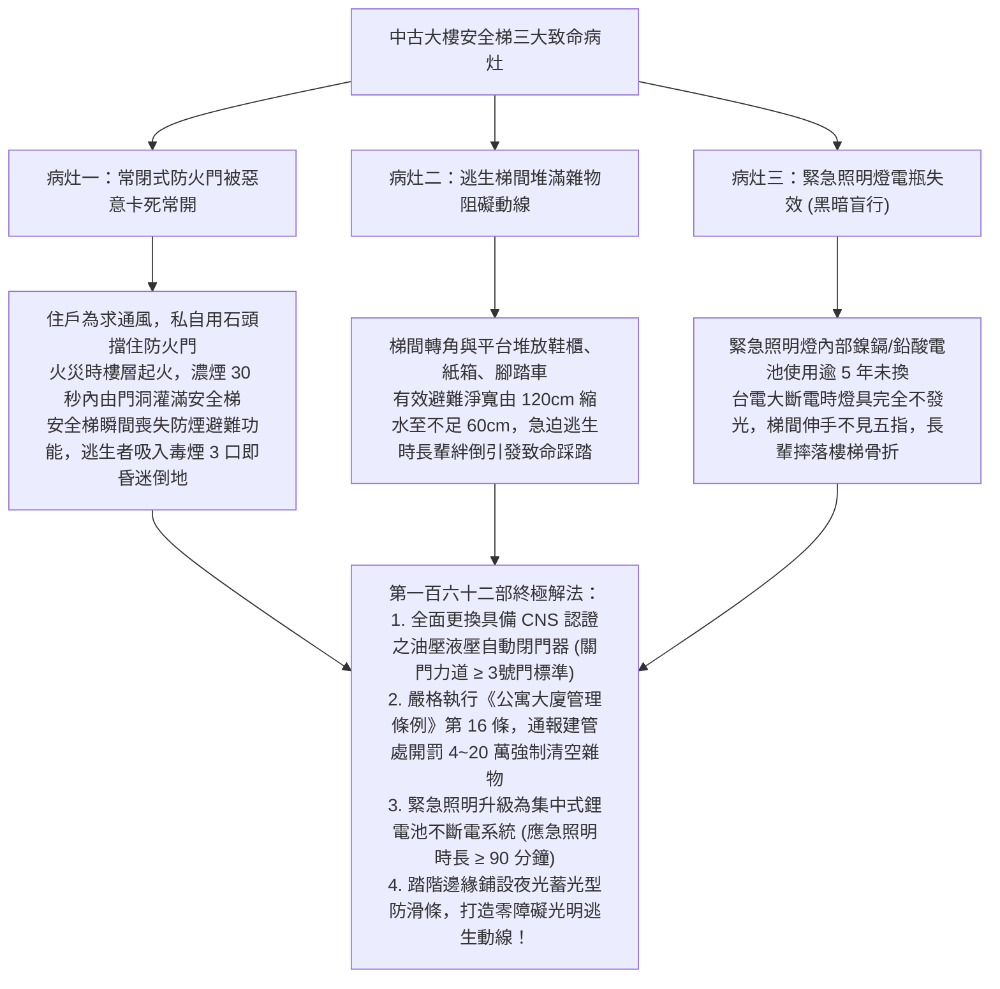
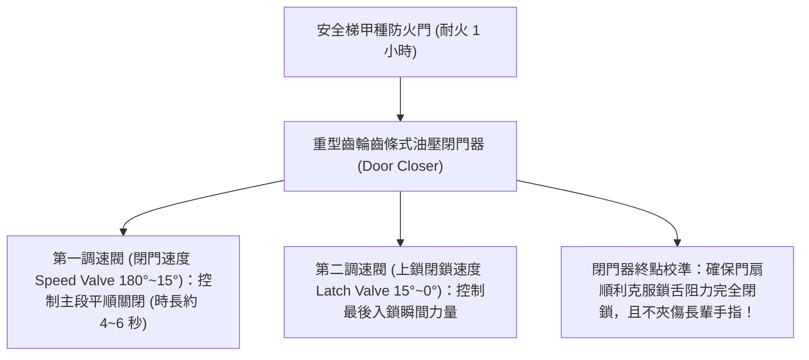
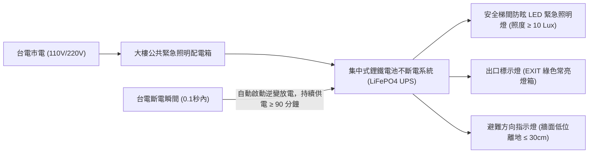
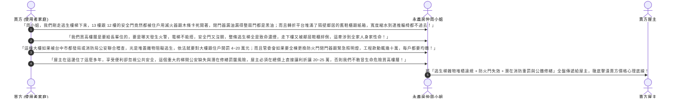

# 全案購屋實戰第一百六十二部：中古大樓梯間安全梯逃生動線排查與常閉式防火門自動閉門器及緊急照明迴路全書

> **核心宗旨**：在高層電梯集合住宅（如大安紫金城 13 樓、長億南園 8 樓等 10~18 樓高樓層物件）中，一旦遭遇火災濃煙或地震斷電，電梯依規強制停用，全棟住戶之唯一生命逃生通道即為「室內安全梯（逃生特別安全梯）」。然而，20~30 年中古大樓最常見的致命公共安全通病莫過於「梯間堆滿住戶鞋櫃、嬰兒車與雜物阻礙逃生寬度」、「逃生門（常閉式防火門）自動閉門器損壞漏油無法自動關閉，甚至被住戶私自用木條或石頭卡死常開，火災時毒煙迅速灌滿全棟梯間形成垂直毒氣管道」、「緊急照明燈蓄電池老化斷電時完全不亮，長輩在黑暗中跌倒踐踏傷亡」。本手冊專攻「安全梯淨寬度與防滑階梯規範、常閉式防火門閉門器與防夾調速工藝、獨立不斷電集中式緊急照明迴路體檢、管委會公共安全申報缺失排查及利用梯間公安瑕疵狠砍買賣總價 20~25 萬戰術」，為家庭逃生與長輩下樓避難築起萬全生命防線。

---

## 第一章：高樓層安全梯三大致命隱患與火場逃生受阻機理

---

## 第二章：安全梯逃生通道法規標準尺寸與現場測量

在看房大安紫金城 13 樓或長億南園 8 樓時，買方必須親自自該樓層沿著安全梯走下一樓，手持捲尺現場測量以下法規數據：

| 測量維度 | 建築技術規則設計施工編標準 | 老舊中古社區常見違規現況 | 危害程度與整改要求 |
| :--- | :--- | :--- | :--- |
| **樓梯淨寬度 (Clear Width)** | 集合住宅走廊與安全梯淨寬必須 **$\ge 120 \text{ cm}$**（若單側有扶手，扶手外伸不得超過 10cm） | 住戶擺放鞋櫃、紙箱，實測有效逃生寬度剩餘 $< 70\text{ cm}$ | 🔴 **致命級**：長輩與幼童逃生推擠阻卡，責令管委會限期 3 日公告強制清除。 |
| **踏面深度與級高** | 踏面深度（Tread）$\ge 24\text{ cm}$，級高（Riser）$\le 20\text{ cm}$，全梯段尺寸必須一致 | 早期設計踏面過窄（僅 20~22cm），雨天潮濕或穿襪行走極易踩空 | 🟡 **跌倒高風險**：階梯前端必須加貼高摩擦金剛砂防滑條。 |
| **安全扶手高度** | 扶手垂直高度必須介於 **$75 \sim 85 \text{ cm}$**，直徑 $3.0 \sim 4.5 \text{ cm}$ 易於長輩抓握 | 扶手鬆脫晃動、甚至轉折平台處中斷無連續扶手 | 🔴 **嚴重缺失**：長輩急迫下樓無支撐點，要求管委會修繕固結。 |
| **排煙室與特別安全梯** | 15 層以上高樓層必須設有「排煙室」及正壓送風風門 | 排煙風門控制線被剪斷，或排煙室常態推滿雜物變成私人儲藏室 | 🔴 **窒息風險**：毒煙無法排散，違反消防法規，報請消防局列管。 |

---

## 第三章：常閉式防火門自動閉門器（Door Closer）調速與防夾工藝

安全梯防火門依內政部營建署法規必須維持「常態性閉合（Normally Closed）」狀態：

### 3.1 閉門器安裝與調校四大不可妥協之鐵則：
1. **嚴禁使用「定位型閉門器（Hold-Open Closer）」**：
   - 早期部分社區為圖通風，私自更換具備 $90^\circ$ 定位扣之閉門器。
   - **這是嚴重的違法行為**！安全梯防火門依法 **絕對禁止具備任何自動卡死定位功能**，門扇被推開後，任何人鬆手在任何角度都必須 100% 自動關閉並上鎖閉合。
2. **克服樓梯間正壓風阻之閉門力矩**：
   - 高樓層火災時啟動正壓送風防煙風機，樓梯間內空氣壓力為 $+30 \sim +50 \text{ Pa}$。
   - 閉門器規格必須選用 **EN 1154 標準之 3 號或 4 號強力閉門器**，具備足夠閉門力矩推合門扇；嚴禁使用力量不足之 2 號輕型閉門器（在正壓風阻下門縫無法完全咬緊，毒煙由縫隙灌入）。
3. **兩段式精準微調（防止暴力撞擊摔門）**：
   - 第一段調速閥將門扇從開門角度帶至離門框約 $15^\circ$ 位置，保持平緩勻速；第二段閉鎖閥在最後 $15^\circ$ 處稍微加力，精確推動彈簧斜舌「喀噠」一聲滑入鎖孔，既保證完全閉合，又杜絕金屬劇烈撞擊巨響。

---

## 第四章：緊急照明燈與集中式不斷電迴路（Emergency Lighting）

### 4.1 緊急照明四大檢驗指標：
1. **地坪照度標準（CNS 10207）**：
   - 在完全無外部光源下，安全梯之每一階踏面及轉折平台上，測得之緊急照明水平照度必須 **$\ge 10 \text{ Lux}$**（逃生通道至少需 1 Lux，但有長輩出入之樓梯必須提升至 10 Lux 以上，看清階梯邊界）。
2. **超耐久磷酸鐵鋰（LiFePO4）蓄電池**：
   - 淘汰傳統易發脹老化的鎳鎘電池，全面採用壽命長達 8~10 年的磷酸鐵鋰電池，即使歷經 2000 次充放電循環，放電容量仍大於 80%。
3. **低位避難方向指示燈（Low-Location Lighting）**：
   - 火災時濃煙向上漂浮，上方天花板之指示燈常在 2 分鐘內被濃煙遮蔽。
   - 安全梯牆面 **離地坪 $20 \sim 30 \text{ cm}$ 處** 必須設置低位夜光逃生指標，即使長輩採低姿勢跪爬逃生，仍能清晰看見箭頭導引方向。

---

## 第五章：看屋現場梯間公安缺失排查與殺價戰術

在看房大安紫金城 13 樓或長億南園 8 樓時，買方必須請房仲周小姐（或信義建宇）陪同走入逃生梯，實地檢視每一層樓梯間現況，並將其轉化為**狠砍買賣總價 20~25 萬元的公安瑕疵談判籌碼**：

---

## 第六章：安全梯公共安全體檢核對表（現場看屋必備）

| 查核項目 | 標準合格判定條件 | 現場重大異常判定（致命警訊） | 處置戰術 |
| :---: | :--- | :--- | :--- |
| **防火門閉合狀態** | 門扇常閉且密合，推開鬆手後自動完全關閉上鎖 | 門被石頭/木塊卡住常開，或閉門器漏油鬆脫懸空 | 🔴 **隨時有火災濃煙灌梯致命危險**，列入重大公安瑕疵扣款 |
| **梯間雜物堆積** | 梯段與轉折平台 100% 淨空，無任何鞋櫃、腳踏車 | 堆放鞋櫃、紙箱、雜物，有效通道寬度 $< 90\text{cm}$ | ⚠️ 違反《公寓大廈管理條例》第 16 條，拍照存證並殺價 |
| **緊急照明燈測試** | 按下燈具「TEST」測試按鈕，高亮度白光立即點亮 | 按下測試紐完全不亮，或發光微弱紅燈閃爍 | ⚠️ 電瓶已死，全棟更換費用高昂，主張折抵工程款 |
| **安全扶手與地坪** | 扶手堅固無鬆動，階梯踏面乾燥平整無缺角 | 扶手膨脹螺絲拔出搖晃、階梯邊角破損缺裂 | ⚠️ 長輩夜間逃生摔倒高風險，要求由賣方負責修復 |
