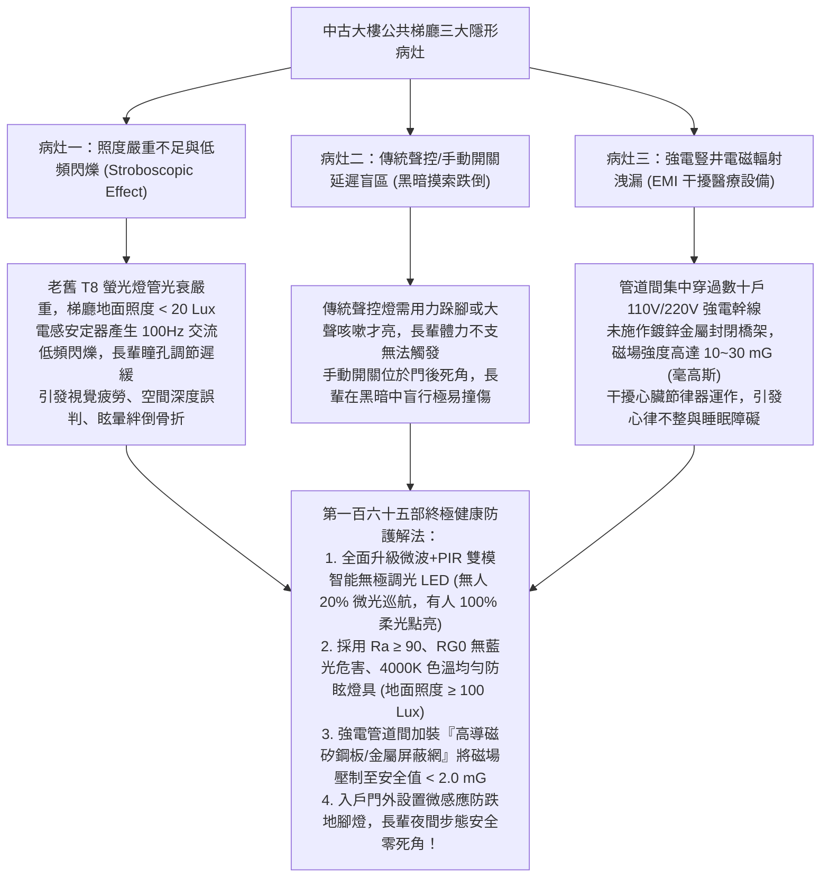
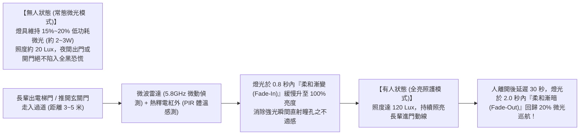
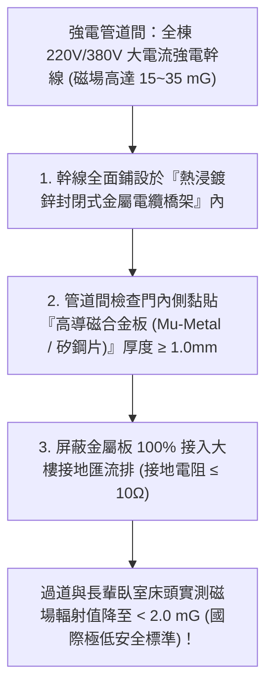
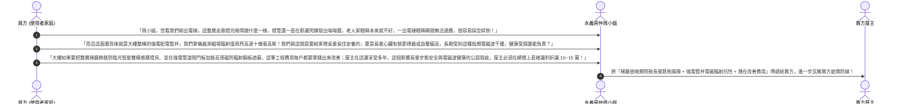

# 全案購屋實戰第一百六十五部：中古大樓社區公共梯間感應節能照明與低頻電磁波EMI遮蔽及長輩夜間步態安全全書

> **核心宗旨**：在高層電梯住宅集合住宅（特別如大安紫金城 13 樓、長億南園 8 樓等早期規劃物件）中，公共走廊、電梯梯廳與玄關過道為每日進出家門與長輩夜間步態安全之第一線動線。然而，20~30 年中古大樓常見「公共梯廳燈光昏暗長年不換、採用老舊高耗電螢光燈管頻繁閃爍誘發長輩眩暈失衡」、「開關設計不良需在黑暗中摸黑摸索開關導致跌倒骨折」、「老舊電表箱與管道間高壓電纜缺乏金屬隔離，產生高強度低頻電磁波輻射（EMI）干擾長輩心律調節器與精密醫療監測設備」等隱蔽性公設缺陷。本手冊專攻「微波雷達 + 熱釋電紅外（PIR）雙模感應無極調光節能燈具選型、4000K 自然暖白光防眩光光學設計、高導磁合金（Mu-Metal）管道間電磁波遮蔽工序、全通道低照度夜間安全導引及利用梯廳照明與電磁波瑕疵狠砍買賣總價 10~15 萬戰術」，為長輩居家進出安全與微環境健康構築萬全防線。

---

## 第一章：老舊大樓公共梯廳三大隱形病灶與長輩步態失衡機理

---

## 第二章：公共梯廳健康照明光學標準與色溫防眩選型

依據國際照明委員會（CIE）與內政部建築研究所「高齡者室內照明設計指南」，梯廳與過道照明不可過亮刺眼，更不可昏暗不清：

| 評估維度 | 傳統中古大樓常見現況（嚴重不合格） | 本案全齡健康照明旗艦標準 | 實質健康與安全效益 |
| :--- | :--- | :--- | :--- |
| **梯廳地坪照度** | 僅 $10 \sim 30 \text{ Lux}$（昏暗如洞穴） | **均勻維持 $100 \sim 150 \text{ Lux}$（階梯處 $\ge 150 \text{ Lux}$）** | 消除視覺陰影盲區，長輩清晰辨識地面高低差與障礙物。 |
| **照度均勻度 (Uo)** | 照度均勻度 $< 0.3$（亮暗交錯斑駁） | **照度均勻度 $U_o \ge 0.7$（漫反射均勻柔和）** | 瞳孔無需頻繁縮放調節，徹底消除長輩出電梯時的瞬間眩暈感。 |
| **光源色溫 (CCT)** | 6500K 慘白刺眼冷光、或 2700K 昏黃暗沉 | **4000K 自然暖白光（Neutral White）** | 溫潤舒適、提升視覺敏銳度，不抑制褪黑激素分泌，安撫情緒。 |
| **顯色指數 (CRI / Ra)**| $\text{Ra} < 65$（臉色死灰、色彩失真） | **$\text{Ra} \ge 90$、$\text{R9} \ge 50$（高色彩飽和度）** | 真實還原物體色彩與地面紋理，空間立體感清晰。 |
| **頻閃指標 (Flicker)** | 波動深度 $> 30\%$（肉眼雖不易察覺但大腦持續受累）| **SVM 頻閃可見度 $< 0.4$、IEEE 1789 無危害無可見頻閃** | 徹底杜絕神經性頭痛與眼球乾澀疲勞。 |

---

## 第三章：微波雷達 + PIR 雙模感應「微光巡航」智能調光工藝

傳統聲控燈「非全黑即全亮」，突兀的強光暴衝極度傷害長輩眼睛。本案採用現代化**智能雙模調光系統**：

### 3.1 雙模感應核心技術優勢：
1. **微波 + PIR 雙重確認（零誤報、零漏報）**：
   - 單純 PIR 紅外線在長輩動作極緩慢或穿厚大衣時易感應不到；單純微波易受穿牆風吹草動誤觸發。
   - 雙模感應結合微波對微小動作的極高靈敏度與紅外線對人體體溫的精確判定，**長輩步態即使極其緩慢拖行，燈光依然全程恆定照亮，絕不中途熄滅**！
2. **全天候極致省電（節能 85% 以上）**：
   - 20% 微光巡航功耗僅 2.5W，整層樓 24 小時點亮一個月電費不到 5 元台幣，徹底解決老舊社區因怕耗電而刻意關燈釀成跌倒的惡性循環。

---

## 第四章：強電管道間低頻電磁波（EMI）輻射排查與遮蔽工程

集合住宅樓層過道牆內，通常設有直通頂樓之「強電豎井（電錶箱與大樓輸電幹線管道間）」：

### 4.1 電磁輻射安全檢驗標準：
- **世界衛生組織（WHO）與環保署標準**：
  - 國際癌症研究機構（IARC）將 50/60Hz 極低頻磁場列為 2B 級可能致癌物。
  - 長期居住暴露環境之背景磁場強度，必須控制在 **$< 2.0 \text{ mG (毫高斯)}$** 以內。
- **排查方法**：
  - 看房時手持高精度「三軸極低頻電磁波測試儀（EMF Meter）」，沿大安紫金城 13 樓或長億南園 8 樓大門外牆、電錶箱及室內背牆逐點掃描。
  - 若電錶箱背牆處測得磁場 $> 10 \text{ mG}$，且該背牆恰好為預定之長輩床頭位置，**此為重大健康隱患**，必須在裝修合約中增訂金屬遮蔽防護工程！

---

## 第五章：看屋現場梯廳照明與電磁波排查及殺價戰術

在看房大安紫金城 13 樓或長億南園 8 樓時，買方在走出電梯進入玄關前，應刻意在梯廳停步檢視燈具與電表箱，並轉化為**狠砍買賣總價 10~15 萬元的公設居住健康瑕疵談判武器**：

---

## 第六章：公共梯廳健康安全體檢核對表（現場看屋必備）

| 查核項目 | 標準合格判定條件 | 現場重大異常判定（致命警訊） | 處置戰術 |
| :---: | :--- | :--- | :--- |
| **梯廳地坪照度** | 使用照度計實測地坪照度 $\ge 100 \text{ Lux}$，光線柔和無陰影 | 實測照度 $< 30 \text{ Lux}$，角落漆黑，階梯邊界模糊 | 🔴 **長輩夜間極易踩空骨折**，列入重大公安瑕疵砍價 |
| **燈具頻閃狀態** | 手機相機開啟快門 1/1000s 拍攝，螢幕無黑色滾動條紋 | 手機螢幕出現劇烈黑白跳動條紋、肉眼可見燈頭發黑閃爍 | ⚠️ 電感安定器嚴重老化，要求全面換裝無頻閃 LED |
| **感應燈反應時效** | 人體進入過道 0.8 秒內平順亮起，人走後延時 30 秒 | 必須用力踏地大叫才亮（聲控）、或延遲 3 秒才反應 | ⚠️ 感應器老化鈍化，長輩需在黑暗中摸索盲行 |
| **強電井電磁輻射** | 三軸 EMF 測試儀於門外及背牆測得磁場值 $\le 2.0 \text{ mG}$ | 靠近電錶箱或管道間時，磁場強度飆破 $15 \sim 30 \text{ mG}$ | 👑 以「強磁場干擾長輩心血管與睡眠」狠砍 10~15 萬房價！ |
