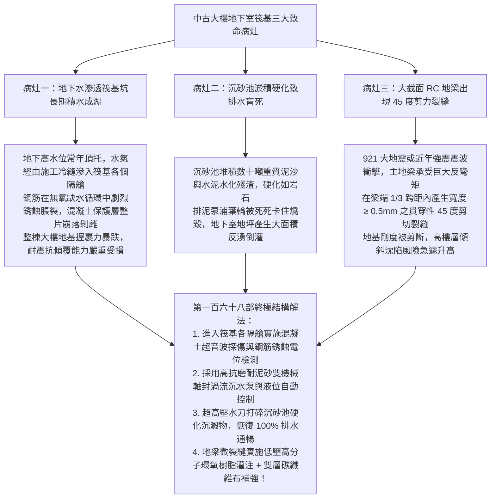
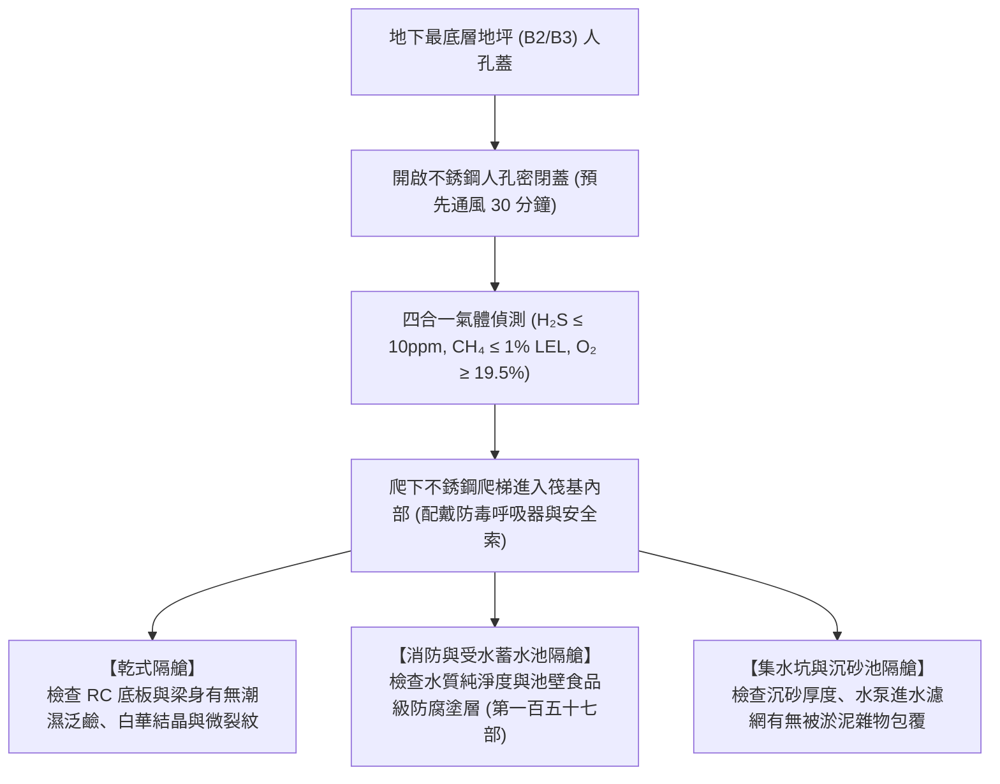
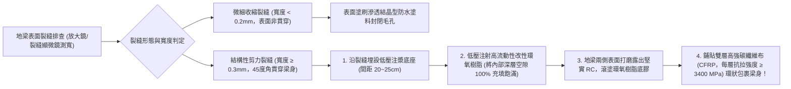
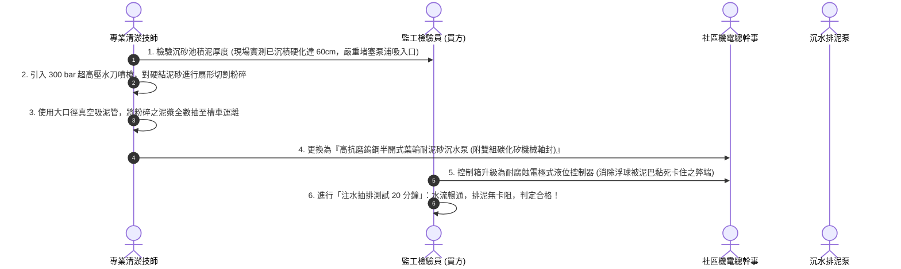
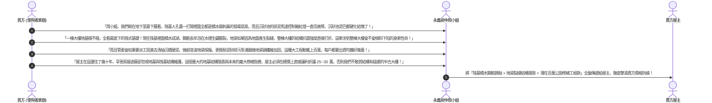

# 全案購屋實戰第一百六十八部：中古大樓社區地下室筏基防潮抽水與沉砂池淤積清掏及地梁剪力裂縫探傷全書

> **核心宗旨**：在高層電梯住宅集合住宅（如大安紫金城 13 樓、長億南園 8 樓等早期規劃物件）中，整棟建築物最深處之「筏式基礎（Raft Foundation，簡稱筏基）」與地下室最底層地坪，為承載整棟數千噸重量之終極結構之錨。然而，20~30 年中古大樓最常面臨「地下水位常年上升引發強大浮力滲透 RC 地坪、筏基內部積水成湖滋生巨量蚊蠅沼氣、沉砂池長年未清掏致排泥管道硬化死卡、地震地應力引發大截面 RC 地梁（Ground Beam）產生貫穿性剪力裂縫」等毀滅性隱患。本手冊專攻「筏基坑內部探勘與超音波混凝土裂縫探傷標準、耐腐蝕沉水式高揚程防泥排砂泵更換、高壓水刀通管清掏沉砂池硬結沉積物、地梁碳纖維貼片（CFRP）加固工藝及利用筏基積水與地梁裂縫瑕疵狠砍買賣總價 25~30 萬戰術」，為整棟建築地基承載安全與結構永恆穩固築起鋼鐵地盤防線。

---

## 第一章：老舊大樓筏基三大致命病灶與地基承載破壞機理

---

## 第二章：筏式基礎內部結構分區與現場勘查 SOP

筏基內部通常由數十個縱橫交錯的 RC 地梁隔成一個個「獨立封閉隔艙（Cell Compartment）」，勘查時必須配備全套防護裝備：

### 2.1 筏基內部勘查三大絕不可妥協之鐵則：
1. **嚴格執行局限空間作業規範**：
   - 筏基內部極度陰暗潮濕，且常年密閉易蓄積高濃度毒氣硫化氫（H₂S）、二氧化碳（CO₂）與甲烷。
   - 嚴禁單人貿然下坑！必須使用防爆軸流風機強制送風 30 分鐘以上，氣體偵測合格後，由專業結構技師配戴安全頭盔與安全帶進入，地面人孔口必須有兩人常時守候通訊。
2. **白華（Efflorescence）與析晶排查**：
   - 地梁側面若出現大面積「白色毛狀、雪花狀針狀結晶（碳酸鈣晶體）」，代表地下水正透過 RC 微毛細孔源源不斷滲入，混凝土內部游離鈣已被嚴重帶出「骨質疏鬆化」，必須立即實施深層滲透結晶型防水堵漏。
3. **鋼筋銹蝕電位檢驗（Half-Cell Potential）**：
   - 使用銅-硫酸銅半電池電位計（CSE）測量混凝土表面電位。
   - 若測得電位比 **$-350 \text{ mV}$ 更負**，代表內部鋼筋已有 $90\%$ 以上機率發生嚴重銹蝕膨脹，結構安全係數急遽下降！

---

## 第三章：大截面 RC 地梁裂縫探傷與碳纖維加固工法

地梁為直接承受上部大樓所有柱子垂直荷載與地震水平剪力的骨幹大梁（斷面常達 $80 \times 120\text{ cm}$ 以上）：

### 3.1 地梁裂縫加固四大標準指標：
1. **結構性裂縫門檻**：
   - 寬度 **$\ge 0.3 \text{ mm}$** 的斜向裂縫屬致命性結構受損，絕不能單純用水泥抹平掩蓋，必須由合法結構技師出具加固設計圖。
2. **低壓慢注工法（Low-Pressure Injection）**：
   - 採用彈簧式自動注漿注射器，注漿壓力控制在 $0.2 \sim 0.4 \text{ MPa}$，利用毛細管負壓引導環氧樹脂緩慢滲透至地梁最深處，抗壓強度達 $\ge 60\text{ MPa}$。
3. **碳纖維布（CFRP）抗剪加固**：
   - 經雙層 300g/m² 碳纖維布垂直梁軸向環抱包裹加固後，地梁之抗剪剛度與抗震韌性可**大幅提升 40% 以上**，完全抵禦下一場強震衝擊。

---

## 第四章：沉砂池超高壓水刀清掏與耐泥砂泵浦配置

筏基最底部的集水坑與沉砂池，是收集全棟地下滲透水並排出建築外的最後防線：

---

## 第五章：看屋現場筏基排查與殺價戰術

在看房大安紫金城 13 樓或長億南園 8 樓時，買方必須在會同房仲周小姐（或信義建宇）與總幹事勘查公設時，主動詢問並要求檢視「地下室筏基人孔與近三年抽水保養紀錄」，並轉化為**狠砍買賣總價 25~30 萬元的殺價核心重槌**：

---

## 第六章：地下室筏基公設健康體檢核對表（現場看屋必備）

| 查核項目 | 標準合格判定條件 | 現場重大異常判定（致命警訊） | 處置戰術 |
| :---: | :--- | :--- | :--- |
| **筏基隔艙積水狀態** | 乾式隔艙地面乾燥無積水，僅沉砂坑有控制水深 | 隔艙大面積積水如地下湖、水深逾 30cm、漂浮油泥 | 🔴 **地下水大量滲透，鋼筋嚴重銹蝕**，列入重大瑕疵砍價 |
| **地梁表面裂縫** | 地梁無裂縫、無泛鹼白華，混凝土敲擊聲清脆 | 出現斜向 45 度裂縫（寬度 $\ge 0.3\text{mm}$）、混凝土剝落露鋼筋 | 🔴 **地基抗震剛度受損**，要求出具結構技師報告否則放棄 |
| **沉砂池排泥馬達** | 雙泵自動輪值，馬達聲音平順，液位電極靈敏 | 馬達卡死嗡嗡大響、控制盤跳脫、池內泥沙堆積見頂 | ⚠️ 排水完全失靈，暴雨時必淹水，要求扣留修繕費 |
| **氣體與通風狀態** | 人孔通風良好，氣體偵測儀各項數值均在安全範圍 | 刺鼻硫化氫臭味撲鼻、氣體偵測儀警報大響 | ⚠️ 嚴重沼氣蓄積，存在氣爆與窒息危險，要求管委會清淤！ |
