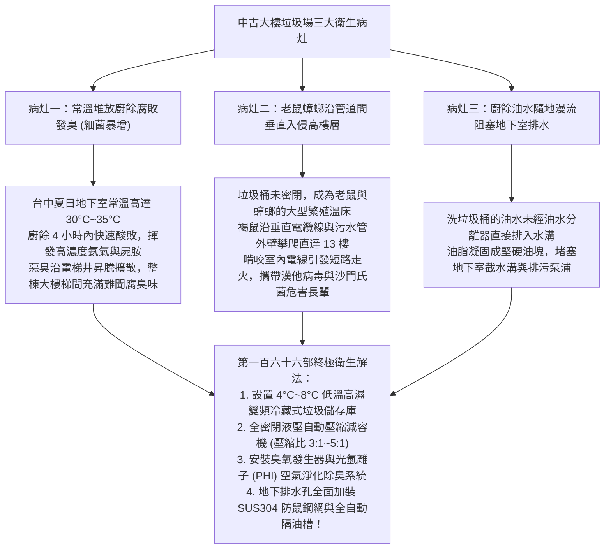
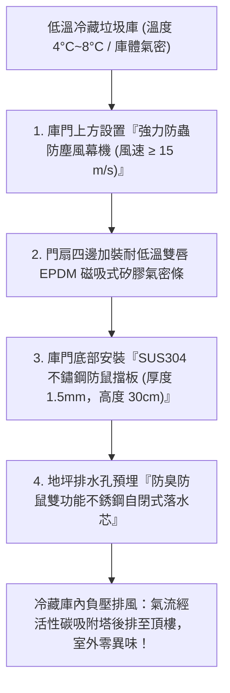
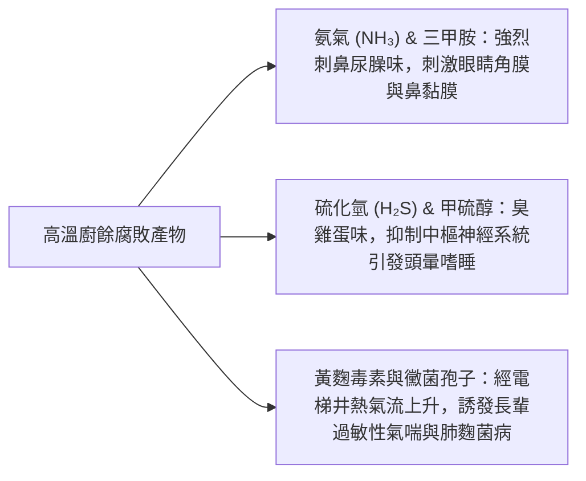
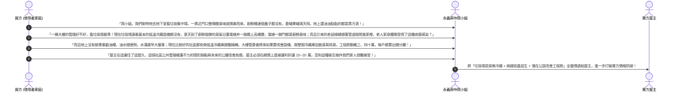

# 全案購屋實戰第一百六十六部：中古大樓垃圾冷藏儲存壓縮系統體檢與廚餘異味防治及防鼠防蟑防病媒全書

> **核心宗旨**：在高層電梯集合住宅（特別如大安紫金城 13 樓、長億南園 8 樓等早期規劃之 20~30 年社區）中，地下室或一樓後方的「社區垃圾集中處理場（垃圾儲存室）」是全棟衛生水準、社區管理良窳與房價保值性的最敏感指標。老舊大樓常面臨「垃圾集中場無冷藏設備，夏日高溫下廚餘劇烈腐敗散發刺鼻酸臭味並孳生上萬隻蛆蠅」、「傳統開放式垃圾桶引來大量巨型溝鼠（Norway Rat）與美洲蟑螂，沿著管道間與電梯井垂直攀爬入侵高樓層室內」、「油污污水未經截油設施直接排放阻塞地下水溝引發積水惡臭」等滅頂級公設隱患。本手冊專攻「全密閉式低溫冷藏（4°C~8°C）垃圾儲存庫選型、大型液壓垃圾壓縮減容機（Compactor）維護標準、臭氧（O₃）紫外線空氣除臭滅菌工藝、不銹鋼重型隔油截油槽設置及利用垃圾場衛生惡劣瑕疵狠砍買賣總價 15~20 萬戰術」，為全家衛生環境與無蟲居所構築鋼鐵防線。

---

## 第一章：老舊大樓垃圾集中場三大衛生災難與病媒垂直入侵機理

---

## 第二章：現代優質社區垃圾處理體系四大硬體升級標準

在看房大安紫金城或長億南園時，買方必須親自請房仲周小姐（或信義建宇）帶領至社區的「垃圾集中處理區」，實地對照以下四大核心硬體標準：

| 硬體設備分類 | 傳統中古社區劣質現況（扣分抗性） | 本案優質社區旗艦標準 | 實質效益與評價 |
| :--- | :--- | :--- | :---: |
| **廚餘/一般垃圾冷藏庫** | 無冷藏，使用大型橘色開放式塑膠子車（蒼蠅成群） | **庫內溫度恆定 $4^\circ\text{C} \sim 8^\circ\text{C}$，全不鏽鋼保溫庫板（厚度 $\ge 50\text{mm}$）** | **低溫徹底休眠微生物，廚餘放置 7 天零酸敗、零腐臭、零生蛆！** |
| **垃圾壓縮機 (Compactor)** | 無壓縮機，大體積紙箱塑膠袋堆積如山溢出至車道 | **固定式液壓垃圾壓縮機（壓縮推力 $\ge 15\text{ 噸}$，體積壓縮比達 4:1）** | 封閉式貯存，完全隔絕老鼠進入，減少清運車次與物業成本。 |
| **除臭滅菌系統** | 僅點蚊香、掛芳香劑（香味混雜臭味更刺鼻） | **定時自動釋放臭氧（O₃ 濃度 $\le 0.05\text{ ppm}$）+ UV-C 紫外線光催化殺菌** | 瞬間氧化分解揮發性有機物，殺滅空氣中 99% 之細菌病毒。 |
| **清洗水槽與排水設施** | 隨意接水喉沖洗，污水在地面形成黑色泥濘油膜 | **專用熱水沖洗水槍 + SUS304 自動排油型截油槽（Grease Trap）** | 油水有效分離，油脂由專用刮油機刮入廢油桶，水溝永不硬化堵塞。 |

---

## 第三章：低溫冷藏庫與防鼠防蟑物理隔離工藝（SOP）

### 3.1 防蟲防鼠四大不可妥協之鐵則：
1. **防鼠擋板（Rat Barrier）必備**：
   - 老鼠具備驚人的縮骨能力，只要有 $> 1.2\text{ cm}$ 的縫隙即可鑽入，且門角木板常被其銳齒咬破。
   - 垃圾庫進出口門扇下端，必須釘裝高度 $\ge 30\text{cm}$、厚度 $\ge 1.5\text{mm}$ 之平滑不鏽鋼薄板；老鼠爪子無法攀爬光滑金屬，且無法啃咬金屬板，形成堅固物理屏障。
2. **防蟲風幕機（Air Curtain）**：
   - 門扇開啟瞬間，門框頂部風幕機自動以高速下吹氣流（風速 $\ge 15\text{ m/s}$），形成高壓無形風門，蒼蠅、蚊子與果蠅受強大氣流阻擋，完全無法隨人飛入庫內。
3. **排水溝口鋼網包覆（Stainless Wire Mesh）**：
   - 垃圾場內部地坪排水口與通往水溝的管道出口，必須加裝孔徑 $\le 5\text{mm}$ 的 SUS316 鋼絲防鼠網，徹底杜絕溝鼠沿排水管道倒鑽入室內。
4. **全密閉式分類桶蓋（Soft-Close Sealed Lid）**：
   - 廚餘桶與一般垃圾桶必須配置氣密密封蓋與腳踏式掀蓋機構，避免住戶用手觸摸細菌，鬆開腳踏板後液壓緩降密閉，異味絕不逸散。

---

## 第四章：社區廚餘異味排查與住戶健康關聯

高齡長輩對空氣中的生物氣膠（Bioaerosol）極度敏感。垃圾場若未妥善管理，其揮發氣體是長輩慢性呼吸道感染的隱形禍首：

---

## 第五章：看屋現場垃圾場排查與殺價戰術

在實地勘查大安紫金城 13 樓或長億南園 8 樓時，買方必須在參觀完室內後，主動要求房仲周小姐（或信義建宇）帶路去看「大樓垃圾集中場」，並將其轉化為**狠砍買賣總價 15~20 萬元的社區公設管理瑕疵重槌**：

---

## 第六章：社區垃圾場公設健康體檢核對表（現場看屋必備）

| 查核項目 | 標準合格判定條件 | 現場重大異常判定（致命警訊） | 處置戰術 |
| :---: | :--- | :--- | :--- |
| **環境氣味與溫度** | 設有專用冷藏庫（溫度 $\le 10^\circ\text{C}$），門外無任何酸臭味 | 常溫堆放、空氣充滿刺鼻腐臭味，距離 10 米即可聞到 | 🔴 **屬嚴重管理失衡**，列入重大公設衛生瑕疵砍價 |
| **蟲鼠活動跡象** | 現場乾燥清潔，白天無蒼蠅，周邊無老鼠屎痕跡 | 蒼蠅成群、地上有老鼠排泄物、角落有美洲蟑螂爬行 | ⚠️ 病媒極易沿管道間入侵室內，要求折抵除蟲工程款 |
| **地面與排水清潔** | 地磚光潔乾燥，設有截油槽，排水溝暢通無油垢 | 地面黑色油污泥濘、排水溝發黑發臭、油塊硬化堆積 | ⚠️ 排水隨時倒灌堵塞，預估清洗水溝工程款砍價 |
| **回收分類規劃** | 標籤清晰、專用金屬架排列整齊，紙箱壓平堆放 | 垃圾包散落地面、回收物雜亂溢出至走道車位阻礙動線 | ⚠️ 住戶素質與物業管理鬆散，嚴重影響社區轉手保值性！ |
