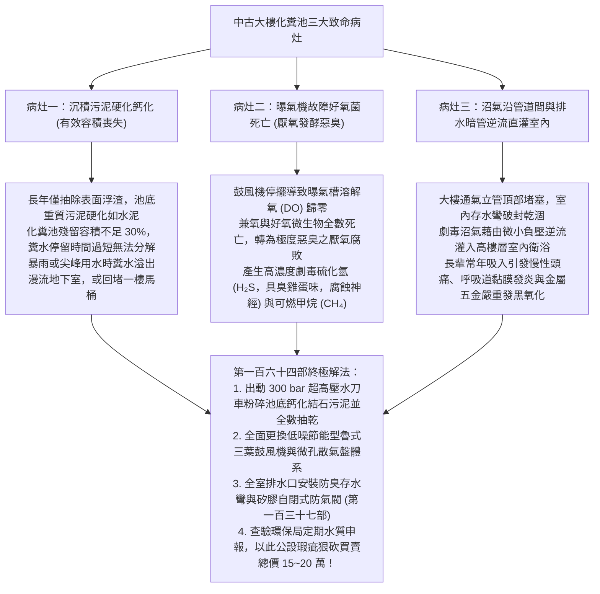
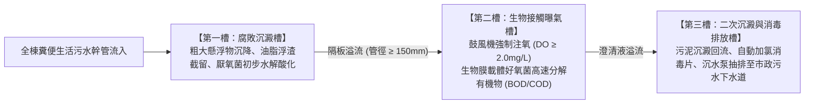
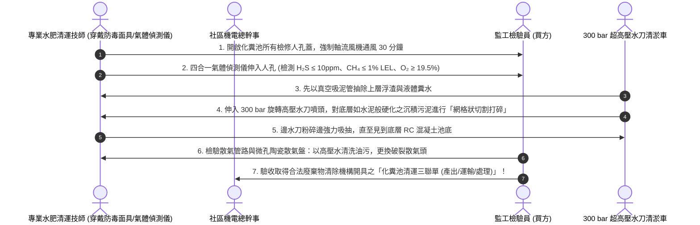
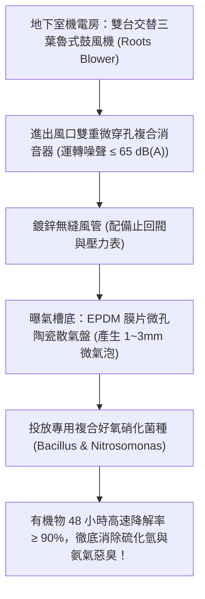
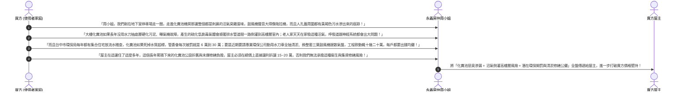

# 全案購屋實戰第一百六十四部：中古大樓地下室污水化糞池生物曝氣活化與沉積硬化污泥水刀抽除清運全書

> **核心宗旨**：在高層電梯住宅集合住宅（特別如大安紫金城 13 樓、長億南園 8 樓等屋齡 20~30 年社區）中，地下室最底層之「化糞池（污水處理設施）」為全大樓排水衛生與環境空氣品質之終極樞紐。然而，中古大樓常面臨「數年甚至十數年未落實徹底清抽化糞池、底層污泥嚴重硬化鈣化結塊導致有效容積縮水超過 70%」、「曝氣機（Blower）線圈燒毀或散氣盤堵塞導致好氧菌全數死亡、厭氧發酵產生劇毒致命硫化氫（H₂S）與高濃度甲烷（CH₄）瓦斯惡臭」、「糞水回湧堵塞一樓與低樓層馬桶、沼氣沿排水管與管道間逆流直灌高樓層室內」等滅頂級公設隱患。本手冊專攻「化糞池三大槽室結構與沉積硬化污泥高壓水刀粉碎抽除標準、魯式鼓風機（Roots Blower）與微孔陶瓷散氣盤生物曝氣工法、沼氣防爆通風與水封防臭阻斷、管委會環保申報體檢及利用化糞池公設瑕疵狠砍買賣總價 15~20 萬戰術」，為全家居住衛生與空氣清新構築鋼鐵防線。

---

## 第一章：老舊大樓化糞池三大致命病灶與沼氣倒灌機理

---

## 第二章：傳統三連式化糞池結構與處理流程解析

集合住宅地下室污水處理設施，依標準建築技術規則多採用「沉澱截留 ➔ 厭氧/好氧生物處理 ➔ 消毒排放」之三槽構造：

### 2.1 化糞池體檢四大不可妥協之物理指標：
1. **污泥硬化沉積厚度（Sludge Depth）**：
   - 使用透明壓克力「取樣測泥棒」垂直插入池底測量。
   - 池底硬化污泥厚度超過池深之 **$1/3$（約 50~80cm 以上）** 時，即達強制水刀清掏標準。
2. **曝氣槽溶解氧濃度（Dissolved Oxygen, DO）**：
   - 正常運作之好氧曝氣槽，水中溶解氧必須維持在 **$2.0 \sim 4.0 \text{ mg/L}$**。
   - 若實測 $\text{DO} < 0.5 \text{ mg/L}$，池面呈黑色且翻滾死泡，代表曝氣機已停擺或散氣孔全被油垢堵死。
3. **出水生化需氧量（BOD / COD）**：
   - 經處理後排放之污水，生化需氧量必須符合環保放流水標準：$\text{BOD} \le 30 \text{ mg/L}$、$\text{COD} \le 100 \text{ mg/L}$。
   - 若超標直接排放，台中市環保局定期稽查抽驗將對社區管委會開立 6~30 萬元罰鍰！
4. **獨立通氣管（Vent Pipe）引至頂樓**：
   - 化糞池槽頂必須設置專用排氣管（口徑 $\ge 100\text{mm}$），獨立筆直引至大樓頂樓無人處排放，**絕對嚴禁將化糞池廢氣就近排入地下室停車場或採光天井**！

---

## 第三章：沉積硬化污泥「高壓水刀粉碎 + 大口徑真空抽取」清運工序（SOP）

中古大樓常見抽水肥僅「抽吸表面 5 分鐘收工」，底層硬化污泥完全未動。本案規範最徹底之深層清掏標準工序：

### 3.1 槽體清理三大安全鐵則：
1. **嚴防硫化氫致命中毒（局限空間作業規範）**：
   - 化糞池內硫化氫濃度常飆破 $500 \sim 1000 \text{ ppm}$，吸入一口即可致命（「閃電型死亡」）。
   - 人員嚴禁未經通風與氣體偵測貿然下坑，作業時池頂必須有兩人以上配戴全身背負式安全帶與防墜三腳架待命救援。
2. **全面更換防爆型人孔密封蓋板**：
   - 人孔蓋必須為球墨鑄鐵附耐油矽膠密封墊圈，以螺栓鎖固。
   - 消除地下室停車位周邊之化糞池人孔微漏惡臭，杜絕車輛壓過時沼氣外洩。

---

## 第四章：低噪節能型「魯式三葉鼓風機」與生物菌種活化工藝

### 4.1 曝氣系統三大頂級升級標準：
1. **三葉魯式鼓風機（Three-Lobe Roots Blower）**：
   - 相比傳統齒輪式鼓風機，三葉轉子氣流脈動小、磨損極低，連續運轉壽命達 10 年以上。
   - 配置雙台交替控制器，每 8 小時自動切換先發主機，確保馬達不溫升過熱。
2. **微孔 EPDM 膜片散氣盤**：
   - 氣孔尺寸僅 $1 \sim 3\text{ mm}$，氧氣轉移效率（OTE）高達 **$25\% \sim 30\%$**（傳統穿孔管僅 8%）。
   - 停機時膜片自動閉合，污水雜質絕不倒灌堵塞風管。
3. **微生物活性菌種移植補給**：
   - 水刀全抽乾後，池內原有生物膜被破壞。必須人工投放高活性「複合硝化菌與枯草芽孢桿菌」，在 72 小時內迅速在填料上重建生物防線，直接分解硫化氫臭氣。

---

## 第五章：看屋現場化糞池公設排查與殺價戰術

在看房大安紫金城或長億南園時，買方必須請房仲周小姐（或信義建宇）陪同走至地下最底層（B2 或 B3）之化糞池人孔周邊與污水泵浦區，現場排查惡臭與保養紀錄，並轉化為**狠砍買賣總價 15~20 萬元的殺價談判武器**：

---

## 第六章：地下室化糞池公設健康體檢核對表（現場看屋必備）

| 查核項目 | 標準合格判定條件 | 現場重大異常判定（致命警訊） | 處置戰術 |
| :---: | :--- | :--- | :--- |
| **周邊環境異味** | 人孔周邊 1 米內無明顯臭味，空氣乾燥通風 | 有強烈刺鼻「臭雞蛋味（硫化氫）」或酸腐發酵惡臭 | 🔴 **屬嚴重曝氣失靈**，列入重大公共衛生瑕疵扣款 |
| **鼓風機運轉狀態** | 雙泵自動交替，馬達聲音低沉平穩，機體溫升正常 | 鼓風機完全靜止不轉、或軸承發出金屬刺耳尖叫 | ⚠️ 曝氣機已燒毀或卡死，要求由管委會立即檢修換新 |
| **人孔蓋密封性** | 人孔蓋為厚重球墨鑄鐵，橡膠條密封，螺栓鎖固 | 蓋板輕微鬆動、有蟑螂自縫隙爬出、周邊有水漬 | ⚠️ 密封失效，要求重打矽利康並列入殺價依據 |
| **環保水質檢驗單** | 管委會出具近 1 年經認可檢驗機構之「放流水檢驗合格報告」 | 無任何水質檢驗報告，或近幾次檢測項目紅字超標 | 👑 隨時面臨環保局高額開罰，主張扣減 15~20 萬房價！ |
